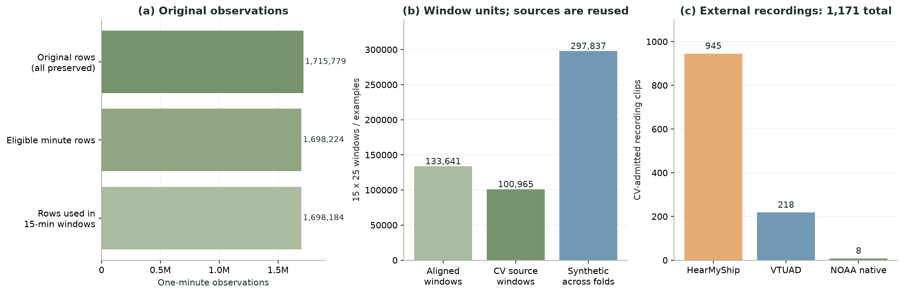
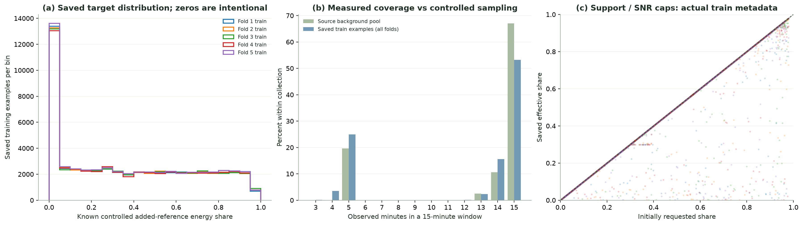
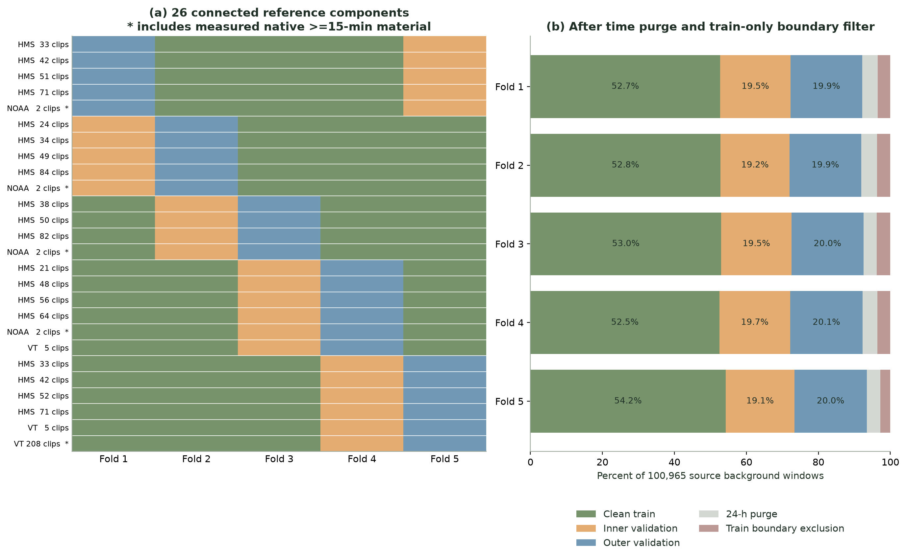
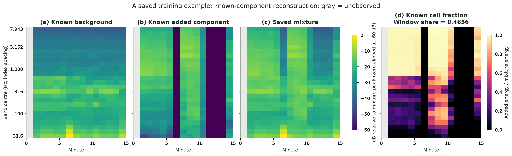
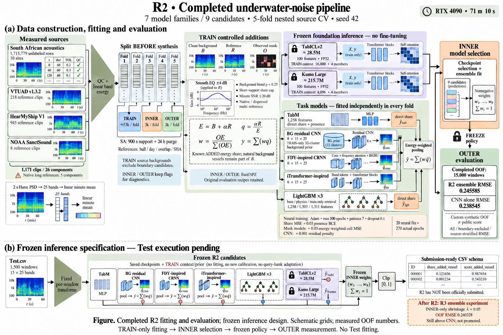

# 대회 원본과 현재 데이터: 물리 증강 V3·전처리·검증 보고서

갱신: 2026-10-25 18:20 KST  
데이터 버전: **group_cv_physics_v2_r1**  
분할: `source_group_nested5_week24h_v1` — 기존 원천 배정·900초 support 기준 24시간 purge 유지  
증강: `physics_aware_v3`, 기본 feature version 3; R2 CNN architecture 4(8채널), FDY/iTransformer architecture 3(6채널)  
데이터 배열·분할은 기존 물리 r1 그대로이며 아래에 R2 완료 상태와 최신 진단을 보완했습니다.

## 1. 현재 상태와 원본 대비 차이

**원본 1,715,779행은 보존했습니다. 새 Train은 경계 후보를 제외한 모든 clean 배경 원천을 한 번씩 사용하는 267,837개입니다. 고정 inner·outer 30,000개를 합하면 전체 297,837개입니다.**

이번 버전은 사용자 검토의 6가지 수정 사항을 반영합니다. 합성은 생성형 오디오 모델·LLM이 아니라 **실측 배경 B와 실측 참조 R의 선형 에너지 혼합**입니다. 자연 선박의 실제 정답을 1,715,779행에서 알아낸 것은 아닙니다.

| 항목 | 대회 제공 자료 | 현재 구축 자료 |
|---|---|---|
| 남아공 관측 | 1,715,779행 × 74열, raw waveform 없음 | 전 행 추적 보존, 공통 25대역 사용 |
| 관측 단위 | 대체로 1분 대역 요약 | 정각 기준 15분 × 25대역 입력 |
| 선박 정답 | 제공되지 않음 | 자연 선박 정답은 여전히 없음; 통제한 추가 참조의 비율만 정답 |
| 배경 원천 | 관측소 10개, 장비별 지원 대역 상이 | 전체 정렬 창 133,641개, CV pool 100,965개 |
| 외부 오디오 | 남아공 원본에 없음 | CV 1,171클립, 26개 연결 그룹 |
| 장시간 실측 참조 | — | native ≥15분 11클립, 연결 그룹 5개 |
| 학습 데이터 | labelled Train.csv 없음 | fold별 clean 배경 전체를 사용한 고정 Train + 고정 inner/outer |
| 실제 GPU 본학습 | — | **R2 전체 5-fold 완료**; 신경망 20회·실제 합계 270 epochs. 이 문서의 원래 그림 4개는 데이터 도식·성분 검증 |

공식 Task에서 정답 0은 통제된 참조 추가가 없다는 의미이며, 자연 선박 부재를 뜻하지 않습니다. 참조에는 원 녹음의 주변 소음도 포함됩니다. [공식 데이터 설명](https://zindi.world/competitions/french-embassy-underwater-vessel-noise-challenge/data)

## 2. 개수·용량과 독립성

| 표현 | 개수 또는 bytes | 해석 |
|---|---:|---|
| 공식 다운로드 전체 | 97,806,656 bytes = 97.81 MB | 음향 ZIP·평가 입력·제출 예시 등 |
| 보존한 공통대역 행 | [1,715,779,25], float32 payload 171,577,900 bytes | 압축 해제·표현 변화; 새 관측 증가 아님 |
| 전체 정렬 배경 | [133,641,15,25], payload 200,461,500 bytes | 미관측 슬롯 NaN 포함 |
| CV 배경 pool | 100,965개 / 7개 관측소 / 258 sensor-week 블록 | 예약 calibration·domain·기존 purge 제외 |
| 새 Train 합계 | 267,837개 | 5-fold 합계, 각 fold clean primary가 정확히 한 번 |
| 고정 inner / outer | 15,000 / 15,000개 | 이전 버전과 NPZ·recipe 바이트 동일 |
| 전체 합성 예제 | 297,837개 | 원천이 fold 사이에서 재사용됨; 독립 현장 녹음 수 아님 |
| 정규 NPZ 15개 | 461,390,519 bytes = 461.39 MB | alias·recipe·metadata·외부 waveform·모델 가중치 제외 |
| 비압축 배열 payload | 895,893,696 bytes | 입력·셀 정답·창 정답·추가 유무 정답 |

1분 원본 행과 15분 합성 예제는 다른 단위입니다. 저장 용량 배수도 압축·정답 저장·fold 반복의 영향을 받으므로 독립 정보량 증가로 해석하지 않습니다. MB는 1,000,000 bytes 기준입니다.



*그림 1. 패널마다 단위가 다릅니다. 합성 예제 수가 늘어도 실제 녹음·선박·센서 그룹의 수가 같은 비율로 늘지는 않습니다.*

## 3. 원천 수집과 원본 전처리

### 남아공 관측값

공통 25대역을 float32로 보존하고 `row_id`, 원본 Parquet·행 위치, site·recorder·export time·duration을 추적합니다. 배경 선별 조건은 25대역 유한값, -156.5 sentinel 미포함, 55≤duration≤65초, export timestamp 초 부분≤5입니다.

같은 recorder의 동일 분은 60초에 가까운 관측을 우선하고, export clock을 정각 15분 bin으로 구성합니다. 관측된 분이 3개 미만이면 창에서 제외하고, 나머지 공백은 NaN으로 유지합니다. 보간·앞뒤 채우기·날짜 이어붙이기는 하지 않았습니다. 선별 1,698,224행 중 1,698,184행이 창에 포함되며, 차이 40행은 모두 관측 분이 3개 미만인 창에 속합니다.

원본 전체 62대역의 결측률은 약25.48%지만 공통25대역의 원본 행은 NaN 0개입니다. 창의 결측은 주로 시간 공백·duty cycle에서 발생합니다. 원본 653개 sentinel·기타 품질 문제를 유한값 검사만으로 해결했다고 주장하지 않습니다.

### 외부 실측 참조

| 원천 | 전체 수집·변환분 | 현재 CV | native sample rate | 의미·한계 |
|---|---:|---:|---|---|
| VTUAD v1.3.2 strict WAV | 525개, 실제 header 합계151,368초≈42.05시간 | 218 | 32kHz | AIS 약한 metadata; 순수 선박 에너지 아님 |
| HearMyShip V1 | 공개entry1,146개 검증, 동일 음원 제외1,145개 | 945 | 48kHz | 실제10–30초; 측정된 완전한 1분은0개 |
| NOAA 신규 확장 | 양성12개×실제900초 | 8 | 48/96kHz | Ship∩전25대역Good∩900초frame; 4개는예약 |
| 합계 CV | 기존1,163 + NOAA8 | 1,171 | — | 26개 연결component; native component는5개 |

NOAA8개는1,171개에 이미 포함합니다. 신규양성12개 중 calibration2·sealed2는 CV에서 제외했고, 별도 PM NoShip 구간도 양성으로 쓰지 않았습니다. VTUAD 공개 약56시간과 로컬 strict 약42.05시간의 정확한 차이 원인은 완전 대조하지 않았으므로 로컬 header 합계를 사용합니다.

출처·권리: [VTUAD CC-BY4](https://zenodo.org/records/23037895), [HearMyShip CC0](https://doi.org/10.57760/sciencedb.13099), [NOAA 원시 음향](https://www.fisheries.noaa.gov/inport/item/80342), [NOAA 주석](https://www.fisheries.noaa.gov/inport/item/80343). WAV별 SHA 또는 provider MD5를 검증했습니다. NOAA는 object generation을 고정한 range·발췌본·변환 배열의 SHA를 검증했으며 **전체 원본 파일 MD5를 재계산한 것은 아닙니다**. 외부 공개 고지문은 지시에 따라 초안만 보관합니다.

### 공통 waveform → 대역 에너지

1. 실제 header sample rate·frame·channel을 읽고 channel0을 선택합니다. 고대역을 만들어내기 위한 upsampling은 없습니다.
2. 겹치지 않는 완전한2초 구간에 Hann periodogram, constant detrend, one-sided density PSD를 적용합니다. FFT 간격은0.5Hz입니다.
3. 중심주파수 `c[j]=10**(1.5+0.1*j)`, j=0..24, 대역 `[c/10**0.05,c*10**0.05)`에서 `sum(PSD)*df`로 적분합니다. 중심31.62–7,943.28Hz, 전체 바깥 경계28.18–8,912.51Hz입니다.
4. 모든 대역이 native Nyquist 안에 있어야 합니다. 완전한2초 벡터30개를 **선형 평균**하여 측정된1분을 만듭니다. dB 평균은 하지 않습니다.
5. 2초 미만의 waveform 꼬리는 버리고, 완전한2초지만1분 미만인 조각은 segment bank에 보존합니다. 기존1,670음원에서87,163개2초 벡터와2,511개완전한 1분벡터를 확보했습니다.

참조는 절대 수중 음압으로 calibration한 값이 아닌 digital mean-square band power입니다. 장비 응답·전파 환경 차이가 모두 제거된 것은 아닙니다.

## 4. 물리 증강 V3: support·EQ·blending

### 알려진 성분의 정답

`O`=관측 마스크, `B`=선형 배경 에너지, `R_tilde`=배치·EQ 후 참조입니다. 원하는 비율을 먼저 추첨하되, support·SNR 제한을 적용한 실제 `effective_share`를 저장 정답으로 사용합니다.

```text
alpha_target = u * sum(O*B) / ((1-u) * sum(O*R_tilde))
E            = B + alpha * R_tilde
q[t,f]       = alpha*R_tilde[t,f] / E[t,f]
w[t,f]       = O[t,f]*E[t,f] / sum(O*E)
y            = sum(w*q)
presence     = (y > 0)
```

무추가에서는 alpha=0입니다. 양성인데 관측 support와 참조가 겹치지 않으면 오류·재선정 대상이며, 0으로 조용히 재라벨링하지 않습니다.

### 짧은 참조 support cap과 고비율 routing

- 실제900초 이상은 연속450개 실측2초 segment를 crop합니다. 짧은 참조는 반복·보간·시간신축 없이한번만 배치합니다. 바깥0은 **통제된 추가 성분의 support 선택**이며 미관측 자연음이 무음이라는 가정이 아닙니다.
- `coverage_ratio = active_ref_minutes / observed_minutes`를 관측 마스크 아래 계산합니다. 단일 short 참조의 활성분이2개 이하이면 `u_max=min(0.98,0.25+0.73*coverage_ratio)`를 적용합니다.
- requested share가0.4를 넘으면 native 장시간 참조 또는 관측 시간축의 다른 구간에 anchor를 둔 고유 다중 참조로 보냅니다. 다중 참조 확률은0.20→**0.50**입니다.
- 분 단위 추가/배경 SNR도 **20dB 이하**로 제한합니다. 각 활성분에서 `alpha <= 100*B_minute/R_tilde_minute`를 계산하고 가장 강한 제약을 사용합니다. 이후 실제 y와 q를 다시 계산합니다.

support 비율은 초 단위 길이가 아닌 **분 grid** 기준입니다. SNR 20dB는 실제 모든 선박의 물리 한계가 아니라 이번 Train의 명시적 보수적 합성 가정입니다. 관측된 25대역의 분별 에너지 합 기준이며, 개별 대역·2초 순간값·raw waveform peak의 상한은 아닙니다. requested≠effective가 될 수 있으며 recipe에 둘 다 저장합니다. SNR도 실제 현장 측정값이 아닌 알려진 합성 B/A 성분의 비율입니다.

### 참조 전용 smooth EQ와 clean 배경 blending

- EQ는25개 대역 축의 선형 tilt+완만한2차 곡선이며 최대절댓값4dB입니다. 대역별 독립노이즈가 아닙니다.
- **R에 먼저** `10**(EQ/10)`를 곱한 다음 support·SNR·alpha·E·q·y를 계산합니다. 배경B를 같은EQ로 함께 변환하는 이전 common-response 옵션과 구분합니다.
- 배경 blending 확률은**0.25**입니다. 해당 fold의 clean train 안에서만 secondary를 고르며, mask 교집합에 관측3분 이상이 있어야 합니다. 결측을 채우거나 다른 분할을 가져오지 않습니다.
- 공통 gain ±8dB와 두 성분·마스크의 시간 반전은 유지합니다. 무추가 추첨확률0.20, 최초 양성 요청범위0.005–0.98은 가정이며 실제 저장분포는 cap에 따라 달라집니다.



*그림2. 실제 저장한 새 Train 배열입니다. cap은 정답 분포를 바꿉니다. 이를 Test나 리더보드의 비공개 분포에 맞춘 것은 아닙니다. 이 데이터로 R2 본학습은 완료했으나 cap 자체의 효과를 분리한 ablation이나 공식 점수 개선은 입증하지 않았습니다.*

## 5. Clean train 전체 활용과 고정 평가

방법B를 선택했습니다. 각 fold의 clean primary 배경을 site-interleaved permutation으로 **정확히1회씩** 사용합니다. 중복없는 primary 전체사용과 secondary blending의 clean/fold 조건을 독립 검사합니다. 증강의 mask 교집합·minute dropout 때문에 primary의 모든 셀이 항상 보존되는 것은 아닙니다.

| Fold | 새 Train/clean primary | 경계 후보 제외창 | 고정 inner | 고정 outer | 최소시간 간격 |
|---|---:|---:|---:|---:|---|
| 1 | 53,244 | 3,545 | 3,000 | 3,000 | 24 h |
| 2 | 53,315 | 3,780 | 3,000 | 3,000 | 24 h |
| 3 | 53,522 | 3,838 | 3,000 | 3,000 | 24 h |
| 4 | 52,998 | 3,635 | 3,000 | 3,000 | 24 h |
| 5 | 54,758 | 2,791 | 3,000 | 3,000 | 24 h |

**실제 R2 신경망 학습은 사용자 지시에 따라 최대 100 epochs, Adam·patience 7·dropout 0.1·best checkpoint 복원을 적용했습니다.** 각 fit의 실제 실행은 8~28 epochs였으며, 상한 100은 수렴 또는 전역최소 보장이 아닙니다. LightGBM은 boosting, TabICL/Kumo는 frozen in-context 방식으로 epoch 정책과 구분합니다.

기존 원천 배정·reference component·시간 purge는 유지합니다. fold f가 outer, (f+1)%5가 inner, 나머지3fold가 train입니다. calibration·domain·sealed·Test는 사용하지 않습니다. 같은 sensor의다른주간에대한검증이며완전한새sensor일반화와동일하지않습니다.

**기존 validation/outer NPZ와 recipe는바이트 그대로** 유지하고 metadata에만 품질flag를추가했습니다. support cap·EQ·blending은 새Train에 적용되므로 고정 평가와의분포차이는의도적으로남습니다. 고정 평가에는 이전의큰short share사례도남아있습니다. 개선 여부는paired OOF와추후독립평가로판단해야 합니다.



*그림3. 참조 component의outer배정은유지했습니다. 배경에서시간 purge와train-only경계제외를각각표시합니다. native그룹은 여전히5개이며 EQ·blending이 독립 녹음 수를 늘린 것은 아닙니다.*

## 6. 경계·URN 품질 처리

- 경계 후보12,643행 중 실제 고정창에포함된6,777행을원본행단위로연결했습니다. 이를포함한창은**Train에서만 제외**합니다. 장비원인이확정돼artifact라고판정한것은 아닙니다.
- inner·outer에는그대로두고 `boundary_artifact_candidate` bool flag를추가합니다. 보고서에**전체 RMSE와경계제외 RMSE**를동시에기록합니다.
- URN_8321의nominal12kHz와상위2대역불일치는원본136,518행에서확인된경고입니다. 실제waveform fs미확인이므로원본대역을삭제하지않습니다.
- `urn_8321_nominal_warning`은 진단 metadata입니다. 모델에는 recorder ID를주지않고, 각창에서고정계산한상위대역jump2개와temporalrange2개의 **4개 HF 파생변수**를 사용합니다. Test집단통계는없습니다.

## 7. 기본 6채널·R2 CNN 8채널·물리 출력·excess prototype

| 입력/모델 | 이번version3 |
|---|---|
| FDY-inspired CRNN·iTransformer변형 | [N,6,15,25] + 원래 관측 에너지 가중치 |
| R2 background-residual CNN | [N,8,15,25]; 아래 6채널 + TRAIN-only prior 파생 2채널 |
| 기본4채널 | 상대dB, 절대dB/100, sqrt(정규화에너지), 관측mask |
| 추가채널5 | 각 대역의 valid 시간 20% 분위수를 뺀 signed dB / 20; 하위 20%의 음수 보존 |
| 추가채널6 | adjacent-valid시간차분dB/20;첫분·결측을가로지르는차분은0 |
| TabM·기본LightGBM | 기존1254+HF4=**1258**차원 |
| PhysicsLightGBM | 1258+물리45=**1303**차원 |
| RetrievalLightGBM | 1303+excess prototype유사도K(최대8) |
| TabICLv2·KumoLarge | 기존96+HF4=**100**차원,원래사전학습가중치고정 |

R2 CNN의 추가 채널은 (7) 집계 배경 prior에서 얻은 `q0`, (8) `log1p(clip(Bhat/E,0,10))/log(11)`입니다. 각 fold TRAIN의 알려진 성분으로 `B=(1-q)E`를 복원해 32개 배경 스펙트럼 cluster를 만들며, query 정답이나 query 집단으로 다시 적합하지 않습니다. `q0`는 정답이 아니라 추정치입니다. CNN은 `sigmoid(0.5*logit(clip(q0,0.01,0.99)) + residual)`로 셀 비율을 예측하고, 에너지 가중 residual² 페널티 0.001을 추가합니다.

이 8채널은 모델 입력 변환이며 저장 NPZ의 `db`를 8채널로 재저장한 것이 아닙니다. 기존 6채널·TabM·LightGBM·foundation feature를 모두 8채널로 바꾼 것도 아닙니다. Prior와 train-only excess retrieval prototype은 서로 다른 모듈입니다. Prior payload/SHA·TRAIN NPZ·fold binding 및 기존 모델 호환성을 별도로 검사했습니다.

세 spectro-temporal 신경망은반드시sigmoid 셀비율 q_hat를예측하고 `y_hat=sum(w*q_hat)`로출력합니다. 기본손실은 **창MSE + 0.03*cell share가중MSE + 0.03*presence BCE**입니다. 창MSE 최소화가RMSE 최소화와동일한방향이며, 평가·checkpoint선택은inner RMSE입니다. TabM은 별도의tabular직접회귀branch입니다.

V3 prototype은**train 양성혼합의대역별20% baseline을초과한선형 에너지**로만만듭니다. query에도같은excess변환을사용하며 whole-mixture스펙트럼또는oracle q를query에서요구하지않습니다. prototype mode와feature version을artifact에고정합니다. 이전clip matching index를사용하지 않습니다.



*그림4. 새fold00 train예제의저장된E와q로B=E(1-q),A=Eq를복원했습니다. 모델이분리한그림이 아닙니다. 이예제의저장share는0.46555087,단순셀평균은0.42960999,가중복원은0.46555083입니다. 회색은미관측입니다.*

## 8. 저장구조·검증·한계

```text
data/synthetic/group_cv_physics_v2_r1/
  cv_manifest.json
  fold_00/ ... fold_04/
    sources/                         # clean train + 고정 평가 원천 metadata
    train.npz                        # clean primary 전체 한 번
    validation.npz                   # 부모inner와bytes동일
    outer_validation.npz             # 부모outer와bytes동일
    *_recipes.json
    train_metadata.parquet
    inner_validation_metadata.parquet
    validation_metadata.parquet      # outer metadata + 품질flag
    readiness_manifest.json
```

NPZ는 float32 `db[N,15,25]`, `share[N]`, `presence[N]`, `cell_share[N,15,25]`입니다. 관측mask는 `isfinite(db)`로복원합니다. tensor 내부의masked0은실제0에너지관측이아닙니다. inner alias는추가예제로세지않습니다.

검증 완료: source배정불변·24시간gap·clean primary100%·경계오염primary/secondary0·support/SNR/EQ제약·정답재계산·seed재현·hash·평가NPZ/recipe동일성. 새Train 저장정답최대오차는**3.64e-07**입니다. float32 q가1에포화될때작은B를역산하는SNR오차는반ULP허용구간과원성분을구분해검사하며,검사실패를무조건통과시키지않습니다.

남은한계: native독립component5개,센서절대 보정미검증, HMS재방문선박ID불명,nominal고주파경고원인미확인,합성과자연선박의차이. support/SNR/EQ는검증가능한설계가정이지만대회점수향상은아직입증되지 않았습니다. 원본 전체의이전weak teacher점수는학습승인되지않아이번정답에사용하지 않습니다.

## 9. 재현 근거와상대 경로

문서와 함께 `figures/`, `evidence/`를 같은 root에 두면 됩니다. 개인 컴퓨터의 절대 경로를 링크에 사용하지 않습니다.

- [실측 집계·그림SHA](evidence/dataset_review_facts.json)
- [새데이터 원천·생성감사](evidence/group_cv_physics_data_audit.json)
- [저장데이터독립검증](evidence/group_cv_physics_data_verification.json)
- [합성기 fixture](evidence/physics_sampler_v3_fixture.json)
- [6채널·출력·추론fixture](evidence/physics_model_v3_verification.json)
- [외부원천출처·checksum한계](evidence/dataset_document_external_facts.json)
- [원본 경계·고주파경고](evidence/data_quality_boundary_audit.json)
- [CV manifest](evidence/cv_manifest.json)
- [데이터 검증 시점의 예비 학습 설정](evidence/group_cv_physics_training.json) — 실제 R2 설정은 아래 별도 링크
- 그림 재생성: `python build_dataset_review.py`; 문서 재생성: `python render_dataset_review.py`.

CV source hash: `f69509648c416cc8e8338a209ca10e728ae9430670fd3922696af40d646f9481`

GPU 본학습·서버PyTorch2.8/CUDA12.8실측·공식제출은이문서생성에서수행하지않습니다.


## 10. R2 완료 후 확인된 데이터 한계와 현재 해석

데이터 원천·분할·정답 배열을 이번 문서 갱신에서 다시 생성하지 않았습니다. 현재 데이터는 여전히 `group_cv_physics_v2_r1`이며, 다음 항목은 완료된 학습과 저장된 recipe에서 확인한 진단입니다. 새 데이터 개선이 이미 구현됐다는 뜻은 아닙니다.

### 실제 사용 규모와 R2 상태

- TRAIN 267,837개는 5개 fold의 역할 합계입니다. 교차 fold의 고유 primary 배경 창은 **94,711개**입니다.
- 신경망 4종 × 5 folds를 완료했습니다. LightGBM 3종과 frozen TabICL/Kumo를 포함하면 7개 모델 계열·9개 후보입니다.
- R2 자체 OOF 15,000개의 앙상블 RMSE는 **0.245585**, CNN 단독은 **0.238545**입니다. 공식 대회 점수가 아니며 R2는 아직 공식 제출하지 않았습니다.
- TabICLv2와 Kumo는 원본 가중치를 고정한 FP32 in-context regression입니다. 각각 TRAIN 문맥 16,000 / 4,096행, 4 members이며 gradient fine-tuning을 하지 않았습니다.

### TRAIN과 고정 inner의 조건부 차이

| 조건 | TRAIN | 고정 inner |
|---|---:|---:|
| 단일 짧은 참조의 예제 비중 | 8.12% | 31.89% |
| 여러 짧은 참조의 예제 비중 | 26.98% | 3.01% |
| 단일 짧은 참조의 평균 share, fold별 범위 | 0.1892~0.1943 | 0.4803~0.5114 |
| 단일 짧은 참조 중 share > 0.4 비율 | 0% | 58.93~61.62% |

이는 전체 recipe와 저장 정답을 함께 집계한 값입니다. TRAIN에서는 높은 share를 native 또는 다중 참조로 보내고, 기존 inner에는 높은 share의 단일 짧은 참조가 남아 있습니다. 따라서 label 수식 검증 통과와 별개로 **학습·검증의 생성 정책이 일치하지 않는 구간**이 있습니다. 고정 평가를 삭제·교체해 점수를 높이는 대신 조건별 stress 성능과 학습 coverage를 함께 검토해야 합니다. 이 불일치만으로 모든 native 실패를 설명할 수는 없습니다.

### 장시간 참조 원천의 한계

Native가 포함된 OOF는 **6,695/15,000개(44.63%)**이며 앙상블 전체 제곱오차의 **78.08%**를 차지합니다. 이 구간의 정답 평균은 0.491620, 예측 평균은 0.288295로 과소추정했습니다. 특히 NOAA 두 component의 2,655개(17.7%)가 전체 SSE의 61.65%를 차지했습니다.

공식 starter는 VTUAD-derived passage의 시간 궤적·상대 channel·energy 변형을 고지하지만 정확한 generator는 공개하지 않습니다. 우리 native pool의 4/5 component는 NOAA이므로 현재 OOF에는 NOAA 원천 전이 평가가 큰 비중으로 포함됩니다. 이것은 해당 NOAA 정답이 틀렸다는 증거가 아니며, 어려운 원천을 제외할 이유도 아닙니다. 합성 예제 증가와 독립 참조 원천 증가를 구분해야 합니다.

### 수식·변환 검증의 범위

공식 starter 변환 함수와 우리 오디오 변환을 별도 생성한 60초·32kHz waveform으로 대조했을 때 25대역 power의 최대 상대 오차는 **1.83e-7**이었습니다. 이는 대역 적분·분 평균의 수치 검증이며 녹음기 교정, 음원 분리 정확도, 대회 생성 분포의 재현을 보장하지 않습니다. 자연 선박의 실제 정답을 확보했다는 주장도 하지 않습니다.

### 최신 재현 자료

- [실제 R2 학습 설정](evidence/group_cv_physics_training_r2.json)
- [R2 OOF 독립 재계산](evidence/R2_OOF_INDEPENDENT_VERIFICATION.json)
- [입력·모델 호환성 및 hybrid 검증](evidence/background_hybrid_parity_verification.json)
- [TRAIN-only prior binding·outer 접근 guard](evidence/cnn_background_prior_outer_verification.json)
- [원천·route별 OOF 오류](evidence/R3_OOF_ERROR_AUDIT.json)
- [상수 비교·recipe 조건별 집계·변환 parity](evidence/OFFICIAL_BASELINE_COMPARISON_FACTS.json)

이후 개선은 원천 다양성·물리 시나리오 coverage·여러 inner 원천에서의 모델 선택을 우선합니다. Test 입력·리더보드 점수로 생성 규칙이나 예측을 적합하지 않습니다.


## 11. 현재 R2 파이프라인에서 데이터가 사용되는 위치



*그림 5. 위쪽은 실제 완료한 R2 학습·평가 흐름이며 아래쪽은 아직 Test에서 실행하지 않은 frozen inference 설계입니다. Spectrogram grid는 설명용 도식이고 OOF RMSE만 실측값입니다. R3는 별도의 후속 앙상블 실험이며 R2 정책으로 승격하지 않았습니다. 최신 데이터 문제의 추가 수정은 이 완료된 R2에 소급 적용하지 않았습니다.*

도식은 built-in image_gen으로 생성했습니다. [최종 프롬프트 세트](figures/pipeline_r2_completed_v1_prompt.md), [원본 설정·이미지 SHA 및 상태](figures/pipeline_r2_completed_v1_provenance.json)를 함께 보관합니다.
