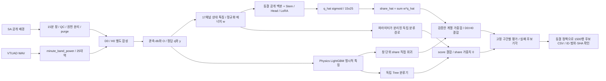

# Underwater Vessel Noise Challenge — 현재 파이프라인·공식 성능·검증 현황

**갱신 기준: 2026-10-30, Asia/Seoul · R21 CPU 검산 완료.** 연구 코드와 근거를 인계하는 공개 스냅샷이다. 실시간 학습 대시보드가 아니다.

> **최고 공식 제출은 R17 B1: Public Score 0.789471136 / RMSE 0.210528863 / AUC 0.572711111이다.**
> 최신 공식 제출 R18 B2는 RMSE 0.221276889로 악화됐다. 로컬 검증 개선이 실전으로 전달되지 않는 문제와 Public AUC 약 0.57 문제는 **미해결**이다.
> **현재 추가 모델 학습·GPU/MPS 실행은 중단한 상태이며, 저장 모델의 CPU 진단만 허용한다.** 사용자가 RunPod Stop을 확인했다. 과거 Fold1~4 waiter나 복구 명령을 자동 실행하지 않는다.

## 바로 확인할 자료

- 최신 R21 결과 및 한계 (`reports/r21_clean_val_zero_training_r1/R21_CLEAN_VAL_ZERO_TRAINING_REPORT.md`, 상세 원문은 로컬 보존)
- R20 통합 진단 (`reports/r20_integrated_cpu_diagnostics_r1/R20_INTEGRATED_DIAGNOSTICS_REPORT.md`, 상세 원문은 로컬 보존)
- R18 공식 결과 악화 원인 감사 (`reports/r18_public_gap_audit_r1/R18_PUBLIC_GAP_AUDIT.md`, 상세 원문은 로컬 보존)
- R17 전수 EDA·원천·출력 감사 (`reports/r17_eda_audit_20261030/R17_FULL_AUDIT_REPORT.md`, 상세 원문은 로컬 보존)
- [코드·데이터 실제 용량](reports/repository_sync_20261030/STORAGE_INVENTORY.md)
- [다음 작업자 지침](CLAUDE.md), [현재 상태](handoff/CURRENT_STATE.md), [공개 파일 검증](handoff/verify_snapshot_20261030.py)

상세 R17~R21 보고서·집계 CSV·새 제출 예측 파일은 이번 공개에 포함하지 않았다. 아래 수치와 설명은 사용자가 요청한 현재 상태 요약이다. 과거 보고서의 가설·예정·학습 중 상태는 당시 기록이다. 현재 README와 최신 사용자 지시가 우선한다. 특히 `old_B2`와 `R18 new_B2`, 소형 실험과 본체 학습, 로컬 수치와 공식 점수를 구분한다.

## 1. 대회 Task와 데이터

입력은 **15분 × 25개 1/3-옥타브 대역(약 31.6~7,943 Hz)**의 관측 dB, 총 375열이다. Test는 1,500창이며 결측이 있다. 남아공 원래 배경에 **새로 추가한 음원 성분의 에너지 비율** `share_added_vessel`을 회귀하고, 추가 여부의 독립 순위 점수 `score_added_vessel`도 출력한다. 원래 배경에 선박 소리가 있어도 **새 성분을 더하지 않았다면 y=0**이다.

| 원천 | 보유·역할 | 처리 및 사용 범위 |
|---|---|---|
| 대회 공개 남아공(SA) 배경 | 1,715,779행의 대역 관측값. 라벨된 공식 Train이 아님 | 시간창 구성, 관측/경계 QC, 원천 그룹 분리와 24시간 purge. 원천 행과 파생 창의 개수는 다른 단위다 |
| VTUAD strict WAV | 선박 509클립 + 배경 16클립 | 공식 helper와 수치 대조한 `minute_band_power`로 1분×25대역 선형 파워 변환. 합성 참조와 주변음 대조에 사용 |
| old R16 Fold0 학습 | 배경 61,446행/조건, 참조 60클립·10그룹 | D0/H0를 각각 생성. 참조 반복 집중도 Kish ESS 25.36, 최대 4,097회 |
| R18 새 학습 | 배경 12,000개/조건, 평가 예약 44개를 뺀 참조 풀 465클립 | 원천 확대·길이 층화·마스크 균형. 참조 ESS 347.49·최대 반복 432회로 개선됐지만 배경 HF 변동 감소와 실전 성능 악화가 함께 관측됨 |
| Test.csv | 1,500창, 정답 비공개 | 동결한 정책 추론 및 허용 범위의 기술 통계만. 숨은 라벨 역산·Test 분포에 맞춘 계수 적합에 사용하지 않음 |

`78,869`는 old 전체 Fold TRAIN 배경 합집합의 **창 수**다. “171만 행 중 95%를 고주파 필터로 버렸다”는 과거 설명은 틀렸다. 원본 행의 98.9745%가 원래 창 구성에 포함됐다는 감사 결과를 확인했다. 원천·QC 검산 (`reports/r18_public_gap_audit_r1/R18_PUBLIC_GAP_AUDIT.md`, 상세 원문은 로컬 보존)

### D0와 H0의 의미

| 조건 | 자연 시간 support | 주의 |
|---|---|---|
| D0 | 주로 실제 피크 중심 1~6분 크롭, 일부 전체 원음 배치 | 짧은 통과 중심 |
| H0 | 10분 이하 원음 전체 보존, 긴 원음의 실제 연속 11~15분 구간 | 중·장시간 보완. **HF 음성을 뜻하지 않음** |

두 조건은 같은 배경·참조 선택·명시적 무추가 위치를 짝지어 쓴다. **각각 별도 모델을 학습하고 예측을 결합**한다. D0 모델을 H0에서 이어 학습한 것이 아니다. 원래 TRAIN의 명시적 무추가는 약 20%였다. 현재의 6개 스케일/EQ 연산자는 자체 가정이며, 공개 스타터가 숨은 Test 합성기 전체를 공개한 것은 아니다.

## 2. 현재 파이프라인



### 모델별 실제 상태

| 계열 | 학습 방식 | 실제 완료 범위 및 현재 역할 |
|---|---|---|
| old Physics LightGBM | 처음부터 트리 적합 | D0/H0 × 5-Fold × 회귀/분류 = **20개 booster**. R17 최고점 B1에 사용 |
| old CatBoost | 처음부터 트리 적합 | 같은 범위 **20개 모델** 완료. R16 V1에는 포함, R17 B1/B2에는 제외 |
| old DINOv2-small | 공개 백본 동결 + 새 Stem/Head + LoRA/허용 Norm 미세조정 | **Fold0** D0/H0 × 독립 회귀/분류 4작업 완료. R17 B1/B2에 사용 |
| old Dasheng-Base | 같은 PEFT 방식의 음향 백본 | **Fold0** 4작업 완료. R17 B1/B2에 사용 |
| old TimeMoE-200M | 공개 MoE 백본 + Stem/Head/Adapter/LoRA 미세조정 | **Fold0** 4작업 완료. R17 B1/B2에서 가중치 **0%**, R18 재학습 제외 |
| R18 new LightGBM | 마스크 정리·profile_energy를 적용한 새 트리 적합 | **D0/H0 단일 분할** 회귀/분류. 새 5-Fold 아님. 실제 회귀 4,667특징·분류 2,408특징 |
| R18 new DINOv2 / Dasheng | 17채널 회귀 및 **전체 17채널 독립 분류** PEFT | 각 D0/H0 × 회귀/분류 4작업 완료. 공식 R18 B2는 개선 실패 |
| 과거 Scratch CNN / FDY / iTransformer / TFGrid | 무작위 초기화 지도학습 | R9 비교군으로 보존. R16 새 데이터에서는 Wide CNN 두 조건 완료, FDY D0 부분 실행 후 중단, 후속 확대 취소. 현재 추가 학습 안 함 |
| version2 ConvNeXt-V2-Base | FCMAE 공개 가중치 + 격자용 adapter 후보 | 가중치/연결·MPS step 검토까지. **본학습 미시작**, 현재 제출 모델 아님 |

기존 `version1`은 **LGB + CatBoost + Dasheng + DINOv2 + TimeMoE** 비교 체계다. 별도 `version2`는 **Dasheng + ConvNeXt-V2-Base + TimeMoE** 후보 설계다. 현재 공식 최고 B1은 version1 완료 모델의 **일부 3계열**을 사용한다. 모델을 추가한다고 자동으로 제출 조합에 넣지 않는다.

SFT(지도 미세조정)는 fine-tuning과 대립하는 용어가 아니다. 과거 Scratch 지도학습과 공개 가중치를 이용한 PEFT를 구분해야 한다. 현재 사전학습 경로도 새 Stem/Head는 처음부터 학습한다. Stage2에는 허용 Norm도 갱신하므로 “모든 백본 tensor 100% 동결”이라고 표현하지 않는다.

### 입력·손실·학습/추론 마스킹

- 회귀 입력 `[N,17,15,25]`: 시간 중앙값·하위 분위수 대비 변화, 시간 차분, 대역 동조/지속성, 상대 프로파일 `Ch4`, 관측 마스크 `O`, `sqrt(w)` 등의 특징. R14의 학습 PCA 잔차·LF anchor 채널은 이 입력과 다르며 현재 주력에 복구하지 않는다.
- `E ∝ 10^(db/10)`, `w=OE/ΣOE`, `q=A/(B+A)`, `y=Σwq`. NN은 `q_hat=sigmoid(mask_logits)` 후 **`share_hat=Σw*q_hat`**으로 풀링한다. Tree는 명시적 특징으로 share를 직접 회귀한다.
- 회귀 손실: `MSE(share_hat,y) + 0.25*Σw*(q_hat-q)^2`. 분류는 **별도 파라미터/그래디언트**의 `BCEWithLogits(presence_logit,z)`. 분류 손실로 회귀 마스크를 왜곡하지 않는다.
- old R16 분류 입력은 Ch4·sqrt(w)를 뺀 15채널/2,033 Tree 특징이었다. R18은 서명 정보 복원의 로컬 이득을 근거로 NN 17채널·Tree profile_energy 2,408특징을 사용했다. 순수 관측 비율 25개는 새 Tree 분류에서 제외했다.
- PEFT는 warm-up 3epoch(lr 1e-3) → Stage2 최대 25epoch(lr 2e-4→1e-5, **ES7**)였다. old Scratch fixed100/noES 계약을 새로운 PEFT에 적용한 것이 아니다. 추가 K-Fold 확대는 사용자 지시로 취소됐다.
- 학습 전용 SpecAugment/정적 프로파일 dropout은 **입력 특징만 가린다**. 원본 O, 풀링 w, 정답 q/y는 보존한다. **추론에서는 꺼진다.** 작은 DINO D0 off/both 대조의 회귀 개선을 모든 백본·조건·공식 LB에서 입증된 효과로 확대 해석하지 않는다.
- Quiet 분위수로 만든 마스크를 진짜 물리적 상한으로 쓰지 않는다. 장시간 성분이 기준선까지 올리는 경우 실제 양성을 0으로 잘라버릴 수 있다.

## 3. 공식 제출 이력과 실제 앙상블

아래는 **사용자가 공유한 공식 결과 기록**이다. 실시간 리더보드 조회값이 아니다. 주 순위는 `share` RMSE 기반이고 `score` AUC는 별도 진단 지표다. 로컬 RMSE를 `1-RMSE`로 바꿔 예상 Public Score라고 부르지 않는다.

| 제출 | Public Score | Share RMSE | Score AUC |
|---|---:|---:|---:|
| Benchmark | 0.753867825 | 0.246132175 | 이 표에서 확정하지 않음 |
| R5 CNN | 0.651991320 | 0.348008679 | 0.539533333 |
| R9 Tree5 | 0.768128675 | 0.231871324 | 0.548088888 |
| R9 Fold0 all5 | 0.782464193 | 0.217535806 | 0.555066666 |
| R14 step1 | 0.705436197 | 0.294563802 | 0.497866666 |
| R16 Tree5 | 0.776856976 | 0.223143023 | 0.568777777 |
| R16 V1 원본 | 0.775233744 | 0.224766255 | 0.568777777 |
| **R17 B1 / wSNRSQBH — 최고** | **0.789471136** | **0.210528863** | **0.572711111** |
| R18 new_B2 / sdrhrvuo — 최신 | 0.778723110 | 0.221276889 | 0.573555555 |

R18은 최고점 대비 RMSE가 **+0.010748026** 악화됐다. 로컬 지표 개선만으로 데이터 간극을 해결했다고 판단할 수 없다는 재확인이다. 공식 수치 근거 CSV (`reports/r20_integrated_cpu_diagnostics_r1/alignment/OFFICIAL_PUBLIC_SCORES_SUPPLIED.csv`, 상세 원문은 로컬 보존)

| 정책 | 회귀 share 계열 비중 | 독립 분류 score 계열 비중 | 상태 |
|---|---|---|---|
| R16 V1 원본 | LGB50% + Cat47.64% + DINO1.84% + Dash0.52%, TimeMoE0% | LGB100% | 공식 0.77523. 5개 계열을 학습했지만 균등 5모델 제출이 아님 |
| **R17 old_B1** | **old LGB5 60% + old DINO25% + old Dash15%** | **같은 60/25/15** | 공식 최고 0.78947 |
| **R17 old_B2** | **같은 old 모델 50/30/20** | **같은 50/30/20** | 후보 생성·로컬 평가. 이 스냅샷에 공식 제출 결과 없음 |
| R18 new_B2 | **새 LGB 50% + 새 DINO30% + 새 Dash20%** | **같은 50/30/20** | 공식 0.77872. old_B2와 다른 파일·모델 |

각 정책은 계열 안의 D0:H0를 **50:50**으로 합친다. `score`에 `share`를 섞는 비중은 0이다. B1/B2의 CatBoost·TimeMoE 비중은 0이다. weight가 작은 이유를 모델 용량만으로 설명할 수 없으며, 검증 분포·상관된 오차·제약·선택 오염을 함께 확인해야 한다.

후처리는 원본 보존 → fit에서 소수 후보 적합 → gate에서 선택 → report 확인 순서로 검토했다. Tree50% 제약 해제·Neural-only·Tree-only·D0/H0 비중·제한된 stretched sigmoid·fit 고정 logit/ECDF를 대조했다. **검토/구현한 후보와 실제 채택한 정책은 다르다.** Test에서 순위·평균을 다시 계산하거나 Public 점수에 맞춰 보정하지 않는다.

## 4. 현재 문제와 의심 원인 — 확인된 것과 미확정인 것

| 측면 | 확인한 문제/근거 | 의심하지만 아직 분리하지 못한 원인 |
|---|---|---|
| **데이터** | old Fold0 참조60개·ESS25.36의 반복 집중. R18은465클립으로 확대했지만 배경12,000개 추출 후 HF bump p90이 **10.39→5.95 dB**로 줄었다 | 자연 과도음·관측 패턴·참조 ambient·채널/EQ·스케일·support를 숨은 생성기가 어떤 비중으로 쓰는지. 개별 요인의 Public 실패 기여는 미확정 |
| **검증/학습** | 구 ensemble_fit의 **49.25%가 St Francis/Nobs5**. old LGB 조기 종료에 분리 전 local_fit 사용. 고정 패널을 반복 개발에 사용함 | 적은 독립 배경/참조에서 checkpoint와 조합을 선택한 낙관 편향의 크기. 짧은 H0 best epoch가 과적합 때문인지, 워밍업/입력 정렬 한계인지 단독 원인 확정 안 됨 |
| **모델링** | R18 로컬 report 전체 RMSE는 개선됐으나 약한 양성 RMSE **0.026007→0.040986**, bias **+0.008883→+0.019392** 악화. profile_energy의 로컬 분류 이득이 Public AUC 개선으로 이어지지 않음 | 새 Stem을 단 15×25 격자에 적응시키는 난도, 사전학습 표현과 TOL 입력의 불일치, 출처 서명과 사이트 편법의 분리. 큰 모델이 자동 해결한다는 근거 없음 |
| **추론/결합** | R16 V1은 회귀 Tree97.64%, 분류LGB100%. B1의 NN40% 고정 결합은 공식 최고점. R18은 Test 예측 평균 **0.241773→0.264184** 상승, score≥.90 **71.13%→87.27%** | 고주파 돌출에 대한 과민 반응과 배경 분모/채널 전이, 잘못된 검증 우선순위가 결합됐을 가능성. 예측 평균 자체로 성능이나 정답 평균을 알 수 없음 |

### 과거 설명 중 정정할 사항

1. **“마스크 편법 중요도15~21%” 단정은 과도했다.** 400특징 묶음 중 375개는 시간 차분·lag 음향 특징이다. old LGB 묶음 gain15.3402%=음향14.5122%+순수 관측25개 **0.8280%**. CatBoost 순수 관측 중요도는 **3.0977%**(다른 중요도 정의)였다. 중요도는 그 자체로 실패의 인과 증명이 아니다.
2. **“절대 dB 제거 때문에 Bayes error floor≈.07”은 입증되지 않았다.** 기존17채널은 공통 레벨 외 상대375셀 정보를 보존한다. B와 A가 같은 E를 만들 수 있어 raw dB 추가만으로 분해가 유일해지지도 않는다.
3. Test 전체의 `HF_bump≈16dB`를 **Test 무추가 음성의 통계**라고 부르면 안 된다. 숨은 라벨 없이는 구분할 수 없다.
4. 원음 변환 helper parity와 정밀도 검사는 통과했지만, 그것이 **전체 숨은 합성 법칙을 재현했다는 뜻은 아니다.**
5. 정답 평균에 대한 Public 점수 역산으로 스케일·사전확률을 맞추지 않는다. 낮은 예측 평균이나 높은 로컬 AUC만으로 좋은 제출을 보장하지 않는다.

## 5. R19~R21에서 무엇을 검증했고 무엇이 남았는가

현재 “검증 중”은 **학습 프로세스가 돌아간다**는 뜻이 아니라 아래 연구 과제가 남았다는 뜻이다. R21 실행 자체는 완료됐다.

| 측면 | 완료한 CPU 검증 | 현재 결론 / 남은 검증 |
|---|---|---|
| 데이터 | SA 원본 전체 창 탐색, 원천 계보·재사용 ESS, 순수 vanilla addition vs 6법칙 교차 대조, HF 음성/양성 paired stress 구성 | Test 대표성은 미확보. 자연 HF 음성과 약한 추가 성분을 구분하는 독립 배경·참조·법칙 전이 필요 |
| 검증/학습 | fit/선택/report 역할·마스크 편중·원천 중복·purge 감사, 새 구간별 게이트 고정 | 기존 패널은 반복 조회됨. 더 독립적인 최종 확인과 검증 대표성 확보가 필요. **새 학습/재적합 안 함** |
| 모델링 | 동결 LGB·DINO·Dash 개별 예측/출처·helper 수식·17채널 정보 보존·profile_energy·마스크 입력 대조 | 순수 마스크 제거만으로 오탐 해결 못함. 확인된 중요도와 실제 음향 편법을 구분해야 함 |
| 추론 | old_B1/B2·new 모델·고정 결합/미세 보정, Quiet 배경 추정 4종과 5%/10% 결합 대조 | Quiet 보정은 기각. 전 구간 오차를 줄이는 안전한 후처리 미확보. Public 결과를 맞추는 보정 금지 |

### 최신 Clean-Val-R20 스트레스 검산(R21)

- **100행=50개 배경×음성/양성 쌍**, 무추가50%, 약한 양성25행. 음성 HF 중앙값 **18.5214 dB**, LF 비중 **0.57324**.
- SA full-clock 적격256,029창에서 물리 조건 후보790창, TRAIN의 사이트·녹음기·센서와 모두 분리된41창 + 별도 부분 관측9창. 전체 old TRAIN78,869 배경 합집합과 대조했다.
- Saldhana Bay41·Fish Hoek9, 3녹음기·28rec-day·35연결 support블록. **100개 독립 표본 아님.** 같은 O별 presence50%로 경험적 MI≈0이지만, 모든 음향 대리변수가 없어진다는 뜻은 아니다.

| 고정 후보 | 전체 RMSE | 무추가 RMSE | 약한 양성 RMSE | HF무추가 RMSE |
|---|---:|---:|---:|---:|
| old_B1 | 0.191133 | 0.210856 | 0.170188 | 0.210856 |
| old_B2 | **0.189597** | **0.208756** | **0.165719** | **0.208756** |
| Quiet 후보 중 전체 최저 | 0.330930 | 0.394717 | 0.290076 | 0.394717 |

사전 지정 정책 후보 중 **old_B2만 엄격 게이트 통과**했다. ΔRMSE의 rec-day bootstrap95% 구간은 **[-0.003344,+0.001097]**으로0을 포함한다. Public 개선을 보장하지 않고 생산 파일은 바꾸지 않았다. 개별 DINO 점수는 기술 진단이며 새 정책으로 사후 추가하지 않았다.

Quiet-Minutes는 자연 변동을 추가 에너지로 잘못 계산했다. **새 `quiet_B_share`를 기존 LightGBM에 추가 학습한 것은 아니다.** 동결된 트리는 새 열을 소비할 수 없으므로 독립 물리 추정 및 고정 출력 결합까지만 평가했다. 순수 마스크 입력 치환과 NN stem O 가림도 오탐 완벽 제거를 입증하지 못했다.

게이트는 old_B1 대비 전체·무추가·약한 양성·HF음성 RMSE 동시 감소, 무추가·약한 양성의 양의 bias 비증가, NaN/빈 구간 거부다. [구현](pipeline/clean_val_gate_r20.py) / [동결 설정](configs/clean_val_r20_gate_v1.json)

**한계:** 모든 음성이 HF≥15라 HF≥12 음성 축은 zero 축과 같다. 장시간 양성은1행, R20과 정확히 같은 입력은4행이다. 이 패널을 Test 대표 분포·새 최종 홀드아웃·Public AUC 붕괴 재현·간극 해소 증거로 부르지 않는다. 기존 생산 모델과 제출 파일을 자동 변경하지 않았다.

## 6. 현재 코드·데이터 크기와 Git 공개 범위

측정: **2026-10-30 19:52 KST**. symlink 미추적, hardlink 중복은 별도 집계했다. GB는10진, GiB는2진이다. 파일 논리 크기와 실제 독점 디스크 점유는 다르며 APFS clone 공유 extent까지 측정하지 않았다.

| 항목 | 논리 크기 |
|---|---:|
| 프로젝트 전체 106,994파일 | **45,430,063,236 bytes / 42.310 GiB** |
| 자체 코드·설정 558파일(실측 시점) | **7,002,497 bytes / 약6.68 MiB** |
| data.nosync | 11.743 GiB |
| models(학습 모델·공개 가중치·캐시 포함) | 11.554 GiB |
| external.nosync(외부 음원 등) | 8.948 GiB |
| ops(운영 백업·배포 묶음 포함) | 3.817 GiB |
| reports(EDA HTML·행별 진단 등 포함) | 2.272 GiB |
| 가상환경 | 1.798 GiB |

[상세 용량 표](reports/repository_sync_20261030/storage_inventory.json) / [측정 정의·제외 기준](reports/repository_sync_20261030/STORAGE_INVENTORY.md)

이번 원격 갱신은 **자체 코드·설정, 요청한 README와 인계 문서, 용량·환경 정보**로 제한한다. 상세 진단 집계·제출 예측 CSV를 포함한 전체 자료 묶음은 자동 승인 검토에서 공개 범위 승인이 부족하다는 이유로 거절돼 로컬에 보존했다. 실제 원격 포함 파일·크기·SHA는 [공개 스냅샷 manifest](handoff/PUBLIC_SNAPSHOT_20261030.json)를 기준으로 한다. 이전 역사 자료는 삭제하지 않는다.

**공개 제외:** 대회 원본/Test 관측값, 외부 WAV·원본 아카이브, 합성 db/q/y 행렬·학습 캐시, vendor 사전학습 가중치, 새 체크포인트, 런타임 복제, 백업·로그·인증 자료. 파일 크기가 작다는 이유만으로 원자료의 재배포 권한이 생기지 않는다. 공개 데이터는 원출처에서 정식 취득하고 [복원 문서](handoff/DATA_AND_RESTORE.md)를 따른다.

과거 [2026-10-28 Release](https://github.com/taeyang0505/-Underwater-Vessel-Noise-Challenge-by-the-French-Embassy-in-South-Africa/releases/tag/handoff-2026-10-28)는 **당시 owned-model 스냅샷**이다. 최신 R16 PEFT/R18 가중치가 그 Release에 들어 있다고 주장하지 않는다. 이 clone만으로 최신 모델 추론·학습까지 완전 복원되지는 않는다. 타사 코드·데이터·가중치의 라이선스는 각각 원출처를 따르며 저장소 전체를 임의로 재라이선스하지 않는다.

## 7. 재현·인계 방법

```bash
# 원자료·가중치 없이 공개 파일 SHA와 코드 구문만 확인한다.
python3 handoff/verify_snapshot_20261030.py

# 기존 원본 데이터·동결 모델을 비공개로 복원한 환경에서만 실행 가능한 CPU 진단.
# 모델 학습/새 GPU 실행 명령이 아니다.
python ops/r21_frozen_clean_inference.py \
  --input reports/r21_clean_val_zero_training_r1/data_multisite/clean_val_r20.npz
python ops/r21_finalize_clean_comparison.py
```

최신 CPU 감사는 Python3.12 환경을 사용했다. [실측 패키지 버전](handoff/audit_environment_20261030.json)은 재현 기록이며 모든 역사적 CUDA/MPS 러너의 공통 lockfile이 아니다. 새 장비의 패키지 설치만으로 비공개 데이터/가중치가 생성되지 않는다.

다음 작업자는 **README → CLAUDE.md → 최신 R21/R20 원문 → 실행 코드와 동결 manifest** 순서로 확인한다. 오래된 PID·waiter·fixed100/noES 지시·전체5Fold 계획을 현재 명령으로 실행하지 않는다. 새 학습이나 GPU 사용은 현재 승인 범위 밖이다. 공식 대회 제출과 외부 자문 전송도 자동 수행하지 않는다.

### 주요 코드와 근거 위치

| 역할 | 경로 |
|---|---|
| SA/참조 데이터·원천/분할 | `pipeline/dataset_r9.py`, `pipeline/source_split_r6.py`, `pipeline/r16_multisupport_data.py` |
| 상대 특징·물리 풀링·모델 | `pipeline/relative_grid_r6_v2.py`, `pipeline/pretrained_audio2d_r16.py` |
| PEFT/masking 학습 코드(역사·복원용, 현재 실행 금지) | `pipeline/training_r16_pretrained_cuda_bf16.py`, `pipeline/training_r18_production_neural.py` |
| R17~R20 원천·교차 법칙 감사 | `ops/r17_*`, `ops/r18_*`, `ops/r19_*`, `ops/r20_*` |
| Clean-Val 원천/부분 관측 확장 | `ops/r21_clean_val_data.py`, `ops/r21_clean_val_multisite.py` |
| 동결 CPU 추론·입력 대조 | `ops/r21_frozen_clean_inference.py`, `ops/r21_mask_proxy_audit.py` |
| Quiet 물리 피처·게이트·집계 | `ops/r21_quiet_feature_candidates.py`, `pipeline/clean_val_gate_r20.py`, `ops/r21_finalize_clean_comparison.py` |

동결 SHA는 원본 검증 영수증의 기준이다. 공개에서 제외된 private 입력이 원본 manifest에 나열될 수 있으므로, clone 검증에는 새 공개 스냅샷 manifest를 사용한다. 공개 README 갱신은 원본 학습 코드·데이터·정책을 변경하는 작업이 아니다.
