# Underwater Vessel Noise Challenge (French Embassy × Zindi): Task 분석과 심층 EDA

- 작성일: 2026-10-24 (대회 진행 중, 마감까지 약 7주)
- 대회: <https://zindi.world/competitions/french-embassy-underwater-vessel-noise-challenge>
- 분석 대상: `data/raw/Test.csv`, `data/raw/sample_submission.csv`, `data/raw/maritime_starter_notebook.ipynb`, `data/extracted/` (`South_African_Real_Acoustics.zip` 압축 해제본)
- 재현: 프로젝트 폴더에서 `python3 -I eda_deep/deep_eda.py`를 실행합니다. 약 30초 걸리고 `eda_deep/figures/` 18장, `eda_deep/tables/` CSV 19개, `eda_deep/summary.json`을 만듭니다.
- 규칙 준수: Test.csv는 **기술 통계만** 냈습니다. fit, calibrate, pseudo-label은 하지 않았습니다. 도메인 프로브(kNN)는 학습 창으로만 학습했고 테스트에는 추론만 적용했습니다.

> **정정 (2026-10-26)**: §0-8과 §5.4에서 "고대역 bump = 추가된 선박 성분의 지문"이라고 쓴 부분은 과대해석이었습니다. 공식 AUC 0.54와 제출 CNN 반사실 실험(Desktop 프로젝트 `reports/R5_ROOT_CAUSE_ANALYSIS.md`)을 보면, 이 특징은 **"SA 배경에 없는 외부 과도 에너지"**를 나타낼 뿐입니다. 그 에너지가 정답에 들어가는 passage 성분인지는 구분하지 못합니다. 테스트 창 대부분에 외부 에너지가 있다는 관측은 유효하지만, 이를 "추가(양성) 비율"로 읽으면 안 됩니다.

---

## 0. TL;DR

1. **실제로 풀어야 하는 문제는 "배경 에너지의 반사실(counterfactual) 추정"입니다.** 타깃은 `share = Σ추가에너지 / Σ혼합에너지 = 1 − 10^(−ΔL/10)`입니다. 창 전체 에너지가 배경보다 +1 dB 올랐으면 0.21, +3 dB면 0.50입니다. 배경 추정이 1 dB만 틀려도 share 오차가 약 0.2 생깁니다(§2.2).
2. **테스트에 더해진 선박 성분의 원천은 공개돼 있습니다.** 스타터 노트북에 따르면 **VTUAD v1.3.2**(Ocean Networks Canada 기반, Zenodo, CC BY 4.0)의 선박 통과 녹음을 1분 × 25밴드로 바꾸고, 절대 이득은 버리고, 시간 궤적·채널·에너지를 바꿔서 남아공 배경에 더했습니다. **학습용 합성 데이터를 테스트와 같은 생성 과정으로 직접 만들 수 있다**는 뜻이고, 이게 가장 중요한 단서입니다(§2.4).
3. **Benchmark public score는 0.753867825(RMSE 0.2461)입니다.** 이 벤치마크가 sample submission(전부 0)이라면 public 구간에서 `E[y²] ≈ 0.0606`입니다(§2.3).
4. **학습 데이터는 녹음기마다 절대 레벨이 최대 약 20 dB씩 다릅니다**(같은 사이트 안에서도 그렇습니다). 절대 dB를 그대로 쓰면 도메인 시프트가 크므로 창 단위 정규화가 필수입니다(§4.3).
5. **파일 경계에서 생기는 아티팩트가 체계적으로 존재합니다.** 시작 분이 +24~+32 dB(RB 7005, ST600, URN 6509), 끝 분이 +11 dB(RB 201383949)입니다. 마스킹하지 않으면 "가짜 선박 통과"로 학습됩니다(§4.1).
6. **테스트 창은 녹음기 시계 기준 15분 정렬 컷으로 보입니다.** 테스트 결측은 항상 *분 전체* 단위(734분)이고, 창의 41%는 1분차, 6.5%는 15분차가 비어 있습니다. Richards Bay와 닮은 테스트 창의 결측 패턴은 RB 녹음기의 정시 파일 경계 패턴과 일치하고, St Francis와 닮은 창은 489개 중 484개가 1분차 결측입니다(§5.1).
7. **테스트 배경은 학습 사이트와 같은 도메인입니다.** 스펙트럼 kNN 프로브(주 단위 그룹 CV balanced-acc 0.705)로 보면 테스트는 St Francis 33%, Richards Bay 28%, Saldanha 19%, St Croix 16%를 닮았습니다. 가장 가까운 학습 창까지의 거리 분포도 학습 OOF와 거의 같습니다(학습 p99를 넘는 비율 1.1%). 반면 학습 창 비중은 RB가 65%, St Francis는 3%라서 **사이트 구성비가 크게 다릅니다**(§5.2).
8. **추가 성분의 지문은 "고주파(3~8 kHz) 시간 bump"와 "저·고대역 동조"입니다.** 같은 사이트끼리 비교해도 테스트의 고대역 bump 중앙값은 10.6~20.2 dB이고 학습은 0.8~1.1 dB입니다(KS 0.61~0.90). 테스트 창의 38~75%가 학습 p99를 넘습니다(§5.4).
9. **추가 성분의 스펙트럼은 평탄한 광대역입니다.** 자연 SA 과도음은 저주파가 지배하지만(31.6~200 Hz에서 최대), 테스트 피크 분은 300 Hz~3 kHz에서 +15~19 dB입니다. 에너지 비율 타깃은 저주파가 지배하지만 *탐지 신호*는 중·고주파에서 가장 깨끗합니다(§5.5).
10. **write-up 상(2×$1,000)을 노린다면** 학습 데이터에서 자연적인 선박형 통과 사건을 휴리스틱으로 5,725건 찾았습니다(사이트별 하루 0.8~7.2건, 중앙 지속 4분). 이것을 "pressure map"의 실데이터 검증 기반으로 쓸 수 있습니다(§4.8, §7).

---

## 1. 대회 개요

| 항목 | 내용 |
|---|---|
| 주최/후원 | 주남아공 프랑스대사관(Le Shift Lab), SAEON. 지원: ITU AI for Good, SANBI, Coalition for Sustainable AI, BioConsult SH |
| 일정 | 시작 2026-10-16 · **마감 2026-12-13** · 공개 2027-01-29 |
| 참가 | 555명 가입 / 237명 활동 (2026-10-24 기준) |
| 상금 | 1위 $1,500 + ChangeNOW Summit 2027 초청($2,500 상당), 2위 $1,000, 3위 $500, **Best write-up $1,000 × 2** |
| 제출 | 하루 2회, 총 200회. 팀 최대 4명. 최종 2개 선택 |
| LB | Public 약 30% / Private 약 70%. 점수는 `1 − RMSE(share_added_vessel)` |
| 보조 출력 | `score_added_vessel`: ROC AUC 진단용이며 **순위에 반영되지 않음** |
| 코드 리뷰 | Private top 10은 48시간 안에 코드 제출. seed 고정과 재현성 필수 |
| 도구 제약 | 오픈소스만 사용 가능. **AutoML 금지**. 공개 사전학습 모델은 허용 |

### 1.1 규칙 요약 (모델링에 직접 영향을 주는 것)

| 허용 | 금지 |
|---|---|
| 공개된 SA 데이터 + 공개 코퍼스(ONC, HearMyShip 명시) 사용. 출처, 버전, 전처리는 **토론 게시판에 공개** | 테스트 입력으로 fit, fine-tune, calibrate, pseudo-label, 학습 예제 생성 |
| 허용된 데이터로 증강 직접 생성 | 숨겨진 정답, **source identity**, 미공개 배경 사용 |
| **창 단위 고정 변환**(per-window transformation) | 리더보드 probing으로 예제별 라벨 복원 |
| 공개 사전학습 모델 | AutoML, 팀 밖 비공개 코드 공유, 다중 계정 |

> 회색지대 주의: VTUAD는 ONC에서 파생된 공개 코퍼스라서 학습 사용은 규칙 취지에 맞습니다(토론 게시판 공지는 필요합니다). 그러나 **테스트 창을 VTUAD 클립과 템플릿 매칭해 "어떤 클립이 몇 dB로 더해졌는지" 역추적하는 행위**는 "source identities 사용"이나 "test로 calibrate"로 해석될 위험이 큽니다. 실격 리스크가 있으니 피해야 합니다.

---

## 2. Task 정의 심층 분석

### 2.1 무엇을 예측하나

각 테스트 창 = **실제 SA 배경 B(15분 × 25밴드)** + **통제된 선박 통과 레퍼런스 A**(없을 수도 있음)입니다.

```
share_added_vessel = Σ_{관측 셀} A_lin / Σ_{관측 셀} (B_lin + A_lin)      (선형 에너지, 25밴드 × 관측된 분)
```

- 결측 셀(빈칸)은 분자와 분모에서 **모두 빠집니다**. 그래서 추정도 관측 셀 기준으로 해야 합니다.
- `share = 0`은 "추가 없음"이라는 뜻일 뿐입니다. 원래 배경에 자연 선박음이 있어도 0입니다. 즉 **자연 선박 소음은 타깃 관점에서 "배경 노이즈"**입니다.
- 레퍼런스 A에는 VTUAD 원 녹음의 주변 소음(Strait of Georgia ambient)도 섞여 있습니다. 그래서 A는 "선박만의 에너지"가 아닙니다.
- 창 하나에 값 하나만 냅니다. 분 단위나 밴드 단위로 내지 않습니다.

### 2.2 dB ↔ share: 사실상 배경 추정 문제

`E_M = E_B + E_A`이므로 `share = 1 − E_B/E_M = 1 − 10^(−ΔL/10)`입니다. ΔL은 "창 에너지가 배경보다 몇 dB 올랐는가"입니다.

| ΔL (dB) | 0.5 | 1 | 3 | 6 | 10 | 20 |
|---|---|---|---|---|---|---|
| share | 0.11 | 0.21 | 0.50 | 0.75 | 0.90 | 0.99 |

배경 에너지 추정 오차가 e dB면 `share 오차 = (1−y)(1 − 10^(e/10))`입니다. **share가 작은 창(추가 없음 포함)일수록 배경 추정 오차에 민감합니다**. 1 dB 과소추정만 해도 0.2만큼 과대예측합니다.

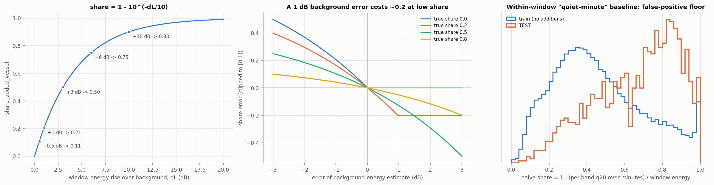

오른쪽 패널은 "창 안에서 조용한 분(밴드별 q20)을 배경으로 본다"는 naive 추정의 분포입니다. **추가가 전혀 없는 학습 창도 중앙값이 0.4 안팎**입니다. 자연 배경의 시간 변동만으로도 naive 방식은 큰 false-positive를 냅니다. 그러니 "선박다운 시공간 패턴"을 학습해서 배경과 성분을 분리해야 합니다.

### 2.3 평가지표와 벤치마크 해석

- RMSE는 큰 오차에 민감합니다. share가 0.9 근처인 창(ΔL ≥ 10 dB)은 비교적 쉽고, **0~0.3 구간을 정확히 맞추는 것**이 점수를 좌우할 가능성이 큽니다.
- **Benchmark public = 0.753867825 → RMSE = 0.246132**입니다.
  - Zindi 관례대로 벤치마크가 sample submission(share = 0.0)이라면 `E[y²] ≈ 0.0606`(public)입니다. 이때 `y∈[0,1]`이므로 `E[y] ∈ [0.061, 0.246]`이고, 최적 상수 예측의 RMSE는 0 ~ 0.239 사이입니다.
  - 스타터 노트북의 상수 0.1이 벤치마크라면 `E[(y−0.1)²] ≈ 0.0606`입니다. 어느 쪽인지는 확정할 수 없습니다(가정).
  - 참고로 §5.4의 고대역 bump 지표로 보면 테스트 창의 약 84%가 학습 기준으로 "이상하게 동적"입니다(학습 18.5%). 이는 라벨이 아니라 기술 통계일 뿐입니다. 그래도 추가 비율 p가 0.7~0.8이라고 가정하면 추가된 창의 RMS share는 약 0.28~0.29로 추정됩니다(추측).
- `score_added_vessel`은 AUC 진단용입니다. 분류기 확률이나 예측 share의 단조 함수를 넣으면 충분합니다.

### 2.4 테스트 생성 과정 역추적 (가장 중요)

스타터 노트북 출처 섹션에 이렇게 적혀 있습니다:

> Adapted vessel-passage components derive from **VTUAD v1.3.2** (Zenodo DOI 10.5281/zenodo.23037895, CC BY 4.0). … audio was converted into minute-level frequency-band energy summaries; absolute digital gain was discarded; time trajectories, relative acoustic channel and energy were varied before combination with measured South African backgrounds.

VTUAD v1.3.2 개요 (Zenodo 페이지 기준):

| 항목 | 값 |
|---|---|
| 녹음 | 525 클립 (선박 509 + 배경 16), 약 56시간, **32 kHz 모노 WAV** |
| 클래스 | 11개 AIS 선종 + background: cargo, tanker, passenger, tug, fishing, pleasure craft, sailing, pilot, rescue, dredger, other |
| 위치/기간 | ONC icListen `ICLISTENAF2523`, Strait of Georgia (BC, Canada), 2016-05 ~ 2017-05 |
| 메타 | MMSI(익명화 버전 별도), UTC 구간, 선박 크기, CTD 환경 변수 22개 열 |
| 파일 | `vtuad_strict_wav_vessel.zip.part01-03`(약 3.6 GB, AIS로 검증된 정확한 구간), `vtuad_strict_wav_background.zip`(926 MB), 클래스별 원 컨테이너 WAV(약 25 GB), log-mel 특징 |

여기서 추론되는 생성기:

```
B  : SA 배경 15분 창 (학습 공개분에서 제외된 기간, 같은 사이트군)
A0 : VTUAD 클립 → 분 × 25밴드 에너지 (스타터의 minute_band_power와 유사)
A  : A0 × 무작위 이득(에너지) ∘ 시간 궤적 변형(이동/신축/부분 삽입) ∘ 채널 변형(스펙트럼 필터)
M  = 10·log10(B_lin + A_lin), 0.1 dB 반올림, 배경 결측 분은 빈칸 유지
y  = ΣA_lin / ΣM_lin (관측 셀)
```

- 테스트 값은 **100% 0.1 dB 격자**입니다(544,150셀 확인). 따라서 "더해진 셀만 격자를 벗어난다" 같은 누수는 없습니다.
- 테스트 결측은 **부분 결측 없이 분 전체 단위**입니다(734분, 25밴드가 함께 비어 있음). 원 배경의 결측이나 QC 마스크로 보입니다.
- 일부 테스트 창에는 1~3분 폭의 수직 광대역 줄무늬가 보입니다(§5.6). 짧은 VTUAD 클립(평균 약 6.4분)이 창 안의 일부 구간에만 삽입된 결과와 일치합니다.

---

## 3. 데이터 구성

### 3.1 파일

| 파일 | 크기 | 내용 |
|---|---|---|
| `South_African_Real_Acoustics.zip` | 90.5 MB | `acoustics/<site>.parquet` 10개, `stations.csv`, `recorders.csv`, `DATA_DICTIONARY.md`, `README.md`, `SHA256SUMS.txt` |
| `Test.csv` | 2.7 MB | 1,500행 × (ID + 375열 = `mMM_TOL_<Hz>`, 분 우선 → 주파수 순) |
| `sample_submission.csv` | 48 KB | `ID, share_added_vessel(0.0), score_added_vessel(0.5)`. ID 집합과 순서가 Test와 같음 |
| `maritime_starter_notebook.ipynb` | 10.5 KB | 로딩, 상수 베이스라인, **VTUAD 출처**, 외부 오디오 → 분 밴드 변환 함수 |

### 3.2 학습(라벨 없음) 스키마

- 1,715,779행 × 74열. 10개 사이트, 17개 site×recorder 조합(고유 녹음기 12개), 2015-04-21 ~ 2025-12-06.
- 주요 열: `site, recorder, station_token, sample_rate_hz(파일명에서 추정, 미검증), file_kind, src_file, file_date, t(export clock, TZ 미검증), dur(1~360 s), TOL_0.8 … TOL_288000(62개), qc_duration_ge55, qc_25band_finite, qc_25band_spread_ge6`
- **공통 25밴드(31.6 Hz~7.94 kHz, deci-decade 1/3 옥타브 중심)는 sentinel 654행을 빼면 항상 finite**입니다. 그 밖의 대역(0.8 Hz~288 kHz)은 녹음기마다 다릅니다.

### 3.3 사이트와 녹음기

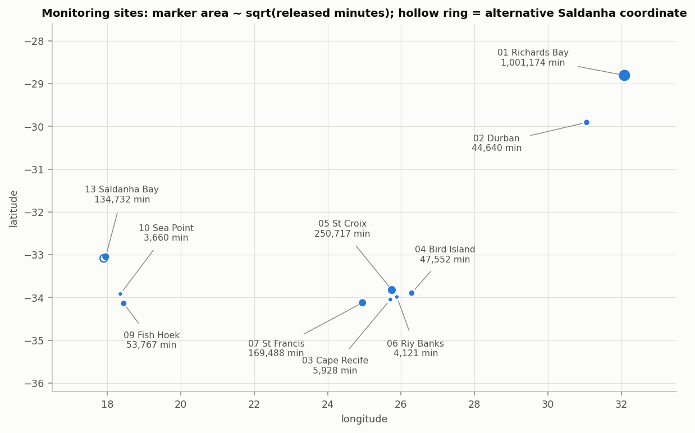

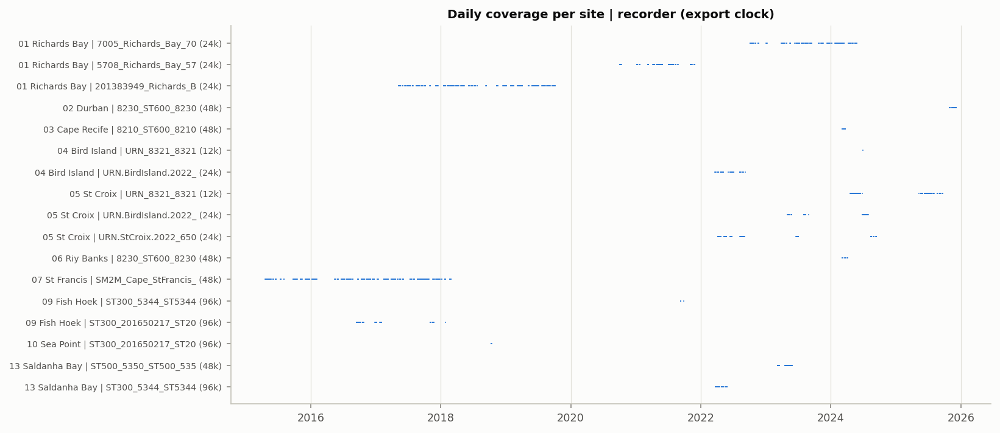

| 사이트 | 행 수 | 기간 | 녹음기 (명목 SR) | 녹음 패턴 | 15분 정렬 창* |
|---|---:|---|---|---|---:|
| 01 Richards Bay | 1,001,174 (58%) | 2017-05 ~ 2024-05 | 201383949 / 5708 / 7005 (24k) | 시간별 파일, 경계 분에 off-grid 또는 아티팩트 | 66,673 |
| 02 Durban | 44,640 | 2025-10 ~ 2025-12 | ST600 8230 (48k) | 거의 연속 | 2,976 |
| 03 Cape Recife | 5,928 | 2024-03 | ST600 8210 (48k) | **매시 13분만 녹음** | 0 |
| 04 Bird Island | 47,552 | 2022-03 ~ 2024-06 | URN 6509 (24k), URN_8321 (12k) | 일 단위 파일(1440분) | 3,168 |
| 05 St Croix | 250,717 | 2022-04 ~ 2025-09 | URN 6509 ×2 (24k), URN_8321 (12k) | 일 단위 파일, 드문드문 | 16,704 |
| 06 Riy Banks | 4,121 | 2024-03 ~ 04 | ST600 8230 (48k) | **매시 13분** | 0 |
| 07 St Francis | 169,488 | 2015-04 ~ 2018-02 | SM2M (48k) | **듀티사이클: 5분 녹음 + 15분 휴지(20분 주기), 일부 기간 매시 15분** | 3,371 |
| 09 Fish Hoek | 53,767 | 2016-09 ~ 2021-09 | ST300 ×2 (96k) | 옛 녹음기는 4~5분 단위 | 300 |
| 10 Sea Point | 3,660 | 2018-10 (2.6일) | ST300 (96k) | 연속 | 244 |
| 13 Saldanha Bay | 134,732 | 2022-03 ~ 2023-05 | ST300 (96k), ST500 (48k) | 1~18시간 블록 | 8,978 |

\* 정각 기준 15분 경계(:00/:15/:30/:45)에 맞춘 창 중 결측 ≤ 2분인 것. 시작/끝 아티팩트 마스킹 후 102,414개입니다.

- Station 13(Saldanha Bay)은 좌표 후보가 두 개입니다(Bay/offshore 미해결). README에 따르면 **Saldanha harbour 스테이션은 별도로 공개되지 않았습니다**(withheld).

### 3.4 테스트 구조

| 항목 | 값 |
|---|---|
| 창 수 | 1,500 (15분 × 25밴드 = 375셀) |
| 결측 | 18,350셀 (3.26%) = **734개 분 전체**. 부분 결측 0 |
| 결측 패턴 | 없음 775, **1분차 620**, 15분차 97, (1,2) 3, (14,15) 2, 기타 3 |
| 값 범위 | 29.3 ~ 152.9 dB, 전부 0.1 dB 격자 |
| 중복 | ID 중복 0, 분 벡터 완전 중복 0 |

---

## 4. 학습 데이터 EDA

### 4.1 품질 이슈 (반드시 전처리할 것)

| 이슈 | 규모 | 처리 |
|---|---|---|
| Sentinel (-156.5 dB 일괄) | 653~654행 (RB 5708, `..._ERROR_.csv`) | 제거 |
| `dur < 55 s` | 16,896행 | 부분 분이므로 에너지 보정이 필요하거나 제외 |
| off-grid 타임스탬프(초 ≠ 0) | 21,082행 | 파일 경계 행(:00:02, :59:58 등). 분 격자에 넣으면 충돌 |
| **파일 시작/끝 아티팩트** | 12,643행 | 아래 표 참조. 마스킹 필수 |
| 12 kHz 녹음기의 6.3/7.9 kHz 밴드 | URN_8321 136,518행 | Nyquist(6 kHz)를 넘는데도 finite. St Croix URN_8321은 7943−5012 Hz 차이 중앙값이 −8.2 dB(다른 녹음기는 −2.6 ~ −4.3)로 롤오프 흔적이 있음. 해당 밴드는 신뢰도가 낮음 |
| 드문 gap 직전 폭발 | 예: RB 2018-02-16 09:4x (+85 dB) | 이벤트/정규화 통계에서 robust 처리 |

파일 경계 아티팩트(같은 연속 구간 중앙값 대비 broadband 초과량의 중앙값, `tables/run_edge_artifacts.csv`):

| 녹음기 | 첫 분 | 마지막 분 | 해석 |
|---|---:|---:|---|
| RB 7005 | **+24.0 dB** | 0.0 | 매시 hh:00 재시작 과도음 |
| RB 201383949 | 0.0 | **+11.2 dB** | hh:59 파일 종료 직전 |
| ST600 8210 / 8230 (Cape Recife, Riy Banks, Durban 동형) | **+28.7 / +30.1 dB** | 0.0 | 듀티사이클 시작 |
| URN 6509 (Bird Island, St Croix) | **+31.9 / +28.9 dB** | ≈ −1 ~ −2 | 일 파일 시작 |
| SM2M (St Francis), ST300, ST500, URN_8321 | ≈ 0 | ≈ 0 | 이상 없음 |

> 이 아티팩트는 "1~2분짜리 광대역 +30 dB 이벤트"라서 **추가된 선박 성분과 생김새가 비슷합니다**. 배경으로 쓰기 전에 마스킹하지 않으면 모델이 아티팩트를 "추가 없음(0)"으로 학습해 성능이 크게 떨어질 수 있습니다.

### 4.2 듀티사이클과 15분 창

- Cape Recife와 Riy Banks는 매시 13분만 녹음하므로(**연속 15분 창 불가**) 첫 분 아티팩트를 빼면 12분입니다.
- St Francis는 대부분 5분 녹음 + 15분 휴지(20분 주기)입니다. 15분 연속 구간(매시 15분 녹음 기간)은 3,371개뿐입니다.
- Fish Hoek 옛 녹음기는 4~5분 단위라서 15분 창을 만들 수 없습니다.
- 그래서 **테스트처럼 15분 배경 창을 만들 수 있는 학습 데이터는 RB, St Croix, Saldanha, Durban, Bird Island, St Francis(일부)에 몰려 있습니다**. 결측 2분 이하를 허용한 정렬 창 102,414개 중 RB가 65%입니다.

### 4.3 스펙트럼과 녹음기 오프셋

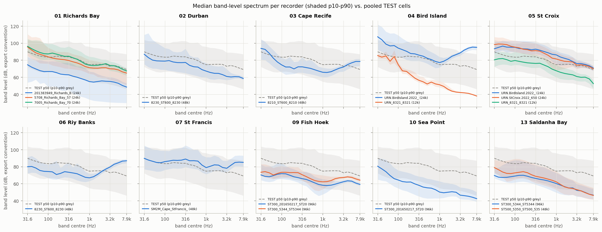

- **같은 사이트 안에서도 녹음기마다 레벨이 크게 다릅니다.** RB 201383949는 7005보다 약 20 dB 낮습니다. St Croix URN_8321(12k)은 다른 두 녹음기보다 약 15 dB 낮습니다. Bird Island 12k와 24k는 고주파에서 50 dB 이상 차이 납니다. export-convention dB는 **보정되지 않은 값**이라 녹음기 사이 비교가 무의미합니다.
- 스펙트럼 모양도 갈립니다. 대부분은 주파수가 높아질수록 감소하지만, **Riy Banks, St Francis, Cape Recife, Bird Island(24k)는 2 kHz 위에서 다시 올라갑니다**(snapping shrimp나 자체 잡음으로 추정).
- 테스트 셀의 p50(회색 점선)은 대부분 사이트 범위 안에 있지만 중·고주파가 상대적으로 높습니다.
- 정리하면 **절대 dB 대신 창 내부 상대값**(밴드별 창 중앙값 차감, 분 간 차분, 스펙트럼 기울기)을 쓰는 것이 안전합니다. 추가 성분 쪽도 "absolute digital gain discarded"이므로 같은 이유로 맞습니다.

### 4.4 에너지가 어디에 있나 (타깃을 지배하는 대역)

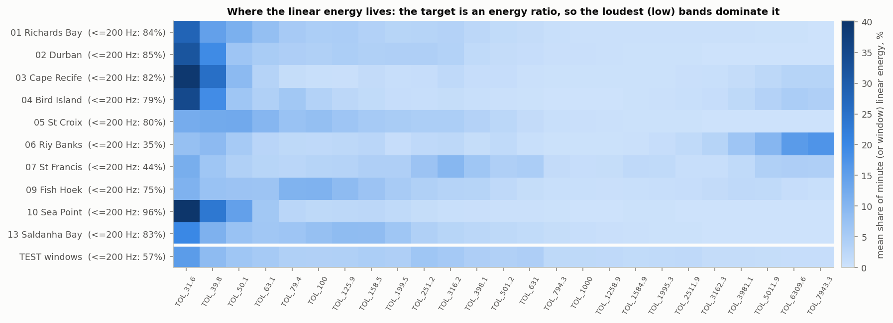

| | RB | Durban | Bird Is. | St Croix | Riy Banks | St Francis | Fish Hoek | Sea Point | Saldanha | **TEST** |
|---|---|---|---|---|---|---|---|---|---|---|
| ≤200 Hz 에너지 비율 | 84% | 85% | 79% | 80% | 35% | 44% | 75% | 96% | 83% | **57.5%** |

- 대부분의 사이트에서 선형 에너지의 80% 이상이 200 Hz 이하에 있습니다. 31.6 Hz 밴드 하나가 창 에너지 1위인 경우가 학습 창의 59%입니다. 그래서 **share의 분모는 저주파 레벨이 결정**합니다.
- 테스트는 저주파 비중이 낮습니다(57.5%). **631 Hz가 1위인 창이 8.3%로 학습(1.0%)의 8배**입니다. 원인은 두 가지가 섞여 있습니다: (a) 고주파 비중이 큰 St Francis형 배경이 많음(§5.2), (b) 추가 성분이 중대역에 에너지를 실음(§5.5).

### 4.5 밴드 상관과 PCA

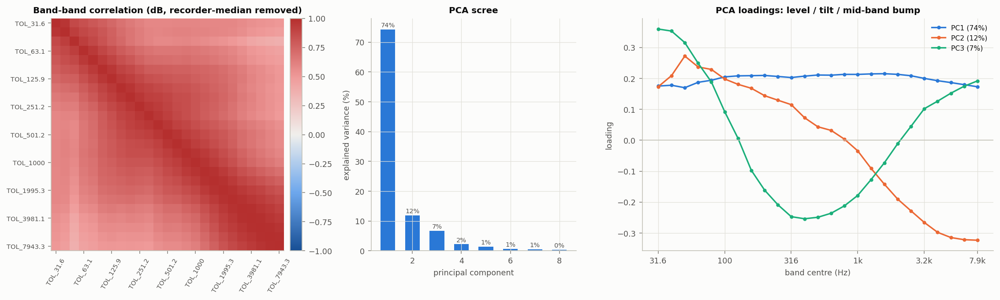

- 녹음기 중앙값을 제거한 뒤에도 인접 밴드 상관이 매우 높고 모든 상관이 양수입니다.
- PCA는 PC1(전체 레벨) 74%, PC2(기울기) 12%, PC3(중대역 dip) 7%로, **상위 3개 성분이 분산의 93%**를 설명합니다. 배경 스펙트럼은 저차원이고, 선박 성분은 이 저차원 구조에서 벗어나는 **잔차와 시간 패턴**으로 드러날 가능성이 큽니다.

### 4.6 시간 구조

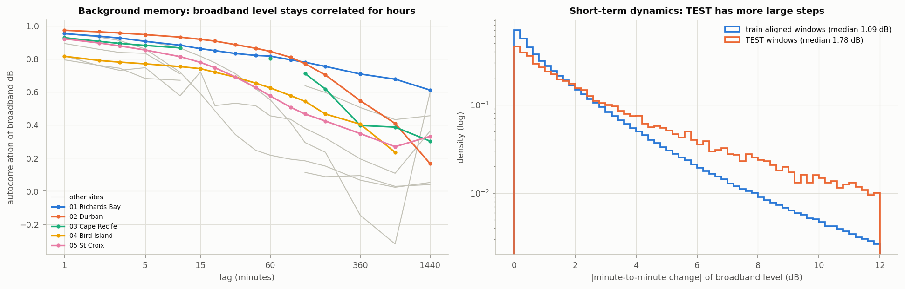

- broadband dB 자기상관은 lag 1분에서 모든 사이트가 0.79~0.97입니다. **분 단위로 보면 배경은 매우 매끄럽습니다.** lag 60분에서는 사이트마다 크게 갈립니다: Durban 0.85, RB 0.82, Bird Island 0.62, St Croix 0.58, Saldanha 0.22. Saldanha는 배경이 빠르게 변하므로 이웃 시간으로 배경을 추정하기 어렵습니다.
- 분 간 |Δ broadband|의 중앙값은 학습 1.09 dB, 테스트 1.78 dB입니다(p90은 4.58 vs 7.86). 테스트 창에는 큰 계단이 훨씬 많습니다.

### 4.7 일주기와 계절성 (녹음기 중앙값 기준 편차)

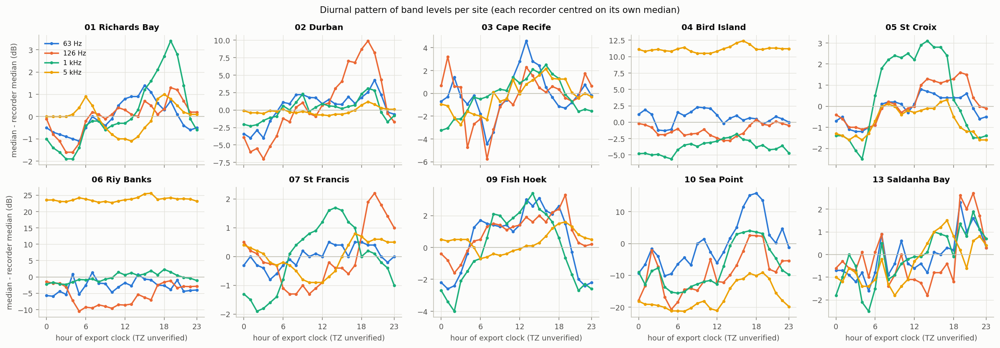
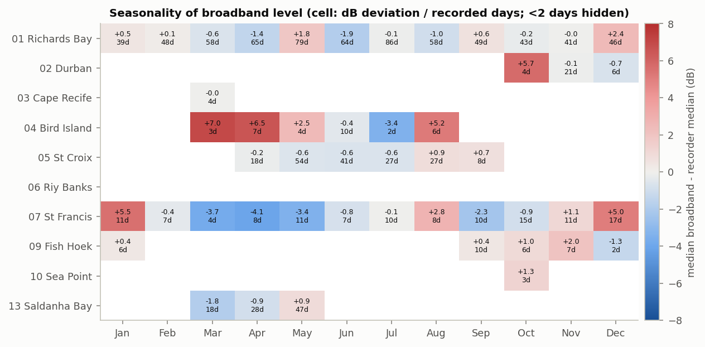

- 녹음기를 중심화하면 효과는 대체로 ±2~6 dB 수준입니다. Durban 126 Hz는 19시 +9.9 dB, 03시 −7.0 dB로 진폭이 크고, St Croix 1 kHz는 14시 +3.1 dB입니다. Sea Point(2.6일)는 표본이 작아 신뢰하기 어렵습니다.
- St Francis는 12~1월 +5 dB, 3~5월 −4 dB이고, Bird Island는 3~4월 +7 dB입니다(일수 적음).
- **export clock의 시간대가 검증되지 않았으므로** AIS(UTC)와 결합할 때는 학습 데이터로 시계 정렬을 먼저 확인해야 합니다.
- 테스트 창에는 시각, 사이트, 계절 정보가 없으므로 이 정보는 **write-up(pressure map)에서만** 쓸 수 있습니다.

### 4.8 공개 SA 데이터 안의 자연적인 선박형 통과 (휴리스틱)

정의: 50~500 Hz 분 에너지가 61분 이동중앙값보다 6 dB 이상 높고, 1.6 kHz 이상 기준대역보다 3 dB 이상 더 오른 상태가 3분 이상 이어지는 구간입니다. 파일 경계, gap 인접, 40 dB 초과 이상치는 제외했습니다.

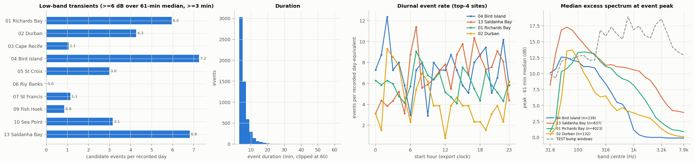
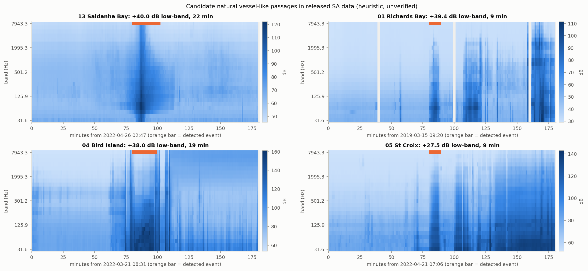

- 총 5,725건(제외된 아티팩트성 후보 1,416건). 하루(녹음 기준)당 Bird Island 7.3, **Saldanha 6.8, RB 6.0**, Durban 4.3, Sea Point 3.1, St Croix 3.0건입니다.
- 지속시간은 중앙 4분, p90 9분, 최대 27분입니다(Saldanha). 초과 스펙트럼은 **60~300 Hz에서 최대**이고 고주파로 갈수록 감소합니다. 대형 선박 방사 소음의 전형적인 모양입니다.
- 예시(Saldanha 2022-04-26, 22분)에서는 CPA(최근접점)를 중심으로 저주파가 대칭으로 올라갔다 내려가는 전형적인 통과 모양이 보입니다.
- **주의**: AIS로 검증한 결과가 아닙니다. 고래, 기상, 장비 잡음도 섞일 수 있습니다. write-up에서는 "candidate"로 다루고 대조군과 AIS로 검증해야 합니다.

---

## 5. 테스트 EDA와 학습 대비 비교

### 5.1 결측 패턴: 테스트는 녹음기 시계 기준 15분 정렬 컷

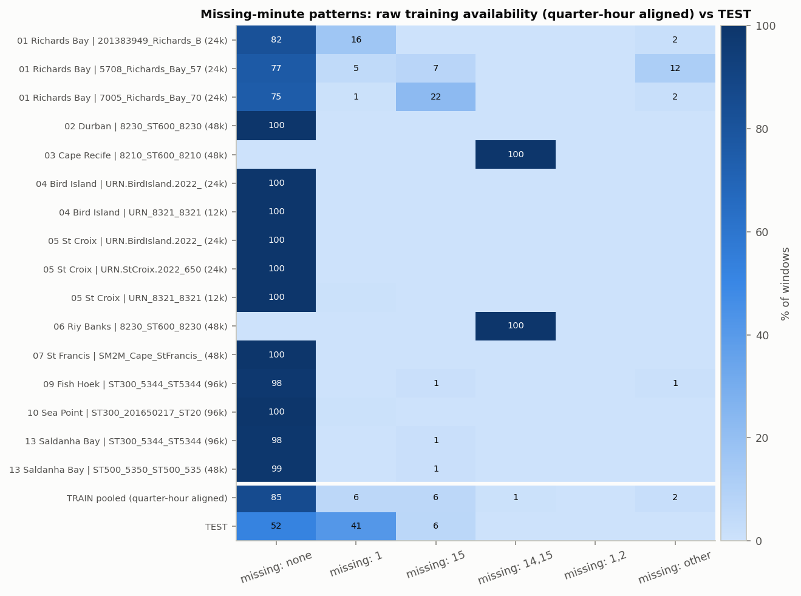

- 원시 가용성(on-grid, non-sentinel) 기준으로 정각 15분 창을 만들면 결측 패턴이 녹음기마다 고유합니다. RB 201383949는 1분차 결측 16%(hh:00:02 off-grid), RB 7005는 15분차 결측 22%(hh:59:58 off-grid), Cape Recife와 Riy Banks는 (14,15) 결측 100%입니다.
- 테스트 결측 패턴을 도메인 프로브 결과와 교차하면(`tables/domain_probe_vs_missing_pattern.csv`):

| 프로브 사이트 | 결측 없음 | 1분차 | 15분차 |
|---|---:|---:|---:|
| 07 St Francis | 2 | **484** | 0 |
| 01 Richards Bay | 268 | 79 | 72 |
| 13 Saldanha Bay | 236 | 29 | 18 |
| 05 St Croix | 211 | 20 | 4 |

- RB와 닮은 테스트 창의 결측 비율(1분차 19%, 15분차 17%)은 **RB 녹음기 파일 경계 패턴과 같은 크기**입니다. 따라서 **테스트 창은 같은 녹음기들의 비공개 기간에서, 정각 15분 경계로 잘라낸 배경**일 가능성이 높습니다.
- St Francis와 닮은 창은 사실상 전부 1분차가 비어 있습니다. 학습 쪽 SM2M에는 이런 패턴이 없으므로 비공개 기간의 녹음 스케줄이 다른 것으로 보입니다(가설).
- 활용: 결측 마스크를 **입력 채널로 넣는 것**은 창 단위 정보라 합법입니다. 단, 결측과 타깃 사이의 상관은 알 수 없으니 도메인 단서로만 쓰고, 마스크를 지운 ablation으로 강건성을 확인하는 것이 좋습니다.

### 5.2 도메인 프로브: 어떤 사이트를 닮았나

창의 분 중앙값 스펙트럼(25차원, 추가 성분에 비교적 둔감)으로 kNN(k=25)을 학습했습니다. 사이트당 4,000창이고, 사이트×ISO주 단위 GroupKFold입니다.

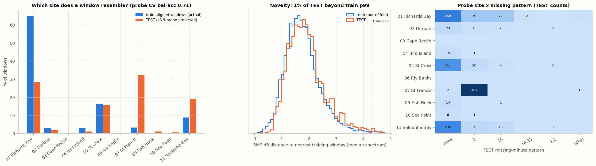

- CV balanced accuracy는 0.705입니다(10클래스, chance 0.1).
- 테스트 예측 구성: **St Francis 32.5%, Richards Bay 28.2%, Saldanha 18.9%, St Croix 15.7%**, Durban 2.1%, 기타 2.6%. 학습 정렬 창 구성(RB 65%, St Francis 3%)과 크게 다릅니다.
- 가장 가까운 학습 창까지의 RMS dB 거리 중앙값은 테스트 1.82, 학습 OOF 1.70이고, 학습 p99를 넘는 테스트 창은 1.1%뿐입니다. **배경 스펙트럼 자체는 학습 도메인 안에 있습니다.**
- 시사점: **사이트 구성 차이 때문에 풀링한 학습 분포로 검증하면 낙관적이거나 왜곡된 결과가 나올 수 있습니다.** 검증은 사이트별로 하거나 사이트 균형을 맞춰서 하세요. 단, *테스트에서 추정한 사이트 비율로 학습을 재가중하는 것*은 "test로 calibrate" 위험이 있으니 피하고, 사전에 정한 균형 가중을 쓰는 것이 안전합니다.

### 5.3 창 특징 분포 (풀링)

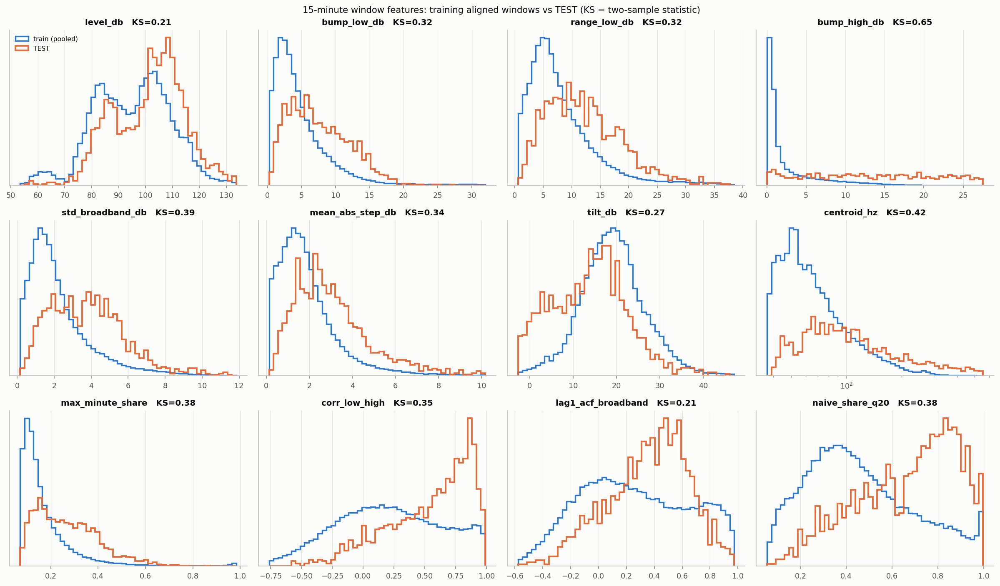

| 특징 | 학습 p50 | 테스트 p50 | KS |
|---|---:|---:|---:|
| bump_high_db (3~8 kHz 최대분 − 중앙분) | 0.96 | **16.25** | **0.65** |
| centroid_hz (에너지 가중 주파수 중심) | 75 | 166 | 0.42 |
| std_broadband_db | 1.79 | 3.72 | 0.39 |
| naive_share_q20 | 0.43 | 0.71 | 0.38 |
| max_minute_share | 0.14 | 0.25 | 0.38 |
| corr_low_high (저대역·고대역 분 시계열 상관) | 0.20 | **0.62** | 0.35 |
| mean_abs_step_db | 1.60 | 2.72 | 0.34 |
| bump_low_db (31.6~501 Hz) | 3.66 | 6.81 | 0.32 |
| range_low_db | 6.58 | 11.38 | 0.32 |
| tilt_db (≤126 Hz − ≥2 kHz) | 18.9 | 14.1 | 0.27 |
| level_db | 95.9 | 103.2 | 0.21 |
| lag1_acf_broadband | 0.23 | 0.39 | 0.21 |

(정확한 분위수는 `tables/window_feature_train_vs_test.csv`)

### 5.4 같은 사이트끼리 비교 (사이트 구성 효과 제거): 핵심 증거

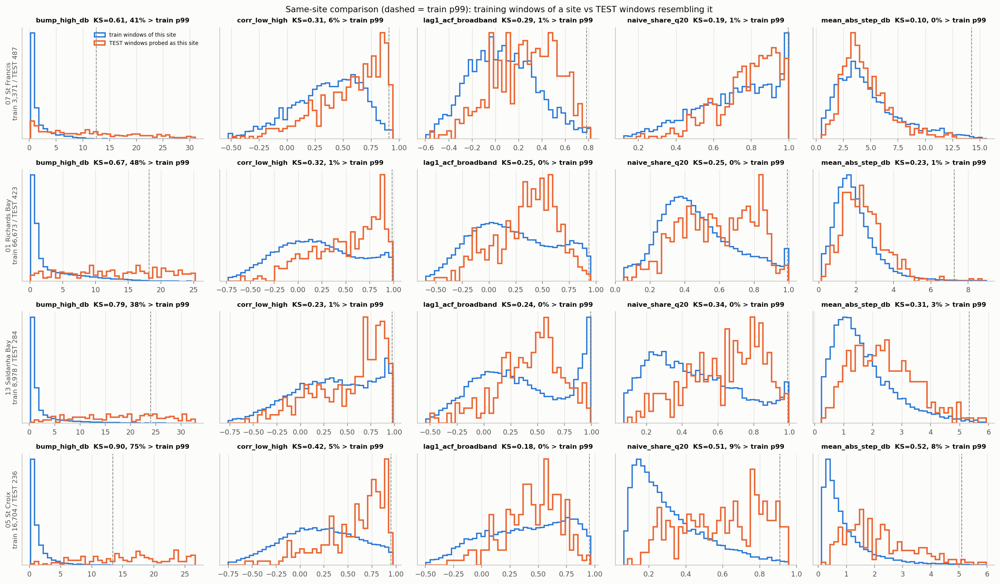

| 프로브 사이트 | 학습 bump_high p50 | 테스트 p50 | 테스트 중 학습 p99 초과 | KS |
|---|---:|---:|---:|---:|
| St Francis | 0.86 dB | 10.6 dB | 41% | 0.61 |
| Richards Bay | 1.15 dB | 17.3 dB | 48% | 0.67 |
| Saldanha Bay | 0.95 dB | 19.8 dB | 38% | 0.79 |
| St Croix | 0.77 dB | 20.2 dB | **75%** | **0.90** |

- 사이트를 맞춰도 차이가 그대로 남습니다. 그러므로 **이 차이는 사이트 구성 탓이 아니라 추가 성분 탓**입니다. SA 배경의 3~8 kHz 대역은 15분 안에서 거의 변하지 않는데(학습 p50 < 1.2 dB), 테스트에서는 10~20 dB씩 움직입니다.
- `corr_low_high` 중앙값도 학습 0.18~0.39, 테스트 0.58~0.67입니다(테스트 분포의 모드는 0.8~0.95). 추가 성분은 **저·고대역을 동시에 올리는 광대역 시간 이벤트**입니다. `lag1_acf`가 높은 것은 매끄러운 궤적(통과의 상승과 하강)에 해당합니다.
- `bump_high_db > 5 dB`인 창은 테스트 83.9%, 학습 18.5%입니다(라벨이 아닌 기술 통계).

### 5.5 추가 성분의 스펙트럼 서명

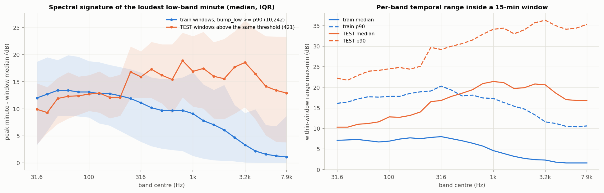

- 저대역 최대분의 "피크 − 창 중앙값" 스펙트럼을 보면, 학습(자연 과도음)은 31.6~200 Hz에서 +12~13 dB이고 3 kHz 이상에서 +1~3 dB로 떨어집니다. 테스트는 **300 Hz~3 kHz에서 +15~19 dB로 평탄**하고 7.9 kHz에서도 +13 dB입니다.
- 창 안 밴드별 시간 범위(max−min) 중앙값은 학습이 저주파 7 dB에서 고주파 2 dB로 줄어들고, 테스트는 저주파 10 dB에서 **1~3 kHz 21 dB**로 늘어납니다.
- 해석: VTUAD 레퍼런스(이득 정규화, 채널 변형)는 SA 배경보다 상대적으로 **중·고주파가 풍부**합니다. 소형선과 근거리 통과, 원 녹음의 주변 소음 때문일 수 있습니다. 그래서 **탐지 신호는 1~3 kHz에서 가장 잘 보이고, 타깃(에너지 비율)은 저주파 배경 레벨이 분모를 결정**합니다. 모델은 두 정보를 모두 써야 합니다.

### 5.6 예시 창

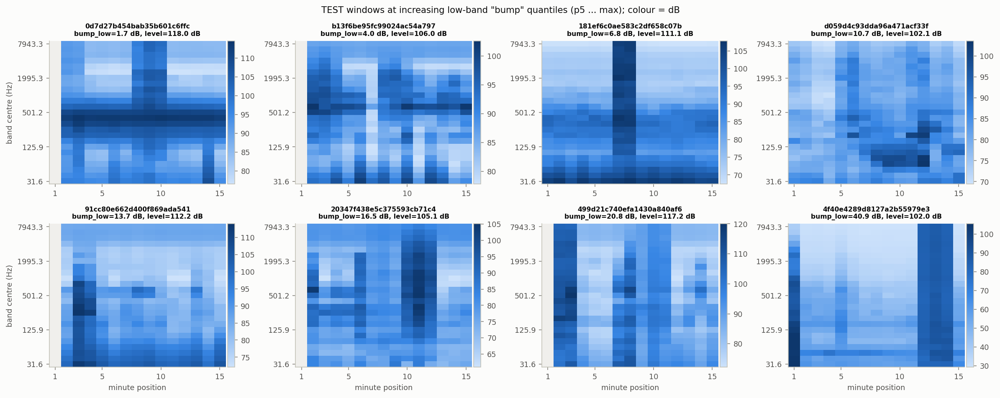
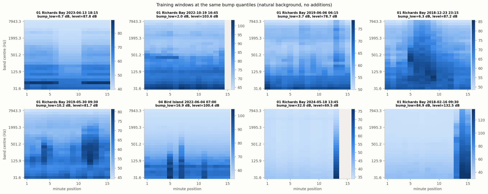

- 테스트에는 1~3분 폭의 **수직 광대역 줄무늬**(예: `181ef6c…` 7~8분, `4f40e42…` 12~14분)와 여러 분에 걸친 저·중대역 융기가 흔합니다.
- 학습 창은 수평 구조(지속 톤, 밴드별 정상성)가 지배적입니다. 극단적인 bump는 대부분 **아티팩트**(gap 직전 폭발, 듀티사이클 시작)입니다.
- 저대역 피크 위치는 학습 완전창에서 1분(11%)과 15분(10%)에 몰립니다(랜덤워크 끝점 효과). 테스트는 2~14분에 고르게 퍼지고 3, 7, 8, 13분에서 약간 높습니다. 삽입 위치가 무작위화된 것과 맞습니다.

---

## 6. 인사이트 → 모델링 전략

### 6.1 권장 파이프라인: 테스트 생성기를 재현한 지도학습

1. **배경 뱅크 (SA 학습 데이터)**
   - 정각 15분 정렬 창, sentinel 제거, **파일 시작/끝 아티팩트 마스킹**, `dur<55` 처리.
   - 결측 패턴 증강: 1분차(약 40%), 15분차(약 6%) 등 테스트 비율에 가깝게. 단, 이 비율은 테스트 *입력의 결측 형태*라는 기술 통계일 뿐 라벨이나 calibration이 아닙니다.
   - 사이트 균형 샘플링. St Francis는 5분 런뿐이라 15분 창이 부족하므로 런 이어붙이기나 짧은 창 학습 후 15분 적용 같은 전략이 필요합니다.
2. **레퍼런스 뱅크 (VTUAD v1.3.2 strict WAV)**
   - 스타터의 `minute_band_power`(2초 Hann periodogram, deci-decade 밴드 적분, 30구간 평균)로 분 × 25밴드 에너지를 만듭니다. 32 kHz이므로 25밴드 모두 지원됩니다.
   - 클립 길이가 짧으므로(평균 약 6.4분) 15분 창 안의 무작위 위치에 삽입하고, 신축, 부분 삽입, 다중 클립을 섞습니다.
   - **채널 변형**: 무작위 스펙트럼 기울기(dB/decade), 부드러운 무작위 EQ, 저역/고역 감쇠. **에너지 변형**: ΔL을 0~20 dB 범위에서 넓게 샘플링(share 0.1~0.99)하고, 추가 없음 샘플도 상당 비율 포함합니다.
   - VTUAD background 16클립은 "레퍼런스에 섞인 주변 소음"을 흉내 내는 데 씁니다.
3. **혼합과 타깃**: 선형 합 → dB → 0.1 반올림 → 배경 결측 유지 → `y = ΣA/ΣM`(관측 셀).
4. **모델**
   - 입력: 15×25 dB와 결측 마스크. 창 단위 정규화(밴드별 창 중앙값 차감, 전역 레벨 별도 채널)를 합니다.
   - 후보 A: GBDT + 공학 특징(§5의 bump_high, corr_low_high, lag1_acf, naive_share, 대역별 range, 피크 초과 스펙트럼, PCA 잔차 등). 빠르고 해석 가능해서 write-up에 유리합니다.
   - 후보 B: 소형 2D CNN이나 시간축 Transformer(15 토큰 × 25 특징)로 **배경 마스크 B̂를 예측**하고 `ŷ = 1 − ΣB̂/ΣM`를 계산합니다(구조적 제약, 해석성).
   - 손실은 MSE(y)이고, logit(y) 회귀와 비교해 봅니다. `score_added_vessel`은 보조 분류 헤드로 냅니다.
5. **검증**: 사이트/녹음기/기간 GroupKFold(최소한 사이트 홀드아웃). 레퍼런스도 **VTUAD 클립(가능하면 hull_id) 단위로 분리**합니다. 테스트와 같은 클립이 들어가 있을 수 있으므로, 이렇게 해야 일반화를 정직하게 잴 수 있습니다.

### 6.2 추가 아이디어

- **자기지도 사전학습**: SA 1.7M 분으로 masked-minute 복원이나 "다음 분 예측"을 학습해 배경 예측기를 만듭니다. 배경이 매끄럽다는 성질(§4.6)을 활용합니다.
- **HearMyShip**(Croatia, <https://hearmyship.fer.hr/>, 논문 <https://www.nature.com/articles/s41597-025-04584-x>)과 ONC 원 하이드로폰 데이터로 레퍼런스를 다양화합니다. 출처는 토론 게시판에 공개해야 합니다.
- 앙상블은 GBDT(특징)와 NN(그리드)을 함께 씁니다. RMSE 지표이므로 [0,1] 클리핑 후 평균합니다.

### 6.3 함정 체크리스트

- [ ] dB 평균 금지. 항상 선형 에너지로 합산하거나 평균합니다.
- [ ] 결측 = NaN이고 0(무음)이 아닙니다. 타깃 계산도 관측 셀만 씁니다.
- [ ] 녹음기 오프셋(약 20 dB)과 12 kHz 녹음기의 고밴드 이상.
- [ ] 파일 경계 아티팩트를 "추가 없음" 배경에 남기지 않습니다.
- [ ] 테스트 기반 재가중, 정규화 통계, pseudo-label을 쓰지 않습니다. 창 단위 고정 변환만 허용됩니다.
- [ ] VTUAD 클립과 테스트를 직접 매칭하지 않습니다(source identity 위험).
- [ ] seed와 버전을 고정하고, 학습/추론 시간·메모리·모델 크기를 기록합니다(코드 리뷰 요구사항).

---

## 7. Research write-up 전략 (Best write-up $1,000 × 2)

심사 기준은 증거 품질, 유용성, 불확실성, 재현성, 효율입니다. "합성 LB 순위나 AIS 근접만으로는 불충분"하다고 명시돼 있습니다.

1. **실데이터 평가**: SA 사이트와 기간을 홀드아웃하고, 창 ID, 표본 크기, 튜닝 내역을 공개합니다.
2. **음향 증거**: §4.8의 후보 통과 사건을 정렬한 밴드 신호와 모델 예측을 나란히 보여줍니다. 약한 사건, 간섭(기상, 생물), 결측, 실패 사례를 포함합니다.
3. **대조군**: 단순 broadband 에너지와 naive_share 베이스라인을 둡니다. 스펙트럼 ablation(저/중/고대역 제거)과 시간 셔플 대조를 합니다. AIS를 썼다면 AIS 없는 결과도 함께 냅니다.
4. **Pressure map**: 사이트 × 시간(시/일/월)별 "추정 추가형 성분 에너지"나 사건률을 상대 지표로 그립니다. 커버리지(듀티사이클)를 명시하고, **같은 날 반복 관측을 고려한 블록 부트스트랩**으로 불확실성을 표시합니다. 보정이 없으므로 절대 압력이 아니라 "relative acoustic activity"로 표현합니다.
5. **해석성**: 1~3 kHz bump, 저·고대역 동조, 궤적 매끄러움 같은 특징 기여도와 SHAP을 제시합니다.
6. **재현성**: 실행 가능한 노트북, 의존성 버전, 실행 시간을 포함합니다.

---

## 8. 리스크와 열린 질문

| 항목 | 상태 | 영향 |
|---|---|---|
| Benchmark가 all-zero인지 0.1 상수인지 | 미확정 | E[y²] 해석 |
| VTUAD 변형의 정확한 분포(이득, 궤적, 채널) | 비공개 | 증강 분포 설계에 불확실성. 넓게 잡고 로버스트하게 |
| St Francis형 테스트 창의 1분차 결측 원인 | 가설(비공개 기간 스케줄) | 도메인 단서로만 사용 |
| Saldanha harbour 등 비공개 스테이션 포함 여부 | 불명. 프로브상 OOD는 1.1% | 낮음 |
| export clock 시간대 | 미검증 | AIS 결합 시 필수 확인 |
| 12 kHz 녹음기 고밴드 | 원인 미해결 | 해당 밴드 가중 축소 |

---

## 9. 산출물과 재현

```
underwater_vessel_noise/
├── TASK_EDA_REPORT.md            ← 이 문서
├── eda_deep/
│   ├── deep_eda.py               ← 전체 분석 스크립트 (python3 -I eda_deep/deep_eda.py, 약 30초)
│   ├── summary.json              ← 핵심 수치
│   ├── figures/00~17_*.png       ← 본문 그림 18장
│   └── tables/*.csv              ← 녹음기 duty cycle, 아티팩트, 스펙트럼 분위수, 창 특징(테스트 전체, 학습 2만 샘플),
│                                    도메인 프로브 혼동행렬, 사이트 매칭 비교, 자연 사건 목록 등
├── eda/ , analyze.py             ← 이전 1차 EDA(기초 품질 점검). 이번 분석이 이를 확장하고 일부 수치를 보정함
└── data/raw, data/extracted      ← 원본 데이터
```

실행 환경: Python 3.10.14 (conda base), numpy 1.26.4, pandas 2.3.3, pyarrow 22.0.0, matplotlib 3.8.4, scipy 1.15.3, scikit-learn 1.7.2.
