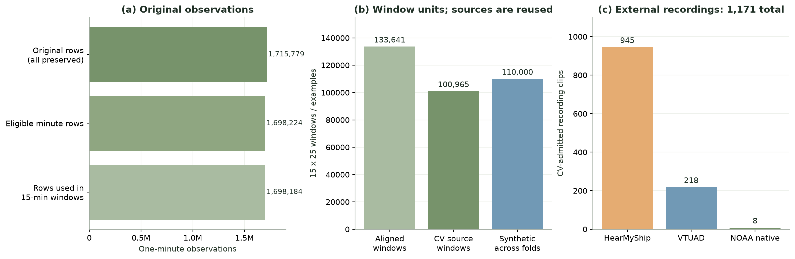
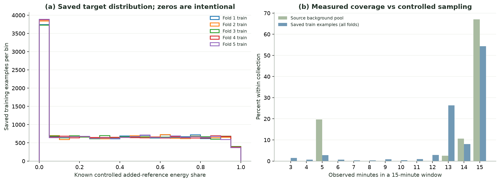
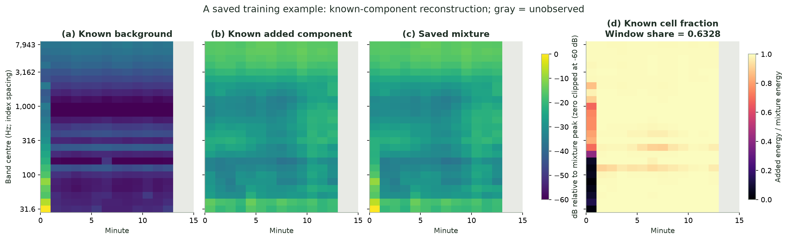
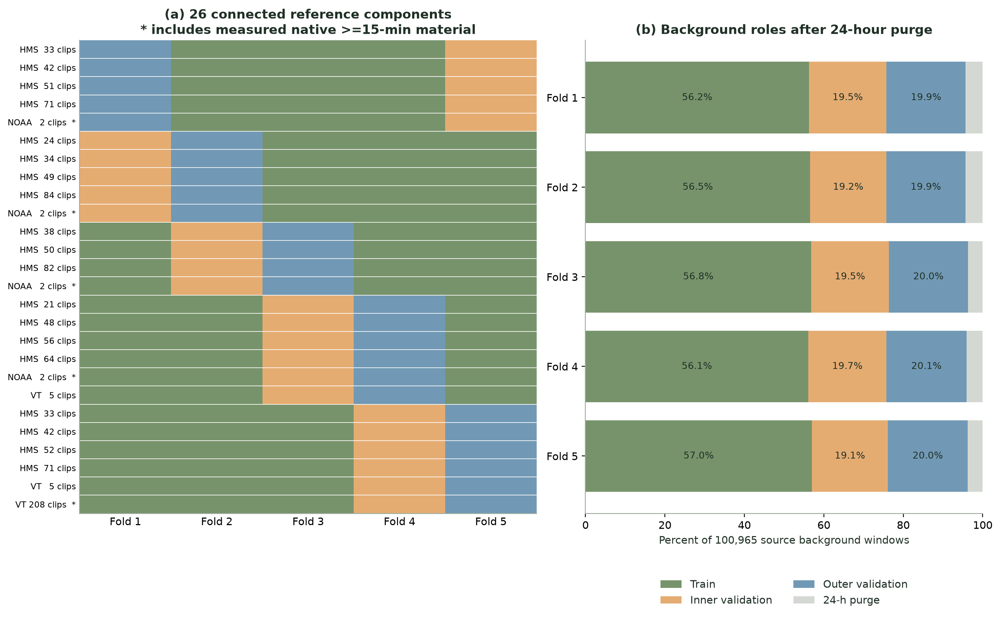

# 대회 제공 데이터와 현재 학습 데이터: 구축·전처리·검증 보고서

작성일: **2026-10-24, KST**  
대상 버전: `group_cv_nested5_pilot_v1`  
분할 프로토콜: `source_group_nested5_week24h_v1`

## 1. 현재 상태와 핵심 차이

**대회가 제공한 것은 정답 없는 실제 음향 관측값입니다. 현재 구축한 것은 그 관측값을 배경으로 사용하고, 실측 외부 참조 음원의 에너지를 통제하여 추가한 지도학습용 데이터입니다.**

원본 1,715,779행을 모두 보존했습니다. 그러나 이 모든 행에 자연 선박의 실제 정답을 새로 알아낸 것은 아닙니다. 학습에 쓰는 정답은 **합성 과정에서 추가한 참조 성분의 알려진 에너지 비율**입니다. 합성 데이터 생성에 생성형 오디오 모델·LLM을 사용하지 않았으며, 실측 성분과 수식으로 정답을 계산했습니다.

| 확인 항목 | 현재 상태 |
|---|---|
| 원본 보존·기초 품질 점검 | 완료 |
| 원천별 오디오 대역 에너지 변환 | 완료 |
| 원천 그룹 분리 및 24시간 purge | 완료 |
| Nested 5-fold 데이터 생성 | 완료: 각 fold 16,000 / 3,000 / 3,000개 |
| 저장 파일·에너지 정답·재현성 검증 | 완료 |
| 모델 입력 변환·CV 실행 연결 검증 | 작은 독립 개발 예제에서 완료 |
| 실제 데이터의 이번 GPU 본학습 | **아직 실행하지 않음** |
| 이번 데이터의 OOF 성능·대회 성능 | **아직 측정하지 않음** |

사용자 검토 후 GPU 서버를 전달받아 본학습을 진행할 예정입니다. 이 문서의 그림에는 새 모델의 성능이나 예측 결과를 제시하지 않았습니다.

## 2. 대회 원본과 현재 데이터 비교

### 2.1 관측 단위와 정답의 차이

공식 설명상 남아프리카 자료는 10개 관측소의 약 1분 해상도 주파수 대역 요약이며, 원시 오디오와 선박 정답 열은 제공되지 않습니다. 평가 입력은 15분 × 25대역의 1,500개 창입니다. 정답 0은 통제된 참조 추가가 없다는 의미이며, 자연 선박 부재를 뜻하지 않습니다. [공식 대회 데이터 설명](https://zindi.world/competitions/french-embassy-underwater-vessel-noise-challenge/data)

| 항목 | 대회 제공 자료 | 현재 구축 자료 |
|---|---|---|
| 실제 남아공 관측값 | 1,715,779행 × 74열 | 전 행 보존, 공통 25대역과 추적용 metadata 분리 저장 |
| 한 관측값 | 대체로 1분의 대역별 음압 수준 요약 | 원본 행을 보존하면서 정각 기준 15분 창으로 구성 |
| 주파수 | 전체 열의 합집합은 62 TOL 대역, 녹음기마다 지원 범위 다름 | 평가 입력에 대응하는 공통 25대역 사용 |
| 남아공 raw waveform | 제공되지 않음 | 새로 만들어낸 waveform 없음 |
| 자연 선박 정답 | 없음 | 여전히 검증된 자연 선박 에너지 정답 없음 |
| 지도학습 정답 | 제공되지 않음 | 알고 있는 배경·추가 성분으로 `share`, `presence`, `cell_share` 계산 |
| 외부 오디오 | 남아공 관측 ZIP에 포함되지 않음 | VTUAD·HearMyShip·NOAA의 공개 실측 오디오 사용 |
| 모델 입력 | 평가 CSV의 ID + 375개 음향 값 | `[N, 15, 25]` 배열, 모델별 고정 특징 변환과 관측 마스크 |
| 교차검증 | 이 작업용 정답 분할은 제공되지 않음 | 합성 전 원천을 나눈 Nested 5-fold |

**1,715,779개의 1분 행과 110,000개의 15분 합성 예제를 직접 나누어 “몇 배 증가”라고 계산하면 단위가 달라 잘못된 비교입니다.** 또한 110,000개는 5개 fold의 파일을 합한 수이며, 서로 다른 독립 현장 녹음 110,000개라는 뜻이 아닙니다.

### 2.2 실제 개수와 저장 크기

아래 MB는 `1 MB = 1,000,000 bytes`입니다. 압축률·배열 형식·정답 저장 여부가 다르므로 파일 크기 증가를 정보량 증가로 해석하지 않습니다.

| 단계 | 개수·형태 | 실제 크기 또는 의미 |
|---|---|---|
| 공식 다운로드 파일 전체 | 음향 ZIP·Test·제출 예시 등 | 97,806,656 bytes, **97.81 MB** |
| 남아공 공통대역 원본 행 배열 | `[1,715,779, 25]`, float32 | 값 payload **171.58 MB**. 압축을 풀고 배열화한 크기 증가 |
| 전체 정렬 배경 창 배열 | `[133,641, 15, 25]`, float32 | 값 payload **200.46 MB**. 미관측 슬롯도 NaN으로 표현 |
| 현재 CV에 들어가는 배경 원천 | 100,965개 창 | 7개 관측소·258개 장비-주간 블록 |
| 현재 CV 외부 참조 원천 | 1,171개 클립 | 26개 연결 그룹, 그중 native 장시간 그룹 5개 |
| 5-fold 합성 파일 | 5 × (train 16k + inner 3k + outer 3k) | **110,000개**. train 합계 80k, inner 합계 15k, outer 합계 15k |
| 정규 NPZ 15개 | fold별 train·validation·outer_validation | 압축 파일 합계 **173,747,257 bytes, 173.75 MB** |
| 위 NPZ의 비압축 배열 payload | 입력·셀 정답·창 정답·존재 정답 | **330,880,000 bytes, 330.88 MB** |

NPZ 173.75 MB는 공식 다운로드 전체 97.81 MB의 약 **1.78배**지만, 원본과 다른 표현·정답·fold 중복을 포함한 저장 크기 비교일 뿐입니다. 외부 raw 오디오, recipe JSON, metadata, inner alias, 모델 가중치는 이 NPZ 합계에 포함하지 않았습니다.



*그림 1. 서로 다른 단위를 패널로 분리했습니다. 왼쪽은 1분 관측 행, 가운데는 15분 창·합성 예제, 오른쪽은 CV에 실제 편입된 외부 클립입니다. 가운데 세 막대는 독립 데이터 증가율을 나타내는 누적 관계가 아닙니다.*

## 3. 데이터 수집과 원천 선정

### 3.1 남아프리카 대회 관측값

원본 음향 Parquet 10개와 관측소·녹음기 metadata, 데이터 사전을 확보하고 원본 hash와 압축 파일 무결성을 확인했습니다. 관측소-녹음기 조합은 17개이며, 녹음기 식별자는 12개입니다. 같은 장비 식별자를 재사용한 관측소는 독립 장비로 세지 않도록 연결했습니다.

원본 전체 행은 다음으로 추적합니다.

- `row_id`: 전체 1,715,779행의 고유 순번.
- `source_parquet`, `source_row_index`: 원본 파일과 행 위치.
- `site`, `recorder`, `src_file`, `t`, `dur`: 측정 출처·시간·길이.
- `eligible_for_minute_window`, `window_included`: 보존 여부와 학습 배경 사용 여부를 분리.

**원본 보존은 모든 행을 학습 배경으로 채택했다는 뜻이 아닙니다.** 사용하지 않은 행도 원인과 원본 위치를 남겼습니다.

### 3.2 외부 자료: 전체 보유분과 현재 CV 편입분

| 원천 | 수집·변환한 전체 보유분 | 현재 CV 편입 | CV 클립 길이 | 라이선스·공식 출처 |
|---|---:|---:|---|---|
| VTUAD v1.3.2 strict WAV | 525개, 헤더 기준 합계 약 42.05시간 | **218개**, 클립 길이 합계 약 14.32시간 | 120–1,380초, 32 kHz | CC-BY-4.0, [Zenodo v1.3.2](https://zenodo.org/records/23037895) |
| HearMyShip V1 | 1,146개 공개 WAV entry 검증, 동일 음원 중복 제외 **1,145개** | **945개**, 클립 길이 합계 약 5.27시간 | 10–30초, 48 kHz | CC0, [ScienceDB DOI](https://doi.org/10.57760/sciencedb.13099), [프로젝트](https://hearmyship.fer.hr/) |
| NOAA SanctSound 신규 확장 | 양성 참조 12개 × 실제 연속 15분 = 180분 | **8개**, 120분 | 각각 정확히 900초, 48/96 kHz | CC0, [원시 음향](https://www.fisheries.noaa.gov/inport/item/80342), [주석 자료](https://www.fisheries.noaa.gov/inport/item/80343) |
| 현재 CV 전체 | — | **1,171개** | 합계 클립 시간은 독립 녹음 시간과 다름 | 원천별 provenance 유지 |

개수의 관계는 다음과 같습니다.

```text
기존 외부 전체: VTUAD 525 + HearMyShip 1,145 = 1,670개
현재 CV 기존분: VTUAD 218 + HearMyShip 945 = 1,163개
현재 CV 전체: 기존분 1,163 + 신규 NOAA 8 = 1,171개
```

NOAA 8개를 1,171개에 다시 더하면 이중 계산입니다. 새 NOAA 양성 12개 중 calibration 2개·새 sealed 평가 2개는 현재 CV에서 제외했습니다. 별도로 받은 PM의 `NoShip` 15분 구간 1개도 양성 12개에 포함하지 않았고 격리했습니다. `NoShip`을 검증된 자연 선박 부재 정답으로 사용하지 않았습니다.

VTUAD 공개 설명에는 약 56시간이 기재되어 있지만, 이 문서는 **실제로 확보한 strict WAV의 헤더 합계인 약 42.05시간**을 사용합니다. strict interval과 다른 배포 view를 구분해야 하며, 두 시간 집계의 차이를 모든 원본 파일에 대해 완전히 대조한 것은 아닙니다. 현재 CV에서는 예약 분할·그룹 충돌·ambient/background 역할을 제외하고 양성 참조로 채택된 218개만 사용합니다.

클립 수·MMSI 수·날짜 수가 서로 독립인 것은 아닙니다. 같은 선박·날짜·겹치는 구간·동일 바이트를 연결하면 현재 CV의 참조는 **26개 component**입니다. 실제 15분 이상 참조는 **11개 클립 = VTUAD 3 + NOAA 8**이며, 이들만의 독립 연결 그룹은 **5개 = VTUAD 1 + NOAA 4**입니다. 이 구분은 과적합 판단에 중요합니다.

### 3.3 편입하지 않은 자료

- NOAA OC01_01: 공식 amplitude drift 경고로 제외.
- NOAA MB01_01: 50 Hz 아래 품질 저하가 목표 대역과 겹쳐 전 25대역 참조에서 제외.
- NOAA FK01_01: 해저 접촉 문제가 기록된 기간을 제외하고 Good 구간만 선택.
- NOAA OC03_02: 2019년 11월 첫 주의 고주파 noise-floor 경고 구간을 제외. 확보한 양성 2개는 calibration 예약이므로 현재 CV에는 넣지 않음.
- PORTIA·VLIZ·MBARI·Vulcano: 공개 범위·라이선스 등을 조사한 후보이며 **현재 CV 오디오에 편입하지 않음**.
- 기존 NOAA OC02_02 평가 자료: 과거 평가에 사용한 예약 자료로, 새 CV나 튜닝에 재사용하지 않음.

출처 고지문은 사용자 지시에 따라 **초안만 보관했고 공개 게시하지 않았습니다**. 이 문서와 GPU 패키지는 출처 고지 게시를 수행하지 않습니다.

## 4. 원천별 전처리 방법

### 4.1 남아공 관측값: 행 보존 → 품질 선별 → 15분 창

1. **공통 25대역 선택.** 전체 62 TOL 대역은 녹음기별 지원 범위가 달라 전체 셀의 약 25.48%가 결측입니다. 공통 25대역의 원본 행 셀에는 NaN이 없지만, 유한값인 고정 sentinel 등은 별도로 검사합니다.
2. **원본 행 전부 보존.** `[1,715,779, 25]` float32 배열과 행 manifest를 저장합니다.
3. **배경 후보 선별.** 25대역 유한값, `-156.5` sentinel 미포함, `55 ≤ dur ≤ 65`초, export timestamp의 초 부분 `≤ 5`를 조건으로 사용합니다. 원본에 `dur < 55`는 16,896행, 정확히 평탄한 sentinel은 653행입니다. 조건은 중복되므로 제외 수를 단순 합산하지 않습니다.
4. **분 단위 정렬.** export timestamp를 분으로 내립니다. 같은 recorder의 같은 분에 여러 행이 있으면 길이가 60초에 가장 가까운 행을 우선하며 중복 집계하지 않습니다.
5. **정각 15분 bin 구성.** 시각을 15분 경계로 내리고 위치 0–14에 해당 분을 넣습니다. 적어도 3개 분이 관측된 창만 저장합니다.
6. **빈 슬롯은 NaN 유지.** 앞뒤 채우기·선형 보간·다른 날짜 이어붙이기를 하지 않습니다. 5분 녹음 후 긴 휴지기가 있는 duty cycle도 실제 관측 마스크로 보존합니다.

그 결과 선별 조건을 통과한 행은 **1,698,224개**, 저장된 15분 창에 포함된 행은 **1,698,184개**, 전체 정렬 창은 **133,641개**입니다. 40행 차이는 분 중복 처리·최소 관측량 등 창 구성 결과에 따른 것입니다.

원본에 결측이 없던 공통 대역도 15분 창에서는 녹음 공백 때문에 NaN을 갖습니다. 이것은 측정한 음향값을 임의로 삭제했다는 뜻이 아닙니다. export clock의 실제 시간대와 장비 절대 레벨 보정은 미검증이며, 외부 AIS를 임의로 결합하지 않았습니다.

### 4.2 외부 waveform 공통 처리: 2초 PSD → 대역 에너지

VTUAD·HearMyShip·NOAA 모두 같은 계산 규칙으로 변환합니다.

1. WAV/FLAC의 실제 헤더에서 sample rate·channel·frame 수를 읽습니다. 현재 채택 소스는 mono이며, 처리 함수는 channel 0을 선택합니다. 지원하지 않는 고주파 대역을 채우려고 upsampling하지 않습니다.
2. 연속된 **완전한 2초 구간**으로 나눕니다. 2초 미만의 마지막 꼬리는 제외합니다.
3. `scipy.signal.periodogram`을 `window='hann'`, `detrend='constant'`, `scaling='density'`, one-sided로 계산합니다. 2초 구간의 FFT 주파수 간격은 0.5 Hz입니다.
4. 대역 중심과 경계를 다음과 같이 정확한 base-10 grid로 정의합니다.

$$
c_j=10^{1.5+0.1j},\quad j=0,\dots,24,
\qquad [f_{j,low},f_{j,high})=[c_j/10^{0.05},c_j10^{0.05}).
$$

대역 중심은 약 **31.62–7,943.28 Hz**, 전체 바깥 경계는 약 **28.18–8,912.51 Hz**입니다. 각 대역에서 `sum(PSD bins) × Δf`로 선형 에너지를 구합니다. 상단 경계가 native Nyquist를 넘으면 그 음원을 거부합니다.

5. 완전한 2초 에너지 30개를 **선형 평균**하여 측정된 1분 에너지로 만듭니다. dB를 먼저 평균하지 않습니다.
6. 1분에 미달하는 완전한 2초 조각은 segment bank에 유지합니다. “측정된 1분”으로 허위 집계하지 않습니다.

기존 1,670개 음원에서 **87,163개 2초 벡터 × 25대역**, **2,511개 측정된 완전한 1분 벡터**를 저장했습니다. HearMyShip 1,145개는 전부 60초 미만이므로 이 2,511분에 HearMyShip의 측정 1분은 없습니다.

참조 에너지는 장비 보정 전의 **digital mean-square band power**입니다. 남아공 수준과 외부 오디오를 절대 수중 음압으로 교정한 것은 아니며, 합성은 디지털 에너지 비율을 통제하는 방식입니다.

### 4.3 VTUAD

- 32 kHz strict WAV를 사용합니다. 배포된 16 kHz log-mel feature store를 25대역 에너지의 대체재로 사용하지 않았습니다.
- WAV별 provider SHA-256과 header·대역 지원·연속 2초 segment를 검증했습니다.
- AIS 유래 vessel type은 참조 선정·그룹 관리의 약한 metadata이며, 자연 선박-only 에너지 정답으로 취급하지 않습니다.
- hull·날짜·실제 시간 구간 중복을 연결하여 같은 음향 사건이 train과 validation에 나뉘지 않게 합니다.
- 큰 DC 성분은 review flag로 남깁니다. PSD의 constant detrend가 평균을 제거하지만 모든 센서 차이를 해결한다는 뜻은 아닙니다.

### 4.4 HearMyShip

- ScienceDB의 원본 MD5와 맞춰 공개 entry 1,146개를 확인하고, 바이트가 같은 중복 1개를 제외하여 1,145개로 관리했습니다.
- 실제 10–30초만 2초 segment로 변환합니다. 짧은 CPA 음원을 반복해서 15분 실제 녹음처럼 만들지 않습니다.
- recording day를 그룹으로 분리합니다. 실제 동일 선박의 날짜 간 재방문 여부는 확인되지 않아 완전한 hull 독립성은 보장할 수 없습니다.
- 현재 CV에는 예약 날짜를 제외한 945개가 들어갑니다.

### 4.5 NOAA native 15분 확장

- 공식 **Ship 주석 구간 ∩ 25대역 전부 Good인 품질 구간 ∩ 실제 900초 frame 지원**을 만족하는 구간을 선택했습니다.
- 원본 48/96 kHz를 유지하고 정확히 `900 × fs` frame을 확보했습니다. resampling하지 않았습니다.
- 1초 이상 디지털 zero gap, 과도한 rail/clipping, 대역 비유한값 등을 검사했습니다.
- 고정된 object generation의 정확한 HTTP 206 범위를 받아 Content-Range·길이·range SHA·발췌본 SHA·변환 배열 SHA를 확인했습니다.
- **거대 원본 전체 파일을 받은 것이 아니므로 provider의 전체 원본 MD5를 재계산한 것은 아닙니다.** 범위·발췌본 검증과 전체 파일 checksum 검증을 구분합니다.
- Ship·Good 주석은 그 녹음에 선박이 포함될 근거이지, 주변 소음이 완전히 제거된 선박-only waveform이라는 증거가 아닙니다.

## 5. 합성 데이터와 정답 생성

### 5.1 어떤 “모델”로 합성했는가

이번 버전은 학습된 생성 모델 대신 **알려진 성분의 에너지 혼합기**를 사용합니다. 코드의 주요 구현은 `NativeFirstSampler`, `EnergyComponents`, `solve_reference_scale`입니다. CPU에서 수집·PSD 변환·합성을 수행했고 GPU는 필요하지 않았습니다.

합성은 raw waveform의 위상을 더하는 방식이 아니라 **대역별 선형 에너지 공간의 통제된 추가**입니다. 합성 정답을 알고 있다는 장점이 있지만, 실제 자연 선박 분리를 완전히 재현한다는 보장은 없습니다.

### 5.2 수식과 정답의 의미

`B`는 남아공 배경 에너지, `R`은 배치한 실측 참조의 에너지, `O`는 관측 셀 마스크입니다. 원하는 share `u`를 추첨한 뒤 다음 `α`를 구합니다.

$$
\alpha=\frac{u\sum OB}{(1-u)\sum OR},\qquad
E=B+\alpha R,
\qquad y=\frac{\sum O\alpha R}{\sum OE}.
$$

셀 정답과 에너지 가중치는 다음과 같습니다.

$$
q_{t,f}=\frac{\alpha R_{t,f}}{E_{t,f}},\qquad
w_{t,f}=\frac{O_{t,f}E_{t,f}}{\sum OE},\qquad
y=\sum_{t,f}w_{t,f}q_{t,f}.
$$

`sum`은 관측 셀만 셉니다. 위 `α` 식은 양성 `u`와 `sum(OR)>0`일 때 사용하며, **무추가 `u=0`에서는 `α=0`으로 별도 정의**합니다. 양성 `u`를 요청했는데 추가 참조가 관측 구간과 겹치지 않으면 오류·재선택 대상으로 처리하며, 조용히 0 정답으로 바꾸지 않습니다. 존재 정답은 `presence = (y > 0)`입니다.

배경에는 원래 자연 선박 소리가 들어 있을 수 있고, 추가 참조에도 주변 소음이 포함됩니다. 따라서 이 정답은 **통제한 추가 참조의 비율**이며, 자연 선박 총 에너지 비율이나 선박 유무의 진실 정답이 아닙니다.

### 5.3 길이별 참조 배치

| 참조 길이 | 현재 처리 | 하지 않는 처리 |
|---|---|---|
| 실제 900초 이상 | 연속된 실측 2초 segment 450개를 crop | 임의 envelope로 15분처럼 위장 |
| 실제 900초 미만 | 실측 segment를 15분 추가 성분의 support 안에 **한 번** 배치, 경계 밖은 crop 가능 | 반복·loop·보간·시간 신축으로 관측 길이 늘리기 |
| 예: 20초 HearMyShip | 실측 2초 조각 10개를 배치하고 30조각 단위로 추가 성분의 분 평균 계산 | 측정된 60초나 900초 음원으로 집계 |

짧은 참조의 배치 바깥을 0으로 둔 것은 **합성에서 그 성분을 추가하지 않기로 한 support 선택**입니다. 자연에서 관측하지 못한 오디오가 실제 무음이었다고 가정한 것이 아닙니다. 이 짧은 사건 형태가 실제 평가의 사건 분포와 완전히 일치하는지도 아직 입증되지 않았습니다.

### 5.4 현재 활성 증강과 비활성 옵션

| 설정 | 현재 값 | 정답 처리·의미 |
|---|---:|---|
| 무추가 예제 | 확률 0.20 | `u = 0`; 자연 선박 부재 라벨 아님 |
| 양성 share 추첨 | `Uniform(0.005, 0.98)` | 관측 마스크 아래 `α`를 다시 풀어 정확한 정답 계산 |
| native 장시간 참조 pool 선택 | 참조 선택당 기본 0.50 | corpus → group → clip 계층 선택과 fallback 적용; 독립 자료 50% 증가라는 뜻 아님 |
| 다중 참조 | 확률 0.20 | 가능한 경우 2–3개 실측 참조를 추가, 총 추가 에너지로 정답 계산 |
| 시간 반전 | 확률 0.50 | 배경·추가 성분·마스크를 함께 반전, share 유지 |
| 공통 gain | `Uniform(-8, +8) dB` | 두 성분에 같은 scalar gain 적용, share 유지 |
| 배경 coverage 선호 | 80%는 12분 이상 관측 pool 선호 | site 먼저 균형 선택; pool 부족 시 fallback |
| whole-minute dropout | 예제당 확률 0.10 | 관측 분 하나를 제거할 수 있음, 최소 3분 유지; 새 마스크로 정답 생성 |
| 추가 receiver response/EQ | **0, 비활성** | 코드 옵션만 구현; 현재 파일에는 적용하지 않음 |
| 배경 간 blending | **0, 비활성** | 코드 옵션만 구현 |
| 별도 ambient 추가 | **0, 비활성** | 코드 옵션만 구현 |

이 값들은 **현재 구현한 실험 가정**입니다. 비공개 평가 정답의 진짜 생성 분포라고 주장하지 않습니다. 대회 Test의 사이트 추정 비율·결측 빈도·특징 분포·리더보드 점수에 맞춰 이 값을 역으로 튜닝하지 않았습니다.



*그림 2. 왼쪽은 각 fold의 실제 train 16,000개 정답입니다. 첫 histogram bin에는 의도한 0 정답과 작은 양성 비율이 함께 포함됩니다. 오른쪽은 배경 원천과 저장 train 예제의 관측 분 수 분포입니다. site 균형·coverage 선호·minute dropout으로 두 분포가 달라지며, 이것은 통제된 학습 설계의 결과입니다. Test 분포를 표시하거나 맞춘 그림이 아닙니다.*

### 5.5 저장 예제의 성분 확인



*그림 3. `fold_00/train.npz`의 index 1입니다. 관측 분은 13개, 저장 share는 0.632768512입니다. 저장된 `E`와 알려진 `q`로 `B=E(1-q)`, `A=Eq`를 복원했습니다. 모델이 추론한 분리 결과가 아닙니다. 회색은 미관측이며, 성분 에너지 0은 그림에서 -60 dB로 잘라 표시했습니다.*

이 예제의 셀 비율을 단순 평균하면 약 **0.96222**지만, 에너지로 가중하여 합하면 **0.632768478**로 저장 정답과 일치합니다. 저주파의 큰 배경 에너지가 분모에 크게 기여하기 때문입니다. 따라서 셀 비율의 단순 평균으로 창 정답을 만들면 안 됩니다.

## 6. Group CV: 합성 전에 원천을 분리

### 6.1 어떤 것을 같은 그룹으로 묶는가

배경은 **재사용 장비로 연결된 `sensor_group` × export-clock 월요일 시작 주간 블록**을 사용합니다. 같은 장비-주간의 창을 서로 다른 fold로 나누지 않습니다.

외부 참조는 다음 연결 관계의 component를 사용합니다.

- 같은 원래 source group: HearMyShip의 날짜, NOAA의 station/deployment 등.
- 동일 음원 바이트 SHA.
- VTUAD의 같은 hull과 recording day.
- VTUAD의 실제 녹음 구간 overlap, 자정을 넘는 경우 포함.

이렇게 묶어 1,171클립을 26개 연결 그룹으로 줄였습니다. “그룹 독립”은 이 metadata로 확인한 관계에 대한 것이며, 모든 원천의 실제 물리 선박 독립성을 증명한 것은 아닙니다.

### 6.2 원천 pool과 3단계 검증

기존 V2의 train 배경 91,186개와 validation 배경 9,779개를 합친 **100,965개**만 CV pool로 사용합니다. 기존 calibration 9,049개, domain 16,048개, 기존 경계 purge 7,579개는 재편입하지 않았습니다.

각 원천 unit에 외부 fold를 한 번 배정합니다. 평가 fold를 `f`라 하면:

```text
outer validation 원천 = f
inner validation 원천 = (f + 1) mod 5
train 원천            = 나머지 3개 fold
```

inner는 early stopping과 앙상블 선택에 쓰고, outer는 해당 선택이 끝난 후 OOF 평가에 사용합니다. calibration·새 sealed·대회 Test는 CV 구성에 넣지 않습니다.

### 6.3 24시간 purge와 실제 배경 개수

15분 창의 시작 시각만이 아니라 **창의 900초 support까지 고려한 시간 간격**이 다른 분할과 최소 24시간이 되도록 합니다. 가까운 경계의 train·inner 창을 purge하고 outer 창은 보존합니다. 같은 sensor 안에서 활성 분할 간 최종 최소 간격을 다시 검사했습니다.

| Fold | Train 배경 원천 | Inner 배경 원천 | Outer 배경 원천 | 이번 CV의 추가 purge | 참조 component: train / inner / outer |
|---|---:|---:|---:|---:|---|
| 1 | 56,789 | 19,714 | 20,121 | 4,341 | 16 / 5 / 5 |
| 2 | 57,095 | 19,358 | 20,121 | 4,391 | 17 / 4 / 5 |
| 3 | 57,360 | 19,728 | 20,170 | 3,707 | 16 / 6 / 4 |
| 4 | 56,633 | 19,877 | 20,316 | 4,139 | 14 / 6 / 6 |
| 5 | 57,549 | 19,329 | 20,237 | 3,850 | 15 / 5 / 6 |

원천 설계는 대략 60% / 20% / 20%이고, purge 후 실제 비율은 위 표처럼 달라집니다. 합성 예제는 이 원천에서 매 fold **16,000 / 3,000 / 3,000개**를 생성했으므로 원천 수 비율과 예제 수 비율은 다릅니다.



*그림 4. 초록은 train, 주황은 inner, 파랑은 outer, 회색은 purge입니다. 왼쪽 한 행은 연결 참조 그룹이며, 별표는 실제 15분 이상 참조가 있는 그룹입니다. 오른쪽은 실제 100,965개 배경 원천에 대한 fold별 비율입니다.*

한 원천은 outer에 한 번만 들어가지만 다른 fold에서는 train이나 inner가 됩니다. 이는 K-fold의 의도된 재사용입니다. **어느 한 fold 안에서 train·inner·outer 원천이 겹치지 않는지**와 **OOF sample ID가 전체에서 중복되지 않는지**를 각각 확인했습니다.

현재 CV는 같은 sensor들의 떨어진 기간에 대한 일반화를 주로 평가합니다. 완전히 새로운 장비·해역으로의 일반화 검증과 같지는 않습니다. native component가 정확히 5개이므로 각 fold의 train/inner/outer에는 native component가 3/1/1개씩 들어가며, fold별 환경 차이를 함께 봐야 합니다.

## 7. 저장 구조와 모델별 입력 전처리

### 7.1 고정 데이터 파일

```text
data/synthetic/group_cv_nested5_pilot_v1/
├── cv_manifest.json
├── background_outer_assignment.parquet
├── reference_outer_assignment.parquet
└── fold_00/ ... fold_04/
    ├── sources/
    │   ├── manifest.json
    │   ├── background_manifest.parquet
    │   └── reference_manifest.parquet
    ├── train.npz
    ├── validation.npz                 # inner early-stop validation
    ├── inner_validation.npz           # 같은 내용의 alias; 추가 데이터 아님
    ├── outer_validation.npz           # outer OOF 전용
    ├── train_recipes.json
    ├── validation_recipes.json
    ├── outer_validation_recipes.json
    ├── inner_validation_metadata.parquet
    ├── validation_metadata.parquet    # outer sample metadata
    └── readiness_manifest.json
```

`inner_validation.npz`와 `validation.npz`는 같은 inner 내용의 alias입니다. 개수나 정규 NPZ 15개 크기를 계산할 때 두 번 세지 않았습니다.

| NPZ key | Shape | dtype | 의미 |
|---|---|---|---|
| `db` | `[N, 15, 25]` | float32 | 혼합 수준, 미관측 셀 NaN |
| `share` | `[N]` | float32 | 관측 셀에서의 알려진 추가 참조 에너지 비율 |
| `presence` | `[N]` | float32 | 통제된 추가 유무, `share > 0` |
| `cell_share` | `[N, 15, 25]` | float32 | 셀별 알려진 추가 비율 |

관측 마스크는 별도 NPZ key가 아니라 `isfinite(db)`로 복원합니다. 미관측 위치의 `cell_share=0`은 계산용 값이며, 관측 마스크 밖을 정답이나 무음으로 세지 않습니다.

Recipe에는 seed·배경 index·참조 clip/group·배치 위치·crop·상대 scale·`α`·원하는 share·gain·시간 반전·dropout 등을 남겼습니다. 원본 배열을 가진 환경에서 같은 순서로 재생성할 수 있습니다.

### 7.2 모델별 고정 변환

| 모델 | 입력 변환 | 학습·검증 통계 처리 |
|---|---|---|
| CNN / FDY-inspired CRNN / iTransformer 변형 | `[N, 4, 15, 25]`: 창 평균 대비 상대 dB, 절대 수준 `/100`, `sqrt(정규화 에너지)`, 관측 마스크 | 창 단위 고정 계산, 에너지 pooling에는 원래 가중치 사용. FDY·iTransformer 원 논문의 완전 재현이 아닌 과제용 변형 |
| TabM / 기본 LightGBM | **1,254차원**: 상대/절대 수준·마스크 각 375 + 대역/시간 통계 129 | 모집단 Test 통계 사용 없음 |
| Physics LightGBM | 기본 1,254 + **45차원** 물리 특징 = 1,299 | 대역 에너지 비율 25, 분별 비율 15, 초과 에너지 3, tilt 1, entropy 1 |
| Retrieval LightGBM | Physics 특징 + train 양성 혼합 스펙트럼 prototype 유사도 | prototype은 해당 fold의 train NPZ만 사용해 학습 중 새로 구성, 개별 외부 clip matching 아님 |
| TabICLv2 / Kumo Large | **96차원**: 물리 45 + 대역 평균 25 + 표준편차 25 + coverage 1 | 원래 사전학습 가중치 고정, 해당 fold train context만 새로 구성 |

모델 tensor의 미관측 위치는 mask를 함께 두고 고정된 0으로 표현할 수 있습니다. **이것은 원본 NaN을 실제 0 에너지로 대체한 전처리와 다릅니다.** 정답·에너지 합은 계속 관측 셀만 사용합니다.

모델별 특징은 학습 로더에서 고정 함수로 생성하며 현재 NPZ에 모든 특징 버전을 중복 저장하지 않았습니다. prototype이나 foundation context처럼 데이터에 맞추는 단계는 **각 fold 실행 때 해당 train만 사용해 새로 생성**합니다. Prototype 구성은 CPU 작업이며, frozen ICL context 구성은 gradient 가중치 학습과 다릅니다. V1 대회 데이터로 맞춘 task 가중치·context·scaler·cache는 이번 CV 검증에 재사용하지 않습니다. **Vendor 원본의 고정 사전학습 가중치는 재사용**합니다.

## 8. 검증 완료 항목과 해결되지 않은 문제

### 8.1 데이터·코드 검증 결과

| 검사 | 결과 |
|---|---|
| 원본 1,715,779행 추적·보존 | 통과 |
| 각 fold 원천 component·동일 바이트 분리 | 통과 |
| 다른 활성 분할 간 24시간 support 간격 | 전 fold 통과 |
| 15개 정규 split의 shape·dtype·관측량·범위 | 통과 |
| 저장 `cell_share`·에너지로 `share` 재계산 | 최대 오차 **5.50×10⁻⁷** |
| 양성 요청이 미관측 참조 때문에 잘못 0이 된 예제 | **0개** |
| 같은 seed와 원천의 첫 batch 재생성 | 정확 일치 |
| source·NPZ·recipe·생성 코드 hash | 검증·고정 |
| 작은 별도 예제의 5-fold 학습→inner 정책→outer OOF | 실행 통과; 대회 본학습 성능이 아님 |
| TabICL·Kumo 실제 API의 작은 context inner→outer 재현 | 통과; 가중치 미세조정 아님 |
| 재시작 때 설정·코드·checkpoint·예측 hash 변경 거부 | 통과 |
| 대회 Test·예약 calibration·sealed의 CV 혼입 | 없음 |

### 8.2 미해결 품질 항목

1. **파일·녹음 run 경계 이상치 후보.** 학습 원천에서 12,643행을 재현했고, 그중 6,777행이 고정 배경 창에 포함됩니다. 장비 원인을 확인하지 못해 현재는 삭제하지 않고 flag를 보관했습니다. “artifact 확정 후 제거 완료”라고 표현할 수 없습니다.
2. **URN_8321의 nominal 12 kHz metadata와 상위 대역.** 136,518행에 대해 명목 Nyquist와 6.31/7.94 kHz 대역의 불일치를 확인했습니다. 실제 waveform sample rate·제공처 provenance가 없어 임의 upsampling 추정이나 blanket 대역 제거를 하지 않았습니다.
3. **절대 음압·센서 응답 차이.** 외부 digital power와 남아공 요약값 사이의 현장 calibration은 해결되지 않았습니다.
4. **독립 native 참조 부족.** 실제 15분 이상 참조는 11개 클립, 독립 component 5개입니다. 합성 수를 늘려도 이 원천 다양성이 자동으로 늘지는 않습니다.
5. **짧은 CPA의 합성 사건 분포.** 반복은 제거했지만 짧은 참조를 한 번 배치하는 사건 모양·level 분포가 평가 환경에 충분한지는 실제 Group CV와 별도 평가로 확인해야 합니다.
6. **라벨 의미의 한계.** AIS·Ship annotation은 혼합된 참조 선택 근거이며, natural vessel-only 성분의 정답을 제공하지 않습니다.

따라서 완료한 것은 **정의된 데이터 버전의 구축·계산·분리·재현성 검증**입니다. 모든 물리 품질 문제가 해결되었다거나 이 데이터로 1위 점수를 넘는 것이 입증되었다는 뜻은 아닙니다.

### 8.3 기존 weak pseudo-score와 과거 제출의 구분

원본 1,715,779행에 대한 이전 외부 teacher 점수는 별도로 보존하지만, teacher의 검증 성능이 부족하여 **학습용 pseudo-label로 승인하지 않았고 이번 데이터에 사용하지 않았습니다**. 자연 관측 정답을 모델이 이미 완성했다는 의미가 아닙니다.

기존 제출 `cJy4iTDK`의 점수 0.658591231은 이전 단일 holdout 데이터의 결과입니다. 당시 소형 신경망 4개는 8 epoch·AdamW로 학습했고, LightGBM 3종과 frozen TabICLv2·Kumo를 포함한 9개 후보를 비교·앙상블했습니다. 이번 Group CV 데이터와 최대 100 epoch·patience 7·Adam 설정으로 본학습한 결과와 혼동하면 안 됩니다.

## 9. 재현·검토 파일

| 목적 | 파일 |
|---|---|
| 이 문서의 집계·그림 근거 | [dataset_review_facts.json](../../reports/dataset_review_facts.json) |
| 그림 재생성 | [build_dataset_review.py](../../build_dataset_review.py) |
| 외부 원천·시간·라이선스·전처리 근거 | [dataset_document_external_facts.json](../../reports/dataset_document_external_facts.json) |
| CV 원천·분할 수 감사 | [group_cv_data_audit.json](../../reports/group_cv_data_audit.json) |
| 저장 정답·원천 분리 독립 검증 | [group_cv_data_verification.json](../../reports/group_cv_data_verification.json) |
| 미해결 경계·sample-rate flag | [data_quality_boundary_audit.json](../../reports/data_quality_boundary_audit.json) |
| 데이터 버전·fold 파일 위치 | [cv_manifest.json](../../data/synthetic/group_cv_nested5_pilot_v1/cv_manifest.json) |
| 실제 학습 설정 | [group_cv_training.json](../../configs/group_cv_training.json) |

CV source hash:

```text
f8e78e5add5d3131d0d11e362fec72928e999987e479815d3c5c5c6fa114498d
```

그림 재생성은 **train 배열·허용된 원천 metadata·기존 검증 JSON**만 읽습니다. Test·예약 calibration·sealed 배열을 새로 읽지 않습니다. PNG와 편집 가능한 SVG를 `reports/dataset_figures/`에 함께 저장했습니다.
