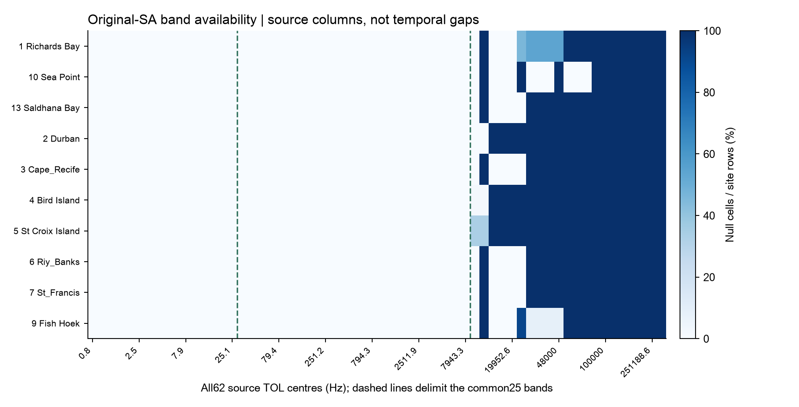
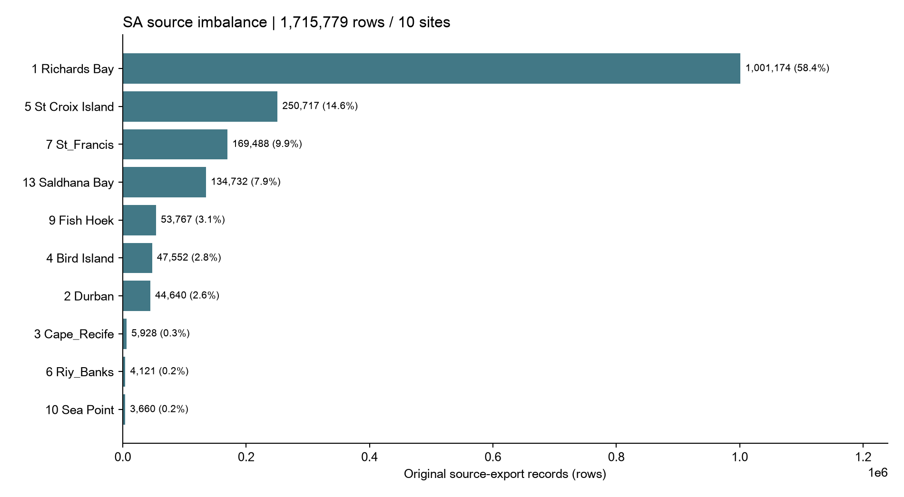
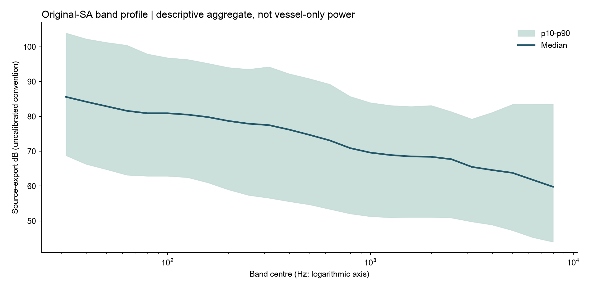
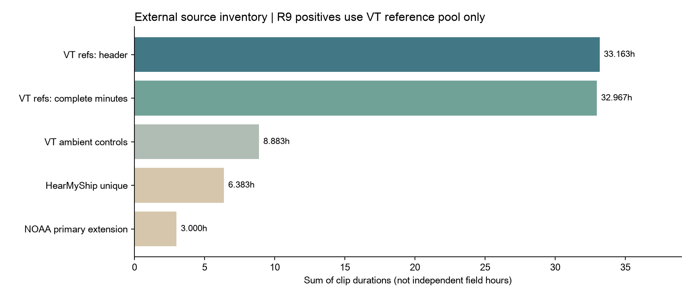
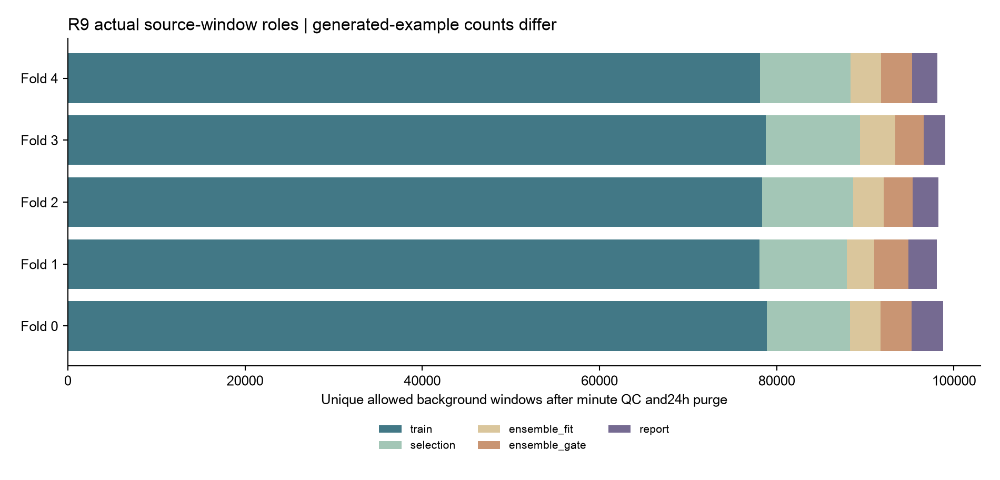
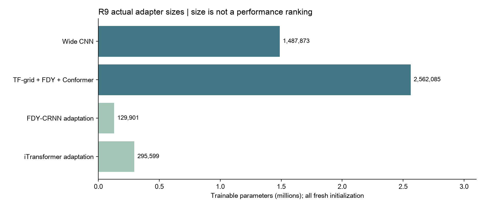
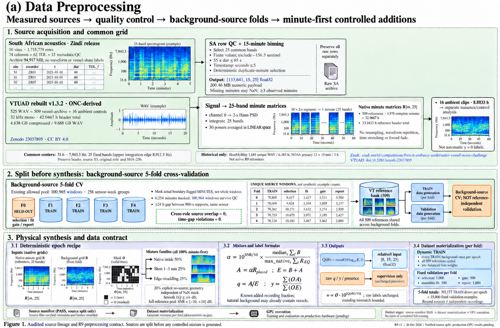
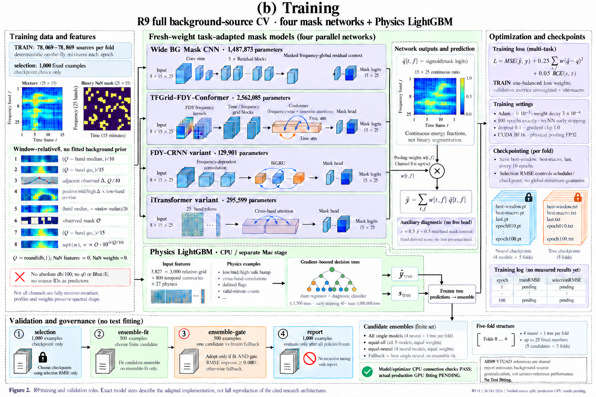
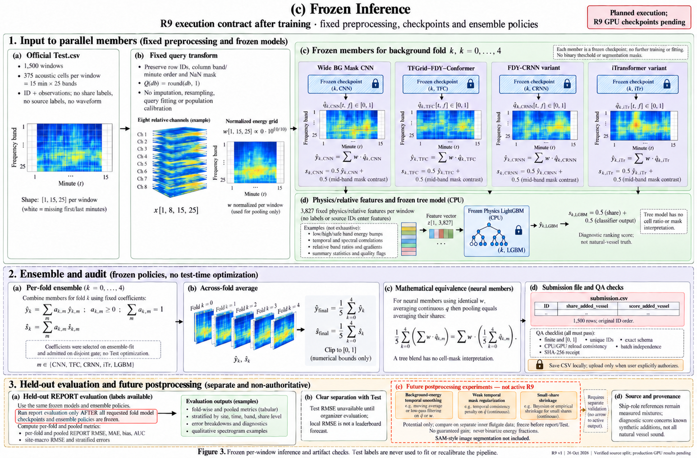

# 데이터·EDA·전처리 근거 보고서 R9

2026-10-26. 원시 Test 재분석·fit·GPU 실행 없이 기존 근거를 통합했습니다.

## 데이터·EDA·전처리 근거 보고서

French Embassy Underwater Vessel Noise Challenge | R4-R9 version audit

무엇을 예측하는지, 어떤 실측 자료를 사용했는지, 결측과 단위가 어떻게 처리되는지, 합성 정답이 어디서 생기는지를 실제 파일·코드·보존된 집계표와 연결한 보고서입니다.

현재 R9는 전체509 reference 풀, 배경5fold 분할, 실제 고정예제15,000개와 동적 TRAIN loader의 준비·검증을 마쳤습니다. 모델·학습 엔진의 작은 CPU 숫자 검증도 완료했습니다. R9 전체5fold100epoch GPU 본학습과 새 production 추론은 아직 실행하지 않았습니다.

본문 뒤에 기존 EDA 지표305개 전부를 수록합니다. 원 집계표26개·4,137행은 portable companion CSV/HTML에 원본 그대로 포함하며 파일별 분모·SHA를 함께 보존합니다.

작성 기준:2026-10-26. 공식 평가·자체 합성 검증·예측값의 서술 통계를 엄격하게 구분합니다. Test 재스캔·재학습·분포 맞추기와 신규 외부 전송은 하지 않았습니다.

## 읽는 순서와 증거의 의미

수치보다 먼저 분모와 버전을 확인합니다.

1단계는 TASK와 source inventory,2단계는 원 SA EDA와 waveform 변환,3단계는 버전·분할·합성 정답,4단계는 특징·학습·앙상블·추론입니다. 마지막은 실행 상태와 감사 결과입니다.

원 관측 행 수, 고유 source window 수, 합성 draw 수, 여러fold의 역할 합은 서로 다릅니다. clip duration의 합도 독립적인 비중복 field-recording hours가 아닙니다.

verified는 해당 기록·코드·정합성 근거가 확인됐다는 뜻입니다. unknown은 원인·권한·정답 등 미확인 사항이고, datasetdependent는 분모·처리·버전에 따라 달라집니다. 내부 수식 정합성이 공식 분포에서의 성능을 증명하지 않습니다.

부록의 과거 Test-derived 집계는 보존된 연구 이력입니다. 이 보고서에서 다시 계산하거나 생성기·특징·가중치 설정의 목표로 사용하지 않았습니다.

## TASK: 정답은 어떤 에너지인가

자연 상태 선박의 존재 라벨이 아니라, 인위적으로 추가한 측정 recording의 알려진 에너지 비율입니다.

공개 SA 데이터는 실제 수중 관측값이지만 vessel-only 에너지 정답, 원 오디오, AIS 정답이 포함되지 않습니다. 따라서 원171만행을 모델로 추정해 만든 score를 검증된 선박 정답으로 바꿀 수 없습니다.

합성 예제에서는 배경 B와 추가 recording A를 선형 에너지로 알고 있습니다. 같은 관측 mask O에서 E=B+A, cell target q=A/E, window target y=합(A)/합(E)를 계산합니다. 원 배경에도 자연 선박음이 포함될 수 있으며 y는 그것을 모두 분리한 비율이 아닙니다.

추가 reference도 주변 소음이 포함된 whole recording입니다. AIS weak class나 Ship annotation만으로 그 에너지를 순수 vessel-only로 확정하지 않습니다. presence는 관측 위치에 실제 추가된 성분이0보다 큰지를 나타냅니다.

공식 주 평가는 share RMSE이며 leaderboard 점수는1-RMSE입니다. diagnostic score의 AUC와 주 순위 손실은 구분합니다. 점수0.90의 필요조건은 공식 RMSE0.10이지 개별 모델별 임의 목표 구간이 아닙니다.

## 원천·라이선스·사용 범위

수집돼 있는 데이터와 현재 R9의 학습 입력을 구분합니다.

SA는 대회 제공 source-export band summaries입니다. organiser-review README는 새로운 재배포 권한을 부여하지 않으며 압력 보정·UTC·명목 sample-rate 토큰의 해석도 미확인 사항을 보존합니다.

VTUAD rebuilt v1.3.2는 ONC hydrophone/AIS 시나리오 구간의 strict view입니다. CC BY4.0의 attribution·버전·수정 고지를 유지합니다. strict와 과거12개 class archive는 같은525시나리오의 다른 cut이며 독립 자료로 이중 집계하지 않습니다.

HearMyShip·NOAA는 수집·검토 기록이 있지만 R9의509-positive reference 풀에 섞이지 않습니다. 원천 라이선스가 SA나 다른 기관 데이터에 자동으로 적용되지 않습니다.

대회 외부 데이터 사용은 공개 이용 가능성·라이선스·대회 고지 조건을 함께 확인해야 합니다. 이 보고서 작성 과정에서 계정 게시나 외부 연락은 하지 않았습니다.

|원천|현재 확보/역할|시간 의미|
|---|---|---|
|SA|1,715,779행 /10sites|dur 합28,358.3308h; 독립획득시간 아님|
|VTUAD|525=509reference+16controls|header42.0467h; active native-minute32.9667h|
|HearMyShip|1,145 unique WAV; R9참조0|6.382677h,10-30s; 완전1분0|
|NOAA extension|12primary clips/6deployments; R9참조0|3h; 별도reserved/sealed관리|

## 원본 SA 스키마와25대역

source ID와 provenance는 분할·감사에 쓰며 모델 predictor에 넣지 않습니다.

Parquet10개는 각74열로 동일한 schema를 가지며 TOL62열과 metadata/QC12열을 포함합니다. 모델에는 공통25band만 사용합니다. 다른37개 TOL열을 값이 없다는 이유로 합성하거나 모델의 현재25band와 혼합하지 않습니다.

공통 중심은 c_i=10^(1.5+0.1i),i=0..24입니다. 적분 지지 구간은[c_i/10^0.05,c_i*10^0.05)이며 전체 약28.18-8912.51Hz입니다. 명목 centre의 최대7943.3Hz와 upper edge를 혼동하지 않습니다.

모델 격자는 시간15 x 주파수25이며 source site/recorder/time/ID와의 join은 별도 metadata에 남깁니다. 파일명 sample_rate_hz는 측정 WAV header가 아닙니다.

|index|centre Hz|index|centre Hz|
|---|---|---|---|
|0|31.6|13|631.0|
|1|39.8|14|794.3|
|2|50.1|15|1000.0|
|3|63.1|16|1258.9|
|4|79.4|17|1584.9|
|5|100.0|18|1995.3|
|6|125.9|19|2511.9|
|7|158.5|20|3162.3|
|8|199.5|21|3981.1|
|9|251.2|22|5011.9|
|10|316.2|23|6309.6|
|11|398.1|24|7943.3|
|12|501.2|||

## 파일 크기·실제 준비 데이터의 분모

압축 파일, 압축 내부 member, 배열 payload, 동적 epoch 방문을 따로 표시합니다.

현재 SA ZIP은94,916,719bytes이고 추출 member 합은96,002,006bytes입니다. member가 Parquet이므로 이 값도 완전히 decode한 table RAM 크기는 아닙니다. 과거97.8MB 추정치 대신 실제 파일 stat을 사용합니다.

VT vessel3parts와 ambient ZIP의 합은4,638,375,330bytes, 내부 WAV 합은9,687,575,100bytes입니다. 원파형을 새로 열지 않고 ZIP directory만 확인했습니다. README1,152bytes까지 더한 과거 download inventory 합과 구별합니다.

R9는 원 배경 array와 reference minute cache를 공유하며 TRAIN 전체를100배 저장하지 않습니다.20개 고정 NPZ와 recipes·metadata·readiness 등으로 구성된 bundle은71,244,935bytes입니다. 모델 checkpoint와 원시 audio는 이 bundle 합에 포함하지 않습니다.

|항목|실제 bytes / 개수|의미|
|---|---|---|
|R9 fixed NPZ|24,707,614B /20files|15,000 fixed examples|
|NPZ 내부 NPY members|94,601,160B|header포함, 압축해제 member합|
|R9 전체 prepared bundle|71,244,935B|recipes/metadata/cache포함|
|R9 dynamic TRAIN|392,177 examples/epoch|5fold합; 원창 once/epoch|
|SA base bank|200,461,628B|133641x15x25 float32+header|
|HearMyShip unique WAV|3,315,250,540B|수집 inventory; R9 positive미사용|

## SA 결측과 초기 QC

결측은 사용할 수 없는 관측값이며 silence가 아닙니다.

초기 minute 적격 조건은 공통25band finite, sentinel -156.5 미포함,55<=dur<=65, timestamp초<=5입니다. 적격1,698,224행, 실제 창 포함1,698,184행으로 단계별 분모가 다릅니다. 원1,715,779행은 보존됩니다.

같은 minute의 중복은 duration이60초에 가까운 행, 이른 timestamp, localindex 순으로 하나를 선택합니다. 실제 export-clock15분 빈의 원 위치에 넣고 최소3observed분을 요구합니다. 공백을 압축·보간·반복하지 않습니다.

후속 boundary QC는 원 row_id와 실제 window/minute를 join해 해당 분만 추가 NaN으로 가립니다. 창의 첫/끝 분을 무조건 지우지 않습니다. 원 허용 pool의6,254후보 중1개는 min3 미달로 제외됐으며, retained pool에서 실제 추가 masking은6,253분입니다. flag의 물리적 원인을 확인했다는 뜻은 아닙니다.



원본62개 TOL열의 site별 null fraction. 점선 안 공통25대역의 원행 null은0입니다. 이후15분 격자의 NaN은 시간 gap·초기 screening·실제 QC 분 masking에서 생기며 raw column 결측과 구분합니다.

## SA 사이트 불균형

모든 source-export 행을 같은 독립 사례로 볼 수 없습니다.

Richards Bay가 원 행 수의 큰 비중을 차지합니다. site별 관측 기간·recorder duty cycle·결측·sample/export 설정이 다르므로 단순 전체 평균은 가장 많은 원천에 영향을 많이 받습니다.

source grouping과 support purge는 같은 장치·가까운 시간대의 유사 창이 train/validation에 섞이는 것을 줄이기 위한 조치입니다. 다만 이것으로 알려지지 않은 reference·generator·새 해역으로의 일반화를 보장하지는 않습니다.

R9는 배경 원창을 복제하는 oversampling 대신 각 epoch 원창을 한 번 쓰는 설계입니다. site-balanced objective는 별도 loss_weight를 공급해 구현하며, sampling 분포 변경과 구분합니다.



기존 site_summary.csv의 원 관측 행수. 행수는 독립 녹음수·합성 예제수·고유 hull수가 아닙니다.

## 대역 분포·단위·희귀 이벤트

높은 에너지를 자동 outlier로 제거하면 목표 회귀를 악화시킬 수 있습니다.

TOL은 source-export dB convention입니다. 시간 평균·주파수 합산·mixture는 dB를 그대로 더하지 않고10^(dB/10)의 선형 power에서 수행합니다. 장치별 gain·교정이 확인되지 않아 같은 수치가 보정된 pressure-unit이라고 주장하지 않습니다.

높은 LF broadband bump, 큰 share, 드문 선박 통과 같은 자연적 희귀 현상은 값이 크다는 이유만으로 오류가 아닙니다. measurement invalid와 natural rare event를 구분하고 filtering은 TRAIN-only 기준 및 고정 validation ablation으로 판단해야 합니다.

그림은 보존된 training_all 분위수입니다. 음수 sentinel과 recorder 차이가 포함된 기술 통계이며 vessel-only spectrum이나 물리적 수중원인 분해가 아닙니다.



기존 common_band_global_stats.csv에서 training_all25행만 사용했습니다. p10-p90 envelope와 median은 모델의 실제 성능 곡선이 아닙니다.

## 기록 시간·duty cycle·장치 caveat

export clock과 시간 합은 획득 시각의 물리적 검증을 대신하지 않습니다.

기록은2015-04-21부터2025-12-06까지의 export clock을 포함하지만, 모든 장치가 그 기간을 연속 녹음한 것이 아닙니다. 원 metadata는17site-recorder coverage entries와12recorder identifiers를 보여주며 이 수를17독립물리장치로 바꾸지 않습니다.

dur의 범위는1-360초이고36,234행은60초와 다릅니다. dur 합102,089,991초=28,358.3308h는 원export행의 합계이며, 녹음 중복·불연속 duty·획득 기간을 독립 검증한 시간 수치가 아닙니다.

명목12k sample token을 가진 recorder에서136,518행의6.3/7.9k bands가 finite인 미해결 사례가 있습니다. finite QC flag만으로 Nyquist support나 실제 sample rate를 인증할 수 없습니다. 원 값을 보존하고 nominal-band warning을 diagnostics에 남깁니다.

일주기·월별·ACF는 관측된 구간과 recorder 운영의 영향을 받습니다. 대회 Test의 숨은 site나 timestamp를 이러한 패턴으로 역추정하는 근거로 쓰지 않습니다.

## VTUAD 전체 풀과 시간의 분모

R9의 확장509개는 새로운 독립 해역509개가 아닙니다.

엄격한 vessel archive509개는 전체33recording days·178original hull IDs의 시나리오입니다. 공유 receiver/시간/원천을 연결한 전체 graph는1component입니다. 모든fold가 이509개를 공유하므로 reference-independent CV가 아닙니다.

header119,388초 중 완전2초 bins는119,376초입니다. 다시 완전60초로 묶은1,978분만 minute-first sampler에 사용할 수 있어 실제 native-minute 합은118,680초=32.9667h입니다. 단편 tail을 padding·반복해 늘리지 않습니다.

509개 중 weak_class=background22개도 사용자 all509 정책에 따라 포함합니다. 이때 target은 실제 추가된 whole recording의 에너지이며 weak class에서 q나presence를 가져오지 않습니다. dedicated ambient16개는 별도controls이고 자동 y0가 아닙니다.



획득된 source inventory의 시간 분모. R9 주 참조는 VT509이며 HearMyShip와NOAA는 현재 active R9 positives에 포함되지 않습니다.

## 외부 자료의 확보와 현재 미사용 범위

다운로드·검토·현재 학습 사용을 별도 상태로 기록합니다.

HearMyShip는1,146verifiedentries에서 중복MD5를 제외한1,145uniqueWAV입니다. total6.382677h, 파일10-30초여서 measuredcomplete-minute0입니다. 이를 반복해15분 관측으로 부르지 않습니다. 과거R2에서는 일부를 사용했지만 현재R4/R5/R6/R9참조에는0개입니다.

NOAA SanctSound는 annotation·Good frequency support·generation-pinnedrange·cropframes·SHA 근거를 가진 primary12clips,6deployments,12days,3h를 확보했습니다. PM NoShip1개는 quarantine입니다. annotationShip는 isolatedvesselenergy정답이 아닙니다.

기존 sealed 자료는 예측·학습·튜닝에 다시 열지 않았습니다. 검색만한PORTIA/VLIZ 등 공개후보의 metadata와 실제 획득 음향값을 혼동하지 않습니다. 현재 새509확장은 이미 확보된 strictVTpool을 새production에서 허용하는 변경입니다.

각 원천의 native support·duration·calibration·annotation은 다릅니다. 공통 선형power계산을 적용해도 waveform 길이, crop, provenance, source isolation이 모두 동일해지는 것은 아닙니다.

## 공통 waveform-to-power 변환

audio branch에만 waveform 처리가 있고 SA는 이미 band summary입니다.

VTWAV는 header32kHz,channel0을 선택하고 완전2초 frame별 Hannperiodogram을 계산합니다. constant detrend,one-sidedPSDdensity를 사용합니다. targetband내PSD의합에frequencyspacing을 곱해power를 적분합니다.

targetband upperedge가Nyquist를 넘으면 그 band를 사용 가능하다고 채우지 않습니다. native sample rate를 유지하며 upsampling으로 지원 대역을 만들어내지 않습니다. 완전2초미만 tail은 버리고,30bins의 선형power평균을1분으로 집계합니다.

SA의 source-exportdB는 원오디오를 복원하지 않고 선형energy로 변환합니다. native reference의 digitalmean-square와 SA exportpower의 절대 단위가 교정돼 같다는 주장은 하지 않으며, 합성 scale은 사전 고정된 상대 SNR로 정합니다.

로그전후의 순서가 중요합니다. 평균(logpower)와log(평균power)는 다르며, R9 minute-first는 후자를 기반으로 knowncomponent를 구성합니다.

## R4·R5·R6·R9 버전별 규모

저장 행 합계와 실제 한 모델이 본 데이터가 다릅니다.

R4의297,837은5foldTRAIN267,837+INNER15,000+OUTER15,000의 저장 역할 합계입니다. 원천이fold사이순환하므로297,837개의 독립 fieldrecording이 아닙니다. canonical15NPZ414.21MiB, 내부NPYmember854.40MiB입니다.

R5CNN은Fold0TRAIN53,244개 배경을 매epoch동적합성하고 fixedINNER3,000으로 checkpoint를 선택했습니다. 전체297,837개를 한꺼번에 학습한 것이 아닙니다.

R6는 TRAIN8,192/INNER1,024와cross3패널각1,024를 고정 생성했습니다. R4/R6대조법의 중복 저장까지 합한21,504rows와 sourceunique는 구분합니다. NPZ40.90MiB/내부NPY128.69MiB입니다.

R9는 허용 배경100,965창과 공유 reference509개를 사용합니다. 현재20개 고정 NPZ에15,000예제를 생성했고,5fold 동적 TRAIN은 epoch당392,177개 원창을 한 번씩 방문하는 준비 상태입니다. 서로 다른 epoch와 fold의 방문 횟수를 독립 녹음수로 더하지 않습니다.

|버전|배경/예제·참조|현재 상태|
|---|---|---|
|R4|297,837stored; VT119/22components|구축·전수정합성검사완료|
|R5Fold0|53,244dynamic/epoch; INNER3,000|기존CNN학습·제출경로감사|
|R6|8,192fixedTRAIN; VT94/17groups|작은CPU모델·fixed100완료|
|R9|78k대TRAIN/fold; VT509shared|실제 data ready / full NN GPU 미실행|

## R6-relative8: 네 NN의 공통 입력

원 관측 창 하나만으로 계산하고 label·sourceID·TRAINprior를 받지 않습니다.

Q=round(db.astype(float64),1),O는finite mask입니다. med_f/q20_f/q05_f는 각band의 관측 시간 통계이고 med_win은전체관측cell의median입니다. 결측feature와w는0, 별도mask채널로결측을알립니다.

공통gain은 반올림 후 수학적으로 상쇄됩니다. 반올림 전 임의gain은 경계값을 넘을 수 있어 완전히 동일하다고 주장하지 않습니다. staticbandoffset도profile채널4와energyweights에는 남습니다.

|채널|정의|
|---|---|
|0|O*(Q-med_f)/10|
|1|O*(Q-q20_f)/15|
|2|관측인접pair의delta_db/10; 첫분0|
|3|f10..24:relu(channel2)*tanh(low0..8positive-delta평균/3)|
|4|O*(med_f-med_win)/20|
|5|O:observed-cellmask|
|6|O*(Q-q05_f)/15|
|7|sqrt(w_rounded)|

## 기존 R5 8채널과 달라진 점

모양이 같아도 입력 의미는 다릅니다.

R5legacy8은 centeredlevel/20,absolutelevel/100,sqrt(rawenergyweight),observedmask,temporalq20excess/20,adjacentdelta/20,backgroundpriorq0,log1p(Bhat/E)/log11이었습니다.

TRAIN의 knownB로 만든 aggregatebackgroundprior는 inference에 label을 직접 주는 것이 아니지만, 실제 background truth도 아닙니다. R6-relative8은 그prior와absolutelevel을 제거하고q05/sqrt(roundedw)를 동일window에서 계산합니다.

R9어댑터는 채널5가binarymask이고 채널7이동일w의sqrt인지 검사하므로, 기존R5의8채널 텐서를 같은모양이라는이유로받지않습니다. R5checkpoint를 R9initialweights로 재사용하지 않습니다.

R5와R6 모두 이미 directsigmoidmask/physicalpool 및share+.25cell+.05BCE를 사용했습니다. R6개선이lossweight변경이나출력prioranchor제거에서새로생겼다고주장하면틀립니다. generator/source/input/size/split등이함께변경됐습니다.

## 물리27개와 LightGBM3,827열

서로 다른 버전의1,324·3,827·27을 혼동하지 않습니다.

R6physics27은9values+9definedflags+9valid-minutecounts입니다. group의모든band가있는분만사용하고regionallevel은10log10(sumlinearenergy)입니다. 미정의값0을정의flag와함께둡니다.

값9개는low/mid/high/safebump4개,low-mid/high/safePearson3개,broadbandpopulationstd,median(high-low)tilt입니다. bump는max-median>=2validminutes, correlation은>=3pairedminutes와양쪽nonconstant를요구합니다.

LightGBM은relative8flatten3,000+timefeaturestats800+physics27=3,827입니다. 800통계는0으로채운grid의일반mean/std/max/min이므로observed-onlynan통계가아닙니다.

기존R5tree1,324는fixed1,258+physics45+TRAINprototype8+추가physics13의다른분기입니다. R7Ridgecontrol27은physics만사용한간단한대조군입니다.

|그룹|0-basedbandindices|실제centre범위Hz|
|---|---|---|
|low|0..8|31.6-199.5|
|mid|10..19|316.2-2511.9|
|high|20..24|3162.3-7943.3|
|safe|15..22|1000-5011.9|

## R9 5fold 배경 분할과24h purge

원천 단위로 나누고, 겹친 support를 제거합니다.

원래 허용한100,965창과258개 sensor-week group의 bucket을 유지합니다. held-out 1개 bucket을 뺀4개 bucket이 TRAIN이므로 purge 전 약80/20이며, 무작위 행 단위 KFold가 아닙니다.

held-out source group 전체를 SHA 순서와 사전 quota로 selection50%, ensemble fit20%, gate15%, report15%에 배정합니다. 행수나 site 비율을 정확히 맞추지는 않으며 작은 site는 일부 역할에 없을 수 있습니다.

같은 sensor의900초 support 사이에24시간 gap을 요구합니다. report > gate > fit > selection 우선순위를 모델 결과 없이 적용하고 TRAIN은 held-out 전체에 대해 purge합니다. 모든 role pair에서24h 미달과 index/group 교차 중복은0입니다.



실제 source-window 역할 수. 고정 합성예제는 fold마다 selection1000 / fit500 / gate500 / report1000개가 준비됐습니다. reference509개는 모든fold가 공유합니다.

## R9 minute-first 합성 데이터

전체 native trajectory peak로 상대세기를 정하고 crop·mask는 별도로 적용합니다.

완전2초 선형 power를 먼저60초 native minute로 집계합니다. 이후 smooth frequency EQ 최대6dB, 실제 구간 선택·crop·배치를 적용합니다. time warp, 강제 boundary fade, waveform 반복과 gap fill은 없습니다.

native_inside는 최대15분의 연속 crop을 창 안에 배치합니다. native_short는 실제1-3분 구간을 사용하고, native_edge는 전체 trajectory가 창 경계를 걸치도록 배치합니다. 1분 source는 정수 minute 경계를 걸칠 수 없어 기록된 fallback을 사용합니다.

alpha는 10^(SNR/10) x 관측 배경의 분별 broadband power 중앙값 / 전체 native EQ trajectory peak 입니다. SNR은 Uniform[-10,+10]dB입니다. crop/mask 이전 peak로 scale을 정하므로 최종 창의 peak나 global share가 요청 SNR과 같을 필요는 없습니다.

inside/short/edge 비율은0.5/0.25/0.25, explicit no-source는20%입니다. reference index는 양성 요청에 cycling하며 모든509개가500개 fold-epoch 일정에 등장함을 검사했습니다. 이는 하나의 event 안에서 waveform을 반복한 처리가 아닙니다.

## 정답·mask·반올림의 정확성

예측 풀링 제약과 raw 정답 풀링 오차를 별도로 검사합니다.

관측O밖B/A는0입니다. E=B+A,cellq=A/E,sharey=sumA/sumE를float64원성분에서계산합니다. no-source는A=0이고,양성요청이어도실제추가구간이전부mask되면관측presence0/y0가가능합니다. 이를기피하는재시도는하지않습니다.

모델은Q=round(rawmixturedb,1)의energyweights를사용하고q/y는rawcomponent기준을유지합니다. 따라서sum(w_raw*q)=y는정의상성립하지만sum(w_round*q)는일반적으로y와다릅니다.

q∈[0,1]에서nominal0.05dBround오차가만드는최대poolinggap은tanh(ln10*0.05/20)≈0.0057564입니다. sampler는float32halfULP를추가한상계를기록합니다. 저장q/y의float32오차도별도수치검사대상입니다.

모델예측은항상yhat=sum(w_round*qhat)로계산하며FP32오차허용3e-6내에같아야합니다. knownrawlabel을억지로roundedqpool값으로다시정의하지않습니다.

## R9 모델 크기와 실제 연결

네 신경망 모두 fresh weights이며 대형일수록 낫다는 보장은 없습니다.

WideCNN은width128,5residualblocks입니다. R9에서각channel/minute의observedfrequencymean을hidden에더하는parameter-freeglobalresidual을추가했습니다. 전체25band문맥이qhead에전달되며전결측분context는0입니다.

TF-grid+FDY+Conformer는E64,H128,grid5blocks,Conformer1block입니다. fullbandfrequencyBLSTM,subbandtimeBLSTM,cross-frameattention,frequencydynamicconvolution과Conformer를15x25energygrid에맞게조합한taskadaptation입니다.

FDY는width32/3dynamicblocks/BiGRU, iTransformer는width96/3layers/4heads와25bandtokens입니다. 원논문의waveform/complex-STFT출력과다른모델이므로공식fullSOTA완전재현이라부르지않습니다.



별도 learned presence head는제거했습니다. Wideglobalcontext추가params0개이며counts는현재R9어댑터의실제전체=학습가능값입니다.

## 학습 루프·loss·checkpoint 정책

실제100epochs를 끝까지 실행하되 선택 기준과 last 상태를 함께 남깁니다.

NN정책은Adam lr0.001/weightdecay0.0003/dropout0.1/gradientclip1,exact100epochs/noearlystopping입니다. ReduceLROnPlateau는selectionwindowRMSE를보고factor0.5/patience2/minlr1e-6으로학습률을줄이지만학습을중단하지않습니다.

행별 loss는 share MSE +0.25 x sum(w x (qhat-q)^2) +0.05 x BCE(derived score logit, presence)입니다. site balance는 N/(site 수 x 해당 site 행수)의 양의 loss_weight를 곱하는 objective이며, 배경을 복제하는 sampling과 다릅니다. 실제 dataset에서 weight 공급을 확인했습니다.

onlineTRAINRMSE는각minibatch갱신도중의unweighted통계이고fixedTRAINevaluation과같지않습니다. selection은고정값/순서/hash를매epoch대조합니다. bestwindow/bestmacro/last/every10epoch를기록합니다.

코드·입력·architecture·seed·precision·sourceidentity를checkpoint에묶습니다. last에는optimizer/scheduler/RNGstate도남기지만기존partialrun의자동resume는거부합니다. CPU2epoch숫자fixture는production100epoch실행증거가아닙니다.

## LightGBM와 안전한 앙상블

미리 정한 후보 하나만 gate에서 확인합니다.

CPUtree는regressor+presenceclassifier,최대1500boostingrounds/ES40/threads4입니다. selectionclippedshareRMSE와classifierlogloss를각각사용합니다. TRAIN100kcap를넘으면자동subsample하지않고거부합니다.

ensemblefit에서bestNNsingle을fallback으로고정합니다. 전체5모델equalaverage,NN4equalaverage,LightGBMsingle중fit에서가장좋은후보하나를정하고source-disjointgate에서fallback보다RMSE0.0001이상나을때만채택합니다.

실패하면이미fit에서고른fallback으로돌아갑니다. gate를보고다른후보를반복시험하거나가중치를다시최적화하지않습니다. Tree가fit에서만좋다는이유로fallback경로로gate를우회하지않습니다.

최종weights는nonnegative/simplex,affine[1,0]입니다. gate는모델선택의일부이므로blindtest가아닙니다. report는모든fold의checkpoint와policy를고정한후열어최종개발CV를보고하며설정을다시선택하지않습니다.

## R5 INNER와 LB 차이: 확인한 것과 모르는 것

재현 성공은 데이터 대표성이나 숨은 generator 정합의 증명이 아닙니다.

R5의epoch19원checkpoint/TRAINprior/정책으로CPU2재현한INNER RMSE는0.090808147081입니다. 저장CPU4와bitwise일치했고GPU BF16기록은0.090849261020입니다. parser375열/시간·주파수/ID/maskroundtrip과동일입력예측이검증됐습니다.

원handoffCSV의SHAe32b04...c83fe는로컬저장rawpredictions와동결정책에서정확재현됐습니다. 다만당시실제Zindi업로드파일bytes의SHA는독립확인되지않았습니다.

사용자가보고한R5공식점수0.65199132는RMSE0.34800868에해당해자체INNER보다훨씬큽니다. 이차이를추론구현누락,작은모델,source/generator조건차이중하나만의원인으로확정하지못했습니다.

R6fixed100globalCNN의bestepoch31자체INNER0.0593773/crossgenerator0.0606567/crosssensor0.0950611/joint0.1104068은같은개발프로젝트의합성패널결과입니다. officialLB와동일분포또는독립새holdout성능이라고부르지않습니다.

## 최신 로컬 R6 예측 요약의 한계

RMS는 RMSE가 아닙니다. 정답 없는 출력 통계로 성능을 판단하지 않습니다.

기존에사전동결한R6epoch31localpilot에서1,500행추론을실행한보존receipt가있습니다. 이보고서는그receipt만인용하고Test배열을새로열지않았습니다. 이pilot은R9신규5fold모델결과가아닙니다.

기존receipt의R6share mean=0.316468, RMS=0.391372입니다. R5share RMS=0.445229보다작다는것은출력크기의서술이지정답오차개선의증거가아닙니다.

출력RMS를0.22-0.27같은임의범위로맞추거나Benchmark를정답의2차moment로해석할수없습니다. 상수0.25도RMS0.25가되지만실제label을설명하지못할수있습니다.

관측누락형태는site정답이아닙니다. StFrancis같은숨은Test원천을ID/누락/cohort패턴으로지정하거나그원천에맞춰generator를튜닝하지않습니다. localpilot는업로드하지않는diagnostic이며새공식점수는없습니다.

## 추론·후처리의 새 계약

고정된 모델과 per-window 변환만 사용합니다.

publicschema는ID와m01_TOL_31.6부터m15_TOL_7943.3까지의명시적375열순서입니다. minute-major15x25로파싱하고ID순서를유지합니다. rawquerylabel이나sourceID는요구하지않습니다.

perwindowQ/relative8/w를계산해각fold의frozen4NN/CPUtree를실행하고그fold의동결convexpolicy로share와diagnosticscore를합칩니다. 모델·입력policy·코드SHA가다르거나fixture/partialcheckpoint면거부해야합니다.

현재 config는 완료한5개 fold policy의 산술평균을 명시적으로 고정했습니다. member share와 diagnostic score에 같은 frozen 가중치를 적용한 뒤 동일하게 fold 평균을 냅니다. 추가 후처리는 수치적인 [0,1] clipping만 허용하며, R9 production inference의 실제 실행은 아직 남아 있습니다.

마지막은범위[0,1],finite,ID/행/열/순서와CSVroundtrip을검사하고해시receipt를남깁니다. Test에서fit/calibration/pseudo-label/generator조정/LB계수튜닝은없습니다. outputscore는diagnostic이며별도정답확률보정이아닙니다.

## 현재 실행 상태와 다음 gate

source readiness, operator fixture, full training을 분리합니다.

완료: 실제 source/QC/24h 분할, VT509+16 manifest, minute-first 합성예제15,000개,20개 고정 NPZ,5fold 동적 TRAIN loader와 모든509 참조의500 fold-epoch 일정 검증입니다. cached-minute와 직접2초 경로의1,527 case가 bitwise 일치했고4개 spawned CPU worker의 순서·출력도 재현됐습니다.

실제 TRAIN4개(결측 포함)와 selection8개로 기본크기4모델의 CPU Adam1step·유한 gradient·동일w·엄격 checkpoint복원을 연결 검증했고2.80초에 통과했습니다. 이는 실제 데이터 연결 smoke이며 본학습·성능평가·GPU 실행은 아닙니다. 새 runner는 단계 분리와 global report gate를 숫자fixture로 확인했습니다.

미실행: R9 production NN4종 x5fold x100epochs CUDA 본학습, 최종 Mac CPU tree fitting과 ensemble fit/gate/report 평가, 새 R9 production inference입니다. 데이터 ready와 모델 training completed를 구별합니다.

WideCNN은 본학습 전 parameter-free masked frequency-global residual을 추가했고4모델 oracle·역전파 검증을 다시 통과했습니다. 기존 R5/R6 모델과 원천 파일은 변경하지 않았습니다.

고정 데이터의 raw q/y energy identity 최대 오차는3.2465156e-8, rounded fixed-q pooling 최대 gap은0.0016588222로 사전 상계 이내입니다. 이는 생성 정합성 QA이며 공식 평가의 대표성이나 성능 개선을 증명하지 않습니다.

## 상세 이미지 1: Data Preprocessing

원천·수식·단계·검증 gate를 분리한 상세 파이프라인.

이 도식은 현재 설계/구현과 예정된 production 실행을 정리합니다. 모형 내부 차트가 있다면 실제 학습 곡선·공식 성능을 나타내지 않는 schematic으로 읽어야 합니다.

도식의 source count와 버전은 본문의 수치표·JSON을 기준으로 확인합니다. R9 shared-reference caveat와 fullrun미실행 상태는 그림의 간결한 표현보다 우선하는 해석 조건입니다.



상세 도식. 수식·분모·실행 상태와 shared-reference 한계는 본문을 함께 확인하십시오.

## 상세 이미지 2: Training

원천·수식·단계·검증 gate를 분리한 상세 파이프라인.

이 도식은 현재 설계/구현과 예정된 production 실행을 정리합니다. 모형 내부 차트가 있다면 실제 학습 곡선·공식 성능을 나타내지 않는 schematic으로 읽어야 합니다.

도식의 source count와 버전은 본문의 수치표·JSON을 기준으로 확인합니다. R9 shared-reference caveat와 fullrun미실행 상태는 그림의 간결한 표현보다 우선하는 해석 조건입니다.



상세 도식. 수식·분모·실행 상태와 shared-reference 한계는 본문을 함께 확인하십시오.

## 상세 이미지 3: Inference

원천·수식·단계·검증 gate를 분리한 상세 파이프라인.

이 도식은 현재 설계/구현과 예정된 production 실행을 정리합니다. 모형 내부 차트가 있다면 실제 학습 곡선·공식 성능을 나타내지 않는 schematic으로 읽어야 합니다.

도식의 source count와 버전은 본문의 수치표·JSON을 기준으로 확인합니다. R9 shared-reference caveat와 fullrun미실행 상태는 그림의 간결한 표현보다 우선하는 해석 조건입니다.



상세 도식. 수식·분모·실행 상태와 shared-reference 한계는 본문을 함께 확인하십시오.

## 전체 근거와 재현·보존

305개 지표와26개 표를 빠짐없이 확인할 수 있습니다.

부록A는기존R8metric_catalog305entries를모두표시합니다. 정확한value/unit/denominator/source/status/version/caveat/evidence_mode는companionJSON/CSV에도그대로포함합니다. 긴값을줄여새수치로바꾸지않습니다.

부록B는26개aggregate table의분모·행수·SHA와portableCSV/HTML경로입니다.4,137행전체는companion에보존됩니다. 과거Test-derivedtable은archival로명시하고새학습설정근거로사용하지않습니다.

원R8SA/external/features보고서·JSON과R9분할/모델/engine/ensemble/replayreceipt를같은assets/evidence에복사해문맥을보존합니다. 원파일은수정하지않으며사본SHA가일치해야합니다.

외부metadata는공식대회data페이지,VTUADDOI10.5281/zenodo.23037895,각원천기록의URL을확인할수있습니다. 이PDF의성능논의는독립공식점수예측이나보장으로해석하지않습니다.

## 부록 A / 전체305개 지표

정확한 전체필드 CSV: [metric_catalog_305.csv](DATA_EDA_PREPROCESSING_R9_REPORT_assets/evidence/metric_catalog_305.csv)

### 001 SA.rows

```json
{
  "metric": "SA.rows",
  "value": 1715779,
  "unit": "rows",
  "denominator": "original public SA",
  "source_file": "eda/summary.json",
  "source_section": "training; training_shape; site_count; global timestamps",
  "status": "verified",
  "dataset_version": "original_public_SA",
  "caveat": "",
  "evidence_mode": "existing_artifact_and_code_review"
}
```

### 002 SA.columns

```json
{
  "metric": "SA.columns",
  "value": 74,
  "unit": "columns",
  "denominator": "per original Parquet row",
  "source_file": "eda/summary.json",
  "source_section": "training; training_shape; site_count; global timestamps",
  "status": "verified",
  "dataset_version": "original_public_SA",
  "caveat": "",
  "evidence_mode": "existing_artifact_and_code_review"
}
```

### 003 SA.TOL_columns

```json
{
  "metric": "SA.TOL_columns",
  "value": 62,
  "unit": "bands",
  "denominator": "original merged schema",
  "source_file": "eda/summary.json",
  "source_section": "training; training_shape; site_count; global timestamps",
  "status": "verified",
  "dataset_version": "original_public_SA",
  "caveat": "",
  "evidence_mode": "existing_artifact_and_code_review"
}
```

### 004 SA.sites

```json
{
  "metric": "SA.sites",
  "value": 10,
  "unit": "sites",
  "denominator": "original public SA",
  "source_file": "eda/summary.json",
  "source_section": "training; training_shape; site_count; global timestamps",
  "status": "verified",
  "dataset_version": "original_public_SA",
  "caveat": "",
  "evidence_mode": "existing_artifact_and_code_review"
}
```

### 005 SA.site_recorder_pairs

```json
{
  "metric": "SA.site_recorder_pairs",
  "value": 17,
  "unit": "pairs",
  "denominator": "original public SA",
  "source_file": "eda/summary.json",
  "source_section": "training; training_shape; site_count; global timestamps",
  "status": "verified",
  "dataset_version": "original_public_SA",
  "caveat": "",
  "evidence_mode": "existing_artifact_and_code_review"
}
```

### 006 SA.unique_recorders

```json
{
  "metric": "SA.unique_recorders",
  "value": 12,
  "unit": "recorder identifiers",
  "denominator": "original public SA",
  "source_file": "eda/summary.json",
  "source_section": "training; training_shape; site_count; global timestamps",
  "status": "verified",
  "dataset_version": "original_public_SA",
  "caveat": "",
  "evidence_mode": "existing_artifact_and_code_review"
}
```

### 007 SA.time_start

```json
{
  "metric": "SA.time_start",
  "value": "2015-04-21 00:00:00",
  "unit": "export-clock timestamp",
  "denominator": "all original rows",
  "source_file": "eda/summary.json",
  "source_section": "training; training_shape; site_count; global timestamps",
  "status": "verified",
  "dataset_version": "original_public_SA",
  "caveat": "",
  "evidence_mode": "existing_artifact_and_code_review"
}
```

### 008 SA.time_end

```json
{
  "metric": "SA.time_end",
  "value": "2025-12-06 23:59:00",
  "unit": "export-clock timestamp",
  "denominator": "all original rows",
  "source_file": "eda/summary.json",
  "source_section": "training; training_shape; site_count; global timestamps",
  "status": "verified",
  "dataset_version": "original_public_SA",
  "caveat": "",
  "evidence_mode": "existing_artifact_and_code_review"
}
```

### 009 SA.common_band_cells

```json
{
  "metric": "SA.common_band_cells",
  "value": 42894475,
  "unit": "cells",
  "denominator": "1715779*25",
  "source_file": "eda/summary.json",
  "source_section": "training; training_shape; site_count; global timestamps",
  "status": "verified",
  "dataset_version": "original_public_SA",
  "caveat": "",
  "evidence_mode": "existing_artifact_and_code_review"
}
```

### 010 SA.common_band_missing_cells

```json
{
  "metric": "SA.common_band_missing_cells",
  "value": 0,
  "unit": "cells",
  "denominator": "42894475 common cells",
  "source_file": "eda/summary.json",
  "source_section": "training; training_shape; site_count; global timestamps",
  "status": "verified",
  "dataset_version": "original_public_SA",
  "caveat": "",
  "evidence_mode": "existing_artifact_and_code_review"
}
```

### 011 SA.all62_missing_cells

```json
{
  "metric": "SA.all62_missing_cells",
  "value": 27102411,
  "unit": "cells",
  "denominator": "106378298=1715779*62",
  "source_file": "eda/summary.json",
  "source_section": "training; training_shape; site_count; global timestamps",
  "status": "verified",
  "dataset_version": "original_public_SA",
  "caveat": "",
  "evidence_mode": "existing_artifact_and_code_review"
}
```

### 012 SA.all62_total_cells

```json
{
  "metric": "SA.all62_total_cells",
  "value": 106378298,
  "unit": "cells",
  "denominator": "all62 bands",
  "source_file": "eda/summary.json",
  "source_section": "training; training_shape; site_count; global timestamps",
  "status": "verified",
  "dataset_version": "original_public_SA",
  "caveat": "",
  "evidence_mode": "existing_artifact_and_code_review"
}
```

### 013 SA.all62_missing_fraction

```json
{
  "metric": "SA.all62_missing_fraction",
  "value": 0.25477387314468974,
  "unit": "fraction",
  "denominator": "106378298 original band cells",
  "source_file": "eda/summary.json",
  "source_section": "training; training_shape; site_count; global timestamps",
  "status": "verified",
  "dataset_version": "original_public_SA",
  "caveat": "",
  "evidence_mode": "existing_artifact_and_code_review"
}
```

### 014 SA.nominal_sample_rates_hz

```json
{
  "metric": "SA.nominal_sample_rates_hz",
  "value": [
    12000,
    24000,
    48000,
    96000
  ],
  "unit": "Hz",
  "denominator": "recorder filename metadata",
  "source_file": "eda_deep/tables/recorder_duty_cycle.csv",
  "source_section": "nominal_sr_hz",
  "status": "datasetdependent",
  "dataset_version": "original_public_SA",
  "caveat": "Metadata-derived, not waveform-header verification or acoustic calibration.",
  "evidence_mode": "existing_artifact_and_code_review"
}
```

### 015 SA.common_band_centres_hz

```json
{
  "metric": "SA.common_band_centres_hz",
  "value": [
    31.6,
    39.8,
    50.1,
    63.1,
    79.4,
    100,
    125.9,
    158.5,
    199.5,
    251.2,
    316.2,
    398.1,
    501.2,
    631,
    794.3,
    1000,
    1258.9,
    1584.9,
    1995.3,
    2511.9,
    3162.3,
    3981.1,
    5011.9,
    6309.6,
    7943.3
  ],
  "unit": "Hz",
  "denominator": "25 shared bands",
  "source_file": "pipeline/prepare_sa.py",
  "source_section": "COMMON",
  "status": "verified",
  "dataset_version": "original_public_SA",
  "caveat": "Displayed rounded centres; exact power-band edges use 10**(1.5+.1*k) times 10**(+/-.05).",
  "evidence_mode": "existing_artifact_and_code_review"
}
```

### 016 SA.uniform_0p1dB_grid_proven

```json
{
  "metric": "SA.uniform_0p1dB_grid_proven",
  "value": null,
  "unit": "not established",
  "denominator": "all original SA cells",
  "source_file": "reports/R5_EDA_INTEGRATION_FACTCHECK.md",
  "source_section": "§3",
  "status": "inferred",
  "dataset_version": "original_public_SA",
  "caveat": "Historical Test grid does not certify every SA value or acquisition resolution; no new SA value-grid scan was performed.",
  "evidence_mode": "existing_artifact_and_code_review"
}
```

### 017 row_QC.invalid_measurement_flag

```json
{
  "metric": "row_QC.invalid_measurement_flag",
  "value": 653,
  "unit": "rows",
  "denominator": 1715779,
  "source_file": "reports/R5_OUTLIER_AUDIT.json",
  "source_section": "row_level.category_counts.invalid_measurement_flag",
  "status": "verified",
  "dataset_version": "original_public_SA",
  "caveat": "Stored percent=0.03805851452896906; categories overlap; candidate/warning is not confirmed measurement error.",
  "evidence_mode": "existing_artifact_and_code_review"
}
```

### 018 row_QC.duration_outside_55_65

```json
{
  "metric": "row_QC.duration_outside_55_65",
  "value": 16918,
  "unit": "rows",
  "denominator": 1715779,
  "source_file": "reports/R5_OUTLIER_AUDIT.json",
  "source_section": "row_level.category_counts.duration_outside_55_65",
  "status": "verified",
  "dataset_version": "original_public_SA",
  "caveat": "Stored percent=0.9860244238914219; categories overlap; candidate/warning is not confirmed measurement error.",
  "evidence_mode": "existing_artifact_and_code_review"
}
```

### 019 row_QC.export_second_gt5

```json
{
  "metric": "row_QC.export_second_gt5",
  "value": 7672,
  "unit": "rows",
  "denominator": 1715779,
  "source_file": "reports/R5_OUTLIER_AUDIT.json",
  "source_section": "row_level.category_counts.export_second_gt5",
  "status": "verified",
  "dataset_version": "original_public_SA",
  "caveat": "Stored percent=0.44714383379211425; categories overlap; candidate/warning is not confirmed measurement error.",
  "evidence_mode": "existing_artifact_and_code_review"
}
```

### 020 row_QC.boundary_candidate_all_rows

```json
{
  "metric": "row_QC.boundary_candidate_all_rows",
  "value": 12643,
  "unit": "rows",
  "denominator": 1715779,
  "source_file": "reports/R5_OUTLIER_AUDIT.json",
  "source_section": "row_level.category_counts.boundary_candidate_all_rows",
  "status": "verified",
  "dataset_version": "original_public_SA",
  "caveat": "Stored percent=0.7368664612400548; categories overlap; candidate/warning is not confirmed measurement error.",
  "evidence_mode": "existing_artifact_and_code_review"
}
```

### 021 row_QC.URN_8321_nominal_rate_warning

```json
{
  "metric": "row_QC.URN_8321_nominal_rate_warning",
  "value": 136518,
  "unit": "rows",
  "denominator": 1715779,
  "source_file": "reports/R5_OUTLIER_AUDIT.json",
  "source_section": "row_level.category_counts.URN_8321_nominal_rate_warning",
  "status": "verified",
  "dataset_version": "original_public_SA",
  "caveat": "Stored percent=7.956619121693412; categories overlap; candidate/warning is not confirmed measurement error.",
  "evidence_mode": "existing_artifact_and_code_review"
}
```

### 022 row_QC.spread_below6_flag

```json
{
  "metric": "row_QC.spread_below6_flag",
  "value": 4974,
  "unit": "rows",
  "denominator": 1715779,
  "source_file": "reports/R5_OUTLIER_AUDIT.json",
  "source_section": "row_level.category_counts.spread_below6_flag",
  "status": "verified",
  "dataset_version": "original_public_SA",
  "caveat": "Stored percent=0.28989747514102926; categories overlap; candidate/warning is not confirmed measurement error.",
  "evidence_mode": "existing_artifact_and_code_review"
}
```

### 023 row_QC.duration_lt5_descriptive_only

```json
{
  "metric": "row_QC.duration_lt5_descriptive_only",
  "value": 10968,
  "unit": "rows",
  "denominator": 1715779,
  "source_file": "reports/R5_OUTLIER_AUDIT.json",
  "source_section": "row_level.category_counts.duration_lt5_descriptive_only",
  "status": "verified",
  "dataset_version": "original_public_SA",
  "caveat": "Stored percent=0.6392431659322092; categories overlap; candidate/warning is not confirmed measurement error.",
  "evidence_mode": "existing_artifact_and_code_review"
}
```

### 024 row_QC.boolean_qc_duration_ge55

```json
{
  "metric": "row_QC.boolean_qc_duration_ge55",
  "value": {
    "true": 1698883,
    "false": 16896,
    "null": 0
  },
  "unit": "rows",
  "denominator": 1715779,
  "source_file": "reports/R5_OUTLIER_AUDIT.json",
  "source_section": "row_level.qc_bool_true_false.qc_duration_ge55",
  "status": "verified",
  "dataset_version": "original_public_SA",
  "caveat": "",
  "evidence_mode": "existing_artifact_and_code_review"
}
```

### 025 row_QC.boolean_qc_25band_finite

```json
{
  "metric": "row_QC.boolean_qc_25band_finite",
  "value": {
    "true": 1715779,
    "false": 0,
    "null": 0
  },
  "unit": "rows",
  "denominator": 1715779,
  "source_file": "reports/R5_OUTLIER_AUDIT.json",
  "source_section": "row_level.qc_bool_true_false.qc_25band_finite",
  "status": "verified",
  "dataset_version": "original_public_SA",
  "caveat": "",
  "evidence_mode": "existing_artifact_and_code_review"
}
```

### 026 row_QC.boolean_qc_25band_spread_ge6

```json
{
  "metric": "row_QC.boolean_qc_25band_spread_ge6",
  "value": {
    "true": 1710805,
    "false": 4974,
    "null": 0
  },
  "unit": "rows",
  "denominator": 1715779,
  "source_file": "reports/R5_OUTLIER_AUDIT.json",
  "source_section": "row_level.qc_bool_true_false.qc_25band_spread_ge6",
  "status": "verified",
  "dataset_version": "original_public_SA",
  "caveat": "",
  "evidence_mode": "existing_artifact_and_code_review"
}
```

### 027 row_QC.boolean_sentinel_like

```json
{
  "metric": "row_QC.boolean_sentinel_like",
  "value": {
    "true": 653,
    "false": 1715126,
    "null": 0
  },
  "unit": "rows",
  "denominator": 1715779,
  "source_file": "reports/R5_OUTLIER_AUDIT.json",
  "source_section": "row_level.qc_bool_true_false.sentinel_like",
  "status": "verified",
  "dataset_version": "original_public_SA",
  "caveat": "",
  "evidence_mode": "existing_artifact_and_code_review"
}
```

### 028 row_QC.boolean_negative_level

```json
{
  "metric": "row_QC.boolean_negative_level",
  "value": {
    "true": 654,
    "false": 1715125,
    "null": 0
  },
  "unit": "rows",
  "denominator": 1715779,
  "source_file": "reports/R5_OUTLIER_AUDIT.json",
  "source_section": "row_level.qc_bool_true_false.negative_level",
  "status": "verified",
  "dataset_version": "original_public_SA",
  "caveat": "",
  "evidence_mode": "existing_artifact_and_code_review"
}
```

### 029 row_QC.boolean_eligible_for_minute_window

```json
{
  "metric": "row_QC.boolean_eligible_for_minute_window",
  "value": {
    "true": 1698224,
    "false": 17555,
    "null": 0
  },
  "unit": "rows",
  "denominator": 1715779,
  "source_file": "reports/R5_OUTLIER_AUDIT.json",
  "source_section": "row_level.qc_bool_true_false.eligible_for_minute_window",
  "status": "verified",
  "dataset_version": "original_public_SA",
  "caveat": "",
  "evidence_mode": "existing_artifact_and_code_review"
}
```

### 030 row_QC.boolean_window_included

```json
{
  "metric": "row_QC.boolean_window_included",
  "value": {
    "true": 1698184,
    "false": 17595,
    "null": 0
  },
  "unit": "rows",
  "denominator": 1715779,
  "source_file": "reports/R5_OUTLIER_AUDIT.json",
  "source_section": "row_level.qc_bool_true_false.window_included",
  "status": "verified",
  "dataset_version": "original_public_SA",
  "caveat": "",
  "evidence_mode": "existing_artifact_and_code_review"
}
```

### 031 duration_bin.nonfinite

```json
{
  "metric": "duration_bin.nonfinite",
  "value": 0,
  "unit": "rows",
  "denominator": 1715779,
  "source_file": "reports/R5_OUTLIER_AUDIT.json",
  "source_section": "row_level.duration_bins_seconds.nonfinite",
  "status": "verified",
  "dataset_version": "original_public_SA",
  "caveat": "Descriptive bins; ge1_lt5 is not a new hard rejection criterion.",
  "evidence_mode": "existing_artifact_and_code_review"
}
```

### 032 duration_bin.le0

```json
{
  "metric": "duration_bin.le0",
  "value": 0,
  "unit": "rows",
  "denominator": 1715779,
  "source_file": "reports/R5_OUTLIER_AUDIT.json",
  "source_section": "row_level.duration_bins_seconds.le0",
  "status": "verified",
  "dataset_version": "original_public_SA",
  "caveat": "Descriptive bins; ge1_lt5 is not a new hard rejection criterion.",
  "evidence_mode": "existing_artifact_and_code_review"
}
```

### 033 duration_bin.gt0_lt1

```json
{
  "metric": "duration_bin.gt0_lt1",
  "value": 0,
  "unit": "rows",
  "denominator": 1715779,
  "source_file": "reports/R5_OUTLIER_AUDIT.json",
  "source_section": "row_level.duration_bins_seconds.gt0_lt1",
  "status": "verified",
  "dataset_version": "original_public_SA",
  "caveat": "Descriptive bins; ge1_lt5 is not a new hard rejection criterion.",
  "evidence_mode": "existing_artifact_and_code_review"
}
```

### 034 duration_bin.ge1_lt5

```json
{
  "metric": "duration_bin.ge1_lt5",
  "value": 10968,
  "unit": "rows",
  "denominator": 1715779,
  "source_file": "reports/R5_OUTLIER_AUDIT.json",
  "source_section": "row_level.duration_bins_seconds.ge1_lt5",
  "status": "verified",
  "dataset_version": "original_public_SA",
  "caveat": "Descriptive bins; ge1_lt5 is not a new hard rejection criterion.",
  "evidence_mode": "existing_artifact_and_code_review"
}
```

### 035 duration_bin.ge5_lt30

```json
{
  "metric": "duration_bin.ge5_lt30",
  "value": 2994,
  "unit": "rows",
  "denominator": 1715779,
  "source_file": "reports/R5_OUTLIER_AUDIT.json",
  "source_section": "row_level.duration_bins_seconds.ge5_lt30",
  "status": "verified",
  "dataset_version": "original_public_SA",
  "caveat": "Descriptive bins; ge1_lt5 is not a new hard rejection criterion.",
  "evidence_mode": "existing_artifact_and_code_review"
}
```

### 036 duration_bin.ge30_lt55

```json
{
  "metric": "duration_bin.ge30_lt55",
  "value": 2934,
  "unit": "rows",
  "denominator": 1715779,
  "source_file": "reports/R5_OUTLIER_AUDIT.json",
  "source_section": "row_level.duration_bins_seconds.ge30_lt55",
  "status": "verified",
  "dataset_version": "original_public_SA",
  "caveat": "Descriptive bins; ge1_lt5 is not a new hard rejection criterion.",
  "evidence_mode": "existing_artifact_and_code_review"
}
```

### 037 duration_bin.ge55_le65

```json
{
  "metric": "duration_bin.ge55_le65",
  "value": 1698861,
  "unit": "rows",
  "denominator": 1715779,
  "source_file": "reports/R5_OUTLIER_AUDIT.json",
  "source_section": "row_level.duration_bins_seconds.ge55_le65",
  "status": "verified",
  "dataset_version": "original_public_SA",
  "caveat": "Descriptive bins; ge1_lt5 is not a new hard rejection criterion.",
  "evidence_mode": "existing_artifact_and_code_review"
}
```

### 038 duration_bin.gt65

```json
{
  "metric": "duration_bin.gt65",
  "value": 22,
  "unit": "rows",
  "denominator": 1715779,
  "source_file": "reports/R5_OUTLIER_AUDIT.json",
  "source_section": "row_level.duration_bins_seconds.gt65",
  "status": "verified",
  "dataset_version": "original_public_SA",
  "caveat": "Descriptive bins; ge1_lt5 is not a new hard rejection criterion.",
  "evidence_mode": "existing_artifact_and_code_review"
}
```

### 039 row_QC.duration_finite_min_max_seconds

```json
{
  "metric": "row_QC.duration_finite_min_max_seconds",
  "value": [
    1.0,
    360.0
  ],
  "unit": "seconds",
  "denominator": 1715779,
  "source_file": "reports/R5_OUTLIER_AUDIT.json",
  "source_section": "row_level.duration_finite_min_max_seconds",
  "status": "verified",
  "dataset_version": "original_public_SA",
  "caveat": "",
  "evidence_mode": "existing_artifact_and_code_review"
}
```

### 040 row_QC.export_second_nonzero

```json
{
  "metric": "row_QC.export_second_nonzero",
  "value": {
    "count": 21082,
    "denominator": 1715779,
    "percent": 1.2287130218985078
  },
  "unit": "stored count/fraction/metadata as named",
  "denominator": 1715779,
  "source_file": "reports/R5_OUTLIER_AUDIT.json",
  "source_section": "row_level.export_second_nonzero",
  "status": "verified",
  "dataset_version": "original_public_SA",
  "caveat": "",
  "evidence_mode": "existing_artifact_and_code_review"
}
```

### 041 row_QC.eligible_rows

```json
{
  "metric": "row_QC.eligible_rows",
  "value": {
    "count": 1698224,
    "denominator": 1715779,
    "percent": 98.97684958260942
  },
  "unit": "stored count/fraction/metadata as named",
  "denominator": 1715779,
  "source_file": "reports/R5_OUTLIER_AUDIT.json",
  "source_section": "row_level.eligible_rows",
  "status": "verified",
  "dataset_version": "original_public_SA",
  "caveat": "",
  "evidence_mode": "existing_artifact_and_code_review"
}
```

### 042 row_QC.rows_already_in_fixed_windows

```json
{
  "metric": "row_QC.rows_already_in_fixed_windows",
  "value": {
    "count": 1698184,
    "denominator": 1715779,
    "percent": 98.9745182800349
  },
  "unit": "stored count/fraction/metadata as named",
  "denominator": 1715779,
  "source_file": "reports/R5_OUTLIER_AUDIT.json",
  "source_section": "row_level.rows_already_in_fixed_windows",
  "status": "verified",
  "dataset_version": "original_public_SA",
  "caveat": "",
  "evidence_mode": "existing_artifact_and_code_review"
}
```

### 043 row_QC.eligible_not_in_any_kept_window

```json
{
  "metric": "row_QC.eligible_not_in_any_kept_window",
  "value": {
    "count": 40,
    "denominator": 1715779,
    "percent": 0.0023313025745157158
  },
  "unit": "stored count/fraction/metadata as named",
  "denominator": 1715779,
  "source_file": "reports/R5_OUTLIER_AUDIT.json",
  "source_section": "row_level.eligible_not_in_any_kept_window",
  "status": "verified",
  "dataset_version": "original_public_SA",
  "caveat": "",
  "evidence_mode": "existing_artifact_and_code_review"
}
```

### 044 row_QC.rows_not_in_fixed_windows_total

```json
{
  "metric": "row_QC.rows_not_in_fixed_windows_total",
  "value": {
    "count": 17595,
    "denominator": 1715779,
    "percent": 1.0254817199651003
  },
  "unit": "stored count/fraction/metadata as named",
  "denominator": 1715779,
  "source_file": "reports/R5_OUTLIER_AUDIT.json",
  "source_section": "row_level.rows_not_in_fixed_windows_total",
  "status": "verified",
  "dataset_version": "original_public_SA",
  "caveat": "",
  "evidence_mode": "existing_artifact_and_code_review"
}
```

### 045 row_QC.boundary_candidates_in_fixed_windows

```json
{
  "metric": "row_QC.boundary_candidates_in_fixed_windows",
  "value": {
    "count": 6777,
    "denominator": 1715779,
    "percent": 0.3949809386873251
  },
  "unit": "stored count/fraction/metadata as named",
  "denominator": 1715779,
  "source_file": "reports/R5_OUTLIER_AUDIT.json",
  "source_section": "row_level.boundary_candidates_in_fixed_windows",
  "status": "verified",
  "dataset_version": "original_public_SA",
  "caveat": "",
  "evidence_mode": "existing_artifact_and_code_review"
}
```

### 046 row_QC.boundary_candidates_outside_fixed_windows

```json
{
  "metric": "row_QC.boundary_candidates_outside_fixed_windows",
  "value": {
    "count": 5866,
    "denominator": 1715779,
    "percent": 0.3418855225527297
  },
  "unit": "stored count/fraction/metadata as named",
  "denominator": 1715779,
  "source_file": "reports/R5_OUTLIER_AUDIT.json",
  "source_section": "row_level.boundary_candidates_outside_fixed_windows",
  "status": "verified",
  "dataset_version": "original_public_SA",
  "caveat": "",
  "evidence_mode": "existing_artifact_and_code_review"
}
```

### 047 row_QC.boundary_in_fixed_windows_fraction_of_candidates

```json
{
  "metric": "row_QC.boundary_in_fixed_windows_fraction_of_candidates",
  "value": {
    "count": 6777,
    "denominator": 12643,
    "percent": 53.60278414933165
  },
  "unit": "stored count/fraction/metadata as named",
  "denominator": 12643,
  "source_file": "reports/R5_OUTLIER_AUDIT.json",
  "source_section": "row_level.boundary_in_fixed_windows_fraction_of_candidates",
  "status": "verified",
  "dataset_version": "original_public_SA",
  "caveat": "",
  "evidence_mode": "existing_artifact_and_code_review"
}
```

### 048 row_QC.boundary_or_URN_in_fixed_windows

```json
{
  "metric": "row_QC.boundary_or_URN_in_fixed_windows",
  "value": {
    "count": 143250,
    "denominator": 1715779,
    "percent": 8.348977344984407
  },
  "unit": "stored count/fraction/metadata as named",
  "denominator": 1715779,
  "source_file": "reports/R5_OUTLIER_AUDIT.json",
  "source_section": "row_level.boundary_or_URN_in_fixed_windows",
  "status": "verified",
  "dataset_version": "original_public_SA",
  "caveat": "",
  "evidence_mode": "existing_artifact_and_code_review"
}
```

### 049 row_QC.boundary_in_fixed_windows_or_all_URN_warning

```json
{
  "metric": "row_QC.boundary_in_fixed_windows_or_all_URN_warning",
  "value": {
    "count": 143295,
    "denominator": 1715779,
    "percent": 8.351600060380736
  },
  "unit": "stored count/fraction/metadata as named",
  "denominator": 1715779,
  "source_file": "reports/R5_OUTLIER_AUDIT.json",
  "source_section": "row_level.boundary_in_fixed_windows_or_all_URN_warning",
  "status": "verified",
  "dataset_version": "original_public_SA",
  "caveat": "",
  "evidence_mode": "existing_artifact_and_code_review"
}
```

### 050 row_QC.URN_warning_rows_in_fixed_windows

```json
{
  "metric": "row_QC.URN_warning_rows_in_fixed_windows",
  "value": {
    "count": 136473,
    "denominator": 1715779,
    "percent": 7.953996406297081
  },
  "unit": "stored count/fraction/metadata as named",
  "denominator": 1715779,
  "source_file": "reports/R5_OUTLIER_AUDIT.json",
  "source_section": "row_level.URN_warning_rows_in_fixed_windows",
  "status": "verified",
  "dataset_version": "original_public_SA",
  "caveat": "",
  "evidence_mode": "existing_artifact_and_code_review"
}
```

### 051 row_QC.invalid_measurement_in_fixed_windows

```json
{
  "metric": "row_QC.invalid_measurement_in_fixed_windows",
  "value": 0,
  "unit": "stored count/fraction/metadata as named",
  "denominator": 1715779,
  "source_file": "reports/R5_OUTLIER_AUDIT.json",
  "source_section": "row_level.invalid_measurement_in_fixed_windows",
  "status": "verified",
  "dataset_version": "original_public_SA",
  "caveat": "",
  "evidence_mode": "existing_artifact_and_code_review"
}
```

### 052 row_QC.duration_bad_in_fixed_windows

```json
{
  "metric": "row_QC.duration_bad_in_fixed_windows",
  "value": 0,
  "unit": "stored count/fraction/metadata as named",
  "denominator": 1715779,
  "source_file": "reports/R5_OUTLIER_AUDIT.json",
  "source_section": "row_level.duration_bad_in_fixed_windows",
  "status": "verified",
  "dataset_version": "original_public_SA",
  "caveat": "",
  "evidence_mode": "existing_artifact_and_code_review"
}
```

### 053 row_QC.clock_bad_in_fixed_windows

```json
{
  "metric": "row_QC.clock_bad_in_fixed_windows",
  "value": 0,
  "unit": "stored count/fraction/metadata as named",
  "denominator": 1715779,
  "source_file": "reports/R5_OUTLIER_AUDIT.json",
  "source_section": "row_level.clock_bad_in_fixed_windows",
  "status": "verified",
  "dataset_version": "original_public_SA",
  "caveat": "",
  "evidence_mode": "existing_artifact_and_code_review"
}
```

### 054 row_QC.negative_non_sentinel_rows

```json
{
  "metric": "row_QC.negative_non_sentinel_rows",
  "value": {
    "count": 1,
    "denominator": 1715779,
    "percent": 5.828256436289289e-05
  },
  "unit": "stored count/fraction/metadata as named",
  "denominator": 1715779,
  "source_file": "reports/R5_OUTLIER_AUDIT.json",
  "source_section": "row_level.negative_non_sentinel_rows",
  "status": "verified",
  "dataset_version": "original_public_SA",
  "caveat": "",
  "evidence_mode": "existing_artifact_and_code_review"
}
```

### 055 row_QC.negative_non_sentinel_metadata

```json
{
  "metric": "row_QC.negative_non_sentinel_metadata",
  "value": [
    {
      "row_id": "633100",
      "recorder": "5708_Richards_Bay_5708.1.24000",
      "dur": "40.0",
      "t": "2021-08-10 05:38:00",
      "window_included": "False"
    }
  ],
  "unit": "stored count/fraction/metadata as named",
  "denominator": 1715779,
  "source_file": "reports/R5_OUTLIER_AUDIT.json",
  "source_section": "row_level.negative_non_sentinel_metadata",
  "status": "verified",
  "dataset_version": "original_public_SA",
  "caveat": "",
  "evidence_mode": "existing_artifact_and_code_review"
}
```

### 056 row_QC.union_actual_initial_screening_rejection

```json
{
  "metric": "row_QC.union_actual_initial_screening_rejection",
  "value": {
    "count": 17555,
    "denominator": 1715779,
    "percent": 1.0231504173905848,
    "categories": [
      "invalid_measurement_flag",
      "duration_outside_55_65",
      "export_second_gt5"
    ],
    "is_confirmed_outlier_rate": false
  },
  "unit": "rows and percent",
  "denominator": 1715779,
  "source_file": "reports/R5_OUTLIER_AUDIT.json",
  "source_section": "row_level.union_counts.actual_initial_screening_rejection",
  "status": "verified",
  "dataset_version": "original_public_SA",
  "caveat": "Not a confirmed outlier/error rate; distinct definitions overlap.",
  "evidence_mode": "existing_artifact_and_code_review"
}
```

### 057 row_QC.union_all_boundary_or_nominal_warning

```json
{
  "metric": "row_QC.union_all_boundary_or_nominal_warning",
  "value": {
    "count": 149161,
    "denominator": 1715779,
    "percent": 8.693485582933466,
    "categories": [
      "boundary_candidate_all_rows",
      "URN_8321_nominal_rate_warning"
    ],
    "is_confirmed_outlier_rate": false
  },
  "unit": "rows and percent",
  "denominator": 1715779,
  "source_file": "reports/R5_OUTLIER_AUDIT.json",
  "source_section": "row_level.union_counts.all_boundary_or_nominal_warning",
  "status": "verified",
  "dataset_version": "original_public_SA",
  "caveat": "Not a confirmed outlier/error rate; distinct definitions overlap.",
  "evidence_mode": "existing_artifact_and_code_review"
}
```

### 058 row_QC.union_invalid_or_duration_or_boundary_or_nominal_warning

```json
{
  "metric": "row_QC.union_invalid_or_duration_or_boundary_or_nominal_warning",
  "value": {
    "count": 160809,
    "denominator": 1715779,
    "percent": 9.372360892632443,
    "categories": [
      "invalid_measurement_flag",
      "duration_outside_55_65",
      "boundary_candidate_all_rows",
      "URN_8321_nominal_rate_warning"
    ],
    "is_confirmed_outlier_rate": false
  },
  "unit": "rows and percent",
  "denominator": 1715779,
  "source_file": "reports/R5_OUTLIER_AUDIT.json",
  "source_section": "row_level.union_counts.invalid_or_duration_or_boundary_or_nominal_warning",
  "status": "verified",
  "dataset_version": "original_public_SA",
  "caveat": "Not a confirmed outlier/error rate; distinct definitions overlap.",
  "evidence_mode": "existing_artifact_and_code_review"
}
```

### 059 row_QC.union_all_recorded_candidate_categories

```json
{
  "metric": "row_QC.union_all_recorded_candidate_categories",
  "value": {
    "count": 164917,
    "denominator": 1715779,
    "percent": 9.611785667035207,
    "categories": [
      "invalid_measurement_flag",
      "duration_outside_55_65",
      "export_second_gt5",
      "boundary_candidate_all_rows",
      "URN_8321_nominal_rate_warning",
      "spread_below6_flag",
      "duration_lt5_descriptive_only"
    ],
    "is_confirmed_outlier_rate": false
  },
  "unit": "rows and percent",
  "denominator": 1715779,
  "source_file": "reports/R5_OUTLIER_AUDIT.json",
  "source_section": "row_level.union_counts.all_recorded_candidate_categories",
  "status": "verified",
  "dataset_version": "original_public_SA",
  "caveat": "Not a confirmed outlier/error rate; distinct definitions overlap.",
  "evidence_mode": "existing_artifact_and_code_review"
}
```

### 060 row_QC.sentinel_exact

```json
{
  "metric": "row_QC.sentinel_exact",
  "value": 653,
  "unit": "rows",
  "denominator": 1715779,
  "source_file": "reports/R5_OUTLIER_AUDIT.json",
  "source_section": "row_level.qc_bool_true_false.sentinel_like",
  "status": "verified",
  "dataset_version": "original_public_SA",
  "caveat": "",
  "evidence_mode": "existing_artifact_and_code_review"
}
```

### 061 row_QC.negative_any_common

```json
{
  "metric": "row_QC.negative_any_common",
  "value": 654,
  "unit": "rows",
  "denominator": 1715779,
  "source_file": "reports/R5_OUTLIER_AUDIT.json",
  "source_section": "row_level.qc_bool_true_false.negative_level",
  "status": "verified",
  "dataset_version": "original_public_SA",
  "caveat": "The extra non-sentinel negative row has duration40s and was not in windows.",
  "evidence_mode": "existing_artifact_and_code_review"
}
```

### 062 row_QC.claim_sentinel654

```json
{
  "metric": "row_QC.claim_sentinel654",
  "value": 654,
  "unit": "claimed sentinel rows",
  "denominator": 1715779,
  "source_file": "TASK_EDA_REPORT.md",
  "source_section": "§3.2/4.1; eda_deep.summary train_sentinel_rows",
  "status": "incorrect",
  "dataset_version": "original_public_SA",
  "caveat": "deep_eda SENT=(V<0).any; 654 is negative-any, exact sentinel653. Common25 NaN count is0 even in sentinel rows.",
  "evidence_mode": "existing_artifact_and_code_review"
}
```

### 063 window.original_prepared

```json
{
  "metric": "window.original_prepared",
  "value": 133641,
  "unit": "15-minute clock windows",
  "denominator": "min3 usable observed minutes",
  "source_file": "data/processed/sa_preparation_manifest.json",
  "source_section": "window_shape[0]",
  "status": "verified",
  "dataset_version": "original_public_SA",
  "caveat": "55<=dur<=65, timestamp seconds<=5; same-minute dedup; missing remainsNaN.",
  "evidence_mode": "existing_artifact_and_code_review"
}
```

### 064 window.historical_EDA_aligned

```json
{
  "metric": "window.historical_EDA_aligned",
  "value": 102414,
  "unit": "15-minute clock windows",
  "denominator": "at least13 observed minutes after EDA ONGRID/nonnegative/run-edge filtering",
  "source_file": "eda_deep/summary.json",
  "source_section": "train_aligned_windows",
  "status": "datasetdependent",
  "dataset_version": "historical_EDA_v1",
  "caveat": "Window keep excludes EDGE and uses exact on-minute timestamps; FULL(dur>=55) is NOT applied in this window loop; has_short_dur only records it.",
  "evidence_mode": "existing_artifact_and_code_review"
}
```

### 065 window.historical_EDA_GOOD_rows

```json
{
  "metric": "window.historical_EDA_GOOD_rows",
  "value": 1678051,
  "unit": "rows",
  "denominator": 1715779,
  "source_file": "eda_deep/summary.json",
  "source_section": "train_good_rows",
  "status": "datasetdependent",
  "dataset_version": "historical_EDA_v1",
  "caveat": "GOOD=~negative & timestamp second==0 & dur>=55 & ~EDGE; no upper dur65 check. This is not prepare_sa eligibility.",
  "evidence_mode": "existing_artifact_and_code_review"
}
```

### 066 window.lineage.original_fixed_clock_windows

```json
{
  "metric": "window.lineage.original_fixed_clock_windows",
  "value": 133641,
  "unit": "stored source-window counts/roles as named",
  "denominator": "source protocol dependent",
  "source_file": "reports/R5_OUTLIER_AUDIT.json",
  "source_section": "window_pool_lineage.original_fixed_clock_windows",
  "status": "datasetdependent",
  "dataset_version": "R4/R5 historical source pools",
  "caveat": "Do not treat a later role exclusion as raw-row deletion. V1 roles differ from quality_v2/R4/R6 roles.",
  "evidence_mode": "existing_artifact_and_code_review"
}
```

### 067 window.lineage.original_window_split_counts

```json
{
  "metric": "window.lineage.original_window_split_counts",
  "value": {
    "train": 92954,
    "domain_holdout": 16048,
    "calibration": 13379,
    "validation": 11260
  },
  "unit": "stored source-window counts/roles as named",
  "denominator": "source protocol dependent",
  "source_file": "reports/R5_OUTLIER_AUDIT.json",
  "source_section": "window_pool_lineage.original_window_split_counts",
  "status": "datasetdependent",
  "dataset_version": "R4/R5 historical source pools",
  "caveat": "Do not treat a later role exclusion as raw-row deletion. V1 roles differ from quality_v2/R4/R6 roles.",
  "evidence_mode": "existing_artifact_and_code_review"
}
```

### 068 window.lineage.quality_v2_split_counts

```json
{
  "metric": "window.lineage.quality_v2_split_counts",
  "value": {
    "train": 91186,
    "domain_holdout": 16048,
    "validation": 9779,
    "calibration": 9049,
    "purged_temporal_boundary": 7579
  },
  "unit": "stored source-window counts/roles as named",
  "denominator": "source protocol dependent",
  "source_file": "reports/R5_OUTLIER_AUDIT.json",
  "source_section": "window_pool_lineage.quality_v2_split_counts",
  "status": "datasetdependent",
  "dataset_version": "R4/R5 historical source pools",
  "caveat": "Do not treat a later role exclusion as raw-row deletion. V1 roles differ from quality_v2/R4/R6 roles.",
  "evidence_mode": "existing_artifact_and_code_review"
}
```

### 069 window.lineage.quality_v2_proposed_split_counts

```json
{
  "metric": "window.lineage.quality_v2_proposed_split_counts",
  "value": {
    "train": 94881,
    "domain_holdout": 16048,
    "validation": 11743,
    "calibration": 10969
  },
  "unit": "stored source-window counts/roles as named",
  "denominator": "source protocol dependent",
  "source_file": "reports/R5_OUTLIER_AUDIT.json",
  "source_section": "window_pool_lineage.quality_v2_proposed_split_counts",
  "status": "datasetdependent",
  "dataset_version": "R4/R5 historical source pools",
  "caveat": "Do not treat a later role exclusion as raw-row deletion. V1 roles differ from quality_v2/R4/R6 roles.",
  "evidence_mode": "existing_artifact_and_code_review"
}
```

### 070 window.lineage.quality_v2_quality_tier_counts

```json
{
  "metric": "window.lineage.quality_v2_quality_tier_counts",
  "value": {
    "high_coverage": 103185,
    "sparse_observed": 30456
  },
  "unit": "stored source-window counts/roles as named",
  "denominator": "source protocol dependent",
  "source_file": "reports/R5_OUTLIER_AUDIT.json",
  "source_section": "window_pool_lineage.quality_v2_quality_tier_counts",
  "status": "datasetdependent",
  "dataset_version": "R4/R5 historical source pools",
  "caveat": "Do not treat a later role exclusion as raw-row deletion. V1 roles differ from quality_v2/R4/R6 roles.",
  "evidence_mode": "existing_artifact_and_code_review"
}
```

### 071 window.lineage.R4_pool_selection_is_not_a_row_outlier_deletion

```json
{
  "metric": "window.lineage.R4_pool_selection_is_not_a_row_outlier_deletion",
  "value": true,
  "unit": "stored source-window counts/roles as named",
  "denominator": "source protocol dependent",
  "source_file": "reports/R5_OUTLIER_AUDIT.json",
  "source_section": "window_pool_lineage.R4_pool_selection_is_not_a_row_outlier_deletion",
  "status": "datasetdependent",
  "dataset_version": "R4/R5 historical source pools",
  "caveat": "Do not treat a later role exclusion as raw-row deletion. V1 roles differ from quality_v2/R4/R6 roles.",
  "evidence_mode": "existing_artifact_and_code_review"
}
```

### 072 window.lineage.R4_pool_windows

```json
{
  "metric": "window.lineage.R4_pool_windows",
  "value": 100965,
  "unit": "stored source-window counts/roles as named",
  "denominator": "source protocol dependent",
  "source_file": "reports/R5_OUTLIER_AUDIT.json",
  "source_section": "window_pool_lineage.R4_pool_windows",
  "status": "datasetdependent",
  "dataset_version": "R4/R5 historical source pools",
  "caveat": "Do not treat a later role exclusion as raw-row deletion. V1 roles differ from quality_v2/R4/R6 roles.",
  "evidence_mode": "existing_artifact_and_code_review"
}
```

### 073 window.lineage.original_fixed_clock_windows_not_in_R4_pool

```json
{
  "metric": "window.lineage.original_fixed_clock_windows_not_in_R4_pool",
  "value": 32676,
  "unit": "stored source-window counts/roles as named",
  "denominator": "source protocol dependent",
  "source_file": "reports/R5_OUTLIER_AUDIT.json",
  "source_section": "window_pool_lineage.original_fixed_clock_windows_not_in_R4_pool",
  "status": "datasetdependent",
  "dataset_version": "R4/R5 historical source pools",
  "caveat": "Do not treat a later role exclusion as raw-row deletion. V1 roles differ from quality_v2/R4/R6 roles.",
  "evidence_mode": "existing_artifact_and_code_review"
}
```

### 074 window.lineage.R4_pool_original_split_counts

```json
{
  "metric": "window.lineage.R4_pool_original_split_counts",
  "value": {
    "train": 80122,
    "calibration": 11459,
    "validation": 9384
  },
  "unit": "stored source-window counts/roles as named",
  "denominator": "source protocol dependent",
  "source_file": "reports/R5_OUTLIER_AUDIT.json",
  "source_section": "window_pool_lineage.R4_pool_original_split_counts",
  "status": "datasetdependent",
  "dataset_version": "R4/R5 historical source pools",
  "caveat": "Do not treat a later role exclusion as raw-row deletion. V1 roles differ from quality_v2/R4/R6 roles.",
  "evidence_mode": "existing_artifact_and_code_review"
}
```

### 075 window.lineage.original_windows_not_in_R4_pool_split_counts

```json
{
  "metric": "window.lineage.original_windows_not_in_R4_pool_split_counts",
  "value": {
    "domain_holdout": 16048,
    "train": 12832,
    "calibration": 1920,
    "validation": 1876
  },
  "unit": "stored source-window counts/roles as named",
  "denominator": "source protocol dependent",
  "source_file": "reports/R5_OUTLIER_AUDIT.json",
  "source_section": "window_pool_lineage.original_windows_not_in_R4_pool_split_counts",
  "status": "datasetdependent",
  "dataset_version": "R4/R5 historical source pools",
  "caveat": "Do not treat a later role exclusion as raw-row deletion. V1 roles differ from quality_v2/R4/R6 roles.",
  "evidence_mode": "existing_artifact_and_code_review"
}
```

### 076 window.lineage.R4_pool_boundary_candidate_windows

```json
{
  "metric": "window.lineage.R4_pool_boundary_candidate_windows",
  "value": 6254,
  "unit": "stored source-window counts/roles as named",
  "denominator": "source protocol dependent",
  "source_file": "reports/R5_OUTLIER_AUDIT.json",
  "source_section": "window_pool_lineage.R4_pool_boundary_candidate_windows",
  "status": "datasetdependent",
  "dataset_version": "R4/R5 historical source pools",
  "caveat": "Do not treat a later role exclusion as raw-row deletion. V1 roles differ from quality_v2/R4/R6 roles.",
  "evidence_mode": "existing_artifact_and_code_review"
}
```

### 077 window.lineage.R4_pool_URN_warning_windows

```json
{
  "metric": "window.lineage.R4_pool_URN_warning_windows",
  "value": 7180,
  "unit": "stored source-window counts/roles as named",
  "denominator": "source protocol dependent",
  "source_file": "reports/R5_OUTLIER_AUDIT.json",
  "source_section": "window_pool_lineage.R4_pool_URN_warning_windows",
  "status": "datasetdependent",
  "dataset_version": "R4/R5 historical source pools",
  "caveat": "Do not treat a later role exclusion as raw-row deletion. V1 roles differ from quality_v2/R4/R6 roles.",
  "evidence_mode": "existing_artifact_and_code_review"
}
```

### 078 window.lineage.R4_pool_quality_v2_active_role_counts

```json
{
  "metric": "window.lineage.R4_pool_quality_v2_active_role_counts",
  "value": {
    "train": 91186,
    "validation": 9779
  },
  "unit": "stored source-window counts/roles as named",
  "denominator": "source protocol dependent",
  "source_file": "reports/R5_OUTLIER_AUDIT.json",
  "source_section": "window_pool_lineage.R4_pool_quality_v2_active_role_counts",
  "status": "datasetdependent",
  "dataset_version": "R4/R5 historical source pools",
  "caveat": "Do not treat a later role exclusion as raw-row deletion. V1 roles differ from quality_v2/R4/R6 roles.",
  "evidence_mode": "existing_artifact_and_code_review"
}
```

### 079 window.lineage.historical_v1_split_caution

```json
{
  "metric": "window.lineage.historical_v1_split_caution",
  "value": "original_window_split_counts are legacy V1 roles, not current reserved roles; R4 uses only active quality_v2 train+validation source roles.",
  "unit": "stored source-window counts/roles as named",
  "denominator": "source protocol dependent",
  "source_file": "reports/R5_OUTLIER_AUDIT.json",
  "source_section": "window_pool_lineage.historical_v1_split_caution",
  "status": "datasetdependent",
  "dataset_version": "R4/R5 historical source pools",
  "caveat": "Do not treat a later role exclusion as raw-row deletion. V1 roles differ from quality_v2/R4/R6 roles.",
  "evidence_mode": "existing_artifact_and_code_review"
}
```

### 080 window.R4_clean_TRAIN_sum

```json
{
  "metric": "window.R4_clean_TRAIN_sum",
  "value": 267837,
  "unit": "repeated fold TRAIN examples",
  "denominator": "5 folds",
  "source_file": "reports/R5_OUTLIER_AUDIT.json",
  "source_section": "cross_fold_repeated_counts",
  "status": "datasetdependent",
  "dataset_version": "R4/R5",
  "caveat": "Not independent source recordings; 5fold reuse. Later R6 pilot training is8192/INNER1024 per arm.",
  "evidence_mode": "existing_artifact_and_code_review"
}
```

### 081 window.R4_all_roles_sum

```json
{
  "metric": "window.R4_all_roles_sum",
  "value": 297837,
  "unit": "fold-role examples",
  "denominator": "267837 TRAIN+15000 INNER+15000 OUTER",
  "source_file": "reports/FINAL_DATASET_SCALE.json",
  "source_section": "R4 totals",
  "status": "datasetdependent",
  "dataset_version": "R4",
  "caveat": "Not current R6 trained row count, not independent audio count.",
  "evidence_mode": "existing_artifact_and_code_review"
}
```

### 082 historical_Test.shape

```json
{
  "metric": "historical_Test.shape",
  "value": [
    1500,
    376
  ],
  "unit": "shape/count/fraction/dB as named",
  "denominator": "1500 windows /22500 minutes /562500 cells as applicable",
  "source_file": "eda/summary.json",
  "source_section": "test.shape",
  "status": "datasetdependent",
  "dataset_version": "historical_Test_EDA_2026-10-24",
  "caveat": "Archived descriptive statistic; no new Test read or validation. Not a fitting or source-matching target.",
  "evidence_mode": "existing_artifact_and_code_review"
}
```

### 083 historical_Test.array_shape

```json
{
  "metric": "historical_Test.array_shape",
  "value": [
    1500,
    15,
    25
  ],
  "unit": "shape/count/fraction/dB as named",
  "denominator": "1500 windows /22500 minutes /562500 cells as applicable",
  "source_file": "eda/summary.json",
  "source_section": "test.array_shape",
  "status": "datasetdependent",
  "dataset_version": "historical_Test_EDA_2026-10-24",
  "caveat": "Archived descriptive statistic; no new Test read or validation. Not a fitting or source-matching target.",
  "evidence_mode": "existing_artifact_and_code_review"
}
```

### 084 historical_Test.missing_cells

```json
{
  "metric": "historical_Test.missing_cells",
  "value": 18350,
  "unit": "shape/count/fraction/dB as named",
  "denominator": "1500 windows /22500 minutes /562500 cells as applicable",
  "source_file": "eda/summary.json",
  "source_section": "test.missing_cells",
  "status": "datasetdependent",
  "dataset_version": "historical_Test_EDA_2026-10-24",
  "caveat": "Archived descriptive statistic; no new Test read or validation. Not a fitting or source-matching target.",
  "evidence_mode": "existing_artifact_and_code_review"
}
```

### 085 historical_Test.total_cells

```json
{
  "metric": "historical_Test.total_cells",
  "value": 562500,
  "unit": "shape/count/fraction/dB as named",
  "denominator": "1500 windows /22500 minutes /562500 cells as applicable",
  "source_file": "eda/summary.json",
  "source_section": "test.total_cells",
  "status": "datasetdependent",
  "dataset_version": "historical_Test_EDA_2026-10-24",
  "caveat": "Archived descriptive statistic; no new Test read or validation. Not a fitting or source-matching target.",
  "evidence_mode": "existing_artifact_and_code_review"
}
```

### 086 historical_Test.missing_fraction

```json
{
  "metric": "historical_Test.missing_fraction",
  "value": 0.03262222222222222,
  "unit": "shape/count/fraction/dB as named",
  "denominator": "1500 windows /22500 minutes /562500 cells as applicable",
  "source_file": "eda/summary.json",
  "source_section": "test.missing_fraction",
  "status": "datasetdependent",
  "dataset_version": "historical_Test_EDA_2026-10-24",
  "caveat": "Archived descriptive statistic; no new Test read or validation. Not a fitting or source-matching target.",
  "evidence_mode": "existing_artifact_and_code_review"
}
```

### 087 historical_Test.windows_with_missing

```json
{
  "metric": "historical_Test.windows_with_missing",
  "value": 725,
  "unit": "shape/count/fraction/dB as named",
  "denominator": "1500 windows /22500 minutes /562500 cells as applicable",
  "source_file": "eda/summary.json",
  "source_section": "test.windows_with_missing",
  "status": "datasetdependent",
  "dataset_version": "historical_Test_EDA_2026-10-24",
  "caveat": "Archived descriptive statistic; no new Test read or validation. Not a fitting or source-matching target.",
  "evidence_mode": "existing_artifact_and_code_review"
}
```

### 088 historical_Test.complete_windows

```json
{
  "metric": "historical_Test.complete_windows",
  "value": 775,
  "unit": "shape/count/fraction/dB as named",
  "denominator": "1500 windows /22500 minutes /562500 cells as applicable",
  "source_file": "eda/summary.json",
  "source_section": "test.complete_windows",
  "status": "datasetdependent",
  "dataset_version": "historical_Test_EDA_2026-10-24",
  "caveat": "Archived descriptive statistic; no new Test read or validation. Not a fitting or source-matching target.",
  "evidence_mode": "existing_artifact_and_code_review"
}
```

### 089 historical_Test.whole_missing_minutes

```json
{
  "metric": "historical_Test.whole_missing_minutes",
  "value": 734,
  "unit": "shape/count/fraction/dB as named",
  "denominator": "1500 windows /22500 minutes /562500 cells as applicable",
  "source_file": "eda/summary.json",
  "source_section": "test.whole_missing_minutes",
  "status": "datasetdependent",
  "dataset_version": "historical_Test_EDA_2026-10-24",
  "caveat": "Archived descriptive statistic; no new Test read or validation. Not a fitting or source-matching target.",
  "evidence_mode": "existing_artifact_and_code_review"
}
```

### 090 historical_Test.partial_missing_minutes

```json
{
  "metric": "historical_Test.partial_missing_minutes",
  "value": 0,
  "unit": "shape/count/fraction/dB as named",
  "denominator": "1500 windows /22500 minutes /562500 cells as applicable",
  "source_file": "eda/summary.json",
  "source_section": "test.partial_missing_minutes",
  "status": "datasetdependent",
  "dataset_version": "historical_Test_EDA_2026-10-24",
  "caveat": "Archived descriptive statistic; no new Test read or validation. Not a fitting or source-matching target.",
  "evidence_mode": "existing_artifact_and_code_review"
}
```

### 091 historical_Test.all_missing_windows

```json
{
  "metric": "historical_Test.all_missing_windows",
  "value": 0,
  "unit": "shape/count/fraction/dB as named",
  "denominator": "1500 windows /22500 minutes /562500 cells as applicable",
  "source_file": "eda/summary.json",
  "source_section": "test.all_missing_windows",
  "status": "datasetdependent",
  "dataset_version": "historical_Test_EDA_2026-10-24",
  "caveat": "Archived descriptive statistic; no new Test read or validation. Not a fitting or source-matching target.",
  "evidence_mode": "existing_artifact_and_code_review"
}
```

### 092 historical_Test.duplicate_IDs

```json
{
  "metric": "historical_Test.duplicate_IDs",
  "value": 0,
  "unit": "shape/count/fraction/dB as named",
  "denominator": "1500 windows /22500 minutes /562500 cells as applicable",
  "source_file": "eda/summary.json",
  "source_section": "test.duplicate_IDs",
  "status": "datasetdependent",
  "dataset_version": "historical_Test_EDA_2026-10-24",
  "caveat": "Archived descriptive statistic; no new Test read or validation. Not a fitting or source-matching target.",
  "evidence_mode": "existing_artifact_and_code_review"
}
```

### 093 historical_Test.duplicate_acoustic_rows

```json
{
  "metric": "historical_Test.duplicate_acoustic_rows",
  "value": 0,
  "unit": "shape/count/fraction/dB as named",
  "denominator": "1500 windows /22500 minutes /562500 cells as applicable",
  "source_file": "eda/summary.json",
  "source_section": "test.duplicate_acoustic_rows",
  "status": "datasetdependent",
  "dataset_version": "historical_Test_EDA_2026-10-24",
  "caveat": "Archived descriptive statistic; no new Test read or validation. Not a fitting or source-matching target.",
  "evidence_mode": "existing_artifact_and_code_review"
}
```

### 094 historical_Test.infinite_cells

```json
{
  "metric": "historical_Test.infinite_cells",
  "value": 0,
  "unit": "shape/count/fraction/dB as named",
  "denominator": "1500 windows /22500 minutes /562500 cells as applicable",
  "source_file": "eda/summary.json",
  "source_section": "test.infinite_cells",
  "status": "datasetdependent",
  "dataset_version": "historical_Test_EDA_2026-10-24",
  "caveat": "Archived descriptive statistic; no new Test read or validation. Not a fitting or source-matching target.",
  "evidence_mode": "existing_artifact_and_code_review"
}
```

### 095 historical_Test.min_db

```json
{
  "metric": "historical_Test.min_db",
  "value": 29.299999237060547,
  "unit": "shape/count/fraction/dB as named",
  "denominator": "1500 windows /22500 minutes /562500 cells as applicable",
  "source_file": "eda/summary.json",
  "source_section": "test.min_db",
  "status": "datasetdependent",
  "dataset_version": "historical_Test_EDA_2026-10-24",
  "caveat": "Archived descriptive statistic; no new Test read or validation. Not a fitting or source-matching target.",
  "evidence_mode": "existing_artifact_and_code_review"
}
```

### 096 historical_Test.max_db

```json
{
  "metric": "historical_Test.max_db",
  "value": 152.89999389648438,
  "unit": "shape/count/fraction/dB as named",
  "denominator": "1500 windows /22500 minutes /562500 cells as applicable",
  "source_file": "eda/summary.json",
  "source_section": "test.max_db",
  "status": "datasetdependent",
  "dataset_version": "historical_Test_EDA_2026-10-24",
  "caveat": "Archived descriptive statistic; no new Test read or validation. Not a fitting or source-matching target.",
  "evidence_mode": "existing_artifact_and_code_review"
}
```

### 097 historical_Test.finite_cells

```json
{
  "metric": "historical_Test.finite_cells",
  "value": 544150,
  "unit": "finite cells",
  "denominator": "562500 total minus18350 missing",
  "source_file": "reports/R5_EDA_INTEGRATION_FACTCHECK.md",
  "source_section": "§3",
  "status": "datasetdependent",
  "dataset_version": "historical_Test_EDA_2026-10-24",
  "caveat": "Archived count; finite does not imply biological/source label.",
  "evidence_mode": "existing_artifact_and_code_review"
}
```

### 098 historical_Test.all_on_0p1_grid

```json
{
  "metric": "historical_Test.all_on_0p1_grid",
  "value": true,
  "unit": "Boolean",
  "denominator": "544150 finite cells",
  "source_file": "eda_deep/summary.json",
  "source_section": "test.all_on_0p1_grid",
  "status": "datasetdependent",
  "dataset_version": "historical_Test_EDA_2026-10-24",
  "caveat": "abs(value*10-round(value*10))<1e-3 in float32; not analog resolution or generator rounding-order proof.",
  "evidence_mode": "existing_artifact_and_code_review"
}
```

### 099 historical_Test.exclusive_missing_pattern.none

```json
{
  "metric": "historical_Test.exclusive_missing_pattern.none",
  "value": 775,
  "unit": "windows",
  "denominator": 1500,
  "source_file": "eda_deep/summary.json",
  "source_section": "test_missing_patterns.none",
  "status": "datasetdependent",
  "dataset_version": "historical_Test_EDA_2026-10-24",
  "caveat": "Pattern counts are exclusive. 620={only minute1};97={only minute15}, not marginal missing-minute counts.",
  "evidence_mode": "existing_artifact_and_code_review"
}
```

### 100 historical_Test.exclusive_missing_pattern.1

```json
{
  "metric": "historical_Test.exclusive_missing_pattern.1",
  "value": 620,
  "unit": "windows",
  "denominator": 1500,
  "source_file": "eda_deep/summary.json",
  "source_section": "test_missing_patterns.1",
  "status": "datasetdependent",
  "dataset_version": "historical_Test_EDA_2026-10-24",
  "caveat": "Pattern counts are exclusive. 620={only minute1};97={only minute15}, not marginal missing-minute counts.",
  "evidence_mode": "existing_artifact_and_code_review"
}
```

### 101 historical_Test.exclusive_missing_pattern.15

```json
{
  "metric": "historical_Test.exclusive_missing_pattern.15",
  "value": 97,
  "unit": "windows",
  "denominator": 1500,
  "source_file": "eda_deep/summary.json",
  "source_section": "test_missing_patterns.15",
  "status": "datasetdependent",
  "dataset_version": "historical_Test_EDA_2026-10-24",
  "caveat": "Pattern counts are exclusive. 620={only minute1};97={only minute15}, not marginal missing-minute counts.",
  "evidence_mode": "existing_artifact_and_code_review"
}
```

### 102 historical_Test.exclusive_missing_pattern.1,2

```json
{
  "metric": "historical_Test.exclusive_missing_pattern.1,2",
  "value": 3,
  "unit": "windows",
  "denominator": 1500,
  "source_file": "eda_deep/summary.json",
  "source_section": "test_missing_patterns.1,2",
  "status": "datasetdependent",
  "dataset_version": "historical_Test_EDA_2026-10-24",
  "caveat": "Pattern counts are exclusive. 620={only minute1};97={only minute15}, not marginal missing-minute counts.",
  "evidence_mode": "existing_artifact_and_code_review"
}
```

### 103 historical_Test.exclusive_missing_pattern.14,15

```json
{
  "metric": "historical_Test.exclusive_missing_pattern.14,15",
  "value": 2,
  "unit": "windows",
  "denominator": 1500,
  "source_file": "eda_deep/summary.json",
  "source_section": "test_missing_patterns.14,15",
  "status": "datasetdependent",
  "dataset_version": "historical_Test_EDA_2026-10-24",
  "caveat": "Pattern counts are exclusive. 620={only minute1};97={only minute15}, not marginal missing-minute counts.",
  "evidence_mode": "existing_artifact_and_code_review"
}
```

### 104 historical_Test.exclusive_missing_pattern.13,14

```json
{
  "metric": "historical_Test.exclusive_missing_pattern.13,14",
  "value": 1,
  "unit": "windows",
  "denominator": 1500,
  "source_file": "eda_deep/summary.json",
  "source_section": "test_missing_patterns.13,14",
  "status": "datasetdependent",
  "dataset_version": "historical_Test_EDA_2026-10-24",
  "caveat": "Pattern counts are exclusive. 620={only minute1};97={only minute15}, not marginal missing-minute counts.",
  "evidence_mode": "existing_artifact_and_code_review"
}
```

### 105 historical_Test.exclusive_missing_pattern.8,9

```json
{
  "metric": "historical_Test.exclusive_missing_pattern.8,9",
  "value": 1,
  "unit": "windows",
  "denominator": 1500,
  "source_file": "eda_deep/summary.json",
  "source_section": "test_missing_patterns.8,9",
  "status": "datasetdependent",
  "dataset_version": "historical_Test_EDA_2026-10-24",
  "caveat": "Pattern counts are exclusive. 620={only minute1};97={only minute15}, not marginal missing-minute counts.",
  "evidence_mode": "existing_artifact_and_code_review"
}
```

### 106 historical_Test.exclusive_missing_pattern.1,14,15

```json
{
  "metric": "historical_Test.exclusive_missing_pattern.1,14,15",
  "value": 1,
  "unit": "windows",
  "denominator": 1500,
  "source_file": "eda_deep/summary.json",
  "source_section": "test_missing_patterns.1,14,15",
  "status": "datasetdependent",
  "dataset_version": "historical_Test_EDA_2026-10-24",
  "caveat": "Pattern counts are exclusive. 620={only minute1};97={only minute15}, not marginal missing-minute counts.",
  "evidence_mode": "existing_artifact_and_code_review"
}
```

### 107 historical_Test.marginal_missing_minute1

```json
{
  "metric": "historical_Test.marginal_missing_minute1",
  "value": 624,
  "unit": "windows",
  "denominator": 1500,
  "source_file": "eda/tables/test_minute_band_missingness.csv",
  "source_section": "minute1 all25 bands",
  "status": "datasetdependent",
  "dataset_version": "historical_Test_EDA_2026-10-24",
  "caveat": "Includes compound patterns; stored fraction.416.",
  "evidence_mode": "existing_artifact_and_code_review"
}
```

### 108 historical_Test.marginal_missing_minute15

```json
{
  "metric": "historical_Test.marginal_missing_minute15",
  "value": 100,
  "unit": "windows",
  "denominator": 1500,
  "source_file": "eda/tables/test_minute_band_missingness.csv",
  "source_section": "minute15 all25 bands",
  "status": "datasetdependent",
  "dataset_version": "historical_Test_EDA_2026-10-24",
  "caveat": "Includes compound patterns; stored fraction.06666666666666667.",
  "evidence_mode": "existing_artifact_and_code_review"
}
```

### 109 historical_sample.shape

```json
{
  "metric": "historical_sample.shape",
  "value": [
    1500,
    3
  ],
  "unit": "shape/Boolean/placeholders as named",
  "denominator": "1500 sample rows",
  "source_file": "eda/summary.json",
  "source_section": "sample.shape",
  "status": "datasetdependent",
  "dataset_version": "historical_Test_EDA_2026-10-24",
  "caveat": "Sample share0/score.5 differ from official notebook constant share.1/score.5; Benchmark algorithm mapping unknown.",
  "evidence_mode": "existing_artifact_and_code_review"
}
```

### 110 historical_sample.ID_set_matches

```json
{
  "metric": "historical_sample.ID_set_matches",
  "value": true,
  "unit": "shape/Boolean/placeholders as named",
  "denominator": "1500 sample rows",
  "source_file": "eda/summary.json",
  "source_section": "sample.ID_set_matches",
  "status": "datasetdependent",
  "dataset_version": "historical_Test_EDA_2026-10-24",
  "caveat": "Sample share0/score.5 differ from official notebook constant share.1/score.5; Benchmark algorithm mapping unknown.",
  "evidence_mode": "existing_artifact_and_code_review"
}
```

### 111 historical_sample.ID_order_matches

```json
{
  "metric": "historical_sample.ID_order_matches",
  "value": true,
  "unit": "shape/Boolean/placeholders as named",
  "denominator": "1500 sample rows",
  "source_file": "eda/summary.json",
  "source_section": "sample.ID_order_matches",
  "status": "datasetdependent",
  "dataset_version": "historical_Test_EDA_2026-10-24",
  "caveat": "Sample share0/score.5 differ from official notebook constant share.1/score.5; Benchmark algorithm mapping unknown.",
  "evidence_mode": "existing_artifact_and_code_review"
}
```

### 112 historical_sample.placeholder_values

```json
{
  "metric": "historical_sample.placeholder_values",
  "value": {
    "share_added_vessel": [
      0.0
    ],
    "score_added_vessel": [
      0.5
    ]
  },
  "unit": "shape/Boolean/placeholders as named",
  "denominator": "1500 sample rows",
  "source_file": "eda/summary.json",
  "source_section": "sample.placeholder_values",
  "status": "datasetdependent",
  "dataset_version": "historical_Test_EDA_2026-10-24",
  "caveat": "Sample share0/score.5 differ from official notebook constant share.1/score.5; Benchmark algorithm mapping unknown.",
  "evidence_mode": "existing_artifact_and_code_review"
}
```

### 113 historical_deep.train_edge_masked_rows

```json
{
  "metric": "historical_deep.train_edge_masked_rows",
  "value": 12643,
  "unit": "dB/fraction/count as named",
  "denominator": "historical deep_eda-specific populations; see definitions",
  "source_file": "eda_deep/summary.json",
  "source_section": "train_edge_masked_rows",
  "status": "datasetdependent",
  "dataset_version": "historical_EDA_v1",
  "caveat": "Exact digits of archived summary, often rounded; not independently rerun. No Test-informed training use.",
  "evidence_mode": "existing_artifact_and_code_review"
}
```

### 114 historical_deep.train_offgrid_rows

```json
{
  "metric": "historical_deep.train_offgrid_rows",
  "value": 21082,
  "unit": "dB/fraction/count as named",
  "denominator": "historical deep_eda-specific populations; see definitions",
  "source_file": "eda_deep/summary.json",
  "source_section": "train_offgrid_rows",
  "status": "datasetdependent",
  "dataset_version": "historical_EDA_v1",
  "caveat": "Exact digits of archived summary, often rounded; not independently rerun. No Test-informed training use.",
  "evidence_mode": "existing_artifact_and_code_review"
}
```

### 115 historical_deep.energy_share_le200Hz.01 Richards Bay

```json
{
  "metric": "historical_deep.energy_share_le200Hz.01 Richards Bay",
  "value": 0.839,
  "unit": "fraction",
  "denominator": "TRAIN: mean of row-normalized band fractions on GOOD rows; TEST: mean of window-normalized band fractions",
  "source_file": "eda_deep/summary.json",
  "source_section": "energy_share_le200Hz.01 Richards Bay",
  "status": "datasetdependent",
  "dataset_version": "historical_EDA_v1",
  "caveat": "Exact digits of archived summary, often rounded; not independently rerun. No Test-informed training use.",
  "evidence_mode": "existing_artifact_and_code_review"
}
```

### 116 historical_deep.energy_share_le200Hz.02 Durban

```json
{
  "metric": "historical_deep.energy_share_le200Hz.02 Durban",
  "value": 0.849,
  "unit": "fraction",
  "denominator": "TRAIN: mean of row-normalized band fractions on GOOD rows; TEST: mean of window-normalized band fractions",
  "source_file": "eda_deep/summary.json",
  "source_section": "energy_share_le200Hz.02 Durban",
  "status": "datasetdependent",
  "dataset_version": "historical_EDA_v1",
  "caveat": "Exact digits of archived summary, often rounded; not independently rerun. No Test-informed training use.",
  "evidence_mode": "existing_artifact_and_code_review"
}
```

### 117 historical_deep.energy_share_le200Hz.03 Cape Recife

```json
{
  "metric": "historical_deep.energy_share_le200Hz.03 Cape Recife",
  "value": 0.822,
  "unit": "fraction",
  "denominator": "TRAIN: mean of row-normalized band fractions on GOOD rows; TEST: mean of window-normalized band fractions",
  "source_file": "eda_deep/summary.json",
  "source_section": "energy_share_le200Hz.03 Cape Recife",
  "status": "datasetdependent",
  "dataset_version": "historical_EDA_v1",
  "caveat": "Exact digits of archived summary, often rounded; not independently rerun. No Test-informed training use.",
  "evidence_mode": "existing_artifact_and_code_review"
}
```

### 118 historical_deep.energy_share_le200Hz.04 Bird Island

```json
{
  "metric": "historical_deep.energy_share_le200Hz.04 Bird Island",
  "value": 0.791,
  "unit": "fraction",
  "denominator": "TRAIN: mean of row-normalized band fractions on GOOD rows; TEST: mean of window-normalized band fractions",
  "source_file": "eda_deep/summary.json",
  "source_section": "energy_share_le200Hz.04 Bird Island",
  "status": "datasetdependent",
  "dataset_version": "historical_EDA_v1",
  "caveat": "Exact digits of archived summary, often rounded; not independently rerun. No Test-informed training use.",
  "evidence_mode": "existing_artifact_and_code_review"
}
```

### 119 historical_deep.energy_share_le200Hz.05 St Croix

```json
{
  "metric": "historical_deep.energy_share_le200Hz.05 St Croix",
  "value": 0.804,
  "unit": "fraction",
  "denominator": "TRAIN: mean of row-normalized band fractions on GOOD rows; TEST: mean of window-normalized band fractions",
  "source_file": "eda_deep/summary.json",
  "source_section": "energy_share_le200Hz.05 St Croix",
  "status": "datasetdependent",
  "dataset_version": "historical_EDA_v1",
  "caveat": "Exact digits of archived summary, often rounded; not independently rerun. No Test-informed training use.",
  "evidence_mode": "existing_artifact_and_code_review"
}
```

### 120 historical_deep.energy_share_le200Hz.06 Riy Banks

```json
{
  "metric": "historical_deep.energy_share_le200Hz.06 Riy Banks",
  "value": 0.352,
  "unit": "fraction",
  "denominator": "TRAIN: mean of row-normalized band fractions on GOOD rows; TEST: mean of window-normalized band fractions",
  "source_file": "eda_deep/summary.json",
  "source_section": "energy_share_le200Hz.06 Riy Banks",
  "status": "datasetdependent",
  "dataset_version": "historical_EDA_v1",
  "caveat": "Exact digits of archived summary, often rounded; not independently rerun. No Test-informed training use.",
  "evidence_mode": "existing_artifact_and_code_review"
}
```

### 121 historical_deep.energy_share_le200Hz.07 St Francis

```json
{
  "metric": "historical_deep.energy_share_le200Hz.07 St Francis",
  "value": 0.436,
  "unit": "fraction",
  "denominator": "TRAIN: mean of row-normalized band fractions on GOOD rows; TEST: mean of window-normalized band fractions",
  "source_file": "eda_deep/summary.json",
  "source_section": "energy_share_le200Hz.07 St Francis",
  "status": "datasetdependent",
  "dataset_version": "historical_EDA_v1",
  "caveat": "Exact digits of archived summary, often rounded; not independently rerun. No Test-informed training use.",
  "evidence_mode": "existing_artifact_and_code_review"
}
```

### 122 historical_deep.energy_share_le200Hz.09 Fish Hoek

```json
{
  "metric": "historical_deep.energy_share_le200Hz.09 Fish Hoek",
  "value": 0.747,
  "unit": "fraction",
  "denominator": "TRAIN: mean of row-normalized band fractions on GOOD rows; TEST: mean of window-normalized band fractions",
  "source_file": "eda_deep/summary.json",
  "source_section": "energy_share_le200Hz.09 Fish Hoek",
  "status": "datasetdependent",
  "dataset_version": "historical_EDA_v1",
  "caveat": "Exact digits of archived summary, often rounded; not independently rerun. No Test-informed training use.",
  "evidence_mode": "existing_artifact_and_code_review"
}
```

### 123 historical_deep.energy_share_le200Hz.10 Sea Point

```json
{
  "metric": "historical_deep.energy_share_le200Hz.10 Sea Point",
  "value": 0.957,
  "unit": "fraction",
  "denominator": "TRAIN: mean of row-normalized band fractions on GOOD rows; TEST: mean of window-normalized band fractions",
  "source_file": "eda_deep/summary.json",
  "source_section": "energy_share_le200Hz.10 Sea Point",
  "status": "datasetdependent",
  "dataset_version": "historical_EDA_v1",
  "caveat": "Exact digits of archived summary, often rounded; not independently rerun. No Test-informed training use.",
  "evidence_mode": "existing_artifact_and_code_review"
}
```

### 124 historical_deep.energy_share_le200Hz.13 Saldanha Bay

```json
{
  "metric": "historical_deep.energy_share_le200Hz.13 Saldanha Bay",
  "value": 0.826,
  "unit": "fraction",
  "denominator": "TRAIN: mean of row-normalized band fractions on GOOD rows; TEST: mean of window-normalized band fractions",
  "source_file": "eda_deep/summary.json",
  "source_section": "energy_share_le200Hz.13 Saldanha Bay",
  "status": "datasetdependent",
  "dataset_version": "historical_EDA_v1",
  "caveat": "Exact digits of archived summary, often rounded; not independently rerun. No Test-informed training use.",
  "evidence_mode": "existing_artifact_and_code_review"
}
```

### 125 historical_deep.energy_share_le200Hz.TEST windows

```json
{
  "metric": "historical_deep.energy_share_le200Hz.TEST windows",
  "value": 0.575,
  "unit": "fraction",
  "denominator": "TRAIN: mean of row-normalized band fractions on GOOD rows; TEST: mean of window-normalized band fractions",
  "source_file": "eda_deep/summary.json",
  "source_section": "energy_share_le200Hz.TEST windows",
  "status": "datasetdependent",
  "dataset_version": "historical_EDA_v1",
  "caveat": "Exact digits of archived summary, often rounded; not independently rerun. No Test-informed training use.",
  "evidence_mode": "existing_artifact_and_code_review"
}
```

### 126 historical_deep.energy_share_le500Hz.01 Richards Bay

```json
{
  "metric": "historical_deep.energy_share_le500Hz.01 Richards Bay",
  "value": 0.948,
  "unit": "fraction",
  "denominator": "TRAIN: mean of row-normalized band fractions on GOOD rows; TEST: mean of window-normalized band fractions",
  "source_file": "eda_deep/summary.json",
  "source_section": "energy_share_le500Hz.01 Richards Bay",
  "status": "datasetdependent",
  "dataset_version": "historical_EDA_v1",
  "caveat": "Exact digits of archived summary, often rounded; not independently rerun. No Test-informed training use.",
  "evidence_mode": "existing_artifact_and_code_review"
}
```

### 127 historical_deep.energy_share_le500Hz.02 Durban

```json
{
  "metric": "historical_deep.energy_share_le500Hz.02 Durban",
  "value": 0.962,
  "unit": "fraction",
  "denominator": "TRAIN: mean of row-normalized band fractions on GOOD rows; TEST: mean of window-normalized band fractions",
  "source_file": "eda_deep/summary.json",
  "source_section": "energy_share_le500Hz.02 Durban",
  "status": "datasetdependent",
  "dataset_version": "historical_EDA_v1",
  "caveat": "Exact digits of archived summary, often rounded; not independently rerun. No Test-informed training use.",
  "evidence_mode": "existing_artifact_and_code_review"
}
```

### 128 historical_deep.energy_share_le500Hz.03 Cape Recife

```json
{
  "metric": "historical_deep.energy_share_le500Hz.03 Cape Recife",
  "value": 0.871,
  "unit": "fraction",
  "denominator": "TRAIN: mean of row-normalized band fractions on GOOD rows; TEST: mean of window-normalized band fractions",
  "source_file": "eda_deep/summary.json",
  "source_section": "energy_share_le500Hz.03 Cape Recife",
  "status": "datasetdependent",
  "dataset_version": "historical_EDA_v1",
  "caveat": "Exact digits of archived summary, often rounded; not independently rerun. No Test-informed training use.",
  "evidence_mode": "existing_artifact_and_code_review"
}
```

### 129 historical_deep.energy_share_le500Hz.04 Bird Island

```json
{
  "metric": "historical_deep.energy_share_le500Hz.04 Bird Island",
  "value": 0.823,
  "unit": "fraction",
  "denominator": "TRAIN: mean of row-normalized band fractions on GOOD rows; TEST: mean of window-normalized band fractions",
  "source_file": "eda_deep/summary.json",
  "source_section": "energy_share_le500Hz.04 Bird Island",
  "status": "datasetdependent",
  "dataset_version": "historical_EDA_v1",
  "caveat": "Exact digits of archived summary, often rounded; not independently rerun. No Test-informed training use.",
  "evidence_mode": "existing_artifact_and_code_review"
}
```

### 130 historical_deep.energy_share_le500Hz.05 St Croix

```json
{
  "metric": "historical_deep.energy_share_le500Hz.05 St Croix",
  "value": 0.957,
  "unit": "fraction",
  "denominator": "TRAIN: mean of row-normalized band fractions on GOOD rows; TEST: mean of window-normalized band fractions",
  "source_file": "eda_deep/summary.json",
  "source_section": "energy_share_le500Hz.05 St Croix",
  "status": "datasetdependent",
  "dataset_version": "historical_EDA_v1",
  "caveat": "Exact digits of archived summary, often rounded; not independently rerun. No Test-informed training use.",
  "evidence_mode": "existing_artifact_and_code_review"
}
```

### 131 historical_deep.energy_share_le500Hz.06 Riy Banks

```json
{
  "metric": "historical_deep.energy_share_le500Hz.06 Riy Banks",
  "value": 0.423,
  "unit": "fraction",
  "denominator": "TRAIN: mean of row-normalized band fractions on GOOD rows; TEST: mean of window-normalized band fractions",
  "source_file": "eda_deep/summary.json",
  "source_section": "energy_share_le500Hz.06 Riy Banks",
  "status": "datasetdependent",
  "dataset_version": "historical_EDA_v1",
  "caveat": "Exact digits of archived summary, often rounded; not independently rerun. No Test-informed training use.",
  "evidence_mode": "existing_artifact_and_code_review"
}
```

### 132 historical_deep.energy_share_le500Hz.07 St Francis

```json
{
  "metric": "historical_deep.energy_share_le500Hz.07 St Francis",
  "value": 0.71,
  "unit": "fraction",
  "denominator": "TRAIN: mean of row-normalized band fractions on GOOD rows; TEST: mean of window-normalized band fractions",
  "source_file": "eda_deep/summary.json",
  "source_section": "energy_share_le500Hz.07 St Francis",
  "status": "datasetdependent",
  "dataset_version": "historical_EDA_v1",
  "caveat": "Exact digits of archived summary, often rounded; not independently rerun. No Test-informed training use.",
  "evidence_mode": "existing_artifact_and_code_review"
}
```

### 133 historical_deep.energy_share_le500Hz.09 Fish Hoek

```json
{
  "metric": "historical_deep.energy_share_le500Hz.09 Fish Hoek",
  "value": 0.873,
  "unit": "fraction",
  "denominator": "TRAIN: mean of row-normalized band fractions on GOOD rows; TEST: mean of window-normalized band fractions",
  "source_file": "eda_deep/summary.json",
  "source_section": "energy_share_le500Hz.09 Fish Hoek",
  "status": "datasetdependent",
  "dataset_version": "historical_EDA_v1",
  "caveat": "Exact digits of archived summary, often rounded; not independently rerun. No Test-informed training use.",
  "evidence_mode": "existing_artifact_and_code_review"
}
```

### 134 historical_deep.energy_share_le500Hz.10 Sea Point

```json
{
  "metric": "historical_deep.energy_share_le500Hz.10 Sea Point",
  "value": 0.985,
  "unit": "fraction",
  "denominator": "TRAIN: mean of row-normalized band fractions on GOOD rows; TEST: mean of window-normalized band fractions",
  "source_file": "eda_deep/summary.json",
  "source_section": "energy_share_le500Hz.10 Sea Point",
  "status": "datasetdependent",
  "dataset_version": "historical_EDA_v1",
  "caveat": "Exact digits of archived summary, often rounded; not independently rerun. No Test-informed training use.",
  "evidence_mode": "existing_artifact_and_code_review"
}
```

### 135 historical_deep.energy_share_le500Hz.13 Saldanha Bay

```json
{
  "metric": "historical_deep.energy_share_le500Hz.13 Saldanha Bay",
  "value": 0.945,
  "unit": "fraction",
  "denominator": "TRAIN: mean of row-normalized band fractions on GOOD rows; TEST: mean of window-normalized band fractions",
  "source_file": "eda_deep/summary.json",
  "source_section": "energy_share_le500Hz.13 Saldanha Bay",
  "status": "datasetdependent",
  "dataset_version": "historical_EDA_v1",
  "caveat": "Exact digits of archived summary, often rounded; not independently rerun. No Test-informed training use.",
  "evidence_mode": "existing_artifact_and_code_review"
}
```

### 136 historical_deep.energy_share_le500Hz.TEST windows

```json
{
  "metric": "historical_deep.energy_share_le500Hz.TEST windows",
  "value": 0.78,
  "unit": "fraction",
  "denominator": "TRAIN: mean of row-normalized band fractions on GOOD rows; TEST: mean of window-normalized band fractions",
  "source_file": "eda_deep/summary.json",
  "source_section": "energy_share_le500Hz.TEST windows",
  "status": "datasetdependent",
  "dataset_version": "historical_EDA_v1",
  "caveat": "Exact digits of archived summary, often rounded; not independently rerun. No Test-informed training use.",
  "evidence_mode": "existing_artifact_and_code_review"
}
```

### 137 historical_deep.pca_explained_variance_top5

```json
{
  "metric": "historical_deep.pca_explained_variance_top5",
  "value": [
    0.743,
    0.119,
    0.067,
    0.022,
    0.014
  ],
  "unit": "explained-variance fraction",
  "denominator": "up to400000 GOOD rows, recorder-centered band dB then per-band zscore, RNG0",
  "source_file": "eda_deep/summary.json",
  "source_section": "pca_explained_variance_top5",
  "status": "datasetdependent",
  "dataset_version": "historical_EDA_v1",
  "caveat": "Exact digits of archived summary, often rounded; not independently rerun. No Test-informed training use.",
  "evidence_mode": "existing_artifact_and_code_review"
}
```

### 138 historical_deep.abs_step_quantiles.train.p50

```json
{
  "metric": "historical_deep.abs_step_quantiles.train.p50",
  "value": 1.0909875165183394,
  "unit": "dB/fraction/count as named",
  "denominator": "historical deep_eda-specific populations; see definitions",
  "source_file": "eda_deep/summary.json",
  "source_section": "abs_step_quantiles.train.p50",
  "status": "datasetdependent",
  "dataset_version": "historical_EDA_v1",
  "caveat": "Exact digits of archived summary, often rounded; not independently rerun. No Test-informed training use.",
  "evidence_mode": "existing_artifact_and_code_review"
}
```

### 139 historical_deep.abs_step_quantiles.train.p90

```json
{
  "metric": "historical_deep.abs_step_quantiles.train.p90",
  "value": 4.579296507350436,
  "unit": "dB/fraction/count as named",
  "denominator": "historical deep_eda-specific populations; see definitions",
  "source_file": "eda_deep/summary.json",
  "source_section": "abs_step_quantiles.train.p90",
  "status": "datasetdependent",
  "dataset_version": "historical_EDA_v1",
  "caveat": "Exact digits of archived summary, often rounded; not independently rerun. No Test-informed training use.",
  "evidence_mode": "existing_artifact_and_code_review"
}
```

### 140 historical_deep.abs_step_quantiles.train.p99

```json
{
  "metric": "historical_deep.abs_step_quantiles.train.p99",
  "value": 12.876016598935864,
  "unit": "dB/fraction/count as named",
  "denominator": "historical deep_eda-specific populations; see definitions",
  "source_file": "eda_deep/summary.json",
  "source_section": "abs_step_quantiles.train.p99",
  "status": "datasetdependent",
  "dataset_version": "historical_EDA_v1",
  "caveat": "Exact digits of archived summary, often rounded; not independently rerun. No Test-informed training use.",
  "evidence_mode": "existing_artifact_and_code_review"
}
```

### 141 historical_deep.abs_step_quantiles.test.p50

```json
{
  "metric": "historical_deep.abs_step_quantiles.test.p50",
  "value": 1.7793693800880845,
  "unit": "dB/fraction/count as named",
  "denominator": "historical deep_eda-specific populations; see definitions",
  "source_file": "eda_deep/summary.json",
  "source_section": "abs_step_quantiles.test.p50",
  "status": "datasetdependent",
  "dataset_version": "historical_EDA_v1",
  "caveat": "Exact digits of archived summary, often rounded; not independently rerun. No Test-informed training use.",
  "evidence_mode": "existing_artifact_and_code_review"
}
```

### 142 historical_deep.abs_step_quantiles.test.p90

```json
{
  "metric": "historical_deep.abs_step_quantiles.test.p90",
  "value": 7.857124313041837,
  "unit": "dB/fraction/count as named",
  "denominator": "historical deep_eda-specific populations; see definitions",
  "source_file": "eda_deep/summary.json",
  "source_section": "abs_step_quantiles.test.p90",
  "status": "datasetdependent",
  "dataset_version": "historical_EDA_v1",
  "caveat": "Exact digits of archived summary, often rounded; not independently rerun. No Test-informed training use.",
  "evidence_mode": "existing_artifact_and_code_review"
}
```

### 143 historical_deep.abs_step_quantiles.test.p99

```json
{
  "metric": "historical_deep.abs_step_quantiles.test.p99",
  "value": 17.32887085225654,
  "unit": "dB/fraction/count as named",
  "denominator": "historical deep_eda-specific populations; see definitions",
  "source_file": "eda_deep/summary.json",
  "source_section": "abs_step_quantiles.test.p99",
  "status": "datasetdependent",
  "dataset_version": "historical_EDA_v1",
  "caveat": "Exact digits of archived summary, often rounded; not independently rerun. No Test-informed training use.",
  "evidence_mode": "existing_artifact_and_code_review"
}
```

### 144 historical_deep.bump_low_p90_train_db

```json
{
  "metric": "historical_deep.bump_low_p90_train_db",
  "value": 10.158477595353956,
  "unit": "dB/fraction/count as named",
  "denominator": "historical deep_eda-specific populations; see definitions",
  "source_file": "eda_deep/summary.json",
  "source_section": "bump_low_p90_train_db",
  "status": "datasetdependent",
  "dataset_version": "historical_EDA_v1",
  "caveat": "Exact digits of archived summary, often rounded; not independently rerun. No Test-informed training use.",
  "evidence_mode": "existing_artifact_and_code_review"
}
```

### 145 historical_deep.test_share_windows_above_train_bump_p90

```json
{
  "metric": "historical_deep.test_share_windows_above_train_bump_p90",
  "value": 0.2806666666666667,
  "unit": "dB/fraction/count as named",
  "denominator": "historical deep_eda-specific populations; see definitions",
  "source_file": "eda_deep/summary.json",
  "source_section": "test_share_windows_above_train_bump_p90",
  "status": "datasetdependent",
  "dataset_version": "historical_EDA_v1",
  "caveat": "Exact digits of archived summary, often rounded; not independently rerun. No Test-informed training use.",
  "evidence_mode": "existing_artifact_and_code_review"
}
```

### 146 historical_deep.test_share_windows_above_train_bump_p99

```json
{
  "metric": "historical_deep.test_share_windows_above_train_bump_p99",
  "value": 0.0006666666666666666,
  "unit": "dB/fraction/count as named",
  "denominator": "historical deep_eda-specific populations; see definitions",
  "source_file": "eda_deep/summary.json",
  "source_section": "test_share_windows_above_train_bump_p99",
  "status": "datasetdependent",
  "dataset_version": "historical_EDA_v1",
  "caveat": "Exact digits of archived summary, often rounded; not independently rerun. No Test-informed training use.",
  "evidence_mode": "existing_artifact_and_code_review"
}
```

### 147 historical_deep.domain_probe.cv_balanced_accuracy_week_grouped

```json
{
  "metric": "historical_deep.domain_probe.cv_balanced_accuracy_week_grouped",
  "value": 0.705,
  "unit": "balanced accuracy / fraction / RMSdB as named",
  "denominator": "TRAIN kNN25 with at-most4000 EDA windows/site,5fold site×ISO-week GroupKFold; Test predictions not hidden labels",
  "source_file": "eda_deep/summary.json",
  "source_section": "domain_probe.cv_balanced_accuracy_week_grouped",
  "status": "datasetdependent",
  "dataset_version": "historical_EDA_v1",
  "caveat": "Exact digits of archived summary, often rounded; not independently rerun. No Test-informed training use.",
  "evidence_mode": "existing_artifact_and_code_review"
}
```

### 148 historical_deep.domain_probe.test_pred_site_share.07 St Francis

```json
{
  "metric": "historical_deep.domain_probe.test_pred_site_share.07 St Francis",
  "value": 0.325,
  "unit": "balanced accuracy / fraction / RMSdB as named",
  "denominator": "TRAIN kNN25 with at-most4000 EDA windows/site,5fold site×ISO-week GroupKFold; Test predictions not hidden labels",
  "source_file": "eda_deep/summary.json",
  "source_section": "domain_probe.test_pred_site_share.07 St Francis",
  "status": "datasetdependent",
  "dataset_version": "historical_EDA_v1",
  "caveat": "Exact digits of archived summary, often rounded; not independently rerun. No Test-informed training use.",
  "evidence_mode": "existing_artifact_and_code_review"
}
```

### 149 historical_deep.domain_probe.test_pred_site_share.01 Richards Bay

```json
{
  "metric": "historical_deep.domain_probe.test_pred_site_share.01 Richards Bay",
  "value": 0.282,
  "unit": "balanced accuracy / fraction / RMSdB as named",
  "denominator": "TRAIN kNN25 with at-most4000 EDA windows/site,5fold site×ISO-week GroupKFold; Test predictions not hidden labels",
  "source_file": "eda_deep/summary.json",
  "source_section": "domain_probe.test_pred_site_share.01 Richards Bay",
  "status": "datasetdependent",
  "dataset_version": "historical_EDA_v1",
  "caveat": "Exact digits of archived summary, often rounded; not independently rerun. No Test-informed training use.",
  "evidence_mode": "existing_artifact_and_code_review"
}
```

### 150 historical_deep.domain_probe.test_pred_site_share.13 Saldanha Bay

```json
{
  "metric": "historical_deep.domain_probe.test_pred_site_share.13 Saldanha Bay",
  "value": 0.189,
  "unit": "balanced accuracy / fraction / RMSdB as named",
  "denominator": "TRAIN kNN25 with at-most4000 EDA windows/site,5fold site×ISO-week GroupKFold; Test predictions not hidden labels",
  "source_file": "eda_deep/summary.json",
  "source_section": "domain_probe.test_pred_site_share.13 Saldanha Bay",
  "status": "datasetdependent",
  "dataset_version": "historical_EDA_v1",
  "caveat": "Exact digits of archived summary, often rounded; not independently rerun. No Test-informed training use.",
  "evidence_mode": "existing_artifact_and_code_review"
}
```

### 151 historical_deep.domain_probe.test_pred_site_share.05 St Croix

```json
{
  "metric": "historical_deep.domain_probe.test_pred_site_share.05 St Croix",
  "value": 0.157,
  "unit": "balanced accuracy / fraction / RMSdB as named",
  "denominator": "TRAIN kNN25 with at-most4000 EDA windows/site,5fold site×ISO-week GroupKFold; Test predictions not hidden labels",
  "source_file": "eda_deep/summary.json",
  "source_section": "domain_probe.test_pred_site_share.05 St Croix",
  "status": "datasetdependent",
  "dataset_version": "historical_EDA_v1",
  "caveat": "Exact digits of archived summary, often rounded; not independently rerun. No Test-informed training use.",
  "evidence_mode": "existing_artifact_and_code_review"
}
```

### 152 historical_deep.domain_probe.test_pred_site_share.02 Durban

```json
{
  "metric": "historical_deep.domain_probe.test_pred_site_share.02 Durban",
  "value": 0.021,
  "unit": "balanced accuracy / fraction / RMSdB as named",
  "denominator": "TRAIN kNN25 with at-most4000 EDA windows/site,5fold site×ISO-week GroupKFold; Test predictions not hidden labels",
  "source_file": "eda_deep/summary.json",
  "source_section": "domain_probe.test_pred_site_share.02 Durban",
  "status": "datasetdependent",
  "dataset_version": "historical_EDA_v1",
  "caveat": "Exact digits of archived summary, often rounded; not independently rerun. No Test-informed training use.",
  "evidence_mode": "existing_artifact_and_code_review"
}
```

### 153 historical_deep.domain_probe.test_pred_site_share.04 Bird Island

```json
{
  "metric": "historical_deep.domain_probe.test_pred_site_share.04 Bird Island",
  "value": 0.011,
  "unit": "balanced accuracy / fraction / RMSdB as named",
  "denominator": "TRAIN kNN25 with at-most4000 EDA windows/site,5fold site×ISO-week GroupKFold; Test predictions not hidden labels",
  "source_file": "eda_deep/summary.json",
  "source_section": "domain_probe.test_pred_site_share.04 Bird Island",
  "status": "datasetdependent",
  "dataset_version": "historical_EDA_v1",
  "caveat": "Exact digits of archived summary, often rounded; not independently rerun. No Test-informed training use.",
  "evidence_mode": "existing_artifact_and_code_review"
}
```

### 154 historical_deep.domain_probe.test_pred_site_share.09 Fish Hoek

```json
{
  "metric": "historical_deep.domain_probe.test_pred_site_share.09 Fish Hoek",
  "value": 0.01,
  "unit": "balanced accuracy / fraction / RMSdB as named",
  "denominator": "TRAIN kNN25 with at-most4000 EDA windows/site,5fold site×ISO-week GroupKFold; Test predictions not hidden labels",
  "source_file": "eda_deep/summary.json",
  "source_section": "domain_probe.test_pred_site_share.09 Fish Hoek",
  "status": "datasetdependent",
  "dataset_version": "historical_EDA_v1",
  "caveat": "Exact digits of archived summary, often rounded; not independently rerun. No Test-informed training use.",
  "evidence_mode": "existing_artifact_and_code_review"
}
```

### 155 historical_deep.domain_probe.test_pred_site_share.10 Sea Point

```json
{
  "metric": "historical_deep.domain_probe.test_pred_site_share.10 Sea Point",
  "value": 0.005,
  "unit": "balanced accuracy / fraction / RMSdB as named",
  "denominator": "TRAIN kNN25 with at-most4000 EDA windows/site,5fold site×ISO-week GroupKFold; Test predictions not hidden labels",
  "source_file": "eda_deep/summary.json",
  "source_section": "domain_probe.test_pred_site_share.10 Sea Point",
  "status": "datasetdependent",
  "dataset_version": "historical_EDA_v1",
  "caveat": "Exact digits of archived summary, often rounded; not independently rerun. No Test-informed training use.",
  "evidence_mode": "existing_artifact_and_code_review"
}
```

### 156 historical_deep.domain_probe.train_oof_nn_rms_db_p50_p99

```json
{
  "metric": "historical_deep.domain_probe.train_oof_nn_rms_db_p50_p99",
  "value": [
    1.702,
    4.319
  ],
  "unit": "balanced accuracy / fraction / RMSdB as named",
  "denominator": "TRAIN kNN25 with at-most4000 EDA windows/site,5fold site×ISO-week GroupKFold; Test predictions not hidden labels",
  "source_file": "eda_deep/summary.json",
  "source_section": "domain_probe.train_oof_nn_rms_db_p50_p99",
  "status": "datasetdependent",
  "dataset_version": "historical_EDA_v1",
  "caveat": "Exact digits of archived summary, often rounded; not independently rerun. No Test-informed training use.",
  "evidence_mode": "existing_artifact_and_code_review"
}
```

### 157 historical_deep.domain_probe.test_nn_rms_db_p50

```json
{
  "metric": "historical_deep.domain_probe.test_nn_rms_db_p50",
  "value": 1.822,
  "unit": "balanced accuracy / fraction / RMSdB as named",
  "denominator": "TRAIN kNN25 with at-most4000 EDA windows/site,5fold site×ISO-week GroupKFold; Test predictions not hidden labels",
  "source_file": "eda_deep/summary.json",
  "source_section": "domain_probe.test_nn_rms_db_p50",
  "status": "datasetdependent",
  "dataset_version": "historical_EDA_v1",
  "caveat": "Exact digits of archived summary, often rounded; not independently rerun. No Test-informed training use.",
  "evidence_mode": "existing_artifact_and_code_review"
}
```

### 158 historical_deep.domain_probe.test_share_beyond_train_p99

```json
{
  "metric": "historical_deep.domain_probe.test_share_beyond_train_p99",
  "value": 0.011,
  "unit": "balanced accuracy / fraction / RMSdB as named",
  "denominator": "TRAIN kNN25 with at-most4000 EDA windows/site,5fold site×ISO-week GroupKFold; Test predictions not hidden labels",
  "source_file": "eda_deep/summary.json",
  "source_section": "domain_probe.test_share_beyond_train_p99",
  "status": "datasetdependent",
  "dataset_version": "historical_EDA_v1",
  "caveat": "Exact digits of archived summary, often rounded; not independently rerun. No Test-informed training use.",
  "evidence_mode": "existing_artifact_and_code_review"
}
```

### 159 historical_deep.natural_events.n

```json
{
  "metric": "historical_deep.natural_events.n",
  "value": 5725,
  "unit": "candidate count or minutes as named",
  "denominator": "heuristic on GOOD actual-minute grid",
  "source_file": "eda_deep/summary.json",
  "source_section": "natural_events.n",
  "status": "datasetdependent",
  "dataset_version": "historical_EDA_v1",
  "caveat": "Exact digits of archived summary, often rounded; not independently rerun. No Test-informed training use.",
  "evidence_mode": "existing_artifact_and_code_review"
}
```

### 160 historical_deep.natural_events.per_recorded_day.01 Richards Bay

```json
{
  "metric": "historical_deep.natural_events.per_recorded_day.01 Richards Bay",
  "value": 5.96,
  "unit": "candidate events per1440 GOOD recorded minutes",
  "denominator": "site-specific GOOD recorded minutes, not calendar days",
  "source_file": "eda_deep/summary.json",
  "source_section": "natural_events.per_recorded_day.01 Richards Bay",
  "status": "datasetdependent",
  "dataset_version": "historical_EDA_v1",
  "caveat": "Exact digits of archived summary, often rounded; not independently rerun. No Test-informed training use.",
  "evidence_mode": "existing_artifact_and_code_review"
}
```

### 161 historical_deep.natural_events.per_recorded_day.02 Durban

```json
{
  "metric": "historical_deep.natural_events.per_recorded_day.02 Durban",
  "value": 4.26,
  "unit": "candidate events per1440 GOOD recorded minutes",
  "denominator": "site-specific GOOD recorded minutes, not calendar days",
  "source_file": "eda_deep/summary.json",
  "source_section": "natural_events.per_recorded_day.02 Durban",
  "status": "datasetdependent",
  "dataset_version": "historical_EDA_v1",
  "caveat": "Exact digits of archived summary, often rounded; not independently rerun. No Test-informed training use.",
  "evidence_mode": "existing_artifact_and_code_review"
}
```

### 162 historical_deep.natural_events.per_recorded_day.03 Cape Recife

```json
{
  "metric": "historical_deep.natural_events.per_recorded_day.03 Cape Recife",
  "value": 1.05,
  "unit": "candidate events per1440 GOOD recorded minutes",
  "denominator": "site-specific GOOD recorded minutes, not calendar days",
  "source_file": "eda_deep/summary.json",
  "source_section": "natural_events.per_recorded_day.03 Cape Recife",
  "status": "datasetdependent",
  "dataset_version": "historical_EDA_v1",
  "caveat": "Exact digits of archived summary, often rounded; not independently rerun. No Test-informed training use.",
  "evidence_mode": "existing_artifact_and_code_review"
}
```

### 163 historical_deep.natural_events.per_recorded_day.04 Bird Island

```json
{
  "metric": "historical_deep.natural_events.per_recorded_day.04 Bird Island",
  "value": 7.25,
  "unit": "candidate events per1440 GOOD recorded minutes",
  "denominator": "site-specific GOOD recorded minutes, not calendar days",
  "source_file": "eda_deep/summary.json",
  "source_section": "natural_events.per_recorded_day.04 Bird Island",
  "status": "datasetdependent",
  "dataset_version": "historical_EDA_v1",
  "caveat": "Exact digits of archived summary, often rounded; not independently rerun. No Test-informed training use.",
  "evidence_mode": "existing_artifact_and_code_review"
}
```

### 164 historical_deep.natural_events.per_recorded_day.05 St Croix

```json
{
  "metric": "historical_deep.natural_events.per_recorded_day.05 St Croix",
  "value": 2.99,
  "unit": "candidate events per1440 GOOD recorded minutes",
  "denominator": "site-specific GOOD recorded minutes, not calendar days",
  "source_file": "eda_deep/summary.json",
  "source_section": "natural_events.per_recorded_day.05 St Croix",
  "status": "datasetdependent",
  "dataset_version": "historical_EDA_v1",
  "caveat": "Exact digits of archived summary, often rounded; not independently rerun. No Test-informed training use.",
  "evidence_mode": "existing_artifact_and_code_review"
}
```

### 165 historical_deep.natural_events.per_recorded_day.06 Riy Banks

```json
{
  "metric": "historical_deep.natural_events.per_recorded_day.06 Riy Banks",
  "value": 0.0,
  "unit": "candidate events per1440 GOOD recorded minutes",
  "denominator": "site-specific GOOD recorded minutes, not calendar days",
  "source_file": "eda_deep/summary.json",
  "source_section": "natural_events.per_recorded_day.06 Riy Banks",
  "status": "datasetdependent",
  "dataset_version": "historical_EDA_v1",
  "caveat": "Exact digits of archived summary, often rounded; not independently rerun. No Test-informed training use.",
  "evidence_mode": "existing_artifact_and_code_review"
}
```

### 166 historical_deep.natural_events.per_recorded_day.07 St Francis

```json
{
  "metric": "historical_deep.natural_events.per_recorded_day.07 St Francis",
  "value": 1.15,
  "unit": "candidate events per1440 GOOD recorded minutes",
  "denominator": "site-specific GOOD recorded minutes, not calendar days",
  "source_file": "eda_deep/summary.json",
  "source_section": "natural_events.per_recorded_day.07 St Francis",
  "status": "datasetdependent",
  "dataset_version": "historical_EDA_v1",
  "caveat": "Exact digits of archived summary, often rounded; not independently rerun. No Test-informed training use.",
  "evidence_mode": "existing_artifact_and_code_review"
}
```

### 167 historical_deep.natural_events.per_recorded_day.09 Fish Hoek

```json
{
  "metric": "historical_deep.natural_events.per_recorded_day.09 Fish Hoek",
  "value": 0.85,
  "unit": "candidate events per1440 GOOD recorded minutes",
  "denominator": "site-specific GOOD recorded minutes, not calendar days",
  "source_file": "eda_deep/summary.json",
  "source_section": "natural_events.per_recorded_day.09 Fish Hoek",
  "status": "datasetdependent",
  "dataset_version": "historical_EDA_v1",
  "caveat": "Exact digits of archived summary, often rounded; not independently rerun. No Test-informed training use.",
  "evidence_mode": "existing_artifact_and_code_review"
}
```

### 168 historical_deep.natural_events.per_recorded_day.10 Sea Point

```json
{
  "metric": "historical_deep.natural_events.per_recorded_day.10 Sea Point",
  "value": 3.15,
  "unit": "candidate events per1440 GOOD recorded minutes",
  "denominator": "site-specific GOOD recorded minutes, not calendar days",
  "source_file": "eda_deep/summary.json",
  "source_section": "natural_events.per_recorded_day.10 Sea Point",
  "status": "datasetdependent",
  "dataset_version": "historical_EDA_v1",
  "caveat": "Exact digits of archived summary, often rounded; not independently rerun. No Test-informed training use.",
  "evidence_mode": "existing_artifact_and_code_review"
}
```

### 169 historical_deep.natural_events.per_recorded_day.13 Saldanha Bay

```json
{
  "metric": "historical_deep.natural_events.per_recorded_day.13 Saldanha Bay",
  "value": 6.81,
  "unit": "candidate events per1440 GOOD recorded minutes",
  "denominator": "site-specific GOOD recorded minutes, not calendar days",
  "source_file": "eda_deep/summary.json",
  "source_section": "natural_events.per_recorded_day.13 Saldanha Bay",
  "status": "datasetdependent",
  "dataset_version": "historical_EDA_v1",
  "caveat": "Exact digits of archived summary, often rounded; not independently rerun. No Test-informed training use.",
  "evidence_mode": "existing_artifact_and_code_review"
}
```

### 170 historical_deep.natural_events.rejected_edge_or_glitch.01 Richards Bay

```json
{
  "metric": "historical_deep.natural_events.rejected_edge_or_glitch.01 Richards Bay",
  "value": 535,
  "unit": "candidate count or minutes as named",
  "denominator": "heuristic on GOOD actual-minute grid",
  "source_file": "eda_deep/summary.json",
  "source_section": "natural_events.rejected_edge_or_glitch.01 Richards Bay",
  "status": "datasetdependent",
  "dataset_version": "historical_EDA_v1",
  "caveat": "Exact digits of archived summary, often rounded; not independently rerun. No Test-informed training use.",
  "evidence_mode": "existing_artifact_and_code_review"
}
```

### 171 historical_deep.natural_events.rejected_edge_or_glitch.03 Cape Recife

```json
{
  "metric": "historical_deep.natural_events.rejected_edge_or_glitch.03 Cape Recife",
  "value": 5,
  "unit": "candidate count or minutes as named",
  "denominator": "heuristic on GOOD actual-minute grid",
  "source_file": "eda_deep/summary.json",
  "source_section": "natural_events.rejected_edge_or_glitch.03 Cape Recife",
  "status": "datasetdependent",
  "dataset_version": "historical_EDA_v1",
  "caveat": "Exact digits of archived summary, often rounded; not independently rerun. No Test-informed training use.",
  "evidence_mode": "existing_artifact_and_code_review"
}
```

### 172 historical_deep.natural_events.rejected_edge_or_glitch.04 Bird Island

```json
{
  "metric": "historical_deep.natural_events.rejected_edge_or_glitch.04 Bird Island",
  "value": 3,
  "unit": "candidate count or minutes as named",
  "denominator": "heuristic on GOOD actual-minute grid",
  "source_file": "eda_deep/summary.json",
  "source_section": "natural_events.rejected_edge_or_glitch.04 Bird Island",
  "status": "datasetdependent",
  "dataset_version": "historical_EDA_v1",
  "caveat": "Exact digits of archived summary, often rounded; not independently rerun. No Test-informed training use.",
  "evidence_mode": "existing_artifact_and_code_review"
}
```

### 173 historical_deep.natural_events.rejected_edge_or_glitch.05 St Croix

```json
{
  "metric": "historical_deep.natural_events.rejected_edge_or_glitch.05 St Croix",
  "value": 2,
  "unit": "candidate count or minutes as named",
  "denominator": "heuristic on GOOD actual-minute grid",
  "source_file": "eda_deep/summary.json",
  "source_section": "natural_events.rejected_edge_or_glitch.05 St Croix",
  "status": "datasetdependent",
  "dataset_version": "historical_EDA_v1",
  "caveat": "Exact digits of archived summary, often rounded; not independently rerun. No Test-informed training use.",
  "evidence_mode": "existing_artifact_and_code_review"
}
```

### 174 historical_deep.natural_events.rejected_edge_or_glitch.06 Riy Banks

```json
{
  "metric": "historical_deep.natural_events.rejected_edge_or_glitch.06 Riy Banks",
  "value": 3,
  "unit": "candidate count or minutes as named",
  "denominator": "heuristic on GOOD actual-minute grid",
  "source_file": "eda_deep/summary.json",
  "source_section": "natural_events.rejected_edge_or_glitch.06 Riy Banks",
  "status": "datasetdependent",
  "dataset_version": "historical_EDA_v1",
  "caveat": "Exact digits of archived summary, often rounded; not independently rerun. No Test-informed training use.",
  "evidence_mode": "existing_artifact_and_code_review"
}
```

### 175 historical_deep.natural_events.rejected_edge_or_glitch.07 St Francis

```json
{
  "metric": "historical_deep.natural_events.rejected_edge_or_glitch.07 St Francis",
  "value": 347,
  "unit": "candidate count or minutes as named",
  "denominator": "heuristic on GOOD actual-minute grid",
  "source_file": "eda_deep/summary.json",
  "source_section": "natural_events.rejected_edge_or_glitch.07 St Francis",
  "status": "datasetdependent",
  "dataset_version": "historical_EDA_v1",
  "caveat": "Exact digits of archived summary, often rounded; not independently rerun. No Test-informed training use.",
  "evidence_mode": "existing_artifact_and_code_review"
}
```

### 176 historical_deep.natural_events.rejected_edge_or_glitch.09 Fish Hoek

```json
{
  "metric": "historical_deep.natural_events.rejected_edge_or_glitch.09 Fish Hoek",
  "value": 488,
  "unit": "candidate count or minutes as named",
  "denominator": "heuristic on GOOD actual-minute grid",
  "source_file": "eda_deep/summary.json",
  "source_section": "natural_events.rejected_edge_or_glitch.09 Fish Hoek",
  "status": "datasetdependent",
  "dataset_version": "historical_EDA_v1",
  "caveat": "Exact digits of archived summary, often rounded; not independently rerun. No Test-informed training use.",
  "evidence_mode": "existing_artifact_and_code_review"
}
```

### 177 historical_deep.natural_events.rejected_edge_or_glitch.13 Saldanha Bay

```json
{
  "metric": "historical_deep.natural_events.rejected_edge_or_glitch.13 Saldanha Bay",
  "value": 33,
  "unit": "candidate count or minutes as named",
  "denominator": "heuristic on GOOD actual-minute grid",
  "source_file": "eda_deep/summary.json",
  "source_section": "natural_events.rejected_edge_or_glitch.13 Saldanha Bay",
  "status": "datasetdependent",
  "dataset_version": "historical_EDA_v1",
  "caveat": "Exact digits of archived summary, often rounded; not independently rerun. No Test-informed training use.",
  "evidence_mode": "existing_artifact_and_code_review"
}
```

### 178 historical_deep.natural_events.duration_median_min

```json
{
  "metric": "historical_deep.natural_events.duration_median_min",
  "value": 4.0,
  "unit": "candidate count or minutes as named",
  "denominator": "heuristic on GOOD actual-minute grid",
  "source_file": "eda_deep/summary.json",
  "source_section": "natural_events.duration_median_min",
  "status": "datasetdependent",
  "dataset_version": "historical_EDA_v1",
  "caveat": "Exact digits of archived summary, often rounded; not independently rerun. No Test-informed training use.",
  "evidence_mode": "existing_artifact_and_code_review"
}
```

### 179 historical_deep.natural_events.duration_p90_min

```json
{
  "metric": "historical_deep.natural_events.duration_p90_min",
  "value": 9.0,
  "unit": "candidate count or minutes as named",
  "denominator": "heuristic on GOOD actual-minute grid",
  "source_file": "eda_deep/summary.json",
  "source_section": "natural_events.duration_p90_min",
  "status": "datasetdependent",
  "dataset_version": "historical_EDA_v1",
  "caveat": "Exact digits of archived summary, often rounded; not independently rerun. No Test-informed training use.",
  "evidence_mode": "existing_artifact_and_code_review"
}
```

### 180 historical_deep.test_d7943_5012_quantiles.p01

```json
{
  "metric": "historical_deep.test_d7943_5012_quantiles.p01",
  "value": -5.5,
  "unit": "dB/fraction/count as named",
  "denominator": "historical deep_eda-specific populations; see definitions",
  "source_file": "eda_deep/summary.json",
  "source_section": "test_d7943_5012_quantiles.p01",
  "status": "datasetdependent",
  "dataset_version": "historical_EDA_v1",
  "caveat": "Exact digits of archived summary, often rounded; not independently rerun. No Test-informed training use.",
  "evidence_mode": "existing_artifact_and_code_review"
}
```

### 181 historical_deep.test_d7943_5012_quantiles.p05

```json
{
  "metric": "historical_deep.test_d7943_5012_quantiles.p05",
  "value": -4.799999237060547,
  "unit": "dB/fraction/count as named",
  "denominator": "historical deep_eda-specific populations; see definitions",
  "source_file": "eda_deep/summary.json",
  "source_section": "test_d7943_5012_quantiles.p05",
  "status": "datasetdependent",
  "dataset_version": "historical_EDA_v1",
  "caveat": "Exact digits of archived summary, often rounded; not independently rerun. No Test-informed training use.",
  "evidence_mode": "existing_artifact_and_code_review"
}
```

### 182 historical_deep.test_d7943_5012_quantiles.p50

```json
{
  "metric": "historical_deep.test_d7943_5012_quantiles.p50",
  "value": -2.5999984741210938,
  "unit": "dB/fraction/count as named",
  "denominator": "historical deep_eda-specific populations; see definitions",
  "source_file": "eda_deep/summary.json",
  "source_section": "test_d7943_5012_quantiles.p50",
  "status": "datasetdependent",
  "dataset_version": "historical_EDA_v1",
  "caveat": "Exact digits of archived summary, often rounded; not independently rerun. No Test-informed training use.",
  "evidence_mode": "existing_artifact_and_code_review"
}
```

### 183 historical_deep.test_d7943_5012_quantiles.p95

```json
{
  "metric": "historical_deep.test_d7943_5012_quantiles.p95",
  "value": 0.14999790191650392,
  "unit": "dB/fraction/count as named",
  "denominator": "historical deep_eda-specific populations; see definitions",
  "source_file": "eda_deep/summary.json",
  "source_section": "test_d7943_5012_quantiles.p95",
  "status": "datasetdependent",
  "dataset_version": "historical_EDA_v1",
  "caveat": "Exact digits of archived summary, often rounded; not independently rerun. No Test-informed training use.",
  "evidence_mode": "existing_artifact_and_code_review"
}
```

### 184 historical_deep.test_d7943_5012_quantiles.p99

```json
{
  "metric": "historical_deep.test_d7943_5012_quantiles.p99",
  "value": 0.7504961776733394,
  "unit": "dB/fraction/count as named",
  "denominator": "historical deep_eda-specific populations; see definitions",
  "source_file": "eda_deep/summary.json",
  "source_section": "test_d7943_5012_quantiles.p99",
  "status": "datasetdependent",
  "dataset_version": "historical_EDA_v1",
  "caveat": "Exact digits of archived summary, often rounded; not independently rerun. No Test-informed training use.",
  "evidence_mode": "existing_artifact_and_code_review"
}
```

### 185 historical_deep.site_matched_bump_high.07 St Francis.train_p50

```json
{
  "metric": "historical_deep.site_matched_bump_high.07 St Francis.train_p50",
  "value": 0.862,
  "unit": "dB/fraction/KS as named",
  "denominator": "TRAIN true-site windows versus Test kNN-predicted-site windows; not paired ground-truth site matching",
  "source_file": "eda_deep/summary.json",
  "source_section": "site_matched_bump_high.07 St Francis.train_p50",
  "status": "datasetdependent",
  "dataset_version": "historical_EDA_v1",
  "caveat": "Exact digits of archived summary, often rounded; not independently rerun. No Test-informed training use.",
  "evidence_mode": "existing_artifact_and_code_review"
}
```

### 186 historical_deep.site_matched_bump_high.07 St Francis.test_p50

```json
{
  "metric": "historical_deep.site_matched_bump_high.07 St Francis.test_p50",
  "value": 10.634,
  "unit": "dB/fraction/KS as named",
  "denominator": "TRAIN true-site windows versus Test kNN-predicted-site windows; not paired ground-truth site matching",
  "source_file": "eda_deep/summary.json",
  "source_section": "site_matched_bump_high.07 St Francis.test_p50",
  "status": "datasetdependent",
  "dataset_version": "historical_EDA_v1",
  "caveat": "Exact digits of archived summary, often rounded; not independently rerun. No Test-informed training use.",
  "evidence_mode": "existing_artifact_and_code_review"
}
```

### 187 historical_deep.site_matched_bump_high.07 St Francis.test_share_above_train_p99

```json
{
  "metric": "historical_deep.site_matched_bump_high.07 St Francis.test_share_above_train_p99",
  "value": 0.415,
  "unit": "dB/fraction/KS as named",
  "denominator": "TRAIN true-site windows versus Test kNN-predicted-site windows; not paired ground-truth site matching",
  "source_file": "eda_deep/summary.json",
  "source_section": "site_matched_bump_high.07 St Francis.test_share_above_train_p99",
  "status": "datasetdependent",
  "dataset_version": "historical_EDA_v1",
  "caveat": "Exact digits of archived summary, often rounded; not independently rerun. No Test-informed training use.",
  "evidence_mode": "existing_artifact_and_code_review"
}
```

### 188 historical_deep.site_matched_bump_high.07 St Francis.ks

```json
{
  "metric": "historical_deep.site_matched_bump_high.07 St Francis.ks",
  "value": 0.614,
  "unit": "dB/fraction/KS as named",
  "denominator": "TRAIN true-site windows versus Test kNN-predicted-site windows; not paired ground-truth site matching",
  "source_file": "eda_deep/summary.json",
  "source_section": "site_matched_bump_high.07 St Francis.ks",
  "status": "datasetdependent",
  "dataset_version": "historical_EDA_v1",
  "caveat": "Exact digits of archived summary, often rounded; not independently rerun. No Test-informed training use.",
  "evidence_mode": "existing_artifact_and_code_review"
}
```

### 189 historical_deep.site_matched_bump_high.01 Richards Bay.train_p50

```json
{
  "metric": "historical_deep.site_matched_bump_high.01 Richards Bay.train_p50",
  "value": 1.148,
  "unit": "dB/fraction/KS as named",
  "denominator": "TRAIN true-site windows versus Test kNN-predicted-site windows; not paired ground-truth site matching",
  "source_file": "eda_deep/summary.json",
  "source_section": "site_matched_bump_high.01 Richards Bay.train_p50",
  "status": "datasetdependent",
  "dataset_version": "historical_EDA_v1",
  "caveat": "Exact digits of archived summary, often rounded; not independently rerun. No Test-informed training use.",
  "evidence_mode": "existing_artifact_and_code_review"
}
```

### 190 historical_deep.site_matched_bump_high.01 Richards Bay.test_p50

```json
{
  "metric": "historical_deep.site_matched_bump_high.01 Richards Bay.test_p50",
  "value": 17.346,
  "unit": "dB/fraction/KS as named",
  "denominator": "TRAIN true-site windows versus Test kNN-predicted-site windows; not paired ground-truth site matching",
  "source_file": "eda_deep/summary.json",
  "source_section": "site_matched_bump_high.01 Richards Bay.test_p50",
  "status": "datasetdependent",
  "dataset_version": "historical_EDA_v1",
  "caveat": "Exact digits of archived summary, often rounded; not independently rerun. No Test-informed training use.",
  "evidence_mode": "existing_artifact_and_code_review"
}
```

### 191 historical_deep.site_matched_bump_high.01 Richards Bay.test_share_above_train_p99

```json
{
  "metric": "historical_deep.site_matched_bump_high.01 Richards Bay.test_share_above_train_p99",
  "value": 0.478,
  "unit": "dB/fraction/KS as named",
  "denominator": "TRAIN true-site windows versus Test kNN-predicted-site windows; not paired ground-truth site matching",
  "source_file": "eda_deep/summary.json",
  "source_section": "site_matched_bump_high.01 Richards Bay.test_share_above_train_p99",
  "status": "datasetdependent",
  "dataset_version": "historical_EDA_v1",
  "caveat": "Exact digits of archived summary, often rounded; not independently rerun. No Test-informed training use.",
  "evidence_mode": "existing_artifact_and_code_review"
}
```

### 192 historical_deep.site_matched_bump_high.01 Richards Bay.ks

```json
{
  "metric": "historical_deep.site_matched_bump_high.01 Richards Bay.ks",
  "value": 0.668,
  "unit": "dB/fraction/KS as named",
  "denominator": "TRAIN true-site windows versus Test kNN-predicted-site windows; not paired ground-truth site matching",
  "source_file": "eda_deep/summary.json",
  "source_section": "site_matched_bump_high.01 Richards Bay.ks",
  "status": "datasetdependent",
  "dataset_version": "historical_EDA_v1",
  "caveat": "Exact digits of archived summary, often rounded; not independently rerun. No Test-informed training use.",
  "evidence_mode": "existing_artifact_and_code_review"
}
```

### 193 historical_deep.site_matched_bump_high.13 Saldanha Bay.train_p50

```json
{
  "metric": "historical_deep.site_matched_bump_high.13 Saldanha Bay.train_p50",
  "value": 0.951,
  "unit": "dB/fraction/KS as named",
  "denominator": "TRAIN true-site windows versus Test kNN-predicted-site windows; not paired ground-truth site matching",
  "source_file": "eda_deep/summary.json",
  "source_section": "site_matched_bump_high.13 Saldanha Bay.train_p50",
  "status": "datasetdependent",
  "dataset_version": "historical_EDA_v1",
  "caveat": "Exact digits of archived summary, often rounded; not independently rerun. No Test-informed training use.",
  "evidence_mode": "existing_artifact_and_code_review"
}
```

### 194 historical_deep.site_matched_bump_high.13 Saldanha Bay.test_p50

```json
{
  "metric": "historical_deep.site_matched_bump_high.13 Saldanha Bay.test_p50",
  "value": 19.836,
  "unit": "dB/fraction/KS as named",
  "denominator": "TRAIN true-site windows versus Test kNN-predicted-site windows; not paired ground-truth site matching",
  "source_file": "eda_deep/summary.json",
  "source_section": "site_matched_bump_high.13 Saldanha Bay.test_p50",
  "status": "datasetdependent",
  "dataset_version": "historical_EDA_v1",
  "caveat": "Exact digits of archived summary, often rounded; not independently rerun. No Test-informed training use.",
  "evidence_mode": "existing_artifact_and_code_review"
}
```

### 195 historical_deep.site_matched_bump_high.13 Saldanha Bay.test_share_above_train_p99

```json
{
  "metric": "historical_deep.site_matched_bump_high.13 Saldanha Bay.test_share_above_train_p99",
  "value": 0.377,
  "unit": "dB/fraction/KS as named",
  "denominator": "TRAIN true-site windows versus Test kNN-predicted-site windows; not paired ground-truth site matching",
  "source_file": "eda_deep/summary.json",
  "source_section": "site_matched_bump_high.13 Saldanha Bay.test_share_above_train_p99",
  "status": "datasetdependent",
  "dataset_version": "historical_EDA_v1",
  "caveat": "Exact digits of archived summary, often rounded; not independently rerun. No Test-informed training use.",
  "evidence_mode": "existing_artifact_and_code_review"
}
```

### 196 historical_deep.site_matched_bump_high.13 Saldanha Bay.ks

```json
{
  "metric": "historical_deep.site_matched_bump_high.13 Saldanha Bay.ks",
  "value": 0.787,
  "unit": "dB/fraction/KS as named",
  "denominator": "TRAIN true-site windows versus Test kNN-predicted-site windows; not paired ground-truth site matching",
  "source_file": "eda_deep/summary.json",
  "source_section": "site_matched_bump_high.13 Saldanha Bay.ks",
  "status": "datasetdependent",
  "dataset_version": "historical_EDA_v1",
  "caveat": "Exact digits of archived summary, often rounded; not independently rerun. No Test-informed training use.",
  "evidence_mode": "existing_artifact_and_code_review"
}
```

### 197 historical_deep.site_matched_bump_high.05 St Croix.train_p50

```json
{
  "metric": "historical_deep.site_matched_bump_high.05 St Croix.train_p50",
  "value": 0.772,
  "unit": "dB/fraction/KS as named",
  "denominator": "TRAIN true-site windows versus Test kNN-predicted-site windows; not paired ground-truth site matching",
  "source_file": "eda_deep/summary.json",
  "source_section": "site_matched_bump_high.05 St Croix.train_p50",
  "status": "datasetdependent",
  "dataset_version": "historical_EDA_v1",
  "caveat": "Exact digits of archived summary, often rounded; not independently rerun. No Test-informed training use.",
  "evidence_mode": "existing_artifact_and_code_review"
}
```

### 198 historical_deep.site_matched_bump_high.05 St Croix.test_p50

```json
{
  "metric": "historical_deep.site_matched_bump_high.05 St Croix.test_p50",
  "value": 20.196,
  "unit": "dB/fraction/KS as named",
  "denominator": "TRAIN true-site windows versus Test kNN-predicted-site windows; not paired ground-truth site matching",
  "source_file": "eda_deep/summary.json",
  "source_section": "site_matched_bump_high.05 St Croix.test_p50",
  "status": "datasetdependent",
  "dataset_version": "historical_EDA_v1",
  "caveat": "Exact digits of archived summary, often rounded; not independently rerun. No Test-informed training use.",
  "evidence_mode": "existing_artifact_and_code_review"
}
```

### 199 historical_deep.site_matched_bump_high.05 St Croix.test_share_above_train_p99

```json
{
  "metric": "historical_deep.site_matched_bump_high.05 St Croix.test_share_above_train_p99",
  "value": 0.754,
  "unit": "dB/fraction/KS as named",
  "denominator": "TRAIN true-site windows versus Test kNN-predicted-site windows; not paired ground-truth site matching",
  "source_file": "eda_deep/summary.json",
  "source_section": "site_matched_bump_high.05 St Croix.test_share_above_train_p99",
  "status": "datasetdependent",
  "dataset_version": "historical_EDA_v1",
  "caveat": "Exact digits of archived summary, often rounded; not independently rerun. No Test-informed training use.",
  "evidence_mode": "existing_artifact_and_code_review"
}
```

### 200 historical_deep.site_matched_bump_high.05 St Croix.ks

```json
{
  "metric": "historical_deep.site_matched_bump_high.05 St Croix.ks",
  "value": 0.896,
  "unit": "dB/fraction/KS as named",
  "denominator": "TRAIN true-site windows versus Test kNN-predicted-site windows; not paired ground-truth site matching",
  "source_file": "eda_deep/summary.json",
  "source_section": "site_matched_bump_high.05 St Croix.ks",
  "status": "datasetdependent",
  "dataset_version": "historical_EDA_v1",
  "caveat": "Exact digits of archived summary, often rounded; not independently rerun. No Test-informed training use.",
  "evidence_mode": "existing_artifact_and_code_review"
}
```

### 201 historical_deep.share_bump_high_gt5db.test

```json
{
  "metric": "historical_deep.share_bump_high_gt5db.test",
  "value": 0.839,
  "unit": "dB/fraction/count as named",
  "denominator": "historical deep_eda-specific populations; see definitions",
  "source_file": "eda_deep/summary.json",
  "source_section": "share_bump_high_gt5db.test",
  "status": "datasetdependent",
  "dataset_version": "historical_EDA_v1",
  "caveat": "Exact digits of archived summary, often rounded; not independently rerun. No Test-informed training use.",
  "evidence_mode": "existing_artifact_and_code_review"
}
```

### 202 historical_deep.share_bump_high_gt5db.train

```json
{
  "metric": "historical_deep.share_bump_high_gt5db.train",
  "value": 0.185,
  "unit": "dB/fraction/count as named",
  "denominator": "historical deep_eda-specific populations; see definitions",
  "source_file": "eda_deep/summary.json",
  "source_section": "share_bump_high_gt5db.train",
  "status": "datasetdependent",
  "dataset_version": "historical_EDA_v1",
  "caveat": "Exact digits of archived summary, often rounded; not independently rerun. No Test-informed training use.",
  "evidence_mode": "existing_artifact_and_code_review"
}
```

### 203 historical_deep.peak_pos_low_complete_windows.test.1

```json
{
  "metric": "historical_deep.peak_pos_low_complete_windows.test.1",
  "value": 0.0477,
  "unit": "fraction",
  "denominator": "as named: all EDA windows or complete windows only; low<=501.2Hz peak",
  "source_file": "eda_deep/summary.json",
  "source_section": "peak_pos_low_complete_windows.test.1",
  "status": "datasetdependent",
  "dataset_version": "historical_EDA_v1",
  "caveat": "Exact digits of archived summary, often rounded; not independently rerun. No Test-informed training use.",
  "evidence_mode": "existing_artifact_and_code_review"
}
```

### 204 historical_deep.peak_pos_low_complete_windows.test.2

```json
{
  "metric": "historical_deep.peak_pos_low_complete_windows.test.2",
  "value": 0.0723,
  "unit": "fraction",
  "denominator": "as named: all EDA windows or complete windows only; low<=501.2Hz peak",
  "source_file": "eda_deep/summary.json",
  "source_section": "peak_pos_low_complete_windows.test.2",
  "status": "datasetdependent",
  "dataset_version": "historical_EDA_v1",
  "caveat": "Exact digits of archived summary, often rounded; not independently rerun. No Test-informed training use.",
  "evidence_mode": "existing_artifact_and_code_review"
}
```

### 205 historical_deep.peak_pos_low_complete_windows.test.3

```json
{
  "metric": "historical_deep.peak_pos_low_complete_windows.test.3",
  "value": 0.0826,
  "unit": "fraction",
  "denominator": "as named: all EDA windows or complete windows only; low<=501.2Hz peak",
  "source_file": "eda_deep/summary.json",
  "source_section": "peak_pos_low_complete_windows.test.3",
  "status": "datasetdependent",
  "dataset_version": "historical_EDA_v1",
  "caveat": "Exact digits of archived summary, often rounded; not independently rerun. No Test-informed training use.",
  "evidence_mode": "existing_artifact_and_code_review"
}
```

### 206 historical_deep.peak_pos_low_complete_windows.test.4

```json
{
  "metric": "historical_deep.peak_pos_low_complete_windows.test.4",
  "value": 0.0594,
  "unit": "fraction",
  "denominator": "as named: all EDA windows or complete windows only; low<=501.2Hz peak",
  "source_file": "eda_deep/summary.json",
  "source_section": "peak_pos_low_complete_windows.test.4",
  "status": "datasetdependent",
  "dataset_version": "historical_EDA_v1",
  "caveat": "Exact digits of archived summary, often rounded; not independently rerun. No Test-informed training use.",
  "evidence_mode": "existing_artifact_and_code_review"
}
```

### 207 historical_deep.peak_pos_low_complete_windows.test.5

```json
{
  "metric": "historical_deep.peak_pos_low_complete_windows.test.5",
  "value": 0.0619,
  "unit": "fraction",
  "denominator": "as named: all EDA windows or complete windows only; low<=501.2Hz peak",
  "source_file": "eda_deep/summary.json",
  "source_section": "peak_pos_low_complete_windows.test.5",
  "status": "datasetdependent",
  "dataset_version": "historical_EDA_v1",
  "caveat": "Exact digits of archived summary, often rounded; not independently rerun. No Test-informed training use.",
  "evidence_mode": "existing_artifact_and_code_review"
}
```

### 208 historical_deep.peak_pos_low_complete_windows.test.6

```json
{
  "metric": "historical_deep.peak_pos_low_complete_windows.test.6",
  "value": 0.0594,
  "unit": "fraction",
  "denominator": "as named: all EDA windows or complete windows only; low<=501.2Hz peak",
  "source_file": "eda_deep/summary.json",
  "source_section": "peak_pos_low_complete_windows.test.6",
  "status": "datasetdependent",
  "dataset_version": "historical_EDA_v1",
  "caveat": "Exact digits of archived summary, often rounded; not independently rerun. No Test-informed training use.",
  "evidence_mode": "existing_artifact_and_code_review"
}
```

### 209 historical_deep.peak_pos_low_complete_windows.test.7

```json
{
  "metric": "historical_deep.peak_pos_low_complete_windows.test.7",
  "value": 0.0813,
  "unit": "fraction",
  "denominator": "as named: all EDA windows or complete windows only; low<=501.2Hz peak",
  "source_file": "eda_deep/summary.json",
  "source_section": "peak_pos_low_complete_windows.test.7",
  "status": "datasetdependent",
  "dataset_version": "historical_EDA_v1",
  "caveat": "Exact digits of archived summary, often rounded; not independently rerun. No Test-informed training use.",
  "evidence_mode": "existing_artifact_and_code_review"
}
```

### 210 historical_deep.peak_pos_low_complete_windows.test.8

```json
{
  "metric": "historical_deep.peak_pos_low_complete_windows.test.8",
  "value": 0.0748,
  "unit": "fraction",
  "denominator": "as named: all EDA windows or complete windows only; low<=501.2Hz peak",
  "source_file": "eda_deep/summary.json",
  "source_section": "peak_pos_low_complete_windows.test.8",
  "status": "datasetdependent",
  "dataset_version": "historical_EDA_v1",
  "caveat": "Exact digits of archived summary, often rounded; not independently rerun. No Test-informed training use.",
  "evidence_mode": "existing_artifact_and_code_review"
}
```

### 211 historical_deep.peak_pos_low_complete_windows.test.9

```json
{
  "metric": "historical_deep.peak_pos_low_complete_windows.test.9",
  "value": 0.0594,
  "unit": "fraction",
  "denominator": "as named: all EDA windows or complete windows only; low<=501.2Hz peak",
  "source_file": "eda_deep/summary.json",
  "source_section": "peak_pos_low_complete_windows.test.9",
  "status": "datasetdependent",
  "dataset_version": "historical_EDA_v1",
  "caveat": "Exact digits of archived summary, often rounded; not independently rerun. No Test-informed training use.",
  "evidence_mode": "existing_artifact_and_code_review"
}
```

### 212 historical_deep.peak_pos_low_complete_windows.test.10

```json
{
  "metric": "historical_deep.peak_pos_low_complete_windows.test.10",
  "value": 0.0684,
  "unit": "fraction",
  "denominator": "as named: all EDA windows or complete windows only; low<=501.2Hz peak",
  "source_file": "eda_deep/summary.json",
  "source_section": "peak_pos_low_complete_windows.test.10",
  "status": "datasetdependent",
  "dataset_version": "historical_EDA_v1",
  "caveat": "Exact digits of archived summary, often rounded; not independently rerun. No Test-informed training use.",
  "evidence_mode": "existing_artifact_and_code_review"
}
```

### 213 historical_deep.peak_pos_low_complete_windows.test.11

```json
{
  "metric": "historical_deep.peak_pos_low_complete_windows.test.11",
  "value": 0.0606,
  "unit": "fraction",
  "denominator": "as named: all EDA windows or complete windows only; low<=501.2Hz peak",
  "source_file": "eda_deep/summary.json",
  "source_section": "peak_pos_low_complete_windows.test.11",
  "status": "datasetdependent",
  "dataset_version": "historical_EDA_v1",
  "caveat": "Exact digits of archived summary, often rounded; not independently rerun. No Test-informed training use.",
  "evidence_mode": "existing_artifact_and_code_review"
}
```

### 214 historical_deep.peak_pos_low_complete_windows.test.12

```json
{
  "metric": "historical_deep.peak_pos_low_complete_windows.test.12",
  "value": 0.0645,
  "unit": "fraction",
  "denominator": "as named: all EDA windows or complete windows only; low<=501.2Hz peak",
  "source_file": "eda_deep/summary.json",
  "source_section": "peak_pos_low_complete_windows.test.12",
  "status": "datasetdependent",
  "dataset_version": "historical_EDA_v1",
  "caveat": "Exact digits of archived summary, often rounded; not independently rerun. No Test-informed training use.",
  "evidence_mode": "existing_artifact_and_code_review"
}
```

### 215 historical_deep.peak_pos_low_complete_windows.test.13

```json
{
  "metric": "historical_deep.peak_pos_low_complete_windows.test.13",
  "value": 0.0735,
  "unit": "fraction",
  "denominator": "as named: all EDA windows or complete windows only; low<=501.2Hz peak",
  "source_file": "eda_deep/summary.json",
  "source_section": "peak_pos_low_complete_windows.test.13",
  "status": "datasetdependent",
  "dataset_version": "historical_EDA_v1",
  "caveat": "Exact digits of archived summary, often rounded; not independently rerun. No Test-informed training use.",
  "evidence_mode": "existing_artifact_and_code_review"
}
```

### 216 historical_deep.peak_pos_low_complete_windows.test.14

```json
{
  "metric": "historical_deep.peak_pos_low_complete_windows.test.14",
  "value": 0.0632,
  "unit": "fraction",
  "denominator": "as named: all EDA windows or complete windows only; low<=501.2Hz peak",
  "source_file": "eda_deep/summary.json",
  "source_section": "peak_pos_low_complete_windows.test.14",
  "status": "datasetdependent",
  "dataset_version": "historical_EDA_v1",
  "caveat": "Exact digits of archived summary, often rounded; not independently rerun. No Test-informed training use.",
  "evidence_mode": "existing_artifact_and_code_review"
}
```

### 217 historical_deep.peak_pos_low_complete_windows.test.15

```json
{
  "metric": "historical_deep.peak_pos_low_complete_windows.test.15",
  "value": 0.071,
  "unit": "fraction",
  "denominator": "as named: all EDA windows or complete windows only; low<=501.2Hz peak",
  "source_file": "eda_deep/summary.json",
  "source_section": "peak_pos_low_complete_windows.test.15",
  "status": "datasetdependent",
  "dataset_version": "historical_EDA_v1",
  "caveat": "Exact digits of archived summary, often rounded; not independently rerun. No Test-informed training use.",
  "evidence_mode": "existing_artifact_and_code_review"
}
```

### 218 historical_deep.peak_pos_low_complete_windows.train.1

```json
{
  "metric": "historical_deep.peak_pos_low_complete_windows.train.1",
  "value": 0.1108,
  "unit": "fraction",
  "denominator": "as named: all EDA windows or complete windows only; low<=501.2Hz peak",
  "source_file": "eda_deep/summary.json",
  "source_section": "peak_pos_low_complete_windows.train.1",
  "status": "datasetdependent",
  "dataset_version": "historical_EDA_v1",
  "caveat": "Exact digits of archived summary, often rounded; not independently rerun. No Test-informed training use.",
  "evidence_mode": "existing_artifact_and_code_review"
}
```

### 219 historical_deep.peak_pos_low_complete_windows.train.2

```json
{
  "metric": "historical_deep.peak_pos_low_complete_windows.train.2",
  "value": 0.0705,
  "unit": "fraction",
  "denominator": "as named: all EDA windows or complete windows only; low<=501.2Hz peak",
  "source_file": "eda_deep/summary.json",
  "source_section": "peak_pos_low_complete_windows.train.2",
  "status": "datasetdependent",
  "dataset_version": "historical_EDA_v1",
  "caveat": "Exact digits of archived summary, often rounded; not independently rerun. No Test-informed training use.",
  "evidence_mode": "existing_artifact_and_code_review"
}
```

### 220 historical_deep.peak_pos_low_complete_windows.train.3

```json
{
  "metric": "historical_deep.peak_pos_low_complete_windows.train.3",
  "value": 0.0629,
  "unit": "fraction",
  "denominator": "as named: all EDA windows or complete windows only; low<=501.2Hz peak",
  "source_file": "eda_deep/summary.json",
  "source_section": "peak_pos_low_complete_windows.train.3",
  "status": "datasetdependent",
  "dataset_version": "historical_EDA_v1",
  "caveat": "Exact digits of archived summary, often rounded; not independently rerun. No Test-informed training use.",
  "evidence_mode": "existing_artifact_and_code_review"
}
```

### 221 historical_deep.peak_pos_low_complete_windows.train.4

```json
{
  "metric": "historical_deep.peak_pos_low_complete_windows.train.4",
  "value": 0.0615,
  "unit": "fraction",
  "denominator": "as named: all EDA windows or complete windows only; low<=501.2Hz peak",
  "source_file": "eda_deep/summary.json",
  "source_section": "peak_pos_low_complete_windows.train.4",
  "status": "datasetdependent",
  "dataset_version": "historical_EDA_v1",
  "caveat": "Exact digits of archived summary, often rounded; not independently rerun. No Test-informed training use.",
  "evidence_mode": "existing_artifact_and_code_review"
}
```

### 222 historical_deep.peak_pos_low_complete_windows.train.5

```json
{
  "metric": "historical_deep.peak_pos_low_complete_windows.train.5",
  "value": 0.0587,
  "unit": "fraction",
  "denominator": "as named: all EDA windows or complete windows only; low<=501.2Hz peak",
  "source_file": "eda_deep/summary.json",
  "source_section": "peak_pos_low_complete_windows.train.5",
  "status": "datasetdependent",
  "dataset_version": "historical_EDA_v1",
  "caveat": "Exact digits of archived summary, often rounded; not independently rerun. No Test-informed training use.",
  "evidence_mode": "existing_artifact_and_code_review"
}
```

### 223 historical_deep.peak_pos_low_complete_windows.train.6

```json
{
  "metric": "historical_deep.peak_pos_low_complete_windows.train.6",
  "value": 0.0576,
  "unit": "fraction",
  "denominator": "as named: all EDA windows or complete windows only; low<=501.2Hz peak",
  "source_file": "eda_deep/summary.json",
  "source_section": "peak_pos_low_complete_windows.train.6",
  "status": "datasetdependent",
  "dataset_version": "historical_EDA_v1",
  "caveat": "Exact digits of archived summary, often rounded; not independently rerun. No Test-informed training use.",
  "evidence_mode": "existing_artifact_and_code_review"
}
```

### 224 historical_deep.peak_pos_low_complete_windows.train.7

```json
{
  "metric": "historical_deep.peak_pos_low_complete_windows.train.7",
  "value": 0.0571,
  "unit": "fraction",
  "denominator": "as named: all EDA windows or complete windows only; low<=501.2Hz peak",
  "source_file": "eda_deep/summary.json",
  "source_section": "peak_pos_low_complete_windows.train.7",
  "status": "datasetdependent",
  "dataset_version": "historical_EDA_v1",
  "caveat": "Exact digits of archived summary, often rounded; not independently rerun. No Test-informed training use.",
  "evidence_mode": "existing_artifact_and_code_review"
}
```

### 225 historical_deep.peak_pos_low_complete_windows.train.8

```json
{
  "metric": "historical_deep.peak_pos_low_complete_windows.train.8",
  "value": 0.0573,
  "unit": "fraction",
  "denominator": "as named: all EDA windows or complete windows only; low<=501.2Hz peak",
  "source_file": "eda_deep/summary.json",
  "source_section": "peak_pos_low_complete_windows.train.8",
  "status": "datasetdependent",
  "dataset_version": "historical_EDA_v1",
  "caveat": "Exact digits of archived summary, often rounded; not independently rerun. No Test-informed training use.",
  "evidence_mode": "existing_artifact_and_code_review"
}
```

### 226 historical_deep.peak_pos_low_complete_windows.train.9

```json
{
  "metric": "historical_deep.peak_pos_low_complete_windows.train.9",
  "value": 0.0575,
  "unit": "fraction",
  "denominator": "as named: all EDA windows or complete windows only; low<=501.2Hz peak",
  "source_file": "eda_deep/summary.json",
  "source_section": "peak_pos_low_complete_windows.train.9",
  "status": "datasetdependent",
  "dataset_version": "historical_EDA_v1",
  "caveat": "Exact digits of archived summary, often rounded; not independently rerun. No Test-informed training use.",
  "evidence_mode": "existing_artifact_and_code_review"
}
```

### 227 historical_deep.peak_pos_low_complete_windows.train.10

```json
{
  "metric": "historical_deep.peak_pos_low_complete_windows.train.10",
  "value": 0.0587,
  "unit": "fraction",
  "denominator": "as named: all EDA windows or complete windows only; low<=501.2Hz peak",
  "source_file": "eda_deep/summary.json",
  "source_section": "peak_pos_low_complete_windows.train.10",
  "status": "datasetdependent",
  "dataset_version": "historical_EDA_v1",
  "caveat": "Exact digits of archived summary, often rounded; not independently rerun. No Test-informed training use.",
  "evidence_mode": "existing_artifact_and_code_review"
}
```

### 228 historical_deep.peak_pos_low_complete_windows.train.11

```json
{
  "metric": "historical_deep.peak_pos_low_complete_windows.train.11",
  "value": 0.0602,
  "unit": "fraction",
  "denominator": "as named: all EDA windows or complete windows only; low<=501.2Hz peak",
  "source_file": "eda_deep/summary.json",
  "source_section": "peak_pos_low_complete_windows.train.11",
  "status": "datasetdependent",
  "dataset_version": "historical_EDA_v1",
  "caveat": "Exact digits of archived summary, often rounded; not independently rerun. No Test-informed training use.",
  "evidence_mode": "existing_artifact_and_code_review"
}
```

### 229 historical_deep.peak_pos_low_complete_windows.train.12

```json
{
  "metric": "historical_deep.peak_pos_low_complete_windows.train.12",
  "value": 0.0601,
  "unit": "fraction",
  "denominator": "as named: all EDA windows or complete windows only; low<=501.2Hz peak",
  "source_file": "eda_deep/summary.json",
  "source_section": "peak_pos_low_complete_windows.train.12",
  "status": "datasetdependent",
  "dataset_version": "historical_EDA_v1",
  "caveat": "Exact digits of archived summary, often rounded; not independently rerun. No Test-informed training use.",
  "evidence_mode": "existing_artifact_and_code_review"
}
```

### 230 historical_deep.peak_pos_low_complete_windows.train.13

```json
{
  "metric": "historical_deep.peak_pos_low_complete_windows.train.13",
  "value": 0.0624,
  "unit": "fraction",
  "denominator": "as named: all EDA windows or complete windows only; low<=501.2Hz peak",
  "source_file": "eda_deep/summary.json",
  "source_section": "peak_pos_low_complete_windows.train.13",
  "status": "datasetdependent",
  "dataset_version": "historical_EDA_v1",
  "caveat": "Exact digits of archived summary, often rounded; not independently rerun. No Test-informed training use.",
  "evidence_mode": "existing_artifact_and_code_review"
}
```

### 231 historical_deep.peak_pos_low_complete_windows.train.14

```json
{
  "metric": "historical_deep.peak_pos_low_complete_windows.train.14",
  "value": 0.0671,
  "unit": "fraction",
  "denominator": "as named: all EDA windows or complete windows only; low<=501.2Hz peak",
  "source_file": "eda_deep/summary.json",
  "source_section": "peak_pos_low_complete_windows.train.14",
  "status": "datasetdependent",
  "dataset_version": "historical_EDA_v1",
  "caveat": "Exact digits of archived summary, often rounded; not independently rerun. No Test-informed training use.",
  "evidence_mode": "existing_artifact_and_code_review"
}
```

### 232 historical_deep.peak_pos_low_complete_windows.train.15

```json
{
  "metric": "historical_deep.peak_pos_low_complete_windows.train.15",
  "value": 0.0977,
  "unit": "fraction",
  "denominator": "as named: all EDA windows or complete windows only; low<=501.2Hz peak",
  "source_file": "eda_deep/summary.json",
  "source_section": "peak_pos_low_complete_windows.train.15",
  "status": "datasetdependent",
  "dataset_version": "historical_EDA_v1",
  "caveat": "Exact digits of archived summary, often rounded; not independently rerun. No Test-informed training use.",
  "evidence_mode": "existing_artifact_and_code_review"
}
```

### 233 historical_deep.top_band_631Hz_share.test

```json
{
  "metric": "historical_deep.top_band_631Hz_share.test",
  "value": 0.0827,
  "unit": "fraction",
  "denominator": "historical EDA window integrated power argmax across25bands",
  "source_file": "eda_deep/summary.json",
  "source_section": "top_band_631Hz_share.test",
  "status": "datasetdependent",
  "dataset_version": "historical_EDA_v1",
  "caveat": "Exact digits of archived summary, often rounded; not independently rerun. No Test-informed training use.",
  "evidence_mode": "existing_artifact_and_code_review"
}
```

### 234 historical_deep.top_band_631Hz_share.train

```json
{
  "metric": "historical_deep.top_band_631Hz_share.train",
  "value": 0.0104,
  "unit": "fraction",
  "denominator": "historical EDA window integrated power argmax across25bands",
  "source_file": "eda_deep/summary.json",
  "source_section": "top_band_631Hz_share.train",
  "status": "datasetdependent",
  "dataset_version": "historical_EDA_v1",
  "caveat": "Exact digits of archived summary, often rounded; not independently rerun. No Test-informed training use.",
  "evidence_mode": "existing_artifact_and_code_review"
}
```

### 235 historical_deep.train_windows_peak_pos_low_share.1

```json
{
  "metric": "historical_deep.train_windows_peak_pos_low_share.1",
  "value": 0.0963,
  "unit": "fraction",
  "denominator": "as named: all EDA windows or complete windows only; low<=501.2Hz peak",
  "source_file": "eda_deep/summary.json",
  "source_section": "train_windows_peak_pos_low_share.1",
  "status": "datasetdependent",
  "dataset_version": "historical_EDA_v1",
  "caveat": "Exact digits of archived summary, often rounded; not independently rerun. No Test-informed training use.",
  "evidence_mode": "existing_artifact_and_code_review"
}
```

### 236 historical_deep.train_windows_peak_pos_low_share.2

```json
{
  "metric": "historical_deep.train_windows_peak_pos_low_share.2",
  "value": 0.0749,
  "unit": "fraction",
  "denominator": "as named: all EDA windows or complete windows only; low<=501.2Hz peak",
  "source_file": "eda_deep/summary.json",
  "source_section": "train_windows_peak_pos_low_share.2",
  "status": "datasetdependent",
  "dataset_version": "historical_EDA_v1",
  "caveat": "Exact digits of archived summary, often rounded; not independently rerun. No Test-informed training use.",
  "evidence_mode": "existing_artifact_and_code_review"
}
```

### 237 historical_deep.train_windows_peak_pos_low_share.3

```json
{
  "metric": "historical_deep.train_windows_peak_pos_low_share.3",
  "value": 0.0657,
  "unit": "fraction",
  "denominator": "as named: all EDA windows or complete windows only; low<=501.2Hz peak",
  "source_file": "eda_deep/summary.json",
  "source_section": "train_windows_peak_pos_low_share.3",
  "status": "datasetdependent",
  "dataset_version": "historical_EDA_v1",
  "caveat": "Exact digits of archived summary, often rounded; not independently rerun. No Test-informed training use.",
  "evidence_mode": "existing_artifact_and_code_review"
}
```

### 238 historical_deep.train_windows_peak_pos_low_share.4

```json
{
  "metric": "historical_deep.train_windows_peak_pos_low_share.4",
  "value": 0.0628,
  "unit": "fraction",
  "denominator": "as named: all EDA windows or complete windows only; low<=501.2Hz peak",
  "source_file": "eda_deep/summary.json",
  "source_section": "train_windows_peak_pos_low_share.4",
  "status": "datasetdependent",
  "dataset_version": "historical_EDA_v1",
  "caveat": "Exact digits of archived summary, often rounded; not independently rerun. No Test-informed training use.",
  "evidence_mode": "existing_artifact_and_code_review"
}
```

### 239 historical_deep.train_windows_peak_pos_low_share.5

```json
{
  "metric": "historical_deep.train_windows_peak_pos_low_share.5",
  "value": 0.06,
  "unit": "fraction",
  "denominator": "as named: all EDA windows or complete windows only; low<=501.2Hz peak",
  "source_file": "eda_deep/summary.json",
  "source_section": "train_windows_peak_pos_low_share.5",
  "status": "datasetdependent",
  "dataset_version": "historical_EDA_v1",
  "caveat": "Exact digits of archived summary, often rounded; not independently rerun. No Test-informed training use.",
  "evidence_mode": "existing_artifact_and_code_review"
}
```

### 240 historical_deep.train_windows_peak_pos_low_share.6

```json
{
  "metric": "historical_deep.train_windows_peak_pos_low_share.6",
  "value": 0.0593,
  "unit": "fraction",
  "denominator": "as named: all EDA windows or complete windows only; low<=501.2Hz peak",
  "source_file": "eda_deep/summary.json",
  "source_section": "train_windows_peak_pos_low_share.6",
  "status": "datasetdependent",
  "dataset_version": "historical_EDA_v1",
  "caveat": "Exact digits of archived summary, often rounded; not independently rerun. No Test-informed training use.",
  "evidence_mode": "existing_artifact_and_code_review"
}
```

### 241 historical_deep.train_windows_peak_pos_low_share.7

```json
{
  "metric": "historical_deep.train_windows_peak_pos_low_share.7",
  "value": 0.0591,
  "unit": "fraction",
  "denominator": "as named: all EDA windows or complete windows only; low<=501.2Hz peak",
  "source_file": "eda_deep/summary.json",
  "source_section": "train_windows_peak_pos_low_share.7",
  "status": "datasetdependent",
  "dataset_version": "historical_EDA_v1",
  "caveat": "Exact digits of archived summary, often rounded; not independently rerun. No Test-informed training use.",
  "evidence_mode": "existing_artifact_and_code_review"
}
```

### 242 historical_deep.train_windows_peak_pos_low_share.8

```json
{
  "metric": "historical_deep.train_windows_peak_pos_low_share.8",
  "value": 0.0585,
  "unit": "fraction",
  "denominator": "as named: all EDA windows or complete windows only; low<=501.2Hz peak",
  "source_file": "eda_deep/summary.json",
  "source_section": "train_windows_peak_pos_low_share.8",
  "status": "datasetdependent",
  "dataset_version": "historical_EDA_v1",
  "caveat": "Exact digits of archived summary, often rounded; not independently rerun. No Test-informed training use.",
  "evidence_mode": "existing_artifact_and_code_review"
}
```

### 243 historical_deep.train_windows_peak_pos_low_share.9

```json
{
  "metric": "historical_deep.train_windows_peak_pos_low_share.9",
  "value": 0.059,
  "unit": "fraction",
  "denominator": "as named: all EDA windows or complete windows only; low<=501.2Hz peak",
  "source_file": "eda_deep/summary.json",
  "source_section": "train_windows_peak_pos_low_share.9",
  "status": "datasetdependent",
  "dataset_version": "historical_EDA_v1",
  "caveat": "Exact digits of archived summary, often rounded; not independently rerun. No Test-informed training use.",
  "evidence_mode": "existing_artifact_and_code_review"
}
```

### 244 historical_deep.train_windows_peak_pos_low_share.10

```json
{
  "metric": "historical_deep.train_windows_peak_pos_low_share.10",
  "value": 0.0594,
  "unit": "fraction",
  "denominator": "as named: all EDA windows or complete windows only; low<=501.2Hz peak",
  "source_file": "eda_deep/summary.json",
  "source_section": "train_windows_peak_pos_low_share.10",
  "status": "datasetdependent",
  "dataset_version": "historical_EDA_v1",
  "caveat": "Exact digits of archived summary, often rounded; not independently rerun. No Test-informed training use.",
  "evidence_mode": "existing_artifact_and_code_review"
}
```

### 245 historical_deep.train_windows_peak_pos_low_share.11

```json
{
  "metric": "historical_deep.train_windows_peak_pos_low_share.11",
  "value": 0.0616,
  "unit": "fraction",
  "denominator": "as named: all EDA windows or complete windows only; low<=501.2Hz peak",
  "source_file": "eda_deep/summary.json",
  "source_section": "train_windows_peak_pos_low_share.11",
  "status": "datasetdependent",
  "dataset_version": "historical_EDA_v1",
  "caveat": "Exact digits of archived summary, often rounded; not independently rerun. No Test-informed training use.",
  "evidence_mode": "existing_artifact_and_code_review"
}
```

### 246 historical_deep.train_windows_peak_pos_low_share.12

```json
{
  "metric": "historical_deep.train_windows_peak_pos_low_share.12",
  "value": 0.0615,
  "unit": "fraction",
  "denominator": "as named: all EDA windows or complete windows only; low<=501.2Hz peak",
  "source_file": "eda_deep/summary.json",
  "source_section": "train_windows_peak_pos_low_share.12",
  "status": "datasetdependent",
  "dataset_version": "historical_EDA_v1",
  "caveat": "Exact digits of archived summary, often rounded; not independently rerun. No Test-informed training use.",
  "evidence_mode": "existing_artifact_and_code_review"
}
```

### 247 historical_deep.train_windows_peak_pos_low_share.13

```json
{
  "metric": "historical_deep.train_windows_peak_pos_low_share.13",
  "value": 0.0655,
  "unit": "fraction",
  "denominator": "as named: all EDA windows or complete windows only; low<=501.2Hz peak",
  "source_file": "eda_deep/summary.json",
  "source_section": "train_windows_peak_pos_low_share.13",
  "status": "datasetdependent",
  "dataset_version": "historical_EDA_v1",
  "caveat": "Exact digits of archived summary, often rounded; not independently rerun. No Test-informed training use.",
  "evidence_mode": "existing_artifact_and_code_review"
}
```

### 248 historical_deep.train_windows_peak_pos_low_share.14

```json
{
  "metric": "historical_deep.train_windows_peak_pos_low_share.14",
  "value": 0.0706,
  "unit": "fraction",
  "denominator": "as named: all EDA windows or complete windows only; low<=501.2Hz peak",
  "source_file": "eda_deep/summary.json",
  "source_section": "train_windows_peak_pos_low_share.14",
  "status": "datasetdependent",
  "dataset_version": "historical_EDA_v1",
  "caveat": "Exact digits of archived summary, often rounded; not independently rerun. No Test-informed training use.",
  "evidence_mode": "existing_artifact_and_code_review"
}
```

### 249 historical_deep.train_windows_peak_pos_low_share.15

```json
{
  "metric": "historical_deep.train_windows_peak_pos_low_share.15",
  "value": 0.086,
  "unit": "fraction",
  "denominator": "as named: all EDA windows or complete windows only; low<=501.2Hz peak",
  "source_file": "eda_deep/summary.json",
  "source_section": "train_windows_peak_pos_low_share.15",
  "status": "datasetdependent",
  "dataset_version": "historical_EDA_v1",
  "caveat": "Exact digits of archived summary, often rounded; not independently rerun. No Test-informed training use.",
  "evidence_mode": "existing_artifact_and_code_review"
}
```

### 250 historical_deep.train_top_band_hz_share.31.6

```json
{
  "metric": "historical_deep.train_top_band_hz_share.31.6",
  "value": 0.5859,
  "unit": "fraction",
  "denominator": "historical EDA window integrated power argmax across25bands",
  "source_file": "eda_deep/summary.json",
  "source_section": "train_top_band_hz_share.31.6",
  "status": "datasetdependent",
  "dataset_version": "historical_EDA_v1",
  "caveat": "Exact digits of archived summary, often rounded; not independently rerun. No Test-informed training use.",
  "evidence_mode": "existing_artifact_and_code_review"
}
```

### 251 historical_deep.train_top_band_hz_share.50.1

```json
{
  "metric": "historical_deep.train_top_band_hz_share.50.1",
  "value": 0.0845,
  "unit": "fraction",
  "denominator": "historical EDA window integrated power argmax across25bands",
  "source_file": "eda_deep/summary.json",
  "source_section": "train_top_band_hz_share.50.1",
  "status": "datasetdependent",
  "dataset_version": "historical_EDA_v1",
  "caveat": "Exact digits of archived summary, often rounded; not independently rerun. No Test-informed training use.",
  "evidence_mode": "existing_artifact_and_code_review"
}
```

### 252 historical_deep.train_top_band_hz_share.63.1

```json
{
  "metric": "historical_deep.train_top_band_hz_share.63.1",
  "value": 0.0533,
  "unit": "fraction",
  "denominator": "historical EDA window integrated power argmax across25bands",
  "source_file": "eda_deep/summary.json",
  "source_section": "train_top_band_hz_share.63.1",
  "status": "datasetdependent",
  "dataset_version": "historical_EDA_v1",
  "caveat": "Exact digits of archived summary, often rounded; not independently rerun. No Test-informed training use.",
  "evidence_mode": "existing_artifact_and_code_review"
}
```

### 253 historical_deep.train_top_band_hz_share.39.8

```json
{
  "metric": "historical_deep.train_top_band_hz_share.39.8",
  "value": 0.0469,
  "unit": "fraction",
  "denominator": "historical EDA window integrated power argmax across25bands",
  "source_file": "eda_deep/summary.json",
  "source_section": "train_top_band_hz_share.39.8",
  "status": "datasetdependent",
  "dataset_version": "historical_EDA_v1",
  "caveat": "Exact digits of archived summary, often rounded; not independently rerun. No Test-informed training use.",
  "evidence_mode": "existing_artifact_and_code_review"
}
```

### 254 historical_deep.train_top_band_hz_share.316.2

```json
{
  "metric": "historical_deep.train_top_band_hz_share.316.2",
  "value": 0.0379,
  "unit": "fraction",
  "denominator": "historical EDA window integrated power argmax across25bands",
  "source_file": "eda_deep/summary.json",
  "source_section": "train_top_band_hz_share.316.2",
  "status": "datasetdependent",
  "dataset_version": "historical_EDA_v1",
  "caveat": "Exact digits of archived summary, often rounded; not independently rerun. No Test-informed training use.",
  "evidence_mode": "existing_artifact_and_code_review"
}
```

### 255 historical_deep.train_top_band_hz_share.125.9

```json
{
  "metric": "historical_deep.train_top_band_hz_share.125.9",
  "value": 0.0336,
  "unit": "fraction",
  "denominator": "historical EDA window integrated power argmax across25bands",
  "source_file": "eda_deep/summary.json",
  "source_section": "train_top_band_hz_share.125.9",
  "status": "datasetdependent",
  "dataset_version": "historical_EDA_v1",
  "caveat": "Exact digits of archived summary, often rounded; not independently rerun. No Test-informed training use.",
  "evidence_mode": "existing_artifact_and_code_review"
}
```

### 256 historical_deep.benchmark.public_score

```json
{
  "metric": "historical_deep.benchmark.public_score",
  "value": 0.753867825,
  "unit": "score/RMSE/conditional moment",
  "denominator": "historical public scalar; algorithm and label moments unverified",
  "source_file": "eda_deep/summary.json",
  "source_section": "benchmark.public_score",
  "status": "datasetdependent",
  "dataset_version": "historical_EDA_v1",
  "caveat": "Exact digits of archived summary, often rounded; not independently rerun. No Test-informed training use.",
  "evidence_mode": "existing_artifact_and_code_review"
}
```

### 257 historical_deep.benchmark.rmse

```json
{
  "metric": "historical_deep.benchmark.rmse",
  "value": 0.246132,
  "unit": "score/RMSE/conditional moment",
  "denominator": "historical public scalar; algorithm and label moments unverified",
  "source_file": "eda_deep/summary.json",
  "source_section": "benchmark.rmse",
  "status": "datasetdependent",
  "dataset_version": "historical_EDA_v1",
  "caveat": "Exact digits of archived summary, often rounded; not independently rerun. No Test-informed training use.",
  "evidence_mode": "existing_artifact_and_code_review"
}
```

### 258 historical_deep.benchmark.if_all_zero_then_E[y^2]

```json
{
  "metric": "historical_deep.benchmark.if_all_zero_then_E[y^2]",
  "value": 0.06058,
  "unit": "score/RMSE/conditional moment",
  "denominator": "historical public scalar; algorithm and label moments unverified",
  "source_file": "eda_deep/summary.json",
  "source_section": "benchmark.if_all_zero_then_E[y^2]",
  "status": "inferred",
  "dataset_version": "historical_EDA_v1",
  "caveat": "Exact digits of archived summary, often rounded; not independently rerun. No Test-informed training use.",
  "evidence_mode": "existing_artifact_and_code_review"
}
```

### 259 historical_deep.feature_ks.level_db.ks_test_vs_train

```json
{
  "metric": "historical_deep.feature_ks.level_db.ks_test_vs_train",
  "value": 0.214,
  "unit": "KS two-sample statistic",
  "denominator": "historical EDA window features; weighted50k resample for trainbal comparison",
  "source_file": "eda_deep/summary.json",
  "source_section": "feature_ks.level_db.ks_test_vs_train",
  "status": "datasetdependent",
  "dataset_version": "historical_EDA_v1",
  "caveat": "Exact digits of archived summary, often rounded; not independently rerun. No Test-informed training use.",
  "evidence_mode": "existing_artifact_and_code_review"
}
```

### 260 historical_deep.feature_ks.level_db.ks_test_vs_trainbal

```json
{
  "metric": "historical_deep.feature_ks.level_db.ks_test_vs_trainbal",
  "value": 0.216,
  "unit": "KS two-sample statistic",
  "denominator": "historical EDA window features; weighted50k resample for trainbal comparison",
  "source_file": "eda_deep/summary.json",
  "source_section": "feature_ks.level_db.ks_test_vs_trainbal",
  "status": "datasetdependent",
  "dataset_version": "historical_EDA_v1",
  "caveat": "Exact digits of archived summary, often rounded; not independently rerun. No Test-informed training use.",
  "evidence_mode": "existing_artifact_and_code_review"
}
```

### 261 historical_deep.feature_ks.bump_low_db.ks_test_vs_train

```json
{
  "metric": "historical_deep.feature_ks.bump_low_db.ks_test_vs_train",
  "value": 0.318,
  "unit": "KS two-sample statistic",
  "denominator": "historical EDA window features; weighted50k resample for trainbal comparison",
  "source_file": "eda_deep/summary.json",
  "source_section": "feature_ks.bump_low_db.ks_test_vs_train",
  "status": "datasetdependent",
  "dataset_version": "historical_EDA_v1",
  "caveat": "Exact digits of archived summary, often rounded; not independently rerun. No Test-informed training use.",
  "evidence_mode": "existing_artifact_and_code_review"
}
```

### 262 historical_deep.feature_ks.bump_low_db.ks_test_vs_trainbal

```json
{
  "metric": "historical_deep.feature_ks.bump_low_db.ks_test_vs_trainbal",
  "value": 0.272,
  "unit": "KS two-sample statistic",
  "denominator": "historical EDA window features; weighted50k resample for trainbal comparison",
  "source_file": "eda_deep/summary.json",
  "source_section": "feature_ks.bump_low_db.ks_test_vs_trainbal",
  "status": "datasetdependent",
  "dataset_version": "historical_EDA_v1",
  "caveat": "Exact digits of archived summary, often rounded; not independently rerun. No Test-informed training use.",
  "evidence_mode": "existing_artifact_and_code_review"
}
```

### 263 historical_deep.feature_ks.range_low_db.ks_test_vs_train

```json
{
  "metric": "historical_deep.feature_ks.range_low_db.ks_test_vs_train",
  "value": 0.318,
  "unit": "KS two-sample statistic",
  "denominator": "historical EDA window features; weighted50k resample for trainbal comparison",
  "source_file": "eda_deep/summary.json",
  "source_section": "feature_ks.range_low_db.ks_test_vs_train",
  "status": "datasetdependent",
  "dataset_version": "historical_EDA_v1",
  "caveat": "Exact digits of archived summary, often rounded; not independently rerun. No Test-informed training use.",
  "evidence_mode": "existing_artifact_and_code_review"
}
```

### 264 historical_deep.feature_ks.range_low_db.ks_test_vs_trainbal

```json
{
  "metric": "historical_deep.feature_ks.range_low_db.ks_test_vs_trainbal",
  "value": 0.246,
  "unit": "KS two-sample statistic",
  "denominator": "historical EDA window features; weighted50k resample for trainbal comparison",
  "source_file": "eda_deep/summary.json",
  "source_section": "feature_ks.range_low_db.ks_test_vs_trainbal",
  "status": "datasetdependent",
  "dataset_version": "historical_EDA_v1",
  "caveat": "Exact digits of archived summary, often rounded; not independently rerun. No Test-informed training use.",
  "evidence_mode": "existing_artifact_and_code_review"
}
```

### 265 historical_deep.feature_ks.bump_high_db.ks_test_vs_train

```json
{
  "metric": "historical_deep.feature_ks.bump_high_db.ks_test_vs_train",
  "value": 0.655,
  "unit": "KS two-sample statistic",
  "denominator": "historical EDA window features; weighted50k resample for trainbal comparison",
  "source_file": "eda_deep/summary.json",
  "source_section": "feature_ks.bump_high_db.ks_test_vs_train",
  "status": "datasetdependent",
  "dataset_version": "historical_EDA_v1",
  "caveat": "Exact digits of archived summary, often rounded; not independently rerun. No Test-informed training use.",
  "evidence_mode": "existing_artifact_and_code_review"
}
```

### 266 historical_deep.feature_ks.bump_high_db.ks_test_vs_trainbal

```json
{
  "metric": "historical_deep.feature_ks.bump_high_db.ks_test_vs_trainbal",
  "value": 0.745,
  "unit": "KS two-sample statistic",
  "denominator": "historical EDA window features; weighted50k resample for trainbal comparison",
  "source_file": "eda_deep/summary.json",
  "source_section": "feature_ks.bump_high_db.ks_test_vs_trainbal",
  "status": "datasetdependent",
  "dataset_version": "historical_EDA_v1",
  "caveat": "Exact digits of archived summary, often rounded; not independently rerun. No Test-informed training use.",
  "evidence_mode": "existing_artifact_and_code_review"
}
```

### 267 historical_deep.feature_ks.std_broadband_db.ks_test_vs_train

```json
{
  "metric": "historical_deep.feature_ks.std_broadband_db.ks_test_vs_train",
  "value": 0.386,
  "unit": "KS two-sample statistic",
  "denominator": "historical EDA window features; weighted50k resample for trainbal comparison",
  "source_file": "eda_deep/summary.json",
  "source_section": "feature_ks.std_broadband_db.ks_test_vs_train",
  "status": "datasetdependent",
  "dataset_version": "historical_EDA_v1",
  "caveat": "Exact digits of archived summary, often rounded; not independently rerun. No Test-informed training use.",
  "evidence_mode": "existing_artifact_and_code_review"
}
```

### 268 historical_deep.feature_ks.std_broadband_db.ks_test_vs_trainbal

```json
{
  "metric": "historical_deep.feature_ks.std_broadband_db.ks_test_vs_trainbal",
  "value": 0.31,
  "unit": "KS two-sample statistic",
  "denominator": "historical EDA window features; weighted50k resample for trainbal comparison",
  "source_file": "eda_deep/summary.json",
  "source_section": "feature_ks.std_broadband_db.ks_test_vs_trainbal",
  "status": "datasetdependent",
  "dataset_version": "historical_EDA_v1",
  "caveat": "Exact digits of archived summary, often rounded; not independently rerun. No Test-informed training use.",
  "evidence_mode": "existing_artifact_and_code_review"
}
```

### 269 historical_deep.feature_ks.mean_abs_step_db.ks_test_vs_train

```json
{
  "metric": "historical_deep.feature_ks.mean_abs_step_db.ks_test_vs_train",
  "value": 0.344,
  "unit": "KS two-sample statistic",
  "denominator": "historical EDA window features; weighted50k resample for trainbal comparison",
  "source_file": "eda_deep/summary.json",
  "source_section": "feature_ks.mean_abs_step_db.ks_test_vs_train",
  "status": "datasetdependent",
  "dataset_version": "historical_EDA_v1",
  "caveat": "Exact digits of archived summary, often rounded; not independently rerun. No Test-informed training use.",
  "evidence_mode": "existing_artifact_and_code_review"
}
```

### 270 historical_deep.feature_ks.mean_abs_step_db.ks_test_vs_trainbal

```json
{
  "metric": "historical_deep.feature_ks.mean_abs_step_db.ks_test_vs_trainbal",
  "value": 0.288,
  "unit": "KS two-sample statistic",
  "denominator": "historical EDA window features; weighted50k resample for trainbal comparison",
  "source_file": "eda_deep/summary.json",
  "source_section": "feature_ks.mean_abs_step_db.ks_test_vs_trainbal",
  "status": "datasetdependent",
  "dataset_version": "historical_EDA_v1",
  "caveat": "Exact digits of archived summary, often rounded; not independently rerun. No Test-informed training use.",
  "evidence_mode": "existing_artifact_and_code_review"
}
```

### 271 historical_deep.feature_ks.tilt_db.ks_test_vs_train

```json
{
  "metric": "historical_deep.feature_ks.tilt_db.ks_test_vs_train",
  "value": 0.269,
  "unit": "KS two-sample statistic",
  "denominator": "historical EDA window features; weighted50k resample for trainbal comparison",
  "source_file": "eda_deep/summary.json",
  "source_section": "feature_ks.tilt_db.ks_test_vs_train",
  "status": "datasetdependent",
  "dataset_version": "historical_EDA_v1",
  "caveat": "Exact digits of archived summary, often rounded; not independently rerun. No Test-informed training use.",
  "evidence_mode": "existing_artifact_and_code_review"
}
```

### 272 historical_deep.feature_ks.tilt_db.ks_test_vs_trainbal

```json
{
  "metric": "historical_deep.feature_ks.tilt_db.ks_test_vs_trainbal",
  "value": 0.172,
  "unit": "KS two-sample statistic",
  "denominator": "historical EDA window features; weighted50k resample for trainbal comparison",
  "source_file": "eda_deep/summary.json",
  "source_section": "feature_ks.tilt_db.ks_test_vs_trainbal",
  "status": "datasetdependent",
  "dataset_version": "historical_EDA_v1",
  "caveat": "Exact digits of archived summary, often rounded; not independently rerun. No Test-informed training use.",
  "evidence_mode": "existing_artifact_and_code_review"
}
```

### 273 historical_deep.feature_ks.centroid_hz.ks_test_vs_train

```json
{
  "metric": "historical_deep.feature_ks.centroid_hz.ks_test_vs_train",
  "value": 0.419,
  "unit": "KS two-sample statistic",
  "denominator": "historical EDA window features; weighted50k resample for trainbal comparison",
  "source_file": "eda_deep/summary.json",
  "source_section": "feature_ks.centroid_hz.ks_test_vs_train",
  "status": "datasetdependent",
  "dataset_version": "historical_EDA_v1",
  "caveat": "Exact digits of archived summary, often rounded; not independently rerun. No Test-informed training use.",
  "evidence_mode": "existing_artifact_and_code_review"
}
```

### 274 historical_deep.feature_ks.centroid_hz.ks_test_vs_trainbal

```json
{
  "metric": "historical_deep.feature_ks.centroid_hz.ks_test_vs_trainbal",
  "value": 0.333,
  "unit": "KS two-sample statistic",
  "denominator": "historical EDA window features; weighted50k resample for trainbal comparison",
  "source_file": "eda_deep/summary.json",
  "source_section": "feature_ks.centroid_hz.ks_test_vs_trainbal",
  "status": "datasetdependent",
  "dataset_version": "historical_EDA_v1",
  "caveat": "Exact digits of archived summary, often rounded; not independently rerun. No Test-informed training use.",
  "evidence_mode": "existing_artifact_and_code_review"
}
```

### 275 historical_deep.feature_ks.max_minute_share.ks_test_vs_train

```json
{
  "metric": "historical_deep.feature_ks.max_minute_share.ks_test_vs_train",
  "value": 0.376,
  "unit": "KS two-sample statistic",
  "denominator": "historical EDA window features; weighted50k resample for trainbal comparison",
  "source_file": "eda_deep/summary.json",
  "source_section": "feature_ks.max_minute_share.ks_test_vs_train",
  "status": "datasetdependent",
  "dataset_version": "historical_EDA_v1",
  "caveat": "Exact digits of archived summary, often rounded; not independently rerun. No Test-informed training use.",
  "evidence_mode": "existing_artifact_and_code_review"
}
```

### 276 historical_deep.feature_ks.max_minute_share.ks_test_vs_trainbal

```json
{
  "metric": "historical_deep.feature_ks.max_minute_share.ks_test_vs_trainbal",
  "value": 0.337,
  "unit": "KS two-sample statistic",
  "denominator": "historical EDA window features; weighted50k resample for trainbal comparison",
  "source_file": "eda_deep/summary.json",
  "source_section": "feature_ks.max_minute_share.ks_test_vs_trainbal",
  "status": "datasetdependent",
  "dataset_version": "historical_EDA_v1",
  "caveat": "Exact digits of archived summary, often rounded; not independently rerun. No Test-informed training use.",
  "evidence_mode": "existing_artifact_and_code_review"
}
```

### 277 historical_deep.feature_ks.corr_low_high.ks_test_vs_train

```json
{
  "metric": "historical_deep.feature_ks.corr_low_high.ks_test_vs_train",
  "value": 0.354,
  "unit": "KS two-sample statistic",
  "denominator": "historical EDA window features; weighted50k resample for trainbal comparison",
  "source_file": "eda_deep/summary.json",
  "source_section": "feature_ks.corr_low_high.ks_test_vs_train",
  "status": "datasetdependent",
  "dataset_version": "historical_EDA_v1",
  "caveat": "Exact digits of archived summary, often rounded; not independently rerun. No Test-informed training use.",
  "evidence_mode": "existing_artifact_and_code_review"
}
```

### 278 historical_deep.feature_ks.corr_low_high.ks_test_vs_trainbal

```json
{
  "metric": "historical_deep.feature_ks.corr_low_high.ks_test_vs_trainbal",
  "value": 0.351,
  "unit": "KS two-sample statistic",
  "denominator": "historical EDA window features; weighted50k resample for trainbal comparison",
  "source_file": "eda_deep/summary.json",
  "source_section": "feature_ks.corr_low_high.ks_test_vs_trainbal",
  "status": "datasetdependent",
  "dataset_version": "historical_EDA_v1",
  "caveat": "Exact digits of archived summary, often rounded; not independently rerun. No Test-informed training use.",
  "evidence_mode": "existing_artifact_and_code_review"
}
```

### 279 historical_deep.feature_ks.lag1_acf_broadband.ks_test_vs_train

```json
{
  "metric": "historical_deep.feature_ks.lag1_acf_broadband.ks_test_vs_train",
  "value": 0.205,
  "unit": "KS two-sample statistic",
  "denominator": "historical EDA window features; weighted50k resample for trainbal comparison",
  "source_file": "eda_deep/summary.json",
  "source_section": "feature_ks.lag1_acf_broadband.ks_test_vs_train",
  "status": "datasetdependent",
  "dataset_version": "historical_EDA_v1",
  "caveat": "Exact digits of archived summary, often rounded; not independently rerun. No Test-informed training use.",
  "evidence_mode": "existing_artifact_and_code_review"
}
```

### 280 historical_deep.feature_ks.lag1_acf_broadband.ks_test_vs_trainbal

```json
{
  "metric": "historical_deep.feature_ks.lag1_acf_broadband.ks_test_vs_trainbal",
  "value": 0.193,
  "unit": "KS two-sample statistic",
  "denominator": "historical EDA window features; weighted50k resample for trainbal comparison",
  "source_file": "eda_deep/summary.json",
  "source_section": "feature_ks.lag1_acf_broadband.ks_test_vs_trainbal",
  "status": "datasetdependent",
  "dataset_version": "historical_EDA_v1",
  "caveat": "Exact digits of archived summary, often rounded; not independently rerun. No Test-informed training use.",
  "evidence_mode": "existing_artifact_and_code_review"
}
```

### 281 historical_deep.feature_ks.naive_share_q20.ks_test_vs_train

```json
{
  "metric": "historical_deep.feature_ks.naive_share_q20.ks_test_vs_train",
  "value": 0.382,
  "unit": "KS two-sample statistic",
  "denominator": "historical EDA window features; weighted50k resample for trainbal comparison",
  "source_file": "eda_deep/summary.json",
  "source_section": "feature_ks.naive_share_q20.ks_test_vs_train",
  "status": "datasetdependent",
  "dataset_version": "historical_EDA_v1",
  "caveat": "Exact digits of archived summary, often rounded; not independently rerun. No Test-informed training use.",
  "evidence_mode": "existing_artifact_and_code_review"
}
```

### 282 historical_deep.feature_ks.naive_share_q20.ks_test_vs_trainbal

```json
{
  "metric": "historical_deep.feature_ks.naive_share_q20.ks_test_vs_trainbal",
  "value": 0.326,
  "unit": "KS two-sample statistic",
  "denominator": "historical EDA window features; weighted50k resample for trainbal comparison",
  "source_file": "eda_deep/summary.json",
  "source_section": "feature_ks.naive_share_q20.ks_test_vs_trainbal",
  "status": "datasetdependent",
  "dataset_version": "historical_EDA_v1",
  "caveat": "Exact digits of archived summary, often rounded; not independently rerun. No Test-informed training use.",
  "evidence_mode": "existing_artifact_and_code_review"
}
```

### 283 historical_base_training.rows

```json
{
  "metric": "historical_base_training.rows",
  "value": 1715779,
  "unit": "cells, rows, or overlapping-window counts as named",
  "denominator": "all1715779 releasedSA rows;62band or25bandcells as named",
  "source_file": "eda/summary.json",
  "source_section": "training.rows",
  "status": "datasetdependent",
  "dataset_version": "historical_base_EDA_2026-10-24",
  "caveat": "raw/base/stricter_candidate_windows15 are OVERLAPPING15-row starts exactly60s apart, not fixed-clock windows; see analyze.candidate_windows. No fresh acoustic recount.",
  "evidence_mode": "archived_json_and_code_review"
}
```

### 284 historical_base_training.tol_missing_cells

```json
{
  "metric": "historical_base_training.tol_missing_cells",
  "value": 27102411,
  "unit": "cells, rows, or overlapping-window counts as named",
  "denominator": "all1715779 releasedSA rows;62band or25bandcells as named",
  "source_file": "eda/summary.json",
  "source_section": "training.tol_missing_cells",
  "status": "datasetdependent",
  "dataset_version": "historical_base_EDA_2026-10-24",
  "caveat": "raw/base/stricter_candidate_windows15 are OVERLAPPING15-row starts exactly60s apart, not fixed-clock windows; see analyze.candidate_windows. No fresh acoustic recount.",
  "evidence_mode": "archived_json_and_code_review"
}
```

### 285 historical_base_training.tol_total_cells

```json
{
  "metric": "historical_base_training.tol_total_cells",
  "value": 106378298,
  "unit": "cells, rows, or overlapping-window counts as named",
  "denominator": "all1715779 releasedSA rows;62band or25bandcells as named",
  "source_file": "eda/summary.json",
  "source_section": "training.tol_total_cells",
  "status": "datasetdependent",
  "dataset_version": "historical_base_EDA_2026-10-24",
  "caveat": "raw/base/stricter_candidate_windows15 are OVERLAPPING15-row starts exactly60s apart, not fixed-clock windows; see analyze.candidate_windows. No fresh acoustic recount.",
  "evidence_mode": "archived_json_and_code_review"
}
```

### 286 historical_base_training.common_missing_cells

```json
{
  "metric": "historical_base_training.common_missing_cells",
  "value": 0,
  "unit": "cells, rows, or overlapping-window counts as named",
  "denominator": "all1715779 releasedSA rows;62band or25bandcells as named",
  "source_file": "eda/summary.json",
  "source_section": "training.common_missing_cells",
  "status": "datasetdependent",
  "dataset_version": "historical_base_EDA_2026-10-24",
  "caveat": "raw/base/stricter_candidate_windows15 are OVERLAPPING15-row starts exactly60s apart, not fixed-clock windows; see analyze.candidate_windows. No fresh acoustic recount.",
  "evidence_mode": "archived_json_and_code_review"
}
```

### 287 historical_base_training.common_cells

```json
{
  "metric": "historical_base_training.common_cells",
  "value": 42894475,
  "unit": "cells, rows, or overlapping-window counts as named",
  "denominator": "all1715779 releasedSA rows;62band or25bandcells as named",
  "source_file": "eda/summary.json",
  "source_section": "training.common_cells",
  "status": "datasetdependent",
  "dataset_version": "historical_base_EDA_2026-10-24",
  "caveat": "raw/base/stricter_candidate_windows15 are OVERLAPPING15-row starts exactly60s apart, not fixed-clock windows; see analyze.candidate_windows. No fresh acoustic recount.",
  "evidence_mode": "archived_json_and_code_review"
}
```

### 288 historical_base_training.duration_not60

```json
{
  "metric": "historical_base_training.duration_not60",
  "value": 36234,
  "unit": "cells, rows, or overlapping-window counts as named",
  "denominator": "all1715779 releasedSA rows;62band or25bandcells as named",
  "source_file": "eda/summary.json",
  "source_section": "training.duration_not60",
  "status": "datasetdependent",
  "dataset_version": "historical_base_EDA_2026-10-24",
  "caveat": "raw/base/stricter_candidate_windows15 are OVERLAPPING15-row starts exactly60s apart, not fixed-clock windows; see analyze.candidate_windows. No fresh acoustic recount.",
  "evidence_mode": "archived_json_and_code_review"
}
```

### 289 historical_base_training.duration_lt55

```json
{
  "metric": "historical_base_training.duration_lt55",
  "value": 16896,
  "unit": "cells, rows, or overlapping-window counts as named",
  "denominator": "all1715779 releasedSA rows;62band or25bandcells as named",
  "source_file": "eda/summary.json",
  "source_section": "training.duration_lt55",
  "status": "datasetdependent",
  "dataset_version": "historical_base_EDA_2026-10-24",
  "caveat": "raw/base/stricter_candidate_windows15 are OVERLAPPING15-row starts exactly60s apart, not fixed-clock windows; see analyze.candidate_windows. No fresh acoustic recount.",
  "evidence_mode": "archived_json_and_code_review"
}
```

### 290 historical_base_training.duration_gt60

```json
{
  "metric": "historical_base_training.duration_gt60",
  "value": 28,
  "unit": "cells, rows, or overlapping-window counts as named",
  "denominator": "all1715779 releasedSA rows;62band or25bandcells as named",
  "source_file": "eda/summary.json",
  "source_section": "training.duration_gt60",
  "status": "datasetdependent",
  "dataset_version": "historical_base_EDA_2026-10-24",
  "caveat": "raw/base/stricter_candidate_windows15 are OVERLAPPING15-row starts exactly60s apart, not fixed-clock windows; see analyze.candidate_windows. No fresh acoustic recount.",
  "evidence_mode": "archived_json_and_code_review"
}
```

### 291 historical_base_training.spread_lt6

```json
{
  "metric": "historical_base_training.spread_lt6",
  "value": 4974,
  "unit": "cells, rows, or overlapping-window counts as named",
  "denominator": "all1715779 releasedSA rows;62band or25bandcells as named",
  "source_file": "eda/summary.json",
  "source_section": "training.spread_lt6",
  "status": "datasetdependent",
  "dataset_version": "historical_base_EDA_2026-10-24",
  "caveat": "raw/base/stricter_candidate_windows15 are OVERLAPPING15-row starts exactly60s apart, not fixed-clock windows; see analyze.candidate_windows. No fresh acoustic recount.",
  "evidence_mode": "archived_json_and_code_review"
}
```

### 292 historical_base_training.exact_flat_rows

```json
{
  "metric": "historical_base_training.exact_flat_rows",
  "value": 653,
  "unit": "cells, rows, or overlapping-window counts as named",
  "denominator": "all1715779 releasedSA rows;62band or25bandcells as named",
  "source_file": "eda/summary.json",
  "source_section": "training.exact_flat_rows",
  "status": "datasetdependent",
  "dataset_version": "historical_base_EDA_2026-10-24",
  "caveat": "raw/base/stricter_candidate_windows15 are OVERLAPPING15-row starts exactly60s apart, not fixed-clock windows; see analyze.candidate_windows. No fresh acoustic recount.",
  "evidence_mode": "archived_json_and_code_review"
}
```

### 293 historical_base_training.sentinel_rows

```json
{
  "metric": "historical_base_training.sentinel_rows",
  "value": 653,
  "unit": "cells, rows, or overlapping-window counts as named",
  "denominator": "all1715779 releasedSA rows;62band or25bandcells as named",
  "source_file": "eda/summary.json",
  "source_section": "training.sentinel_rows",
  "status": "datasetdependent",
  "dataset_version": "historical_base_EDA_2026-10-24",
  "caveat": "raw/base/stricter_candidate_windows15 are OVERLAPPING15-row starts exactly60s apart, not fixed-clock windows; see analyze.candidate_windows. No fresh acoustic recount.",
  "evidence_mode": "archived_json_and_code_review"
}
```

### 294 historical_base_training.negative_rows

```json
{
  "metric": "historical_base_training.negative_rows",
  "value": 654,
  "unit": "cells, rows, or overlapping-window counts as named",
  "denominator": "all1715779 releasedSA rows;62band or25bandcells as named",
  "source_file": "eda/summary.json",
  "source_section": "training.negative_rows",
  "status": "datasetdependent",
  "dataset_version": "historical_base_EDA_2026-10-24",
  "caveat": "raw/base/stricter_candidate_windows15 are OVERLAPPING15-row starts exactly60s apart, not fixed-clock windows; see analyze.candidate_windows. No fresh acoustic recount.",
  "evidence_mode": "archived_json_and_code_review"
}
```

### 295 historical_base_training.raw_candidate_windows15

```json
{
  "metric": "historical_base_training.raw_candidate_windows15",
  "value": 1269356,
  "unit": "cells, rows, or overlapping-window counts as named",
  "denominator": "all1715779 releasedSA rows;62band or25bandcells as named",
  "source_file": "eda/summary.json",
  "source_section": "training.raw_candidate_windows15",
  "status": "datasetdependent",
  "dataset_version": "historical_base_EDA_2026-10-24",
  "caveat": "raw/base/stricter_candidate_windows15 are OVERLAPPING15-row starts exactly60s apart, not fixed-clock windows; see analyze.candidate_windows. No fresh acoustic recount.",
  "evidence_mode": "archived_json_and_code_review"
}
```

### 296 historical_base_training.base_candidate_windows15

```json
{
  "metric": "historical_base_training.base_candidate_windows15",
  "value": 1259260,
  "unit": "cells, rows, or overlapping-window counts as named",
  "denominator": "all1715779 releasedSA rows;62band or25bandcells as named",
  "source_file": "eda/summary.json",
  "source_section": "training.base_candidate_windows15",
  "status": "datasetdependent",
  "dataset_version": "historical_base_EDA_2026-10-24",
  "caveat": "raw/base/stricter_candidate_windows15 are OVERLAPPING15-row starts exactly60s apart, not fixed-clock windows; see analyze.candidate_windows. No fresh acoustic recount.",
  "evidence_mode": "archived_json_and_code_review"
}
```

### 297 historical_base_training.stricter_candidate_windows15

```json
{
  "metric": "historical_base_training.stricter_candidate_windows15",
  "value": 1253096,
  "unit": "cells, rows, or overlapping-window counts as named",
  "denominator": "all1715779 releasedSA rows;62band or25bandcells as named",
  "source_file": "eda/summary.json",
  "source_section": "training.stricter_candidate_windows15",
  "status": "datasetdependent",
  "dataset_version": "historical_base_EDA_2026-10-24",
  "caveat": "raw/base/stricter_candidate_windows15 are OVERLAPPING15-row starts exactly60s apart, not fixed-clock windows; see analyze.candidate_windows. No fresh acoustic recount.",
  "evidence_mode": "archived_json_and_code_review"
}
```

### 298 historical_base_training.qc_duration_mismatch

```json
{
  "metric": "historical_base_training.qc_duration_mismatch",
  "value": 0,
  "unit": "cells, rows, or overlapping-window counts as named",
  "denominator": "all1715779 releasedSA rows;62band or25bandcells as named",
  "source_file": "eda/summary.json",
  "source_section": "training.qc_duration_mismatch",
  "status": "datasetdependent",
  "dataset_version": "historical_base_EDA_2026-10-24",
  "caveat": "raw/base/stricter_candidate_windows15 are OVERLAPPING15-row starts exactly60s apart, not fixed-clock windows; see analyze.candidate_windows. No fresh acoustic recount.",
  "evidence_mode": "archived_json_and_code_review"
}
```

### 299 historical_base_training.qc_finite_mismatch

```json
{
  "metric": "historical_base_training.qc_finite_mismatch",
  "value": 0,
  "unit": "cells, rows, or overlapping-window counts as named",
  "denominator": "all1715779 releasedSA rows;62band or25bandcells as named",
  "source_file": "eda/summary.json",
  "source_section": "training.qc_finite_mismatch",
  "status": "datasetdependent",
  "dataset_version": "historical_base_EDA_2026-10-24",
  "caveat": "raw/base/stricter_candidate_windows15 are OVERLAPPING15-row starts exactly60s apart, not fixed-clock windows; see analyze.candidate_windows. No fresh acoustic recount.",
  "evidence_mode": "archived_json_and_code_review"
}
```

### 300 historical_base_training.qc_spread_mismatch

```json
{
  "metric": "historical_base_training.qc_spread_mismatch",
  "value": 0,
  "unit": "cells, rows, or overlapping-window counts as named",
  "denominator": "all1715779 releasedSA rows;62band or25bandcells as named",
  "source_file": "eda/summary.json",
  "source_section": "training.qc_spread_mismatch",
  "status": "datasetdependent",
  "dataset_version": "historical_base_EDA_2026-10-24",
  "caveat": "raw/base/stricter_candidate_windows15 are OVERLAPPING15-row starts exactly60s apart, not fixed-clock windows; see analyze.candidate_windows. No fresh acoustic recount.",
  "evidence_mode": "archived_json_and_code_review"
}
```

### 301 natural_candidate_max_duration_min

```json
{
  "metric": "natural_candidate_max_duration_min",
  "value": 27,
  "unit": "minutes",
  "denominator": "5725 heuristic events",
  "source_file": "TASK_EDA_REPORT.md",
  "source_section": "§4.8",
  "status": "datasetdependent",
  "dataset_version": "historical_EDA",
  "caveat": "Archived statistic only;no rawTestreanalysis.",
  "evidence_mode": "archived_artifact"
}
```

### 302 natural_candidate_rejected_count

```json
{
  "metric": "natural_candidate_rejected_count",
  "value": 1416,
  "unit": "candidates",
  "denominator": "heuristic contiguous candidate runs meeting min3 duration",
  "source_file": "TASK_EDA_REPORT.md",
  "source_section": "§4.8;summary rejected_edge_or_glitch",
  "status": "datasetdependent",
  "dataset_version": "historical_EDA",
  "caveat": "Archived statistic only;no rawTestreanalysis.",
  "evidence_mode": "archived_artifact"
}
```

### 303 file_size_SA_zip_bytes

```json
{
  "metric": "file_size_SA_zip_bytes",
  "value": 94916719,
  "unit": "bytes",
  "denominator": "named original compressedfile",
  "source_file": "eda/tables/file_inventory.csv",
  "source_section": "data/raw/South_African_Real_Acoustics.zip",
  "status": "datasetdependent",
  "dataset_version": "historical_EDA",
  "caveat": "Archived statistic only;no rawTestreanalysis.",
  "evidence_mode": "archived_artifact"
}
```

### 304 file_size_Test_CSV_bytes

```json
{
  "metric": "file_size_Test_CSV_bytes",
  "value": 2829614,
  "unit": "bytes",
  "denominator": "named historical inputfile",
  "source_file": "eda/tables/file_inventory.csv",
  "source_section": "data/raw/Test.csv",
  "status": "datasetdependent",
  "dataset_version": "historical_EDA",
  "caveat": "Archived statistic only;no rawTestreanalysis.",
  "evidence_mode": "archived_artifact"
}
```

### 305 file_size_sample_CSV_bytes

```json
{
  "metric": "file_size_sample_CSV_bytes",
  "value": 49541,
  "unit": "bytes",
  "denominator": "named historical inputfile",
  "source_file": "eda/tables/file_inventory.csv",
  "source_section": "data/raw/sample_submission.csv",
  "status": "datasetdependent",
  "dataset_version": "historical_EDA",
  "caveat": "Archived statistic only;no rawTestreanalysis.",
  "evidence_mode": "archived_artifact"
}
```

## 부록 B / 집계표26개·전체4,137행

- [eda/tables/site_summary.csv / 10행 / sourceaggregate](DATA_EDA_PREPROCESSING_R9_REPORT_assets/tables/01_site_summary.html) / [CSV](DATA_EDA_PREPROCESSING_R9_REPORT_assets/tables/01_site_summary.csv)
  - 분모: named site/recorder original metadata; screen-specific candidates are not fixed clock windows
  - SHA256: `88032ae5b2740b8fe3b657074d3a090da7d7f55b01c1521b2997b1b8ce34e661`

- [eda/tables/recorder_summary.csv / 17행 / sourceaggregate](DATA_EDA_PREPROCESSING_R9_REPORT_assets/tables/02_recorder_summary.html) / [CSV](DATA_EDA_PREPROCESSING_R9_REPORT_assets/tables/02_recorder_summary.csv)
  - 분모: named site/recorder original metadata; screen-specific candidates are not fixed clock windows
  - SHA256: `d67731753900f80d893d9b73da7a2c6e65fbc1b6c1e2b5bb4cda777761835cec`

- [eda/tables/column_missingness.csv / 740행 / sourceaggregate](DATA_EDA_PREPROCESSING_R9_REPORT_assets/tables/03_column_missingness.html) / [CSV](DATA_EDA_PREPROCESSING_R9_REPORT_assets/tables/03_column_missingness.csv)
  - 분모: rows/windows of named site/recorder/column; Test statistics historical only
  - SHA256: `b4a94769ef833e74fd2c8e7cb2d9ce04fd55e0804549e23e3622963177d11f6f`

- [eda/tables/recorder_band_missingness.csv / 1054행 / sourceaggregate](DATA_EDA_PREPROCESSING_R9_REPORT_assets/tables/04_recorder_band_missingness.html) / [CSV](DATA_EDA_PREPROCESSING_R9_REPORT_assets/tables/04_recorder_band_missingness.csv)
  - 분모: rows/windows of named site/recorder/column; Test statistics historical only
  - SHA256: `c4a239740a9e8df2da0af015ed8abf494042ab43130d451be6aecea1e9f128dc`

- [eda/tables/common_band_global_stats.csv / 50행 / sourceaggregate](DATA_EDA_PREPROCESSING_R9_REPORT_assets/tables/05_common_band_global_stats.html) / [CSV](DATA_EDA_PREPROCESSING_R9_REPORT_assets/tables/05_common_band_global_stats.csv)
  - 분모: named source/screen/feature-specific population; no verified separated added component
  - SHA256: `0cba090d88713705f686cc572f8f94e25fc5bcb4eda5f74b886fcd1f22e92442`

- [eda/tables/common_band_site_stats.csv / 250행 / sourceaggregate](DATA_EDA_PREPROCESSING_R9_REPORT_assets/tables/06_common_band_site_stats.html) / [CSV](DATA_EDA_PREPROCESSING_R9_REPORT_assets/tables/06_common_band_site_stats.csv)
  - 분모: named source/screen/feature-specific population; no verified separated added component
  - SHA256: `661d547dcc7923408b484a47b1c2db30b73d5c57d1898ab7f40a0d7921e6757f`

- [eda/tables/duration_counts.csv / 159행 / sourceaggregate](DATA_EDA_PREPROCESSING_R9_REPORT_assets/tables/07_duration_counts.html) / [CSV](DATA_EDA_PREPROCESSING_R9_REPORT_assets/tables/07_duration_counts.csv)
  - 분모: named site/recorder original metadata; screen-specific candidates are not fixed clock windows
  - SHA256: `6a1e9b3cc5f6a5c3e20da48033040f5c2266482839aeb714462e7015696e6fed`

- [eda/tables/file_inventory.csv / 19행 / sourceaggregate](DATA_EDA_PREPROCESSING_R9_REPORT_assets/tables/08_file_inventory.html) / [CSV](DATA_EDA_PREPROCESSING_R9_REPORT_assets/tables/08_file_inventory.csv)
  - 분모: named file
  - SHA256: `889c50bf37999883e419a5514341e6daf94b59c723c64d7b06491551762bb6da`

- [eda_deep/tables/recorder_duty_cycle.csv / 17행 / sourceaggregate](DATA_EDA_PREPROCESSING_R9_REPORT_assets/tables/09_recorder_duty_cycle.html) / [CSV](DATA_EDA_PREPROCESSING_R9_REPORT_assets/tables/09_recorder_duty_cycle.csv)
  - 분모: site×recorder after exact-onminute/nonnegative/EDGE filter; FULL not applied
  - SHA256: `381fe106fc8c91ca79f93dbfa87784eb15c5239db732ddf5f569c42004de5bb3`

- [eda_deep/tables/run_edge_artifacts.csv / 12행 / sourceaggregate](DATA_EDA_PREPROCESSING_R9_REPORT_assets/tables/10_run_edge_artifacts.html) / [CSV](DATA_EDA_PREPROCESSING_R9_REPORT_assets/tables/10_run_edge_artifacts.csv)
  - 분모: per recorder contiguous ONGRID nonnegative runs
  - SHA256: `33b0f1c191517623fe091f1dc559bd80903a431bb59893b4de812b8e1dc50003`

- [eda_deep/tables/band_energy_share.csv / 11행 / sourceaggregate](DATA_EDA_PREPROCESSING_R9_REPORT_assets/tables/11_band_energy_share.html) / [CSV](DATA_EDA_PREPROCESSING_R9_REPORT_assets/tables/11_band_energy_share.csv)
  - 분모: TRAIN mean per-GOOD-row fractions vsTest mean per-window fractions
  - SHA256: `e3588fb10b19f6b00b7dbd41960757311ebcd34093fd75c4f21a73d081e19ba4`

- [eda_deep/tables/diurnal_band_deviation.csv / 960행 / sourceaggregate](DATA_EDA_PREPROCESSING_R9_REPORT_assets/tables/12_diurnal_band_deviation.html) / [CSV](DATA_EDA_PREPROCESSING_R9_REPORT_assets/tables/12_diurnal_band_deviation.csv)
  - 분모: GOOD rows, recorder-median-centered levels; calendar uses unverified exportclock
  - SHA256: `df5b0e043ca118c3a3052e656d79350ca46cfe180e3707f0e98fb0c4cc255ef3`

- [eda_deep/tables/monthly_broadband_deviation.csv / 10행 / sourceaggregate](DATA_EDA_PREPROCESSING_R9_REPORT_assets/tables/13_monthly_broadband_deviation.html) / [CSV](DATA_EDA_PREPROCESSING_R9_REPORT_assets/tables/13_monthly_broadband_deviation.csv)
  - 분모: GOOD rows, recorder-median-centered levels; calendar uses unverified exportclock
  - SHA256: `6d48b2fae067f253ba8e706d2d329d0235bef13d23435ffa9e0eb7d27953dae2`

- [eda_deep/tables/broadband_acf.csv / 251행 / sourceaggregate](DATA_EDA_PREPROCESSING_R9_REPORT_assets/tables/14_broadband_acf.html) / [CSV](DATA_EDA_PREPROCESSING_R9_REPORT_assets/tables/14_broadband_acf.csv)
  - 분모: GOOD clock-grid observations,>=500rows/recorder and>200valid pairs/lag; site curves pair-count weighted
  - SHA256: `ec668312fe52504fc1bdb90811bb1745fffb6f63d78ab1c2622bb91fc62ea1e4`

- [eda_deep/tables/band_correlation.csv / 25행 / sourceaggregate](DATA_EDA_PREPROCESSING_R9_REPORT_assets/tables/15_band_correlation.html) / [CSV](DATA_EDA_PREPROCESSING_R9_REPORT_assets/tables/15_band_correlation.csv)
  - 분모: up to400000 recorder-centered GOOD rows
  - SHA256: `45ac0bb2e0e17d4de151011e8b3fdcb9b0cace268eb051893fac0847d9e8d0e4`

- [eda_deep/tables/window_feature_train_vs_test.csv / 12행 / historicalTest-related](DATA_EDA_PREPROCESSING_R9_REPORT_assets/tables/16_window_feature_train_vs_test.html) / [CSV](DATA_EDA_PREPROCESSING_R9_REPORT_assets/tables/16_window_feature_train_vs_test.csv)
  - 분모: TRAIN102414 EDA windows /Test1500;trainbal50000 weighted resample per feature
  - SHA256: `b799a9524075305e961de2d294eb0162732244c695e6e764a353170698af9866`

- [eda_deep/tables/band_transient_profiles.csv / 25행 / sourceaggregate](DATA_EDA_PREPROCESSING_R9_REPORT_assets/tables/17_band_transient_profiles.html) / [CSV](DATA_EDA_PREPROCESSING_R9_REPORT_assets/tables/17_band_transient_profiles.csv)
  - 분모: named source/screen/feature-specific population; no verified separated added component
  - SHA256: `bf218ac16972c63349c9e4f652ebc5100727c429465f4ac4a7fecd6c0a5d9e07`

- [eda_deep/tables/domain_probe_cv_confusion.csv / 10행 / historicalTest-related](DATA_EDA_PREPROCESSING_R9_REPORT_assets/tables/18_domain_probe_cv_confusion.html) / [CSV](DATA_EDA_PREPROCESSING_R9_REPORT_assets/tables/18_domain_probe_cv_confusion.csv)
  - 분모: named site/recorder original metadata; screen-specific candidates are not fixed clock windows
  - SHA256: `234d6bf3536cbbc2a5bef37f87630b41116e67fd28b7bff75fad181424aa969e`

- [eda_deep/tables/domain_probe_vs_missing_pattern.csv / 10행 / historicalTest-related](DATA_EDA_PREPROCESSING_R9_REPORT_assets/tables/19_domain_probe_vs_missing_pattern.html) / [CSV](DATA_EDA_PREPROCESSING_R9_REPORT_assets/tables/19_domain_probe_vs_missing_pattern.csv)
  - 분모: True TRAIN site and predicted Test site counts retained in table; not hidden site truth
  - SHA256: `54262585e419b9efa4118356902976e5dc4c30b2c969dc2367d9b0b4596941c9`

- [eda_deep/tables/site_matched_feature_comparison.csv / 20행 / historicalTest-related](DATA_EDA_PREPROCESSING_R9_REPORT_assets/tables/20_site_matched_feature_comparison.html) / [CSV](DATA_EDA_PREPROCESSING_R9_REPORT_assets/tables/20_site_matched_feature_comparison.csv)
  - 분모: True TRAIN site and predicted Test site counts retained in table; not hidden site truth
  - SHA256: `aa0b033b57e163b5032ebb47a5a64723562bcb57d0c49e08c75deceb5d8dcd82`

- [eda_deep/tables/top_band_support_by_recorder.csv / 17행 / sourceaggregate](DATA_EDA_PREPROCESSING_R9_REPORT_assets/tables/21_top_band_support_by_recorder.html) / [CSV](DATA_EDA_PREPROCESSING_R9_REPORT_assets/tables/21_top_band_support_by_recorder.csv)
  - 분모: GOOD rows/site×recorder
  - SHA256: `d807bf7e37dbb9ca0a7f117bb50d41c631e79c9b8f62f69cb9e982702f24c1b7`

- [eda/tables/test_missing_patterns.csv / 8행 / historicalTest-related](DATA_EDA_PREPROCESSING_R9_REPORT_assets/tables/22_test_missing_patterns.html) / [CSV](DATA_EDA_PREPROCESSING_R9_REPORT_assets/tables/22_test_missing_patterns.csv)
  - 분모: rows/windows of named site/recorder/column; Test statistics historical only
  - SHA256: `9cd0b4c10dd377fbb962ea6eee7911d1a9864f40e4526bb6926353f8f4e9add3`

- [eda/tables/test_minute_band_missingness.csv / 375행 / historicalTest-related](DATA_EDA_PREPROCESSING_R9_REPORT_assets/tables/23_test_minute_band_missingness.html) / [CSV](DATA_EDA_PREPROCESSING_R9_REPORT_assets/tables/23_test_minute_band_missingness.csv)
  - 분모: rows/windows of named site/recorder/column; Test statistics historical only
  - SHA256: `18041390aec6e2eddfd0c6acebe545842f8f3d892fb883b731dd9d2d8716d771`

- [eda_deep/tables/recorder_spectrum_quantiles.csv / 51행 / sourceaggregate](DATA_EDA_PREPROCESSING_R9_REPORT_assets/tables/24_recorder_spectrum_quantiles.html) / [CSV](DATA_EDA_PREPROCESSING_R9_REPORT_assets/tables/24_recorder_spectrum_quantiles.csv)
  - 분모: GOOD observations/site×recorder;storedp10,p50,p90 spectra
  - SHA256: `01b852b2a040f7efde02aaa2cc95b9a1af51f232f1e9dbfb2046f95631085e98`

- [eda_deep/tables/missing_pattern_by_recorder.csv / 18행 / sourceaggregate](DATA_EDA_PREPROCESSING_R9_REPORT_assets/tables/25_missing_pattern_by_recorder.html) / [CSV](DATA_EDA_PREPROCESSING_R9_REPORT_assets/tables/25_missing_pattern_by_recorder.csv)
  - 분모: historicalRAWavailabilityexact-onminute/nonnegative;at-most2missing quarterhourwindows
  - SHA256: `86b5241a63befb287bf3a27754487348732c75b34711f129f19f7b395c9748e4`

- [eda_deep/tables/test_features_by_missing_pattern.csv / 6행 / historicalTest-related](DATA_EDA_PREPROCESSING_R9_REPORT_assets/tables/26_test_features_by_missing_pattern.html) / [CSV](DATA_EDA_PREPROCESSING_R9_REPORT_assets/tables/26_test_features_by_missing_pattern.csv)
  - 분모: archivedTest grouped by missingpattern;not hidden source truth
  - SHA256: `11c28ec33ffc06fedca06edcce6709c011a040d3b1062857b4a521c0898a00c9`

