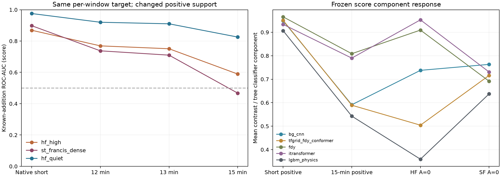

# R11 핀포인트 진단: 장시간 support·HF·출력 포화·관측 밀도

**실행 완료.** R11-1·2·4는 Mac CPU에서 기존 R9 Fold0 5개 모델과 고정 가중치(4NN 각0.1/tree0.6)를 사용했다. R11-3은 저장된 예측만 분석했으며 새 추론0회다. GPU·본학습·정책/원자료 변경·새 제출은 하지 않았다.

**핵심 결론:** 같은 정답 비율을 유지한 장시간15분 양성과 실제 StFrancis 고밀도 A=0 배경을 비교하자 all5 AUC가0.897949→0.467513으로 하락했다. 새로 확보한 구체적인 실패 조건이다. 다만 이때 RMSE0.116927은 Public0.217536과 같지 않아 공식 실패의 AUC·RMSE·예측평균0.265를 한 조건에서 동시에 재현한 것은 아니다.

정확한 마스크가 전체 loss를 최소화하지 않는 contrast-BCE 반례도 확인했다. 따라서 개선 비교의 우선 축을 **장시간 양성 보강 / HF 무추가 대조 보강 / contrast BCE의 마스크 왜곡 경로 제거**로 고정했다. 개선 모델을 새로 학습해 성능 향상을 입증한 단계는 아직 아니다.

## 1. R11-1: support 변화로 AUC 붕괴 재현

양성 배경 500개·원참조·창별 정답을 유지하면서 추가 성분의 지속 구간과 시간 형태를 바꾸는 비교다. 주 비교의 정답 평균 0.141007, RMS 0.213753은 동일하다. 13분/15분 조건에서는 추가 성분 A=0인 분이 각각 2개/0개다. 12분 조건은 3개로 별도 표시했다. 전체 210개 모델×패널 조합을 보존했으며, AUC가 0.55에 가까운 결과만 고르지 않았다.

|양성 모드|HF 자연변동 A=0: RMSE / score AUC / share AUC|StFrancis A=0: RMSE / score AUC / share AUC|
|---|---|---|
|r9_original|0.073414 / 0.868836 / 0.790728|0.059904 / 0.897949 / 0.709231|
|full_smooth12|0.084569 / 0.769172 / 0.778160|0.075888 / 0.737494 / 0.693692|
|full_smooth13|0.086390 / 0.750828 / 0.769780|0.078373 / 0.709949 / 0.679564|
|full_smooth15|0.116521 / 0.589224 / 0.640988|0.116927 / 0.467513 / 0.463295|
|native_long15|0.099587 / 0.625856 / 0.685920|0.095733 / 0.520109 / 0.536763|
|stationary15_control|0.130942 / 0.362940 / 0.558100|0.134412 / 0.207859 / 0.342987|

15분 smooth 양성과 St Francis 음성 사이의 엄격한 score 역전율(음성 점수 > 양성 점수)은 53.25%다. 자연 HF 변동 상위 패널과의 AUC도 0.868836→0.589224로 하락했다. 실제 native 15분 이상 참조 7개를 순환한 대조에서도 St Francis AUC는 0.520109였다. 현재 509개 풀에는 이러한 참조가 7개 있어, 과거 제한 풀의 3개와 구분해야 한다. 500개의 독립적인 장시간 녹음을 확보했다는 뜻은 아니다.

R9 원형 양성의 입력 HF bump 중앙값은 10.213 dB였으나, 같은 y를 유지한 full15에서는 0.867 dB로 낮아졌다. 정답 q의 시간 최대−중앙값 대비 평균도 0.5896→0.0794로 낮아졌다. 기준선 차감과 시간 대비에 의존한 판단이 길고 완만한 추가음에서 약해지는 양상과 일치한다. 다만 모든 모델이 오직 HF 변수 하나만 사용했다거나, 공식 Test도 이 생성법을 사용했다고 확정하지는 않는다.

HF음성은실제SA selection고밀도6920개창에서band18..24(1995~7943Hz) 선형합의시간max−median이q90=10.725742dB보다큰500개다. R10의HFband20..24와범위가다르다. SF음성은실제metadata의완전관측312개이며Test의추정사이트와다르다. 경계분은같은500개배경에서첫/끝flag분만복원해pairedQC와비교했다.

양성배경에는SF가없고 음성에는SF312개가있어site-matched인과실험은아니다. 그러나양성의원형→full변환을비교할때정답·배경·SF음성패널은고정되어있다. fullsmooth는1분통계의시간리샘플링이며실측WAV가아니다. stationary15는관측가능성반례이고현실선박일반을대변하지않는다. 고정y=.30 추가팔에서는SF AUC0.715237이므로전체share범위가똑같이무너지는것도아니다.
Full support가 항상 낮은 시간 대비를 뜻하지는 않는다. 모든 분에 추가 성분이 조금씩 있어도 날카로운 통과 피크를 가질 수 있다. 이번 smooth 조건은 넓고 완만한 에너지 변화를 구현했으므로, 지속 분 수뿐 아니라 시간 형태까지 포함한 개입이다. 또한 관측 E만 주어졌을 때 A=cE, B=(1−c)E는 여러 c에서 같은 E를 만든다. 물리적 풀링이 없는 배경 정보를 만들어 주지는 않는다. 정적인 추가 성분을 분리하려면 타당한 배경 가정과 실제 조건의 검증이 필요하다.

[전모델·역전율·타깃구간별AUC](r11_diagnostics/full_support_hf_r1/FINDINGS.md) · [독립물리·산술QA](r11_diagnostics/full_support_independent_qa_r1.md)

## 2. R11-2: 비대칭 주파수 응답

처음 고정한LF−10/−15dB×중고역peakSNR+10/+20dB의네조건은두목표를동시에충족하지못했다. +10에서는yRMS0.155~0.161/bump9.862dB, +20에서는yRMS0.458~0.467/bump18.427dB였다. LF만감쇠하면나머지HF에너지의전체비중까지임의로작게만들수는없다.

모델결과와무관한별도18조건물리grid를사전고정하고, LF뿐아니라316~1995Hz중역도감쇠하는가정을추가했다. HF기준도3162~7943Hz로바꾼확장이다. 집계제약통과네조건을모두추론했고성능이좋거나나쁜한조건만채택하지않았다.

|예시조건: LF−15 / mid−20 / HFpeak+15|예측평균|bias|RMSE|AUC score|
|---|---|---|---|---|
|CNN|0.10826|+0.03541|0.09331|0.89497|
|TFGrid|0.09295|+0.02010|0.06158|0.89111|
|FDY|0.09122|+0.01837|0.07846|0.90346|
|iTransformer|0.09080|+0.01795|0.10295|0.81789|
|LightGBM|0.07127|−0.00158|0.08241|0.92726|
|all5|0.08108|+0.00824|0.07355|0.94079|

이예시는전체yRMS0.167693·bump중앙14.860dB다. 목표통과네조건의all5 RMSE는0.06852~0.08089,AUC0.94004~0.94829였다. 동일y의EQ6대조보다RMSE가0.00262~0.01147증가했지만, LightGBM예측평균이0.265로치솟거나AUC0.55로무너지는현상은재현되지않았다. 이조건에서는LightGBM만범인이라는가설을지지하지않는다.

강한HF+20의고정profile/support에서는저·중역을0으로만들어도전역yRMS하한0.2292여서상한0.20과동시충족불가였다. 이는특정forward설정의하한이며모든생성법에대한불가능성주장은아니다. 목표통과가site별통과또는실제Test분포일치도뜻하지않는다.

[처음네조건](r11_diagnostics/asymmetric_eq_r1/RESULTS.md) · [18조건feasibility](r11_diagnostics/asymmetric_forward_feasibility_r1/RESULTS.md) · [목표통과4조건·모델별수치](r11_diagnostics/asymmetric_feasible_models_r1/RESULTS.md)

## 3. R11-3: 기존 Test 출력 감사 — 추론0회

정답없는query의출력분포만비교했다. 공정하게기존CPUFP32 selection1000예측과CPUFP32 query1500예측을사용했다. 원NPZ·ID순서·제출CSV의고정가중합을검산했으며Test값에서는finite-mask만읽어관측량을집계했다.

|모델|selection 예측평균|Test 예측평균|selection 예측RMS|Test 예측RMS|
|---|---|---|---|---|
|CNN|0.116242|0.286026|0.180968|0.356107|
|TFGrid|0.110983|0.260752|0.179789|0.340305|
|FDY|0.108474|0.261929|0.171702|0.343577|
|iTransformer|0.114936|0.272464|0.177286|0.337628|
|LightGBM|0.102821|0.261044|0.173387|0.322998|
|all5|0.106756|0.264744|0.171654|0.326982|

상승은LightGBM하나가아니라전모델에서공통이다. selection정답평균0.098867을Test예측평균과비교하는것과, 위처럼예측평균끼리비교하는것을구분해야한다. 공정한all5예측평균비는약2.48배다. Test정답평균/RMS가알려진것은아니다.

|복원구성요소|selection 평균 → Test 평균|selection ≥.99 → Test ≥.99|
|---|---|---|
|CNN contrast|0.740538 → 0.970127|40.60% → 71.13%|
|TFGrid contrast|0.714583 → 0.983388|54.60% → 90.53%|
|FDY contrast|0.776484 → 0.967692|43.80% → 72.93%|
|iTransformer contrast|0.732467 → 0.950813|10.60% → 17.60%|
|LightGBM classifier|0.660918 → 0.939013|20.30% → 44.67%|

NN contrast는 입력 db의 max−median이 아니라, 관측 셀에서 모델이 예측한 마스크 q_hat의 대역별 시간 max−min 중 최댓값이다. 다섯 모델의 share 예측 간 Pearson 상관은 selection 0.869~0.949, query 0.834~0.952로 높게 유지됐다. 반면 score 구성요소 간 상관은 0.759~0.899→0.391~0.734로 낮아졌다. 상관과 포화도는 출력 감사 결과이며, 개별 query의 오답 여부를 확정하는 정답은 아니다.

원Test의Nobs12/13/14/15는1/7/717/775다. 첫분전체결측624,마지막100이고일부대역만결측인분은없다. 과거kNN의StFrancis-like추정유형은487개,Nobs14는그중484개다. Nobs14전체717개가SF라는가정은맞지않는다. 이추정유형의all5평균0.277588도전체0.264744보다조금높을뿐유일한상승집중점은아니다. 실제Test사이트GT는없다.

[5×5상관행렬·분위수·포화·유형별표](r11_diagnostics/saved_query_audit_r1/FINDINGS.md)

## 4. R11-4: 실제 SF5분 대 15분 및 짝지은 마스킹

Fold0selection의SF는Nobs5가2348개,Nobs≥13이312개(모두15)였다. sparse는2016~2018/6groups,dense는2015/2groups여서시기가다르다. Nobs5관측분은[0..4],[5..9],[10..14]연속5분block이며“매5분마다1분측정”이라는뜻이아니다.

312개전수를사용하면서명시적무추가정확20%를맞추기위해각배경5views(1zero+4positive)를생성했다. sparse1000개→5000예제,dense312개→1560예제이며같은dense를5분만남긴paired도1560예제다. 반복view를독립녹음수로세지않았다. 양성은관측추가energy>0일때만유효하며재시도횟수·조건부선택을보존했다.

|패널|생성예제|고유 배경|all5 RMSE|bias|AUC share|AUC score|
|---|---|---|---|---|---|---|
|sparse|5000|1000|0.105665|-0.026516|0.893451|0.910675|
|dense|1560|312|0.083171|+0.012459|0.787157|0.855975|
|dense_mask5|1560|312|0.134205|+0.002522|0.825024|0.874421|

같은 dense 배경을 5분만 남기도록 가리면 all5 RMSE는 0.083171→0.134205로 악화했다. paired−dense RMSE 차이의 source ID 단위 cluster bootstrap 95% 구간은 [0.04444, 0.05778]이다. 다만 남은 관측 분으로 재계산한 실제 y 평균도 0.108113→0.184529로 변한다. 따라서 이 차이는 관측 개수만의 효과가 아니라, 관측 구간과 타깃의 물리적 재정의를 포함한다. Bootstrap 구간은 고정된 32개 처리 조건에 한정되며, 주 단위·녹음일 단위 상관을 완전히 반영하지 않는다.

중요한지원제약도확인했다. native2~6분465개는중간5분block[5..9]에native_edge로삽입하면관측추가양성이구조적으로불가능하다. 따라서원R9의mask-inducedzero는분포상우연만이아니라family×길이×maskblock의결합이다. 원형식그대로와“정확20%zero/모든양성support>0”을동시에유지할수없어이번대조는edge8treatment에metadata기준native≥7분을썼고양쪽군에동일bank를적용했다. 이조건화는생산레시피변경이아니다.

[실제지원·재시도·편향·대역별지표](r11_diagnostics/st_francis_density_r2/README.md)

## 5. 추가 수학 검산: 정답 마스크와 contrast BCE의 충돌

현재 손실은 Share MSE + 0.25×weighted cell MSE + 0.05×BCE이고, NN score는 0.5×share + 0.5×contrast다. 장시간 추가음의 정답 q=y가 모든 시간에 일정하면, 정확한 마스크여도 contrast=0, score=y/2가 된다.

예를 들어 y=0.2, 375개 셀의 균등 가중치 조건에서 정확한 q의 전체 loss는 0.115129다. 두 고역 셀의 예측 q를 0과 1로 틀리게 만들면, 예측 share는 0.2016으로 거의 같지만 contrast=1, score=0.6008이 되어 전체 loss가 0.025931로 낮아진다. 정확한 q의 물리 손실은 0인 반면 틀린 q의 물리 손실은 0.000456인데, BCE 감소가 그 차이를 압도했다.

경계0/1뿐아니라유한logit내부값ε=1e−4와작은대칭변형q₀=y−δ,q₁=y+δ에서도동일했다. 두셀의같은가중치를a라하면share=y를유지하면서L(δ)=0.5aδ²−0.05log(y/2+δ),L′(0+)=-0.1/y<0이다. 따라서정확q가결합loss의출력공간국소최소조차아닐수있다는구체적인반례다.

이는 목적함수의 수학적 허점이다. 현재 아키텍처가 실제로 그 파라미터 경로를 학습했거나, 공식 점수 하락이 전부 이 때문이라고 증명한 것은 아니다. R9 소스·loss·모델을 변경하지 않고 기존 함수 호출과 독립적인 손계산으로 확인했다.

[반례6건](r11_diagnostics/derived_score_loss_counterexample_r1/FINDINGS.md) · [내부값·미분 독립QA](r11_diagnostics/derived_score_loss_independent_qa_r1.json)

## 6. 확인된 실패와 개선 비교의 고정 범위

|항목|현재 판정|
|---|---|
|장시간추가 vs 자연HF/SF|구체적저AUC조건재현. 데이터와모델의지원범위취약점확인.|
|공식RMSE0.2175동시재현|이번주요저AUC패널에서는미재현. 숫자맞춤은하지않음.|
|LightGBM60%가단독주원인|비대칭패널로지지안됨;query의예측평균상승은전모델공통.|
|관측량·source시기혼동|실제시기차이·구조적양성지원제약확인;paired마스킹에서오차민감도확인.|
|contrast BCE|정확q보다왜곡q의loss가낮아지는수학적반례확인.|
|수정모델실제개선|이번에는학습하지않았으므로아직입증안됨.|

다음 소형 CPU 검증은 세 축의 2×2×2 ablation으로 고정한다: 장시간 양성 보강 여부, TRAIN 전용 HF 자연 A=0 대조 보강 여부, 기존 contrast BCE가 q에 주는 기울기 제거 여부다. 같은 모델·원천 분할·스케줄과 100 epoch/Adam/no early stopping/dropout 0.1을 유지해 각 변경의 효과를 분리한다. 개선을 검증하기 전에는 고비용 GPU 본학습을 확대하지 않는다.
Contrast 보조점수를 없애거나 별도 분류기로 분리할 후보도 사전에 명시하되, 현재 CSV를 소급 변경하지 않는다. Score는 보조지표다. 핵심 평가 지표인 RMSE를 희생하면서 최대−최소 대비를 키우도록 유도하지 않는 것이 우선이다. Test 출력의 포화율이나 예측 평균을 학습 분포·보정의 목표로 맞추지 않는다.

[개선ablation계획 JSON — 실행전 계획이며 학습완료 아님](R11_IMPROVEMENT_ABLATION_PLAN.json)

## 7. 파일·재현성

원본프로젝트실행기준은 `/Users/hongtaeyang/Documents/ChatGPT/대회/underwater_vessel_noise.nosync`다. 새코드는ops/r11_*.py와finalize/build리뷰스크립트, 새결과는reports/r11_diagnostics에있다. Desktop복사본에서도HTML·MD·PNG·CSV를열수있다. 원형R9경로맵을쓰는재실행은원본프로젝트에서해야하며,새모델산출물또는대회제출로표시하지않는다.
계획·입력·고정모델·정책·ID순서·정답·가중합·물리식의실행전후해시/독립오라클을보존했다. density의최초실험은native_edge/중간5분support의불가능조건으로모델추론전중단했고FAILED로보존한후새r2로진행했다. 이실패를생산모델오류로오인하지않는다. 최종리뷰수치오라클은SciPy의float32rank누적오차를피해float64로재계산했다.

[이전 R10 보고서](R10_LOCAL_VALIDATION_GAP_DIAGNOSTICS.md) · [R11 파일 SHA목록](R11_DIAGNOSTICS_MANIFEST.json)
