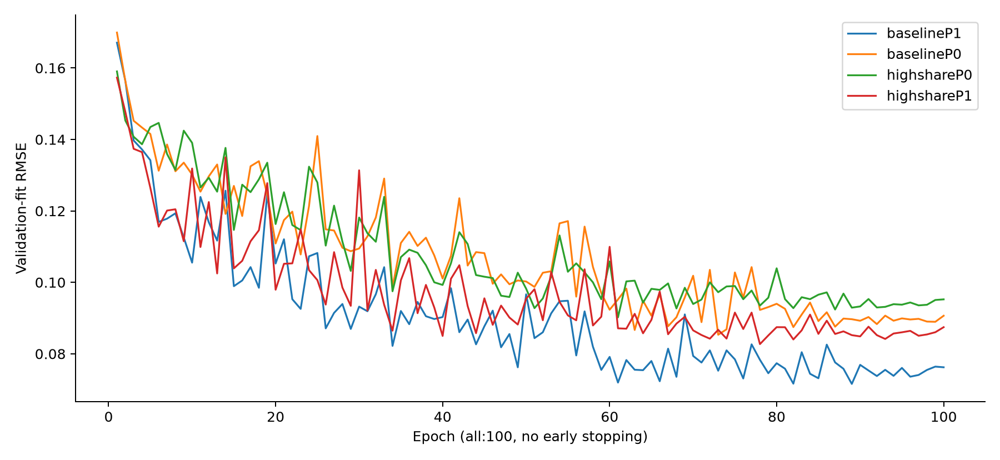
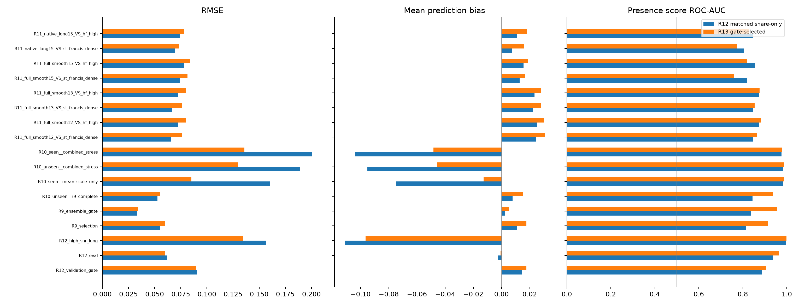

# R13 고비율·독립 분류기·PCA 비교 결과

**범위:** Mac CPU의 소형 후속 실험이다. 신경망 본체 5-Fold 학습이나 새 Test.csv 제출 점수가 아니다. Test/리더보드로 정책을 선택하지 않았고 기존 R12 결과도 수정하지 않았다. R10/R11 및 R12 평가 패널은 이미 개발 과정에 노출됐으므로 새 맹검·OOF로 부르지 않는다.

선택된 회귀 조건은 **highshareP1**, 진단 score는 `(1−λ)×share + λ×독립 Tree classifier`, **λ=0.5**다. CNN/Tree 회귀 비중은 각각50%로 고정했다. 모든 학습을 동결한 뒤 gate RMSE로 회귀 조건을 선택하고 같은 gate AUC로 사전 지정된 λ 4개 중 하나를 골랐다. 그 후 정책 SHA를 저장하고 eval을 읽었다.

고SNR·장시간 패널 RMSE **0.156340→0.134734**, bias **-0.111366→-0.096543**. 미관측 일반 패널 RMSE **0.052679→0.055365**, score AUC **0.844269→0.938044**. 15분/SF score AUC **0.820224→0.759756**. 개선 여부는 패널별로 구분하며 일부 수치만으로 모든 목표를 달성했다고 판정하지 않는다.

**판정: 요청한 모든 패널의 동시 개선 조건은 미달이다.** 고SNR 과소추정이 줄고 일반 분류 AUC는 회복됐지만, 15분/SF 및 native/SF 분류와 일부 일반 RMSE는 악화됐다. 현재 조건을 완전히 해결된 생산 표준으로 확정하거나 GPU 전체 학습을 자동 시작하지 않았다. 아래의 본체 러너 준비는 이 성능 판정과 별도의 기술 준비다.

## 1. 실제 데이터 개편과 원인 가설의 한계

기반은 사이트·센서·녹음기 라벨·정확 mask를 일치시킨 R12 matched control이다. 제거된 것은 확인된 class-mask 교란이며 모든 사이트 편향이 사라졌다는 뜻은 아니다. 양성9600개 중2400개의 추가 세기 alpha만 변경했다. zero2400(20%), long-positive2880(양성30%), source·참조·배치·EQ·mask는 유지했다. 새 highshare 대상은 long720/standard1680이며 목표는 고정 seed 층화 LHS Uniform(.25,.85)다. CNN6000부분집합에서도 정확1200개만 변경했다.

기존 TRAIN의 long-positive 평균 share는 이미 **0.3173**이었고 전체 y≥.5 예제는1,244개였다. 명시적인 share cap도 없었다. 따라서 “장시간 예제가 전부 저비율이고 cap을 배웠다”는 원인은 확정할 수 없다. 이번 비교는 중·고비율 관측을 더 공급했을 때의 효과를 직접 측정하는 개입이다.

새 TRAIN positive 평균은0.203439→0.290995, y≥.5는1244→2347이다. 일부 기존 높은 share도 Uniform 목표에 따라 낮아져 증가2117/감소283개다. 임의 max(oldy,target)나 Test 모멘트 맞춤을 사용하지 않았다. 정답은 raw B/A/E에서 재계산했고 입력과 w만0.1dB 관측을 쓴다. [전수 물리 검산·분포](R13_DATASET_CONSTRUCTION.md) / [원수치](R13_DATASET_CONSTRUCTION.json) 

## 2. 학습과 실제 예산

동일한26,953개 파라미터 CNN·같은6000TRAIN·같은validation_fit1000으로P0/P1을 비교했다. 모두100epoch/Adam/dropout0.1/no early stopping/최저fit RMSE checkpoint다. baselineP1은 배열·subset·PCA·seed·손실·100epoch 규약이 동일한 완료된 R12 strict control을 재사용했다. 중단된 부분 run은 재사용하지 않았다. 다른CNN3개 및 LightGBM4조건(각회귀기+독립분류기)은 새로 학습했다.

마스크 손실은 Share MSE+.25×energy-weighted cell MSE만 사용한다. 분류 확률은 별도 Tree 모델에서 생성하므로 q에 분류 BCE 기울기가 흐르지 않는다. P0도shape3채널0패딩으로CNN예산을같게했다. Tree는P0/P1각466/673특징,12000TRAIN,최대1500trees/ES40다.

|CNN조건|실행epoch|best epoch|fit RMSE|출처|
|---|---|---|---|---|
|baselineP1|100|89|0.071565|completed control reuse|
|baselineP0|100|73|0.085329|new fit|
|highshareP0|100|61|0.090196|new fit|
|highshareP1|100|78|0.082713|new fit|

## 3. PCA와 고비율 보강의 대응 비교

|조건|eval RMSE|고SNR RMSE|고SNR bias|unseen RMSE|unseen share AUC|full15/SF share AUC|
|---|---|---|---|---|---|---|
|baselineP0|0.066673|0.170105|-0.115166|0.057838|0.809213|0.742064|
|baselineP1|0.062234|0.156340|-0.111366|0.052679|0.844269|0.820224|
|highshareP0|0.068106|0.160107|-0.109872|0.056763|0.808688|0.737545|
|highshareP1|0.060119|0.134734|-0.096543|0.055365|0.851231|0.782135|

P0/P1의 모델 예산과 데이터는 같으므로 이 비교는 PCA 잔차 표현의 영향과 방향을 보여준다. 기본 데이터에서 unseen RMSE는 P0 0.057838 → P1 0.052679, 고비율 데이터에서는 P0 0.056763 → P1 0.055365였다. 이 비교에서는 PCA 제거가 해결책이 아니었다. 다만 대형 본체와 미니 모델의 용량 차이는 GPU 본체 실험 전에는 분리할 수 없다. PCA는 Fold0 TRAIN 배경에만 적합했고 다른 fold의 PCA로 공유하지 않는다.

## 4. 독립 분류기 score: 이득과 손해를 함께 표시

|패널|λ0 share-only AUC|λ.25 AUC|λ.5 AUC|λ1 classifier AUC|
|---|---|---|---|---|
|R9_selection|0.815637|0.905764|0.913787|0.920682|
|R10_unseen__r9_complete|0.851231|0.926512|0.938044|0.945800|
|R11_full_smooth15_VS_st_francis_dense|0.782135|0.758436|0.759756|0.760763|
|R11_native_long15_VS_st_francis_dense|0.778795|0.771192|0.774827|0.777237|
|R11_full_smooth15_VS_hf_high|0.827360|0.821940|0.819604|0.821532|

λ는gate만으로선택했다. 아래 개발 패널별로 가장 좋은λ를 따로 골라 붙이지 않았다. 진단score를바꿔도회귀share와RMSE는변하지않는다. Brier는추가유무presence에대한값이고에너지share오차가아니다. 원R12저장예측만분석한별도snapshot에서는일반AUC개선과장시간/SF악화가함께있었으므로무조건적인classifier복원은사용하지않았다. [snapshot 별도 기록](r13_score_snapshot_r1/RESULTS.json)

추가로, 기존 matched 회귀와 새 고비율 회귀의 고정 혼합5종 × 독립 분류기 비중6종을 조합한30개 전역 결합을 별도 개발 분석으로 점검했다. 일반 AUC>0.9와 full15/SF·native/SF AUC≥0.8, 고SNR 회귀 개선을 함께 충족한 조합은0개였다. 즉, 이번30개 후보에서는 단순 가중치 조정만으로 상충을 해결하지 못했다. 연속 계수 전체나 다른 모델이 불가능하다는 증명은 아니며, 이 후속 결과로 원 R13 정책을 바꾸지 않았다. [30개 조합과 독립 검산](r13_safety_feasibility_r1/RESULTS.md)

## 5. 17개 고정 패널 전체 결과

|패널|matched R12→R13 RMSE|bias|R13 share AUC|score AUC|R13 y>.2 bias|
|---|---|---|---|---|---|
|R12_validation_gate|0.090328 → 0.089586|+0.014500 → +0.017755|0.884550|0.888125 → 0.907388|-0.011199|
|R12_eval|0.062234 → 0.060119|-0.002600 → -0.000725|0.933600|0.938300 → 0.964300|-0.019791|
|R12_high_snr_long|0.156340 → 0.134734|-0.111366 → -0.096543|0.997325|0.996825 → 0.998375|-0.127191|
|R9_selection|0.055490 → 0.059630|+0.011175 → +0.017585|0.815637|0.814431 → 0.913787|-0.010628|
|R9_ensemble_gate|0.033557 → 0.034120|+0.002256 → +0.005479|0.834272|0.837354 → 0.954128|-0.007397|
|R10_unseen__r9_complete|0.052679 → 0.055365|+0.007800 → +0.015138|0.851231|0.844269 → 0.938044|-0.005232|
|R10_seen__mean_scale_only|0.160046 → 0.085086|-0.074884 → -0.012756|0.987581|0.984525 → 0.987319|-0.035492|
|R10_unseen__combined_stress|0.189233 → 0.129641|-0.095227 → -0.045498|0.984831|0.984281 → 0.987419|-0.080459|
|R10_seen__combined_stress|0.200386 → 0.135844|-0.104098 → -0.048307|0.981700|0.976231 → 0.979962|-0.086885|
|R11_full_smooth12_VS_st_francis_dense|0.066016 → 0.075926|+0.024626 → +0.030556|0.818462|0.847763 → 0.863833|+0.014730|
|R11_full_smooth12_VS_hf_high|0.072166 → 0.080018|+0.025104 → +0.030091|0.854596|0.874928 → 0.881740|+0.014730|
|R11_full_smooth13_VS_st_francis_dense|0.066677 → 0.076217|+0.022488 → +0.028160|0.811801|0.845173 → 0.854365|+0.006383|
|R11_full_smooth13_VS_hf_high|0.072658 → 0.080242|+0.023368 → +0.028146|0.849396|0.872744 → 0.875916|+0.006383|
|R11_full_smooth15_VS_st_francis_dense|0.074042 → 0.081356|+0.012865 → +0.016943|0.782135|0.820224 → 0.759756|-0.033611|
|R11_full_smooth15_VS_hf_high|0.078235 → 0.084239|+0.015554 → +0.019038|0.827360|0.855400 → 0.819604|-0.033611|
|R11_native_long15_VS_st_francis_dense|0.069205 → 0.073330|+0.007321 → +0.015734|0.778795|0.806051 → 0.774827|-0.032507|
|R11_native_long15_VS_hf_high|0.074552 → 0.078027|+0.011053 → +0.018056|0.824680|0.845136 → 0.830032|-0.032507|

[모든 모델/score 후보 CSV](r13_cpu_correction_r1/results.csv) / [고정 선택정책](r13_cpu_correction_r1/selected_policy.json) / [paired 군집 CI](r13_cpu_correction_r1/paired_cluster_CI.csv) / [원예측·검산근거](r13_cpu_correction_r1/RESULTS.json)

독립 검산은 17개 패널·458행의 지표 12,366개를 원예측으로 재계산했고 차이는 0이었다. 99개 CI의 독립 재계산 차이는 최대5.55×10⁻¹⁷, 실제 q 마스크의 물리 pooling 오차는 최대1.34×10⁻⁷이었다. [독립 검산 보고서](R13_EVALUATION_INDEPENDENT_QA.md)

R10 unseen의 군집은 기존 R12 로더에서 누락했던 sensor_group×recording_week_start를 이번 평가에 명시적으로 연결했다. 원자료와 R12 CI 파일은 바꾸지 않았다. 주간 CI 군집끼리는 최소15분 간격도 있어 군집 간 독립이 자동 보장되지는 않는다. 이는 TRAIN/heldout의 24시간 purge 위반과 다른 문제다. CI는 고정 패널·고정 모델에 조건부이며 gate 선택·단일 seed·참조 공유·여러 비교 불확실성을 완전히 보정하지 않는다.

## 6. 본체 학습과 제출 파일

CPU개선실험과GPU본체실행은별도단계다. 본체는WideBGMaskCNN/TFGrid-FDY-Conformer/FDY-CRNN/iTransformer/PhysicsLightGBM 5종이며fullTRAIN각epoch전수·원천5fold·24시간purge·Fold별TRAINPCA·동결추론규약으로준비한다. 새고정validation도동일물리레시피로별도생성하고원R9자료는비교용으로보존한다. GPU접속과CUDA1epoch실측전에는전체소요시간/메모리를확정하지않는다.

**submission_r13.csv는본체학습·OOF/앙상블검증이실제로완료된뒤생성한다. 이CPU미니모델결과나기존R9파일을본체완성본으로이름만바꿔제공하지않는다.**

[본체 5-Fold 기술 준비 상태](R13_FULL_PIPELINE_READINESS.md)

## 7. 마지막 추가 대조: 약한 버전과 강한 버전을 함께 유지

고비율 고정 교체 때문에 원래 약한 사례가 사라졌을 가능성을 점검하기 위해, P1 조건 한 개를 추가했다. CNN은 같은6000개 primary를 epoch마다1회씩 사용하고, 바뀐1200개 양성 중600개만 강한 버전으로 선택했다. 다음 epoch는 나머지600개를 선택해 매2epoch마다 각 행의 약한/강한 버전을1회씩 학습했다. q/y뿐 아니라 입력 x와 에너지 가중치 w도 해당 버전으로 함께 바꿨다. zero1200·장시간1440·site/sensor/recorder/mask는 유지했다. 100epoch/Adam/no early stopping은 같았다.

Tree는 baseline12000+highshare12000의24,000행으로 학습했다. 고유 primary는12,000개이며, 공통9600행은 중복이다. 이를 새로 수집한 독립 녹음24,000개로 세지 않는다. Tree의 행 수가 바뀐 만큼 이 추가 비교는 CNN과 Tree 모두의 순수한 동일 예산 인과 분리를 보장하지 않는다.

이 조건도 동시 개선을 충족하지 못했다. 고SNR RMSE는0.148884로 최초 R12 matched0.156340보다 낫지만 원 R13 highshare0.134734보다 나빴다. 일반 AUC는 R9 selection0.92419 / R9 gate0.96406 / unseen0.95289로 높았지만 full15/SF0.76501·native/SF0.78197은0.8에 미달했다. 원래 약한 사례의 고정 교체만이 문제의 전부였다고 볼 수 없으며, 원 R13 선택 정책을 바꾸거나 이 조건을 생산 표준으로 승격하지 않았다.

추가 실험의 트리 실행부는 Mapping import 누락으로 실제 fit 전에 실패했고, 수정용 동적 helper 시도도 실제 fit 전에 중단했다. 두 기록은 보존했다. 최종 정적 helper에서만 Tree를 새로 학습했고, CNN은 정상적으로100epoch를 모두 마친 뒤 checkpoint와6개 파일의 바이트 일치를 확인해 별도 r2 완료 기록에 결박했다. 부분 checkpoint에서 학습을 재개하지 않았다.

[추가 조건 전체 결과](r13_dynamic_mix_r1/RESULTS.md) / [지표 독립 검산](r13_dynamic_mix_r1/INDEPENDENT_QA.json) / [복구·source 독립 검산](R13_DYNAMIC_MIX_RECOVERY_INDEPENDENT_QA_FINAL.md)

[사전고정설정](../configs/r13_cpu_correction_v1.json) / [R12 비교보고서](R12_CPU_ABLATION_RESULTS.md)
