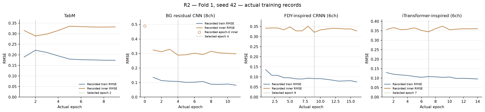
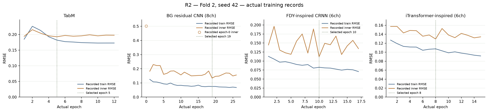
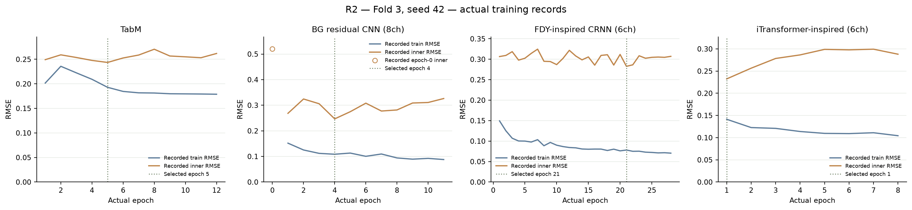
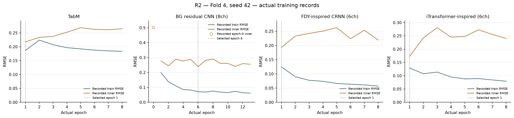
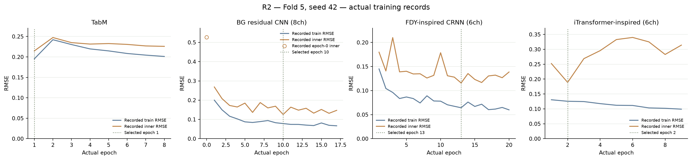
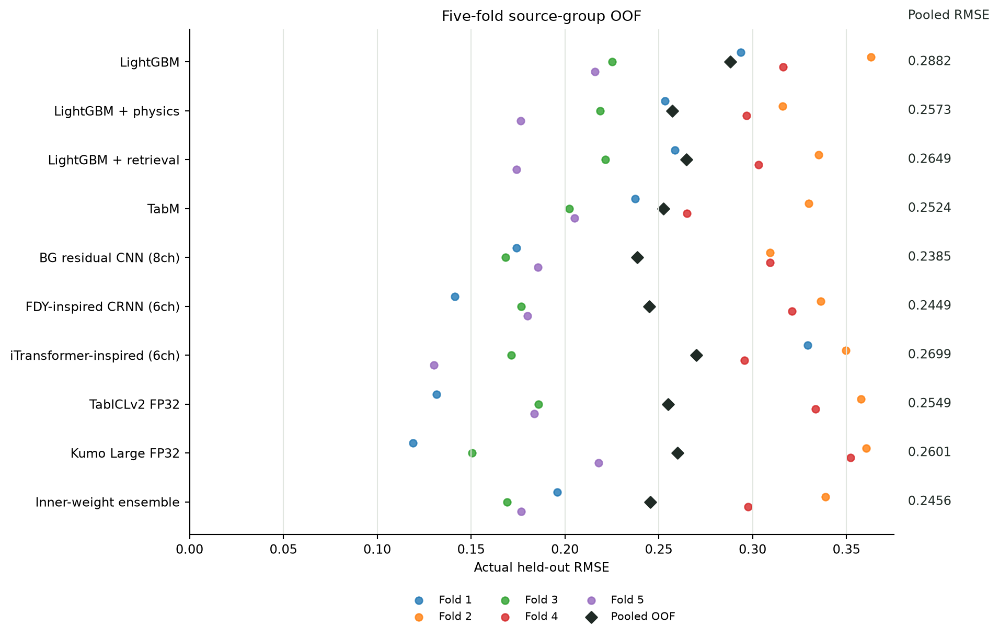

# R2 전체 모델 학습·추론 파이프라인 보고서

실제 본 실행 시작: **2026-10-25 04:25:09 KST** (`1792869909.5714338`).
이 문서는 고정된 한 파이프라인과 내려받은 실제 실행 기록만 정리합니다. 새 실험·서버 조회·데이터 재생성을 수행하지 않습니다.

## 현재 결과 상태

**전체 5-fold / OOF 15,000개 집계 완료.** 최종 inner-weight ensemble의 pooled RMSE는 **0.245585**입니다.
이 값은 합성 데이터의 원천 분리 OOF 결과이며 Zindi 공식 점수가 아닙니다.
단일 후보 중 pooled RMSE가 가장 낮은 모델은 **BG residual CNN (8ch)** (0.238545)입니다. 사전에 inner로 고정한 ensemble보다 낮으며, 이 결과를 보고 OOF 가중치를 다시 맞추지 않았습니다.
실제 실행은 **71분 10.4초**였습니다. 시작·완료 timestamp와 실행 설정을 [실행 receipt](evidence/execution_receipt.json)에 보존했습니다.
독립 검증은 15,000개 고유 ID 정합, 모든 모델의 pooled·경계 제외 RMSE 재계산, 다섯 동결 inner policy의 예측 재구성을 통과했습니다. 경계 후보 2,730개를 제외한 진단 표본은 12,270개입니다. [독립 검증 원본](evidence/R2_OOF_INDEPENDENT_VERIFICATION.json)

| 후보 | Pooled OOF RMSE | Fold RMSE 평균 ± 표준편차 | 경계 후보 제외 RMSE |
|---|---:|---:|---:|
| LightGBM | 0.288236 | 0.282820 ± 0.062178 | 0.283388 |
| LightGBM + physics | 0.257267 | 0.252201 ± 0.056803 | 0.258259 |
| LightGBM + retrieval | 0.264865 | 0.258615 ± 0.063954 | 0.266212 |
| TabM | 0.252390 | 0.247992 ± 0.052447 | 0.256210 |
| BG residual CNN (8ch) | 0.238545 | 0.229353 ± 0.073320 | 0.238023 |
| FDY-inspired CRNN (6ch) | 0.244860 | 0.231085 ± 0.090527 | 0.247607 |
| iTransformer-inspired (6ch) | 0.269944 | 0.255195 ± 0.098394 | 0.270023 |
| TabICLv2 FP32 | 0.254936 | 0.238539 ± 0.100568 | 0.257543 |
| Kumo Large FP32 | 0.260131 | 0.240015 ± 0.112143 | 0.260952 |
| Inner-weight ensemble | 0.245585 | 0.235638 ± 0.077353 | 0.247995 |

Pooled RMSE는 전체 SSE를 합쳐 계산합니다. Fold RMSE의 단순 산술평균과 다르며, 표준편차는 다섯 원천 fold의 산포입니다. 독립 녹음 15,000개의 불확실성 구간을 뜻하지 않습니다.

[최종 cv_report 원본](evidence/cv_report.json)

## 고정한 단일 파이프라인

| 단계·모델 | 현재 실행 구성 |
|---|---|
| 데이터 | 물리 r1: train 합계 267,837 + inner 15,000 + outer 15,000. 원천 분할·평가 NPZ 고정 |
| LightGBM 계열 | 기본 / physics / training-only retrieval, 3후보. 최대 800 trees, 회귀 inner early stopping 40 |
| TabM | feature version 3, 1,258차원 |
| CNN 대체 모델 | 8채널 background-prior residual CNN, architecture 4. 다른 후보를 추가한 것이 아니라 CNN을 대체 |
| FDY / iTransformer | 기존 feature 3의 6채널, 각각 독립 후보 |
| TabICLv2 / Kumo Large | vendor 원본 가중치 고정, fold TRAIN context만 새 구성. FP32, 각 4 members, context 16,000 / 4,096 |
| 신경망 최적화 | Adam, 최대 100 epochs, patience 7, dropout 0.1, batch 128, seed 42 |
| 추가 domain augmentation | none. 실패한 추가 증강 pilot을 본 실행에 자동 적용하지 않음 |
| 앙상블·후처리 | 각 fold inner에서 nonnegative·합 1 가중치를 학습하고 고정한 뒤 outer에 적용. Outer-fitted affine 보정 없음 |

**7개 모델 계열, 9개 후보**이며 마지막에 inner-weight ensemble을 평가합니다. Adam/epoch 정책은 신경망에 적용됩니다. LightGBM과 frozen-context foundation 모델을 100 epochs 학습했다고 표현하지 않습니다.

회귀 주 손실은 정답 share에 대한 MSE로, RMSE를 최소화하는 것과 같은 예측값을 목표로 합니다. TabM은 share MSE + 0.03 presence BCE를 사용합니다. 셀 mask를 출력하는 CNN·FDY·iTransformer에는 0.03 × 관측 에너지 가중 cell MSE가 추가되고, BG CNN만 0.001 × 에너지 가중 residual-logit 제곱 페널티를 더합니다. 보조 손실이 평가 지표 자체라는 뜻은 아니며 best checkpoint 선택은 고정 inner RMSE로 합니다.
신경망 초기 learning rate는 0.001, weight decay는 0.0003입니다. Plateau scheduler와 gradient norm clipping 1.0을 쓰고, 종료 후 마지막 epoch가 아닌 실제 best checkpoint를 복원합니다.

## 데이터와 라벨의 범위

남아공 원본 1,715,779행은 보존했습니다. 이 원본에 검증된 자연 선박 에너지 정답을 완성했다는 뜻은 아닙니다. 저장 정답은 알려진 추가 참조의 관측 셀 에너지 비중이며, 참조에 포함된 주변음도 함께 셉니다.
보조 presence 정답과 score 역시 controlled addition의 유무를 나타냅니다. 배경 안에 원래 존재하던 자연 선박을 모두 검증한 정답으로 해석하지 않습니다.
r1은 각 fold의 깨끗한 학습 배경을 한 번씩 primary로 사용합니다. 학습 수는 53,244 / 53,315 / 53,522 / 52,998 / 54,758개입니다. 외부 참조 1,171클립은 26개 연결 component이며 native 장시간 참조의 독립 component는 5개입니다.
267,837은 다섯 fold의 학습 역할을 더한 수입니다. 원천이 다른 fold의 학습에 다시 등장하므로 독립 배경 267,837개라는 뜻은 아닙니다. 교차 fold의 고유 primary 배경 창은 94,711개이고, 정규 train·inner·outer NPZ 15개는 합계 461,390,519 bytes입니다.
공유 센서-주간 블록과 reference hull/day/overlap/byte 연결 단위로 합성 전에 분리했고, 활성 분할 간 15분 support를 고려한 24시간 purge를 유지했습니다. Calibration·sealed·Test를 이 CV에 넣지 않았습니다.
고정 r1 train은 합성 시 reference-only smooth EQ 최대 ±4dB와 깨끗한 같은 분할 배경 blending 확률 0.25 등을 적용한 데이터입니다. 이번 R2 실행은 이를 그대로 쓰며 추가적인 epoch별 domain augmentation을 넣지 않습니다.
원본 r1 train의 support·20dB minute SNR 제한은 그대로이며, 기존 inner/outer NPZ는 byte로 보존했습니다. 해당 제한이 옛 평가 분포까지 적용됐다고 주장하지 않습니다.

[데이터 원천·분할 감사](evidence/group_cv_physics_data_audit.json) · [독립 데이터 검증](evidence/group_cv_physics_data_verification.json) · [실제 크기·분포](evidence/group_cv_physics_data_facts.json)

## Background prior를 CNN에 쓰는 방법

각 fold에서 해당 TRAIN의 `db`와 알려진 `cell_share`로 B=(1−q)E를 복원하고, 배경 스펙트럼의 집계 cluster 32개를 새로 만듭니다. Fold 0 prior나 이전 task 가중치를 다른 fold에 재사용하지 않습니다.
Inner/outer에서는 query `db`와 이미 고정된 prior만 사용합니다. Query 정답·source tag·query 집단 통계로 prior를 다시 맞추지 않습니다. Checkpoint는 prior 파일 SHA, embedded payload, TRAIN NPZ·package·seed·source·fold binding을 검사하며 변조·누락을 거부합니다.
6개 기존 입력 채널에 q0와 log-normalized raw Bhat/E를 더합니다. q0를 정답으로 쓰지 않고 softened logit prior에 학습된 residual을 더합니다. 잔차 정규화 가중치는 0.001이고 CNN 출력은 원래 관측 에너지 가중치로 pooling합니다.
**개발 근거 구분:** raw prior 자체는 fold 0 inner RMSE 약 0.5547, zero 예제 RMSE 약 0.8390으로 실패했습니다. 반면 학습된 residual CNN pilot은 같은 inner에서 약 0.28835로 기존 CNN 약 0.32115보다 개선됐습니다. 두 수치는 최종 OOF가 아니며, raw q0의 정확성을 입증하지 않습니다.
CNN 구조 선택에 fold 0 inner가 사용됐고 이 원천은 다른 fold에서는 outer 역할을 합니다. 따라서 전체 OOF는 모델 개발 증거이며, 모델 설계 선택까지 포함해 완전히 손대지 않은 최종 현장 평가라고 해석하지 않습니다.

[Raw prior 진단](evidence/background_prior_raw_diagnostic.json) · [기존 12모델·hybrid parity](evidence/background_hybrid_parity_verification.json) · [훈련 연결 검증](evidence/cnn_background_prior_training_verification.json) · [prior binding·guard 검증](evidence/cnn_background_prior_outer_verification.json)

## 실제 동결 앙상블

최종 inner ensemble의 실제 동결 가중치는 아래와 같습니다. Outer 값으로 다시 맞추지 않았고 affine은 모든 fold에서 [1, 0]입니다. 아래 표는 표시 자릿수만 반올림했으며 전체 정밀도는 원본 JSON에 보존했습니다.

| 후보 | Fold 1 | Fold 2 | Fold 3 | Fold 4 | Fold 5 |
|---|---:|---:|---:|---:|---:|
| LightGBM | 0.0000 | 0.0000 | 0.2976 | 0.0000 | 0.0000 |
| LightGBM + physics | 0.0000 | 0.0000 | 0.0000 | 0.0000 | 0.0000 |
| LightGBM + retrieval | 0.4193 | 0.0000 | 0.0000 | 0.0000 | 0.0000 |
| TabM | 0.1916 | 0.0000 | 0.0268 | 0.0000 | 0.0000 |
| BG residual CNN (8ch) | 0.3891 | 0.0000 | 0.0629 | 0.0000 | 0.3731 |
| FDY-inspired CRNN (6ch) | 0.0000 | 0.5944 | 0.0000 | 0.2829 | 0.3006 |
| iTransformer-inspired (6ch) | 0.0000 | 0.3214 | 0.6128 | 0.7171 | 0.0000 |
| TabICLv2 FP32 | 0.0000 | 0.0842 | 0.0000 | 0.0000 | 0.2471 |
| Kumo Large FP32 | 0.0000 | 0.0000 | 0.0000 | 0.0000 | 0.0792 |

정책 원본: [Fold 1](evidence/ensemble_policy.json) · [Fold 2](evidence/2e4d3e5c_ensemble_policy.json) · [Fold 3](evidence/da54363d_ensemble_policy.json) · [Fold 4](evidence/153a938c_ensemble_policy.json) · [Fold 5](evidence/29870fe8_ensemble_policy.json)

## 실제 학습 곡선과 종료 기록

현재 수집된 신경망 학습 20건의 실제 epoch 합계는 270입니다. 100은 각 학습의 최대 예산이며 실제 수행 epoch 수로 바꾸어 적지 않았습니다.

*Fold 1, seed 42. Train과 inner RMSE의 실제 epoch 기록이며 보간·평활화·예측 곡선을 추가하지 않았습니다. 점선은 실제 저장된 선택 epoch입니다. 패널별 y 범위가 다르므로 모델 간 수치는 축과 표로 비교합니다.* [SVG 원본](figures/fold_00_seed_42_learning_curves.svg)

*Fold 2, seed 42. Train과 inner RMSE의 실제 epoch 기록이며 보간·평활화·예측 곡선을 추가하지 않았습니다. 점선은 실제 저장된 선택 epoch입니다. 패널별 y 범위가 다르므로 모델 간 수치는 축과 표로 비교합니다.* [SVG 원본](figures/fold_01_seed_42_learning_curves.svg)

*Fold 3, seed 42. Train과 inner RMSE의 실제 epoch 기록이며 보간·평활화·예측 곡선을 추가하지 않았습니다. 점선은 실제 저장된 선택 epoch입니다. 패널별 y 범위가 다르므로 모델 간 수치는 축과 표로 비교합니다.* [SVG 원본](figures/fold_02_seed_42_learning_curves.svg)

*Fold 4, seed 42. Train과 inner RMSE의 실제 epoch 기록이며 보간·평활화·예측 곡선을 추가하지 않았습니다. 점선은 실제 저장된 선택 epoch입니다. 패널별 y 범위가 다르므로 모델 간 수치는 축과 표로 비교합니다.* [SVG 원본](figures/fold_03_seed_42_learning_curves.svg)

*Fold 5, seed 42. Train과 inner RMSE의 실제 epoch 기록이며 보간·평활화·예측 곡선을 추가하지 않았습니다. 점선은 실제 저장된 선택 epoch입니다. 패널별 y 범위가 다르므로 모델 간 수치는 축과 표로 비교합니다.* [SVG 원본](figures/fold_04_seed_42_learning_curves.svg)

| Fold | 모델 | 실제 epoch 수 | 선택 epoch | 최선 inner RMSE | 종료 사유 | 실제 원본 |
|---:|---|---:|---:|---:|---|---|
| 1 | TabM | 9 | 2 | 0.289361 | patience 7 조기 종료 | [history](evidence/tabm_history.json) · [summary](evidence/tabm_training_summary.json) |
| 1 | BG residual CNN (8ch) | 11 | 4 | 0.288554 | patience 7 조기 종료 | [history](evidence/cnn_history.json) · [summary](evidence/cnn_training_summary.json) |
| 1 | FDY-inspired CRNN (6ch) | 16 | 9 | 0.321225 | patience 7 조기 종료 | [history](evidence/fdy_history.json) · [summary](evidence/fdy_training_summary.json) |
| 1 | iTransformer-inspired (6ch) | 14 | 7 | 0.344797 | patience 7 조기 종료 | [history](evidence/itransformer_history.json) · [summary](evidence/itransformer_training_summary.json) |
| 2 | TabM | 12 | 5 | 0.192777 | patience 7 조기 종료 | [history](evidence/65e2ff1f_tabm_history.json) · [summary](evidence/e44c4f41_tabm_training_summary.json) |
| 2 | BG residual CNN (8ch) | 26 | 19 | 0.134656 | patience 7 조기 종료 | [history](evidence/17f80d22_cnn_history.json) · [summary](evidence/13aacc48_cnn_training_summary.json) |
| 2 | FDY-inspired CRNN (6ch) | 17 | 10 | 0.111987 | patience 7 조기 종료 | [history](evidence/5fb4b162_fdy_history.json) · [summary](evidence/3eed778f_fdy_training_summary.json) |
| 2 | iTransformer-inspired (6ch) | 15 | 8 | 0.129348 | patience 7 조기 종료 | [history](evidence/3ad97420_itransformer_history.json) · [summary](evidence/e3ada655_itransformer_training_summary.json) |
| 3 | TabM | 12 | 5 | 0.243600 | patience 7 조기 종료 | [history](evidence/d5a317bb_tabm_history.json) · [summary](evidence/89f06c04_tabm_training_summary.json) |
| 3 | BG residual CNN (8ch) | 11 | 4 | 0.246708 | patience 7 조기 종료 | [history](evidence/27559b91_cnn_history.json) · [summary](evidence/dce7a2b8_cnn_training_summary.json) |
| 3 | FDY-inspired CRNN (6ch) | 28 | 21 | 0.282699 | patience 7 조기 종료 | [history](evidence/5ef05bc1_fdy_history.json) · [summary](evidence/a5e2f6b8_fdy_training_summary.json) |
| 3 | iTransformer-inspired (6ch) | 8 | 1 | 0.232342 | patience 7 조기 종료 | [history](evidence/5c836d55_itransformer_history.json) · [summary](evidence/fcf023ed_itransformer_training_summary.json) |
| 4 | TabM | 8 | 1 | 0.217711 | patience 7 조기 종료 | [history](evidence/9ea11a81_tabm_history.json) · [summary](evidence/be2ac7b2_tabm_training_summary.json) |
| 4 | BG residual CNN (8ch) | 13 | 6 | 0.239102 | patience 7 조기 종료 | [history](evidence/86a372eb_cnn_history.json) · [summary](evidence/7012d57f_cnn_training_summary.json) |
| 4 | FDY-inspired CRNN (6ch) | 8 | 1 | 0.193568 | patience 7 조기 종료 | [history](evidence/3b7e70db_fdy_history.json) · [summary](evidence/5a89e8e2_fdy_training_summary.json) |
| 4 | iTransformer-inspired (6ch) | 8 | 1 | 0.172408 | patience 7 조기 종료 | [history](evidence/efa19e66_itransformer_history.json) · [summary](evidence/9d490a83_itransformer_training_summary.json) |
| 5 | TabM | 8 | 1 | 0.214751 | patience 7 조기 종료 | [history](evidence/4ffc7f66_tabm_history.json) · [summary](evidence/564de5aa_tabm_training_summary.json) |
| 5 | BG residual CNN (8ch) | 17 | 10 | 0.125756 | patience 7 조기 종료 | [history](evidence/3840c2e9_cnn_history.json) · [summary](evidence/e84d8044_cnn_training_summary.json) |
| 5 | FDY-inspired CRNN (6ch) | 20 | 13 | 0.115821 | patience 7 조기 종료 | [history](evidence/058679eb_fdy_history.json) · [summary](evidence/0d647eb8_fdy_training_summary.json) |
| 5 | iTransformer-inspired (6ch) | 9 | 2 | 0.188986 | patience 7 조기 종료 | [history](evidence/8282ea09_itransformer_history.json) · [summary](evidence/e0becf09_itransformer_training_summary.json) |

Epoch 0이 선택된 hybrid가 있다면 실제 측정된 초기 prior 상태가 inner에서 더 좋았다는 뜻입니다. 수렴·global minimum 또는 충분한 일반화를 증명하는 표현으로 바꾸지 않습니다.

| Fold | 트리 후보 | 최대 trees | 실제 선택 iteration | 실제 원본 |
|---:|---|---:|---:|---|
| 1 | LightGBM + physics | 800 | 24 | [summary](evidence/lgbm_physics_training_summary.json) |
| 1 | LightGBM + retrieval | 800 | 22 | [summary](evidence/lgbm_retrieval_training_summary.json) |
| 1 | LightGBM | 800 | 15 | [summary](evidence/lgbm_training_summary.json) |
| 2 | LightGBM + physics | 800 | 54 | [summary](evidence/2ebe650f_lgbm_physics_training_summary.json) |
| 2 | LightGBM + retrieval | 800 | 138 | [summary](evidence/835f8f67_lgbm_retrieval_training_summary.json) |
| 2 | LightGBM | 800 | 474 | [summary](evidence/dd1d485a_lgbm_training_summary.json) |
| 3 | LightGBM + physics | 800 | 28 | [summary](evidence/ea992d6c_lgbm_physics_training_summary.json) |
| 3 | LightGBM + retrieval | 800 | 27 | [summary](evidence/a1dbe267_lgbm_retrieval_training_summary.json) |
| 3 | LightGBM | 800 | 45 | [summary](evidence/340d05d7_lgbm_training_summary.json) |
| 4 | LightGBM + physics | 800 | 43 | [summary](evidence/382a2f1f_lgbm_physics_training_summary.json) |
| 4 | LightGBM + retrieval | 800 | 50 | [summary](evidence/e51a13d0_lgbm_retrieval_training_summary.json) |
| 4 | LightGBM | 800 | 225 | [summary](evidence/f21e7a10_lgbm_training_summary.json) |
| 5 | LightGBM + physics | 800 | 155 | [summary](evidence/95972a4a_lgbm_physics_training_summary.json) |
| 5 | LightGBM + retrieval | 800 | 99 | [summary](evidence/008625b1_lgbm_retrieval_training_summary.json) |
| 5 | LightGBM | 800 | 781 | [summary](evidence/7d180fe7_lgbm_training_summary.json) |

트리의 선택 iteration은 실제 summary 값이며 신경망 epoch 수와 단위가 다릅니다.

실제 내려받은 기록의 ZIP·entry·ledger 검증 출처: [fold_00 receipt](evidence/collection_receipt.json) · [fold_01 receipt](evidence/3c180c8f_collection_receipt.json) · [fold_02 receipt](evidence/4483193c_collection_receipt.json) · [fold_03 receipt](evidence/096fba54_collection_receipt.json) · [fold_04 receipt](evidence/1e76ba7c_collection_receipt.json)
Receipt의 `verified_archive.remote.training_started=false`는 백업 도구가 새 학습을 시작하지 않았다는 뜻입니다. 진행 중인 CV 학습이 실행되지 않았다는 상태값은 아닙니다.

*색 점은 실제 다섯 fold 결과, 검정 표시는 pooled OOF입니다. 임의의 신뢰구간이나 가상 지표를 그리지 않았습니다.* [SVG 원본](figures/completed_oof_rmse.svg)

트리의 epoch 곡선이나 foundation의 gradient 학습 곡선은 만들지 않습니다. 해당 모델에 실제 기록이 없는 숫자를 신경망 곡선처럼 표시하지 않습니다.

## 재현·해시·해석 제한

- 고정 config SHA256: `92bcf84892839fdf9e1963d4448229923cf34a80a4dbe9ecd9eb6ae27a5452f4`
- 데이터 source hash: `f69509648c416cc8e8338a209ca10e728ae9430670fd3922696af40d646f9481`
- 데이터·코드·설정 해시를 고정하고 완성된 artifact ledger만 재개합니다. 중간 파일이나 다른 설정의 결과를 이어 붙이지 않습니다.
- 독립 native 참조가 적고 합성 예제들이 원천을 재사용합니다. 큰 합성 행 수가 큰 독립 현장 표본 수를 뜻하지 않습니다.
- 자연 배경에도 선박 소리가 있을 수 있고, sensor response·absolute pressure calibration·run-edge/URN 경고가 모두 해결된 것은 아닙니다.
- OOF가 완료돼도 실제 Zindi 점수·새 해역 일반화·리더보드 우위를 자동으로 보장하지 않습니다.

[고정 config](evidence/group_cv_physics_training_r2.json) · [최종 통합 감사](evidence/final_r2_integration_audit.json) · [r1 보존 데이터 gate](evidence/final_r1_data_gate_for_r2.json) · [배포 manifest](evidence/r2_full_pipeline_code_v2_manifest.json) · [그림·history provenance](evidence/figure_provenance.json)

보고서 재생성: `python -m ops.build_r2_full_pipeline_report`. 최종 결과는 조율자가 제공한 완료 파일을 `--final-report <cv_report.json>`으로 명시한 경우에만 읽습니다. 로컬 progress 폴더의 outer metric 파일을 자동 탐색하지 않습니다.
