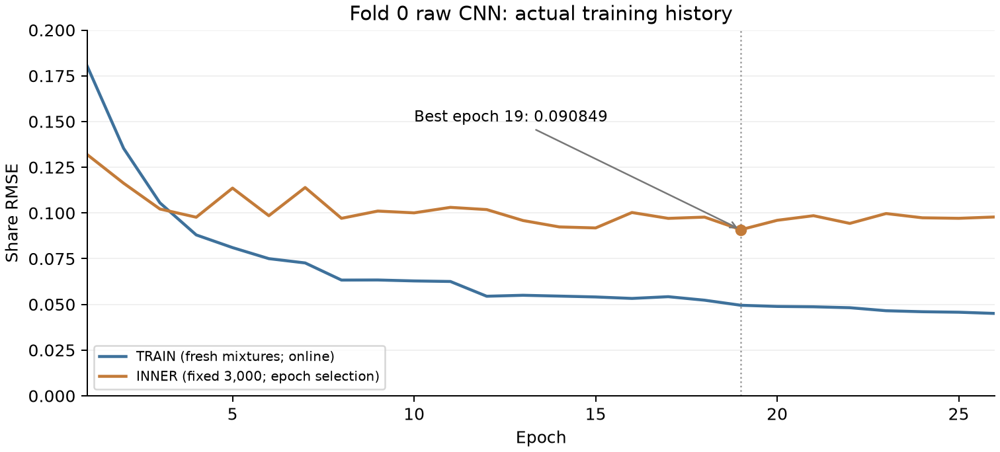
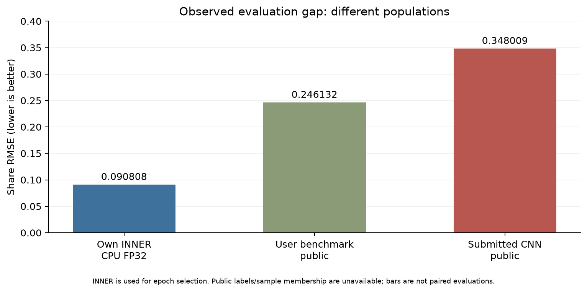

# R5 현재 이슈: 데이터 구축·학습·검증·공식 제출 격차 보고서

기준일: **2026-10-26, Asia/Seoul**. 내부 검토용 문서이며 공개 출처 고지문이 아니다.

이 문서는 현재 활성 데이터 **R4 `group_cv_passage_r4_v1`**와 학습 실행 **R5 `group_cv_r5_gpu_r1`**을 구분해 기록한다. 과거 R1/R2 결과, 사전 연결 검사, 실제 본학습, 제출 결과를 서로 섞지 않았다. 수치의 근거는 저장된 데이터 manifest·완료 모델 백업·감사 보고서·사용자 제공 제출 결과 화면이다. 보고서 작성 과정에서 새 학습·원격 접속·Test/OUTER 수치 분석·추가 제출은 하지 않았다.

## 1. 현재 상황과 가장 중요한 결론

**우리 합성 데이터에서의 낮은 INNER RMSE가 실제 대회 성능으로 이어지지 않았다. 현재 우선 해결할 문제는 이 검증 지표의 대표성이다.** 다만 정확한 단일 원인과 원인별 오차 기여량은 아직 확정하지 못했다.

| 구분 | 현재 확인 상태 |
|---|---|
| 데이터 | R4 저장 예제 297,837건 생성·내부 정합성 전수 검사 완료 |
| 학습 계획 | 원천 단위 5-fold, 각 fold에 TRAIN/INNER/OUTER 역할 구성 |
| 실제 완료 학습 | **Fold 0 CNN의 관측 정책 비교 3회** 완료 |
| 진행 중이던 모델 | Fold 0 TFGrid–FDY–Conformer, epoch 5 로그까지 기록 후 일시 정지 |
| 대형 모델 | 공개 가중치 로드·연결 검사는 완료했지만 **R5 데이터 본학습은 시작하지 않음** |
| 실제 제출 모델 | **Fold 0 원본(raw) Wide BG Mask CNN 한 개**, best epoch 19 |
| 전체 앙상블·5-fold OOF | **미완료·미측정** |
| 자체 INNER RMSE | GPU BF16 **0.090849261** / 동일 가중치 Mac CPU FP32 **0.090808147** |
| 사용자 제공 실제 공개 평가 | RMSE **0.348008679**, LB **0.65199132**, 진단 AUC **0.539533333** |
| 현재 운영 | GPU 학습 프로세스 일시 정지 확인, 완료 CNN 3개 Mac 백업 검증 완료. Pod 종료는 사용자 담당 |

**297,837건 전부를 무작위로 섞어 한 번에 학습한 것이 아니다.** 다섯 fold 각각의 역할별 합성 예제를 합친 저장 수다. 이번 제출에 사용한 CNN은 Fold 0 TRAIN 원천 53,244개를 매 epoch 동적 합성하면서 학습하고, 고정 INNER 3,000개로 epoch를 선택했다.

## 2. 대회 과제와 정답의 의미

입력 한 건은 **15분 × 25개 주파수 대역 = 375개 dB 요약값**이다. 원시 오디오 파일 1개가 아니라, 분 단위로 집계된 시간·주파수 행렬이다. 중심 주파수는 약 31.6–7,943.3 Hz이며, 일부 분은 결측일 수 있다.

주 과제는 회귀다. 통제해서 추가한 참조 성분의 에너지가 혼합 관측 에너지에서 차지하는 비율 `share_added_vessel ∈ [0,1]`을 예측한다. 보조 `score_added_vessel`은 **추가 성분의 존재**에 대한 진단 점수다. 자연적으로 존재하는 모든 선박음의 비율 또는 선종 분류가 아니다. 추가가 없는 배경에도 실제 선박음이 들어 있을 수 있다.

관측 마스크 `O`, 원 배경의 선형 에너지 `B`, 변형한 참조 `R̃`, 추가 배율 `α`에 대해:

```text
A = α R̃                         # 알려진 추가 성분
E = B + A                        # 혼합 선형 에너지
q[t,f] = A[t,f] / E[t,f]          # 셀별 추가 에너지 비율
w[t,f] = O[t,f]E[t,f] / Σ(OE)     # 관측 에너지 가중치
y = Σ(OA) / Σ(OE) = Σ(wq)        # 창 전체 share
presence = 1[y > 0]
```

공식 순위 지표는 창별 `share`의 RMSE이며 점수는 `1 − RMSE`다. 보조 AUC는 공식 순위에서 가중치가 없는 진단 지표다. 현재 구현은 창별 MSE를 평균해 학습하고 INNER RMSE로 모델을 선택한다. [공식 과제·평가](https://zindi.world/competitions/french-embassy-underwater-vessel-noise-challenge), [공식 데이터 설명](https://zindi.world/competitions/french-embassy-underwater-vessel-noise-challenge/data).

## 3. 어떤 데이터를 사용했는가

### 3.1 대회 제공 자료

| 자료 | 규모·형태 | 실제 사용 목적 |
|---|---|---|
| `South_African_Real_Acoustics.zip` | 94,916,719 bytes, 약 94.92 MB. 10개 관측 Parquet와 지점·녹음기·문서·체크섬 자료 | 합성 혼합의 실제 남아공 배경 원천 |
| 남아공 원본 관측 | **1,715,779행**, 각 행의 공통 25대역과 시간·길이·녹음기·QC 정보 | 모든 원본 행의 추적 정보를 보존하고, 적격 분 관측을 15분 창으로 정렬 |
| `Test.csv` | **1,500개 창**, ID + 375개 입력값, 2,829,614 bytes | 정책을 동결한 모델의 제출 추론에 사용. 정답은 제공되지 않음 |
| `sample_submission.csv` | ID와 제출 열 형식 | ID 순서·출력 스키마 검증 |
| `maritime_starter_notebook.ipynb` | 12개 셀, 오디오 변환 helper 및 제출 예시 | 변환식·대역 규격·제출 예시 확인. 성능을 재현한 학습 모델로 취급하지 않음 |

남아공 원본은 **자연 선박의 검증된 정답 라벨이 없는 자료**다. 원시 WAV나 정렬된 AIS 추출물도 제공되지 않았다. 1,715,779행을 보존했다는 사실은 모든 행에 검증된 자연 선박 정답을 붙였다는 뜻이 아니다.

행의 duration 메타데이터 합은 **28,358.3308시간**이다. 여러 지점·녹음기의 합이며 서로 겹치지 않는 전 지구적 시간 길이나 사용 가능한 원시 WAV 시간으로 해석하지 않는다.

### 3.2 현재 활성 외부 음원

현재 R4/R5의 양성 추가 참조는 **VTUAD (rebuilt) v1.3.2**만 사용한다. ONC 계열 실측 수중 음원이며, 출처·버전·라이선스와 strict 음원 provenance를 보존했다. [공식 deposit 및 이용조건](https://zenodo.org/records/23037895).

| 항목 | 실제 활성 규모 |
|---|---:|
| 선택 음원 | **119 clips** |
| 선택 pool 안의 연결 그룹 | **22 components** |
| 원 측정 클립 길이 합계 | **8.631944시간** |
| 원 클립 길이 | 120–1,380초 |
| 원래 900초 이상인 클립 | **3개, 연결 그룹 1개** |
| 선택 pool의 hull / recording day | 88 / 22 |
| Fold 0 TRAIN 참조 | 69 clips / 12 components |
| Fold 0 INNER 참조 | 25 clips / 5 components |

그룹은 hull·recording day·실제 UTC 구간 겹침·동일 WAV 바이트의 연결 관계로 정의했다. **22개 그룹이 서로 다른 해역·녹음 장비·독립 코퍼스 22개라는 뜻은 아니다.** 전체 525개 그래프와 선택된 pool에서의 조건부 분리를 구분해야 한다.

525개 전체를 무조건 양성으로 쓰지 않았다. 기존 허용 218개 밖 307개는 충돌 261개, 예약 21개, background 25개로 구분되어 계속 제외했다. 허용 218개 중에서도 연결을 잇는 99개를 제외해 119개를 선택했다. 이 제외를 해제해 임의로 수량을 늘리면 기존 격리·평가 약속을 다시 검토해야 한다. [선택 감사](r4_reference_selection.md), [정량 원천 감사](r4_reference_audit.json).

### 3.3 수집·검토 이력은 있지만 현재 활성 학습에서 제외한 자료

| 자료·후보 | 현재 R4/R5 상태 |
|---|---|
| HearMyShip | 과거 버전에서 사용했지만 현재 합성 참조로 사용하지 않음 |
| NOAA SanctSound | 과거 버전·별도 조사 자료는 남아 있으나 현재 참조 라우팅에서 제외. 코퍼스 전체가 불량이라는 뜻은 아님 |
| DeepShip / ShipsEar | 조사·확장 후보. 현재 119개 활성 pool에 포함하지 않음 |
| 남아공 AIS 기반 자체 passage 추출 | AIS 정렬 근거가 없고 사용자 확정 방침에 따라 진행하지 않음 |
| Qwen/CLAP 교사 점수 | 현재 합성 share/cell_share 정답을 만드는 데 사용하지 않음 |
| TimeMoE/Dasheng 공개 가중치 | 모델 초기화 자료. 외부 선박 음원 시간이나 독립 passage 수에 합산하지 않음 |

따라서 과거 수집 폴더 전체 용량이나 향후 목표 150–220시간을 현재 실제 학습 참조 규모로 표시하면 안 된다.

## 4. 원본에서 최종 R4 데이터까지의 전처리

### 4.1 남아공 분 관측 → 결측을 보존한 배경 창

1. 공통 25개 TOL 대역을 `float32` 배열로 읽고 `row_id`, 원 파일·원 행 번호·시간·장비·QC 플래그를 보존했다.
2. 초기 입력 적격 조건은 **25대역 finite, sentinel 없음, `55 ≤ duration ≤ 65초`, timestamp의 초 부분 ≤5**다. 이 규칙은 선박 유무 판정이 아니다.
3. 같은 녹음기의 같은 분이 중복되면 duration이 60초에 가까운 행을 우선하고 시간·행 번호로 정렬했다.
4. export clock 기준 고정 15분 구간에 배치하고 **관측된 분이 최소 3개**인 창을 유지했다. 빈 분은 NaN으로 남겼으며 보간하거나 무음으로 채우지 않았다.
5. 원래 고정 배경 창은 133,641개다. 예약·역할·purge를 구분한 활성 CV pool은 100,965개이며, 다섯 TRAIN 역할에서 실제 사용하는 고유 clean primary 창은 94,711개다.

초기 부적격 합집합은 **17,555행 / 1,715,779행 = 1.02315%**였다. 중복 분 정리·최소 관측 조건 이후 실제 창에 들어간 원본 행은 **1,698,184행**이다. 원본 1,715,779행 자체는 삭제하지 않았다.

SA 시간은 원 export clock을 보존했다. 시간대가 검증된 절대 UTC라고 확대 해석하지 않는다. [원본 준비 코드](../pipeline/prepare_sa.py), [이상값·선별 감사](R5_OUTLIER_AUDIT.md).

### 4.2 경계 후보와 장비 경고 처리

고정 창 안에 들어온 run 경계 후보 행은 6,777개였다. TRAIN에서는 이 후보를 포함한 **창 전체**를 제외했다. 다섯 TRAIN 역할 합계 기준 285,426개 중 17,589개, **6.16237%**를 제외해 267,837개 clean TRAIN 원천 항목을 남겼다. INNER/OUTER에는 원 분포와 플래그를 유지했다.

| Fold | 경계 제외 전 TRAIN | 경계 포함 창 제외 | clean TRAIN |
|---:|---:|---:|---:|
| 0 | 56,789 | 3,545 | 53,244 |
| 1 | 57,095 | 3,780 | 53,315 |
| 2 | 57,360 | 3,838 | 53,522 |
| 3 | 56,633 | 3,635 | 52,998 |
| 4 | 57,549 | 2,791 | 54,758 |

이 선별에는 부작용 가능성도 있다. **Cape Recife와 Riy Banks는 각 fold TRAIN 배정 창이 모두 제외되어 clean TRAIN에 0개**가 되었다. 노이즈 제거 효과와 환경 범위 축소 효과를 함께 검증해야 한다. 다만 이것이 실제 LB 실패의 원인이라는 실험적 증거는 아직 없다.

`URN_8321`의 12 kHz 명목 sample-rate와 상위 대역의 불일치 경고는 원본 **136,518행(7.95662%)**에 해당한다. 경고를 확정 오류로 취급해 일괄 삭제하지 않았다. LightGBM용 고주파 이상 파생 특징이 구현되어 있으며, 장비 ID 자체를 query 특징으로 주지 않는다. 높은 dB나 높은 share라는 이유만으로 정상적인 강한 passage를 제거하지 않았다.

### 4.3 외부 VTUAD WAV → 2초×25대역 선형 power

1. 원 WAV의 실제 sample rate를 사용하고 채널 0을 선택했다.
2. 비중첩 **2초 Hann periodogram**, constant detrending, one-sided density PSD를 계산했다.
3. 중심 `c_j = 10^(1.5 + 0.1j)`의 대역 `[c_j/10^.05, c_j×10^.05)`에서 `sum(PSD bins)×Δf`로 적분했다.
4. 25개 대역 전체를 지원하지 않거나 0-power인 2초 구간은 적격 참조로 인정하지 않았다. 모든 완전한 2초 bin을 보존하되 남는 2초 미만 구간은 버렸다.
5. 원 파일 SHA·측정 길이·UTC 구간·참조 그룹·power slice SHA를 기록했다.

결과는 **절대 압력으로 교정되었다고 입증된 Pa²가 아니라, 비교정 digital mean-square band power**다. 공식 starter의 완전한 1분 변환과 비교한 기존 수치 fixture의 최대 상대 오차는 **1.83×10⁻⁷**이었다. 이것은 변환 산술 일치이며 녹음 장비의 물리적 교정 일치를 뜻하지 않는다. [오디오 변환 코드](../pipeline/audio.py), [공식 helper 비교 근거](R5_LB_FAILURE_DOMAIN_AUDIT.md).

### 4.4 동일 R4 생성 법칙으로 TRAIN·INNER·OUTER 만들기

원천을 먼저 분리한 다음 각 역할 안에서만 다음 절차로 합성했다.

| 생성 요소 | 실제 설정 |
|---|---|
| 추가 없음 | 각 역할 `round(0.2N)`개를 고정하고 셔플 |
| 양성 목표 share | `Uniform(0.005, 0.95)`의 full-split LHS 일정 |
| 파생 참조 support | 2초 bin 60–450개, 즉 120–900초. share와 독립 난수 일정 |
| 시간 변형 | 원 궤적 전체를 한 번 단조 통과하는 power 재분배, ratio 1/3–3 |
| 평균 power | timewarp 단계에서, 후속 fade/EQ를 적용하기 전 대역별 평균 power를 보존하는 cumulative integral 방식 |
| 경계 완화 | raised-cosine amplitude² 계열 fade, 최대 30초 |
| 주파수 응답 | 참조에 매끄러운 EQ ±4 dB 적용 |
| 배치 | 15분 안에 2초 단위로 배치, 알려진 관측 support와 양성 overlap 확보 |
| 추가 배율·정답 | 변형 후 `R̃`와 관측 mask로 `α`, `E`, `q`, `y` 재계산 |
| 사용하지 않은 것 | clip 반복, dB 직접 합산, hard SNR/support cap, background blending, 추가 common gain |

요청한 share `u`를 만들 때는 아래를 사용한다.

```text
α = u Σ(OB) / ((1−u) Σ(OR̃))
E = B + αR̃
db = 10 log10(E) + 공통 기준 레벨
```

대역 power의 시간 재분배는 **실제 파형을 물리적으로 time-stretch한 것과 같다는 보장이 없다.** 한편 VT 녹음의 주변음도 `R̃`에 포함되어 함께 더해지므로 q/y는 그 추가 성분 전체의 정답이다. 자연 선박-only 성분의 정답으로 바꾸지 않았다.

TRAIN·INNER·OUTER의 **레시피는 동일**하다. R2에서 있었던 TRAIN 신정책/평가 구정책 혼용은 현재 R4에서 해소했다. 다만 같은 레시피라는 사실은 공식 비공개 generator와 같다는 증거가 아니다. [고정 생성 설정](../configs/group_cv_passage_r4_data.json), [R4 요약](R4_DATA_SUMMARY.md).

### 4.5 저장 배열과 전수 검증

각 정규 NPZ의 기본 항목은 `db[N,15,25]`, `cell_share[N,15,25]`, `share[N]`, `presence[N]`다. 별도로 sample metadata, 합성 recipe, 일정, 원천 manifest·hash를 보관한다. 관측 mask는 db의 NaN에서 복원한다.

**297,837개 전수**와 양성 recipe 238,269개에 대해 q·energy·share, mask, 원천·역할·길이·단조 변형·EQ·SHA·일정 재현을 검증했다. 저장 `q×energy→y` 최대 오차는 **3.166×10⁻⁷**이다. 이 값은 내부 수식 검증이며 외부 평가 대표성 검증이 아니다.

생성 역할 사이 평균 share 차이 0.00000538, zero 비율 차이 0.00000755, 파생 길이 KS 통계 0.00042620 등 사전 분포 gate도 통과했다. 원 측정 길이와 환경까지 같아졌다고 주장하지 않는다. [전수 검증](R4_DATA_FINAL_VERIFICATION.json).

## 5. 최종 규모: 샘플 수·시간·용량

| 저장 역할 | 예제 수 | 전체 297,837건 중 비율 | 15분 창 길이 단순 합 | 압축 NPZ |
|---|---:|---:|---:|---:|
| TRAIN, 5개 fold 역할 합 | 267,837 | 89.9274% | 66,959.25시간 | 0.390338 GB |
| INNER, 3,000×5 | 15,000 | 5.0363% | 3,750.00시간 | 0.022016 GB |
| OUTER, 3,000×5 | 15,000 | 5.0363% | 3,750.00시간 | 0.021976 GB |
| **합계** | **297,837** | **100%** | **74,459.25시간** | **0.434330 GB** |

정규 NPZ는 15개, **434,330,282 bytes = 414.21 MiB**다. 압축을 푼 정규 배열 payload는 **895,893,696 bytes ≈0.895894 GB**다. waveform을 저장하지 않고 작은 15×25 요약과 정답을 저장하므로 용량이 작다. recipe·metadata·공개 가중치·원본·과거 자료·백업은 이 수치에 포함되지 않는다.

**74,459시간은 독립 녹음 시간이 아니다.** 같은 배경·참조가 교차 fold TRAIN 또는 다른 조합에 다시 등장한 합성 창 길이의 역할 합이다. 관측된 분만 합친 역할별 grid 시간은 TRAIN 57,023.53 / INNER 3,219.98 / OUTER 3,210.72시간이며 이것도 독립 원천 시간은 아니다. 외부 양성 원 측정은 여전히 **8.63시간**이다.

R5는 고정 TRAIN NPZ만 반복하지 않는다. 각 epoch 해당 fold clean primary 배경을 **정확히 한 번씩** 순회하고, epoch seed로 참조·share·길이·EQ·위치를 새로 합성한다. 이것은 조합 다양성을 늘리지만 독립 녹음 원천의 수를 같은 비율로 늘리지는 않는다. [정량 규모](FINAL_DATASET_SCALE.json), [동적 합성 코드](../pipeline/dynamic_passage_r5.py).

## 6. 어떤 비율로 나누고 학습했는가

### 6.1 원천 단위의 5-fold 역할

남아공은 같은 장비 연결 그룹의 **주 단위 block**, VTUAD는 선택된 참조 연결 그룹을 분리 단위로 사용한다. 합성 예제를 만든 다음 무작위로 나누면 같은 녹음이 TRAIN과 validation 양쪽에 섞이므로, **원천을 나누고 그 뒤 합성**한다.

외부 fold `f=0..4`에서:

```text
OUTER 원천 = f
INNER 원천 = (f+1) mod 5
TRAIN 원천 = 남은 3개 fold
```

**5개 fold bucket의 개수 기준** 명목 구성은 **TRAIN 3/5, INNER 1/5, OUTER 1/5**다. 연결 그룹의 실제 개수 비율까지 같다는 뜻은 아니다. 예를 들어 Fold 0 VT 참조 component는 TRAIN/INNER/OUTER가 12/5/5다. 그룹별 길이·개수 차이와 purge 때문에 원천 행 수 역시 정확히 60:20:20은 아니다. 각 outer에 대해 inner 전체를 다시 5회 탐색하는 5×5 완전 nested CV가 아니라, 인접 fold 하나를 early stopping용으로 정한 회전 구성이다.

SA에서는 900초 창 support를 고려해 역할 사이 최소 **24시간 gap**을 유지한다. VT 참조는 hull/day/실제 UTC 겹침/바이트의 직접 격리다. SA의 24시간 보장을 VT 전체 또는 검증된 절대 UTC 보장으로 확대하지 않는다.

### 6.2 실제 저장 예제와 비율

| Fold | TRAIN | INNER | OUTER | 해당 fold 저장 합 |
|---:|---:|---:|---:|---:|
| 0 | 53,244 | 3,000 | 3,000 | 59,244 |
| 1 | 53,315 | 3,000 | 3,000 | 59,315 |
| 2 | 53,522 | 3,000 | 3,000 | 59,522 |
| 3 | 52,998 | 3,000 | 3,000 | 58,998 |
| 4 | 54,758 | 3,000 | 3,000 | 60,758 |

Fold 0 저장 수 기준 비율은 약 **89.8724 : 5.0638 : 5.0638**이다. fold bucket의 3:1:1 구성과 다른 이유는 TRAIN은 clean 배경 전체를 순회하는 반면 평가에서는 해당 역할 원천 pool에서 각각 고정 3,000개를 합성했기 때문이다. 평가 primary 원천 선택에는 복원 추출이 있어 **3,000건 모두가 서로 독립인 3,000개 원천이라는 뜻도 아니다.**

INNER는 매 epoch 평가·early stopping·관측 정책·앙상블 선택에 쓰는 개발 자료다. OUTER는 정책 동결 후 평가용이다. R5에서는 완료 fold가 0개이므로 **전체 OOF RMSE가 아직 없다.**

### 6.3 분리가 보장하는 것과 보장하지 않는 것

Fold 0 감사에서 TRAIN/INNER 배경 그룹 겹침과 양성 참조 그룹 겹침은 모두 0이었다. 그러나 INNER의 **4개 site와 4개 sensor group은 모두 TRAIN에도 등장**한다. 따라서 이 Fold 0 지표는 새 녹음 source block에 대한 평가이지, 완전히 새로운 지점·장비·합성 generator에 대한 검증이 아니다. [검증 설계 감사](R5_LB_FAILURE_VALIDATION_AUDIT.md).

주의: `validation.npz`의 INNER metadata는 `inner_validation_metadata.parquet`다. 역사적 `validation_metadata.parquet`는 OUTER alias이므로 혼동하지 않아야 한다. 현재 R5 runner는 역할별 명시 경로를 사용한다.

## 7. 모델에 주입한 특징과 정답

### 7.1 공통 신경망 8채널

모든 신경망 후보의 query 입력은 db와 해당 TRAIN에서 맞춘 고정 prior에서 만든 `[N,8,15,25]`다. site·recorder ID·reference ID·생성 recipe·query의 true q/y를 입력하지 않는다.

| 채널 | 특징 | 목적·한계 |
|---:|---|---|
| 1 | `(db − 창 내 관측 평균)/20` | 창 전체 상대 dB |
| 2 | `db/100` | 절대 레벨 정보. 공통 gain 불변성을 구조적으로 보장하지 않음 |
| 3 | `sqrt(정규화 선형 에너지 가중치)` | 에너지 집중 위치 |
| 4 | 관측 mask | 결측과 실제 값 구분 |
| 5 | `(db − 대역별 시간 하위 20% 분위수)/20` | 대역별 상대 초과 레벨. 순수 선박 분리 정답은 아님 |
| 6 | 인접 관측 분의 `Δt db/20` | 시간 변화. 양쪽이 관측된 경우만 계산 |
| 7 | TRAIN 집계 배경 prior에서 얻은 `q0` | 배경 대비 초과량의 추정 특징. true q가 아님 |
| 8 | `log1p(clip(Bhat/E,0,10))/log(11)` | 배경 대비 비율·overshoot 정보 |

prior는 TRAIN의 알려진 q를 이용해 `B=(1−q)E`를 복원한 뒤 최대 32개 집계 스펙트럼 중심을 만든다. 따라서 **TRAIN 라벨을 사용한 supervised nuisance prior**다. 다만 validation/query 정답을 prior fitting이나 query 입력에 쓰지 않는다. 이를 완전 비지도 prior 또는 oracle q라고 설명하면 모두 부정확하다.

현재 q0만 pooling한 Fold 0 INNER RMSE는 **0.51041**, presence AUC는 **0.23893**, zero 600개에서 q0-share 평균은 **0.73902**다. q0 자체는 좋은 분리기가 아니었다. CNN이 이 불완전한 특징을 어떻게 사용하는지는 추가 ablation이 필요하다.

### 7.2 관측 정책 비교와 선택

사전 정의한 세 정책으로 같은 CNN을 학습했다.

| 정책 | 입력 특징 반올림 | TRAIN endpoint 결측 증강 |
|---|---|---|
| raw | 없음 | 없음 |
| resolution_01 | 0.1 dB | 없음 |
| resolution_01_endpoint | 0.1 dB | 확률 0.20으로 첫/끝 1~2분 제거 시도, 최소 3관측 분 보호 |

반올림은 **feature db**에만 적용하고, 물리 pooling weights는 원래 관측 db에서 계산한다. 실제 관측 분을 제거하는 TRAIN 증강에서는 그 분의 q·에너지 질량을 제거하고 y·presence를 다시 계산한다. INNER 평가 때 임의 mask를 추가하지 않는다.

INNER 최저 RMSE 정책은 raw였고 이번 제출에도 raw를 사용했다. 세 정책이 모두 최종 앙상블의 독립 구성원으로 들어간 것은 아니다. 실제 관측 범위 밖의 Test 비율에 맞춘 사이트 가중 샘플링도 하지 않았으며, site별 분리 진단을 사용한다. [실행 설정](../configs/r5_training_gpu_r1.json).

### 7.3 LightGBM 특징과 감독 신호

현재 tree branch는 **1,324개** 특징을 구성하도록 준비됐다. 기존 격자·대역/분 통계, 에너지·초과 스펙트럼, TRAIN에서만 만든 retrieval prototype, high-frequency 이상 특징, high-band bump·low/high 상관·중대역 peak 초과·TRAIN-fitted PCA 잔차를 포함한다. prototype은 전체 저순도 혼합물 대신 excess-energy 계열을 사용한다. PCA·prototype fitting은 해당 TRAIN 내부로 제한한다.

LightGBM 본학습은 아직 하지 않았으므로 이 특징이 실제 성능을 개선했다는 결과는 없다. [특징 수치 검사](R5_PHYSICS_FEATURES_FIXTURE.json), [실제 특징 코드](../pipeline/physics_features_r5.py).

## 8. 어떤 모델을 썼고, 어디까지 학습했는가

| 후보 | 전체 branch 크기 | 학습 파라미터 | R5 실제 상태 |
|---|---:|---:|---|
| **Wide BG Mask CNN** | **1,488,002** | 전체 | Fold 0에서 세 관측 정책 학습 완료. raw 한 개를 제출 |
| TFGrid–FDY–Conformer | **2,562,150** | 전체 | Fold 0 epoch 5 로그 이후 일시 정지, 미완료 |
| TimeMoE-200M + Grid Stem/LoRA | 약 **453.892M** | **775,706 ≈0.776M** | 공개 가중치·연결 검사 완료, 본학습 미시작 |
| Dasheng-1.2B + Grid Stem/LoRA | **1,136,190,082 ≈1.136B** | **2,142,722 ≈2.143M** | 공개 가중치·연결 검사 완료, 본학습 미시작 |
| Physics/Excess Retrieval LightGBM | 신경망 M/B와 직접 비교 불가 | tree/leaf | 최대 1,500 trees 설정·연결 검사. Mac/서버 모두 본학습 미시작 |
| FDY-CRNN adaptation, 비교군 | **129,966** | 전체 | 공통 8채널 연결 검사, 본학습 미시작 |
| iTransformer adaptation, 비교군 | **295,696** | 전체 | 공통 8채널 연결 검사, 본학습 미시작 |

TimeMoE의 이름에 들어간 200M은 총 파라미터 수가 아니다. 사용 후보는 공개 Large이며 공개 가중치가 확인되지 않은 Ultra 2.4B는 제외했다. Dasheng의 1.2B는 명목 모델명이며 실제 사용 branch 계수와 구분했다. 기존 Kumo·TabICLv2·TabM은 현재 후보에서 제외돼 있다.

TFGrid–FDY–Conformer와 FDY/iTransformer는 논문 연산자를 참고해 현재 실수 energy grid에 맞춘 **자체 adaptation**이다. 원 waveform/STFT 모델의 완전 재현 또는 이 대회에서 검증된 SOTA로 부르지 않는다. Dasheng도 waveform/mel front-end를 그대로 쓰는 것이 아니라 새 grid stem을 연결했다. 공개 가중치가 있다는 사실만으로 현재 coarse grid에 잘 전이된다고 볼 수 없다.

주요 출처: [Time-MoE 논문](https://arxiv.org/abs/2409.16040), [공개 checkpoint](https://huggingface.co/Maple728/TimeMoE-200M), [Dasheng 논문](https://arxiv.org/abs/2406.06992), [공개 checkpoint](https://huggingface.co/mispeech/dasheng-1.2B), [TF-GridNet](https://arxiv.org/abs/2211.12433), [FDY 연산](https://www.isca-archive.org/interspeech_2022/nam22_interspeech.html), [Conformer](https://arxiv.org/abs/2005.08100), [LightGBM](https://proceedings.neurips.cc/paper/2017/hash/6449f44a102fde848669bdd9eb6b76fa-Abstract.html). 실제 계수·구현 범위는 [모델 명세](../MODEL_ROSTER_AND_STATUS.md)와 [공개 모델 검증](R5_MODEL_REFERENCE_FACTCHECK.md)에 있다. 해당 문서의 과거 “GPU 대기” 문구보다 **이 보고서의 실제 실행 상태가 최신**이다.

### 8.1 학습 설정

| 항목 | 소형 신경망 실제 실행 설정 |
|---|---|
| 장비 | RTX 4090 24 GB, CUDA 학습. 완료 가중치 Mac CPU FP32 추론 |
| 최대 epoch | **100** |
| early stopping | INNER RMSE, **patience 7**, 최소 개선 0.00001 |
| optimizer | **Adam**, weight decay 0.0003 |
| 초기 learning rate | 0.001 |
| LR scheduler | ReduceLROnPlateau, factor 0.5, patience 2, min LR 1e-6 |
| batch | effective/micro/evaluation 각 128 |
| dropout | 0.1 |
| gradient clipping | norm 1.0 |
| seed | 모델 seed 42, epoch/fold에 묶인 재현 가능한 합성 seed |
| contrastive learning | weight 0, **활성화하지 않음** |

대형 branch 계획은 LR 0.0001, effective batch 32, microbatch 8, evaluation batch 2, 나머지 최대 100/ES7/Adam 계약을 유지한다. LightGBM은 Adam/epoch 대신 최대 1,500 boosting trees·ES40·CPU 4 threads다. 이 대형/tree 계획을 이미 학습한 결과로 읽으면 안 된다.

Nesterov·RL·POMDP를 실행한 것은 아니며, Adam이 global minimum에 도달했다는 보장도 없다. **100 epoch는 최대 상한이지 반드시 100회 학습했다는 뜻이 아니다.**

### 8.2 출력과 손실

모든 신경망 후보는 셀 마스크 `qhat∈[0,1]`를 예측하고 `yhat=Σ(w qhat)`로 share를 만든다. q0를 출력 logit에 강제로 더하는 anchor와 residual 억제 페널티는 없다.

```text
L = mean_windows((yhat−y)^2)
  + 0.25 × mean_windows(Σ w(t,f)(qhat(t,f)−q(t,f))²)
  + 0.05 × BCEWithLogits(presence_logit, presence)
```

셀 손실과 presence는 보조 목적이다. 공식 share RMSE만의 최적화와 완전히 동일한 목적 함수는 아니므로 보조 가중치의 이득은 별도 실험으로 확인해야 한다. 현재 이 가중치가 LB 실패의 원인이라는 근거는 없다.

## 9. 내부 최적점과 실제 제출 사이의 격차

### 9.1 완료한 세 CNN의 성능

| Fold 0 관측 정책 | 최적 INNER RMSE, GPU BF16 | best epoch | 실행 epoch | 종료 이유 | 학습 경과 시간 |
|---|---:|---:|---:|---|---:|
| raw | **0.090849261** | **19** | **26** | ES7 | 약 98.61분 |
| 0.1 dB 반올림 | 0.099602575 | 3 | 10 | ES7 | 약 37.59분 |
| 반올림 + endpoint 결측 | 0.096575277 | 10 | 17 | ES7 | 약 64.11분 |

raw CNN의 실제 로그:

| Epoch | TRAIN online RMSE | 고정 INNER RMSE | 기록 LR |
|---:|---:|---:|---:|
| 1 | 0.180163 | 0.131866 | 0.001 |
| 3 | 0.105526 | 0.102157 | 0.001 |
| 10 | 0.062826 | 0.100050 | 0.0005 |
| **19** | **0.049515** | **0.090849** | **0.000125** |
| 26 | 0.045049 | 0.097805 | 0.00003125 |



TRAIN 수치는 해당 epoch의 새 합성 batch를 학습하며 집계한 online 값이며 고정 TRAIN 전체의 사후 평가와 같지 않다. 그럼에도 후반 TRAIN은 낮아지고 INNER는 최적 이후 다시 나빠져, best checkpoint를 선택하고 ES7로 종료했다. **학습이 아예 안 됐거나 100 epoch를 채우지 않아 실패했다고 단정할 근거는 없다.** 같은 합성 체계 안에서의 과적합 징후와 외부 도메인 일반화 실패는 구분해야 한다.

중단 당시 TFGrid–FDY–Conformer의 최신 epoch는 5, TRAIN RMSE 약 0.071088, INNER 약 0.113369, best INNER 약 0.099271(epoch 2)이었다. 이 모델은 미완료이고 제출에 사용하지 않았다.

### 9.2 같은 완료 가중치의 CPU 추론과 공식 결과

| 평가 | RMSE | MAE | 평균 bias, 예측−정답 | presence ROC-AUC |
|---|---:|---:|---:|---:|
| 원본 CNN GPU BF16 INNER 최적 | 0.090849261 | 여기서는 미기재 | 여기서는 미기재 | 여기서는 미기재 |
| 동일 가중치 Mac CPU FP32 INNER 3,000개 | **0.090808147** | **0.048217629** | **−0.009386678** | **0.996720833** |
| 사용자 제공 공개 제출 `Vz5mjZEr` | **0.348008679** | 비공개 | 비공개 | **0.539533333** |
| 사용자 제시 Benchmark 공개 점수 0.753867825 | **0.246132175** | 미확인 | 미확인 | 미확인 |



산술적으로 공개 RMSE는 CPU INNER보다 **0.257200532** 크고, 약 **3.83배**다. 제곱오차의 비는 약 **14.69배**다. Benchmark RMSE보다 **0.101876504**, 약 **41.39%** 크다. 이는 **서로 다른 평가 모집단의 지표 차이**이며 같은 샘플에 대한 paired 오차 증가나 원인별 기여량이 아니다. 공개 평가에는 제출 1,500건 중 비공개로 선택된 일부가 쓰이며 그 정답·소속은 우리에게 없다.

presence AUC도 0.99672에서 0.53953으로 크게 달라졌다. 자체 합성에서의 추가 성분 판별은 거의 완벽하지만 공개 평가에서는 무작위 순위에 가까운 수준이었다. 따라서 단순 scalar offset 조정만으로 충분하다는 판단은 근거가 부족하다. ROC-AUC는 판별 점수의 순위를 평가하는 지표이지만, **이 대회 순위 산정에서는 가중치가 0인 보조 지표**다.

**`1−0.090808≈0.909192`를 예상 LB로 제시할 수 없었다.** 내부 metric에 동일한 산식을 적용한 값일 뿐이고, 실제 공개 평가는 0.65199132였다. 해당 내부 검증을 근거로 우수한 공식 성능을 기대한 판단은 충분히 검증되지 않았다.

### 9.3 후처리와 실제 제출 모델

같은 INNER 예측에 source-crossfit 진단을 적용해 사전에 정한 세 후처리를 비교했다.

| 후보 | crossfit 진단 RMSE | 선택 |
|---|---:|---|
| identity | **0.090808147** | 채택 |
| 제한된 offset | 0.091789314 | gate 실패 |
| 제한된 affine | 0.092133282 | gate 실패 |

최종 정책은 **`a=1, b=0`**, 즉 예측값을 바꾸지 않는 identity였다. 원 예측이 [0,1] 안에 있어 clip도 값을 바꾸지 않았다. presence score도 수정하지 않았다. 따라서 “후처리 적용 때문에 이번 값이 변질됐다”는 증거는 없다.

이 crossfit은 후처리 계수의 진단이다. 기본 CNN이 이미 같은 INNER 전체로 epoch를 선택했으므로, 이를 독립적인 neural OOF라고 부르지 않는다. [후처리 근거](R5_CNN_PILOT_CALIBRATION/README.md).

제출에 건넨 로컬 파일은 [pilot submission.csv](../submissions/r5_fold0_raw_cnn_cpu_pilot_r1/submission.csv)이며, 로컬 SHA256은 다음과 같다.

```text
e32b04a2b876a66da6046e1ef1fdae6fd7e768eb9365bde5aa7227ad235c83fe
```

Documents 원본·독립 재현본·Desktop `SUBMIT_NOW` 사본은 byte SHA가 같았다. **Zindi가 실제 받은 업로드 파일을 재다운로드해 SHA를 대조하지는 않았다.** 제출 ID·점수는 사용자 화면 관측이며, 위 hash는 어디까지나 로컬 handoff 파일의 hash다.

### 9.4 Benchmark와 로컬 starter를 혼동하면 안 되는 이유

현재 보유한 공식 starter notebook의 제출 예시는 학습 없이 share=0.1, score=0.5를 넣는 상수 예시다. 그 코드와 사용자 제시 Benchmark 점수 0.753867825 사이의 검증 가능한 대응 관계는 찾지 못했다.

해당 상수 예시를 우리 데이터에 그대로 평가한 pooled INNER RMSE는 **0.418974162**였다. 별도 우리 TRAIN 평균 상수 baseline의 pooled INNER RMSE는 **0.309864199**다. 상수 baseline은 주로 정답 평균·분산의 영향을 받으므로 이것만으로 **“우리 validation이 공식 Test보다 더 어렵다”라고 결론낼 수 없다.** 이 두 자체 진단에 Benchmark 이름을 붙이지 않는다. [공식 starter 자체 평가](R5_OFFICIAL_STARTER_TRAIN_INNER/README.md), [TRAIN 평균 대조](R5_TRAIN_MEAN_BASELINE_TRAIN_INNER/README.md).

## 10. 현재 실제로 확인된 문제

아래는 단순 의심 목록이 아니라 현재 자료로 확인된 상태다. 원인 확정 여부는 별도다.

| 이슈 | 확인된 증거 | 의미 |
|---|---|---|
| **내부 validation의 외부 성능 대리 지표 실패** | INNER 0.090808 vs public 0.348009, AUC 0.99672 vs 0.53953 | 현재 INNER 수치만 보고 학습·앙상블을 확장할 근거가 약함 |
| 같은 합성 generator 공유 | TRAIN/INNER/OUTER 모두 같은 R4 sampler·u/길이/fade/EQ 계열 | 원천 holdout은 했지만 generator holdout은 하지 않음 |
| Fold 0 평가의 지점·장비 범위 중복 | INNER의 4 sites/4 sensor groups가 TRAIN에도 존재 | 미관측 지점·장비 전이를 검증하지 못함 |
| 독립 참조 정보의 제한 | VTUAD 8.63시간·선택 22그룹, 원래 장시간 clips는 3개/1그룹 | 많은 합성 행이 독립 원천 확장과 같지 않음 |
| 폭넓은 시간 재분배 | 양성 중 ratio가 0.8–1.25 밖인 비율 TRAIN 83.64%, INNER 85.96% | 단순한 미세 증강 중심 데이터가 아님 |
| 선별에 따른 환경 범위 축소 | Cape Recife/Riy Banks clean TRAIN 0 | QC가 모든 도메인에서 균일하게 작동하지 않음 |
| prior 단독 품질 낮음 | q0 INNER RMSE 0.51041 | q0를 검증된 분리기로 취급할 수 없음. CNN 특징으로서의 기여와 실패 기여는 미확인 |
| 전체 파이프라인 평가 미완료 | Fold 0 CNN 3정책만 완료, 전체 fold 0개 완료 | 이번 LB를 최종 5모델/7후보 앙상블 결과로 부를 수 없음 |
| 최적 INNER의 모델 선택 편향 | epoch·관측 정책 선택에 같은 INNER 사용 | 최적점은 독립 최종 평가보다 낙관적일 수 있음 |

기존 R2의 **TRAIN/V1 INNER 생성 규칙 불일치**, short-reference hard cap, NOAA 의존 등은 현재 R4와 구분해야 한다. R4에서는 동일 정책·VT 중심으로 변경됐으므로 그 옛 오류가 그대로 남아 있다고 설명하지 않는다. 그렇다고 R4의 일반화 문제가 해결된 것도 아니다.

## 11. 원인으로 추정되는 것과 아직 단정하지 못하는 것

### 가설 A. 선박의 일반적 구조보다 ‘외부 녹음이 섞인 흔적’을 배웠을 가능성

**쉽게 말하면:** 선박 통과 자체를 배우는 대신, 남아공 배경과 VT 녹음의 대역 모양 차이를 구분해 합성 정답을 잘 맞췄을 수 있다.

양성에는 선박뿐 아니라 VT 녹음의 주변음·장비 응답도 함께 추가된다. zero는 변경하지 않은 SA 배경이다. 자체 TRAIN/INNER에서 단일 고주파 에너지 비율만으로 presence AUC가 **0.78266 / 0.82793**이었다. nominal 1,995.3–7,943.3 Hz의 대역 비율을 쓴 단순 진단이다. 저주파 ≤200 Hz 에너지 비율과 share의 상관도 **−0.60319 / −0.59848**로 강했다.

이것은 shortcut 가설을 뒷받침하는 자체 자료의 관측이다. 공식 hidden generator에도 같은 대조가 있는지, 실제 실패에 얼마나 기여했는지는 모른다. **고주파 특징을 없애면 해결된다는 결론도 아직 아니다.**

### 가설 B. 합성 generator의 가정과 실제 평가 조건이 다를 가능성

**쉽게 말하면:** 서로 다른 녹음을 시험에 썼지만, 문제를 만드는 규칙 자체는 TRAIN과 INNER가 공유했다. 모델이 그 규칙에 익숙해진 것일 수 있다.

우리의 zero 20%, 양성 share Uniform, support 길이, ratio 1/3–3, fade 형태, EQ 범위, mask와 위치의 관계는 사전 정한 합성 설계다. 공식적으로 같은 recipe라고 확인된 것은 아니다. 공식 평가 배경 기간은 공개 TRAIN에서 제외되고 세부 변형은 공개되지 않았다.

현재 증거는 **같은 원천 이름을 사용하면 같은 데이터 분포가 된다**는 판단을 지지하지 않는다. `E=B+A`라는 식이 같아도 B/R의 성격, 변형·배치 순서와 샘플링 법칙이 다르면 모델이 풀어야 할 문제가 달라진다.

### 가설 C. 시간 변형과 분 평균 연산 순서의 차이

공식 starter helper는 완전한 60초까지만 사용해 30개 2초 power의 분 평균을 반환한다. 우리 R4는 완전한 2초 bin을 보존하고 **2초 궤적 warp → fade/EQ → 위치 배치 → 분 평균**을 한다. 일반적으로 이 순서는 분 평균을 먼저 하고 변형하는 것과 같지 않다.

또한 시간 변형의 강도가 큰 양성이 대부분이고, 특정 rendered 길이를 만들 수 있는 source만 선택되므로 길이와 source의 의존성이 생긴다. 이것이 자기 generator 안의 유용한 단서가 될 수 있다.

그러나 **실제 비공개 generator가 starter helper의 분 평균만 사용했다고 입증된 것은 아니다.** 확인된 것은 helper와 우리 연산의 차이이며, 이번 실패의 단독 원인은 미확정이다.

### 가설 D. 검증이 새로운 환경과 생성 법칙을 충분히 시험하지 못했을 가능성

source 격리와 24시간 purge는 직접 중복·시간 누수를 줄인다. 하지만 장비·해역·계절·생성 방식이 달라지는 문제를 자동으로 해결하지 않는다. INNER 최적점을 여러 후보 선택에 반복 사용한 점도 낙관성을 추가할 수 있다.

이 선택 편향이 RMSE 0.2572 차이 전부를 설명한다고 실험적으로 입증된 것은 아니다. 별도 잠긴 원천 및 generator-family holdout으로 다시 평가해야 한다.

### 가설 E. prior·절대 레벨·다중 손실에 대한 생성기 의존

q0가 부정확하고 절대 dB 채널이 있으므로, CNN이 내부 합성에서만 통하는 보정 방식을 익혔을 수 있다. 셀/presence 보조 손실도 실제 hidden 분포에서 share 회귀에 이득인지 미검증이다.

현재 감사에서는 **query true q/y의 직접 입력 누수는 찾지 못했다.** TRAIN 라벨로 집계 prior를 맞추는 행위와 query 라벨 유출을 구분해야 한다. 모델의 잘못된 특징 의존 여부는 prior 제거·채널 제거·loss ablation으로 확인할 후보이며 아직 실행하지 않았다.

### 가설 F. 도메인 다양성·QC·단일 fold 제출의 영향

합성 조합은 많지만 참조의 독립 정보는 작고 QC로 빠진 배경 지역도 있다. 다른 fold·다른 모델을 함께 썼다면 분산이 줄 수 있지만, **같은 편향을 공유하면 앙상블도 해결하지 못한다.** 대형 backbone이나 추가 epoch만으로 LB가 개선된다는 근거는 없다.

현재 public 결과는 단일 Fold 0 모델이다. 이것이 결과의 제한이기는 하지만 “나머지 모델을 학습하면 자동으로 0.90을 넘는다”는 뜻은 아니다.

## 12. 이미 확인한 구현과 수치 스트레스 결과

### 12.1 제출·구현 감사

| 검사 | 확인 결과 |
|---|---|
| 로컬 원본·독립 재현·Desktop CSV | SHA 전수 일치, 1,500행·3열 |
| ID와 열 순서 | 중복 없음, sample 제출 순서 및 저장 예측과 일치 |
| 예측과 CSV | 모든 share/score 값이 원본 CPU 예측과 일치 |
| 후처리 | identity, 값 변경 없음 |
| 가중치 | 완료 raw CNN epoch 19, checkpoint·prior·코드 SHA 검증 |
| parser 재현 | 자체 INNER 16개를 375열 CSV로 왕복한 dB·NaN·8채널·weights·예측 bitwise 일치 |
| TRAIN raw vs inference | 같은 입력의 변환·weights·예측 bitwise 일치 |
| 에너지 정답·pooling | 독립 B/R 숫자 fixture 및 실제 INNER 검사 통과 |
| CPU vs GPU | 동일 INNER RMSE 차이 **−0.000041114**, 예측 벡터 간 RMSE 0.000584365 |

현재 감사 범위에서 **CSV 순서·축·잘못된 checkpoint·dB 직접 합산·다른 전처리·identity 오적용이 이번 큰 격차를 일으켰다는 증거를 찾지 못했다.** 이는 가능한 모든 구현 오류를 보편적으로 증명해 배제했다는 뜻은 아니다. CPU/GPU의 작은 차이를 다른 미관측 집합에 대한 보편 상한으로도 해석하지 않는다. [구현 감사](R5_LB_FAILURE_IMPLEMENTATION_AUDIT.md).

### 12.2 고정 CNN·자체 INNER 전용 물리 스트레스

결과를 보기 전에 9개 시나리오를 고정했다. 모델 fitting·정책 선택 없이 같은 epoch 19 CNN과 INNER 3,000개로 전부 평가했다. gain은 q/y를 유지하고, tilt·분 제거는 변형된 에너지·mask에서 y를 다시 계산했다. tilt는 대역 좌표 −1..1에 ±4 dB 계수를 곱한 매끄러운 선형 경사로, 양 끝의 레벨 차이는 8 dB다. 여기의 endpoint 스트레스는 첫/끝 **1분** 제거이며 TRAIN의 1~2분 증강과 구분한다. Test·OUTER·GPU는 사용하지 않았다.

| 시나리오 | RMSE | MAE | bias | presence AUC |
|---|---:|---:|---:|---:|
| 원래 입력 | 0.090808 | 0.048218 | −0.009387 | 0.996721 |
| 공통 gain −12 dB | 0.092714 | 0.048014 | −0.018187 | 0.996585 |
| 공통 gain −6 dB | 0.091405 | 0.047796 | −0.013918 | 0.996678 |
| 공통 gain +6 dB | 0.091094 | 0.049268 | −0.004527 | 0.996684 |
| 공통 gain +12 dB | 0.092518 | 0.051061 | +0.000721 | 0.996553 |
| 매끄러운 주파수 tilt −4 dB | 0.120976 | 0.062184 | −0.036700 | 0.994119 |
| 매끄러운 주파수 tilt +4 dB | 0.072482 | 0.042686 | +0.008973 | 0.997163 |
| 첫 분 제거 | 0.099518 | 0.055210 | −0.017507 | 0.995892 |
| 끝 분 제거 | 0.094956 | 0.051185 | −0.009550 | 0.995789 |

**선언한 단순 gain·tilt·endpoint 변화만으로는 public RMSE 0.348/AUC 0.539의 붕괴를 재현하지 못했다.** 다만 완전한 불변성을 보인 것은 아니다. 예를 들어 +12 dB에서 정답은 같아도 개별 share 예측의 최대 변화가 약 0.141이었다. 이 실험은 특정 변형에 대한 민감도 진단이며, 실제 hidden 변형의 존재·부재 또는 원인을 증명하지 않는다. [9개 전 결과·사전 사양](R5_PHYSICAL_ROBUSTNESS_AUDIT.md).

## 13. 사용한 평가 지표와 현재 해석 한계

| 지표 | 용도 |
|---|---|
| **share RMSE** | 주 모델·epoch·앙상블 선택 기준 |
| MAE | 평균적인 절대 오차 규모 |
| bias | 과소/과대추정 방향 |
| R² / Spearman | 설명력·순위의 진단. 공식 목적을 대체하지 않음 |
| 절대 오차 p50/p90/p95/p99·worst-decile RMSE | 꼬리 오차와 큰 실패 |
| share 구간별 RMSE·bias | 고비율·저비율에서의 문제 |
| source/site/sensor/coverage/경계 플래그별 지표 | 특정 환경이나 QC에 집중된 실패 |
| presence ROC-AUC / AP / Brier / ECE | 알려진 추가 여부의 판별·확률 진단 |
| cell loss·pooling residual | 셀 감독과 물리 합산의 수치 정합성 |
| source-group bootstrap·fold 분산 | 가용 원천 조건 아래의 불확실성. 대회 전체 도메인 보장은 아님 |

위 지표 계산 기능과 진단은 준비되어 있지만 모든 후보·모든 OUTER에서 실제 지표가 산출된 것은 아니다. 공개 제출은 화면에 나온 RMSE·AUC만 알며 MAE·bias·오류 사례별 분석은 불가능하다. **전체 OOF, 앙상블 후 OOF, 후처리 후 OOF는 현재 미측정**이다. [지표 코드](../pipeline/metrics.py).

## 14. 현재 중단 상태와 다음 검증의 우선순위

2026-10-26 **03:12:52 KST**에 학습 driver·활성 TFGrid 프로세스·supervisor가 SIGSTOP 상태임을 확인했다. 자동 재개는 꺼져 있고 30분 RMSE 자동화도 삭제했다. Pod 종료는 사용자가 수행한다. 이 문서가 현재 Pod가 계속 켜져 있다는 원격 실시간 확인을 뜻하지는 않는다.

완료 CNN 세 개는 Mac에 복사하고 ZIP SHA·CRC·21개 payload SHA를 검증했다. 마지막 완료 백업 SHA는 `6e539c915d01482c43d4a9606d5281657ebad11083f96039714214ccc12f2b2b`다. TFGrid partial run은 완료 모델로 인증하지 않았으며 자동 재사용하지 않는다. [중단 확인 receipt](../ops/r5_data_audit_pause_receipt.json), [현재 로컬 상태](../ops/r5_remote_state.json).

후속 작업은 아래 순서가 타당하다. **아래 미실행 제안을 이미 완료한 것으로 보지 않는다.**

1. **완료:** 고정 가중치·로컬 제출 파일·parser·정답 수식·학습/추론 경로 감사. 큰 구현 오류를 재현하지 못했다는 결과를 보존한다.
2. **완료:** 동일 INNER에서 사전 고정한 9개 물리 스트레스. 단순 변화만으로 이번 붕괴가 재현되지 않았다는 결과를 보존한다.
3. **다음:** 원천 격리를 유지하면서 **생성 연산자까지 분리한 검증**을 설계한다. 예: minute-first/2초-first, 무 warp 실제 궤적/선언된 warp, 다른 사전 고정 fade·support 계열. 각 label은 변형 후 실제 알려진 성분에서 재계산한다.
4. **다음:** 가능한 범위에서 site/sensor/참조 domain holdout을 별도로 두고, QC 때문에 범위가 사라진 지점을 어떻게 평가할지 사전 정의한다. 어려운 사례를 지워 지표를 낮추지 않는다.
5. **다음:** 같은 잠긴 평가에서 prior·절대 dB·시간 변형·보조 loss를 한 요소씩 바꾸는 ablation으로 가설을 검증한다. 이미 여러 번 본 INNER를 새 독립 검증이라고 다시 부르지 않는다.
6. **그 이후:** 검증 체계가 납득 가능한 상태에서 소형 모델과 사전학습 adapter를 비교한다. source/family별 오차가 개선되고 단독 최고 모델보다 좋아질 때만 앙상블을 채택한다.

Test population 통계·공개 점수로 목표 prior나 calibration 계수를 맞추거나 hidden source·정답을 복구하는 경로는 개선 방법으로 사용하지 않는다. 새 독립 평가의 설계는 허용 원천·TRAIN/개발 자료와 공개 task 정의에서 정하고, 이미 본 OUTER/LB는 그 실행의 보고 결과로 보존한다.

**현재 답:** 데이터 내부 계산은 재현되지만, 합성·검증 체계가 대회의 미관측 평가 조건을 대표한다는 근거가 부족했다. 원인 가설들을 구분해 검증하기 전에는 더 많은 GPU 학습·더 큰 모델·앙상블을 해결책으로 단정할 수 없다.

## 15. 파일 안내와 증거의 우선순위

이번 보고서는 실행 중지 이후의 통합 현황이다. 과거 파일의 “GPU 대기”, “전부 검증 완료”, “모델 학습 미실행” 등 문구는 작성 당시의 특정 단계에 대한 기록이므로 현재 실행 현황에 그대로 적용하면 안 된다.

| 확인할 내용 | 파일 |
|---|---|
| 본 문서의 수치·완료 epoch·그림 원자료 | [R5_CURRENT_ISSUES_FACTS.json](R5_CURRENT_ISSUES_FACTS.json) |
| 실제 R4 수량·동일 생성 법칙 | [R4_DATA_SUMMARY.md](R4_DATA_SUMMARY.md), [FINAL_DATASET_SCALE.json](FINAL_DATASET_SCALE.json) |
| 데이터 전수 검산 | [R4_DATA_FINAL_VERIFICATION.json](R4_DATA_FINAL_VERIFICATION.json) |
| 원천 선택·격리 | [r4_reference_selection.md](r4_reference_selection.md), [r4_reference_audit.json](r4_reference_audit.json) |
| outlier·QC 비율과 도메인 범위 | [R5_OUTLIER_AUDIT.md](R5_OUTLIER_AUDIT.md) |
| 현재 GPU 실행 설정 | [r5_training_gpu_r1.json](../configs/r5_training_gpu_r1.json) |
| 완료 모델 백업 | [완료 CNN 3개 ZIP](../ops/server_backups/r5_gpu_r1/r5_snapshot_20261025T181356_426036Z_a349d40f.zip) |
| 동일 모델 CPU 결과 | [R5_CNN_MAC_INFERENCE_PROFILE.json](R5_CNN_MAC_INFERENCE_PROFILE.json) |
| 자체 validation 감사 | [R5_LB_FAILURE_VALIDATION_AUDIT.md](R5_LB_FAILURE_VALIDATION_AUDIT.md) |
| 공식 정의·단위·helper 차이 | [R5_LB_FAILURE_DOMAIN_AUDIT.md](R5_LB_FAILURE_DOMAIN_AUDIT.md) |
| parser·CSV·가중치·수식 감사 | [R5_LB_FAILURE_IMPLEMENTATION_AUDIT.md](R5_LB_FAILURE_IMPLEMENTATION_AUDIT.md) |
| 물리 스트레스 전 결과 | [R5_PHYSICAL_ROBUSTNESS_AUDIT.md](R5_PHYSICAL_ROBUSTNESS_AUDIT.md) |
| 기존 전체 데이터 상세 보고서 | [DATASET_CONSTRUCTION_PREPROCESSING_REPORT.md](../DATASET_CONSTRUCTION_PREPROCESSING_REPORT.md) |
| 원본 EDA 화면 | [기존 EDA HTML](report.html) |

문서의 로컬 링크·이미지는 상대 경로다. 프로젝트 폴더 전체를 같은 구조로 옮기면 GPU 서버·다른 IDE에서도 경로를 유지할 수 있다. 공개 데이터·모델 출처는 본문에 직접 연결했다.
