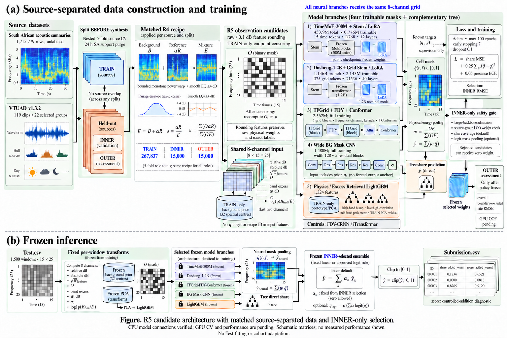

# R5 학습·동결 추론 통합 상태

2026-10-25 기준입니다. **CPU 통합 검증과 실제 R4 데이터·공개 가중치 무결성 사전검증을 완료했습니다. GPU에서 실제 Fold 학습·OOF·Test 추론은 아직 실행하지 않았습니다.**



## 완료한 범위와 아직 측정하지 않은 범위

| 범위 | 상태 |
|---|---|
| R4 TRAIN/INNER/OUTER 297,837건·119 VTUAD클립/22그룹 | 기존 전수 검증 결과 유지, 파일 변경 없음 |
| 두 실제 공개 foundation weights | 공식 revision·파일 SHA 확인, 실제 CPU 로드·Stem/LoRA 연결·Adam 업데이트·frozen base 보존·재로드 통과 |
| Wide CNN / TFGrid-FDY-Conformer / FDY8 / iTransformer8 | 실제 구현·합성 CPU 예제에서 공통8채널·Adam·gradient·물리 pooling·체크포인트 재로드 통과 |
| Physics/Retrieval LightGBM | 합성 TRAIN96/INNER24·8tree fixture에서 1,324개 피처·TRAIN PCA/prototype·저장 복원·배치 독립성 통과 |
| 전체 실행 순서 | 숫자 fixture와 stub child로 TRAIN→INNER 선택→정책 동결→OUTER 평가 순서 검사. 이 검사는 실제 모델 본학습을 대신하지 않음 |
| 동결 5-fold 추론 | mock backend fixture에서 완료 상태·SHA·동일 config·선택 모델·배치 제한·고정 fold 평균 검사 |
| 실제 데이터·가중치 사전검사 | 5fold TRAIN/INNER 정합, 원천 gate, 공개 가중치 SHA, CPU 검증 receipt 확인 |
| 실제 GPU 학습·수렴·VRAM·epoch 처리량·OOF RMSE | **미측정**. 새 GPU 접속 후 점검 필요 |

## EDA 제안의 반영 방식

### 1. 0.1dB 반올림은 특징 표현 후보

미리 선언한 세 후보는 `raw`, `resolution_01`, `resolution_01_endpoint`입니다. 각 fold TRAIN에서 같은 CNN을 별도로 학습하고 **해당 fold INNER**에서 후보를 선택합니다. 다른 fold OUTER나 Test로 고르지 않습니다.

반올림은 `feature_db`에 적용합니다. 8개 학습 채널과 LightGBM 피처는 이 특징용 관측값으로 계산합니다. 물리 pooling `w`와 기존 정답은 반올림 전 관측 에너지에 유지합니다. 반올림한 에너지 가중치에 원래 `q`를 곱하면 정확한 `y`가 달라질 수 있으므로 그 둘을 바꾸어 끼우지 않습니다.

### 2. LightGBM에 13개 신규 피처

- 고주파 3~8kHz 에너지의 시간축 최대 dB−중앙 dB
- 저주파 ≤200Hz / 고주파 ≥3kHz의 유효 분 시계열 상관
- 중주파 300~3,000Hz 피크 분의 대역별 하위20% baseline 대비 초과 선형 에너지 10개
- 해당 fold TRAIN에서만 적합한 3성분 PCA의 관측 대역 재구성 잔차 RMS 1개

기존1,258개 고정 특징 +45개 물리 특징 +8개 TRAIN prototype 유사도 +신규13개 = **1,324개**입니다. 이 정의들은 기존 EDA와 일부 대역/집계가 다르므로 EDA의 KS 수치를 재현했다거나 정답 예측력을 증명했다고 표현하지 않습니다.

### 3. TRAIN 전용 추가 결측·사이트별 평가

추가 결측 후보는 Test에서 관측한 빈도와 무관한 고정 확률0.2로 첫쪽/끝쪽 최대2분을 가립니다. 최소3개 관측 분을 보호하고, 기존에 없는 분이면 건너뜁니다. 제안을 다시 뽑지 않습니다.

새 마스크 `O'`에서 `w'=O'E/Σ(O'E)`, `y'=Σ(O'E q)/Σ(O'E)`를 계산합니다. 추가 성분이 남지 않으면 `presence'=0`으로 바뀔 수 있으며 이 전환도 기록합니다. INNER/OUTER 배열에는 이 증강을 적용하지 않습니다. **R4 합성 원천·레시피의 역할 간 일치와 R5 TRAIN 관측 증강은 별도 단계**입니다. 저장한 R4 데이터는 그대로 보존합니다.

사이트별·최악 사이트·macro-site RMSE를 평가합니다. Test의 추정 사이트 구성으로 학습 가중치나 샘플 수를 맞추지 않습니다. 기존 EDA의 Test 사이트 비율은 kNN 추정 결과이며 실제 사이트 정답이 아닙니다.

## 학습과 선택 계약

- 주 후보5종: TimeMoE public, Dasheng, TFGrid-FDY-Conformer, Wide BG CNN, Physics LightGBM.
- 비교군: 동일8채널을 받는 FDY-CRNN과 iTransformer.
- Neural: **Adam·최대100epoch·early stopping7·dropout0.1**, `share MSE +0.25 energy-weighted cell MSE +0.05 presence BCE`.
- 매 epoch 전체 clean TRAIN primary를 정확히1회 순회하고 새 결정적 seed의 합성을 사용합니다. source identity·epoch plan SHA·처리 수·추가 결측 통계를 영구 기록합니다.
- 대형 모델은 개별 INNER 성능 gate를 통과해야 앙상블 후보에 포함됩니다. share 가중 평균이 기본이며 logit-mask 결합은 INNER source-LOO에서도 개선해야 채택합니다.
- 정책·가중치·관측 변환을 동결한 뒤 OUTER를 평가합니다. OUTER가 나쁘더라도 그 결과로 가중치를 다시 맞추지 않습니다.
- 전체/경계 제외 OOF, 사이트·배경 원천·target 구간별 지표를 기록합니다.
- 새 실행 경로만 허용합니다. 실패한 partial run이나 구형 R2 task weights를 재사용하지 않습니다.

기존 `validation_metadata.parquet`는 역사적 OUTER join 이름입니다. 새 러너는 **INNER=`inner_validation_metadata.parquet`**, OUTER=`outer_validation_metadata.parquet`를 명시하여 행·역할·share·SHA를 검증합니다.

## 실행 진입점

프로젝트 루트에서 사전검증:

```sh
python -m pipeline.runner_r5 preflight --output reports/R5_TRAINING_PREFLIGHT.json
```

CUDA 호스트에서 새 Fold0 실제 학습을 시작할 때:

```sh
python -m pipeline.runner_r5 fit --folds 0 \
  --preflight-report reports/R5_TRAINING_PREFLIGHT.json \
  --output models/r5_fold0_first_gpu_run
```

완료된 **5fold** 모델의 고정 추론만 실행할 때:

```sh
python -m pipeline.inference_r5 infer --run-dir models/COMPLETED_R5_RUN \
  --input data/raw/Test.csv --output outputs/submission_r5.csv
```

추론은 저장된 모델별 평가 배치 상한을 유지합니다. 대형 모델의 기본 상한은2이며 일반 query batch128을 그대로 적용하지 않습니다. 완료5fold·단일 config·prior·checkpoint·정책·코드 SHA가 모두 맞아야 실행합니다. 대회 제출은 자동 수행하지 않습니다.

위 명령은 준비된 인터페이스이며 아직 실제 GPU에서 검증한 실행 결과가 아닙니다. Mac ARM64용 `models/pretrained_r5/runtime`은 Linux로 복사해서 사용하지 말고 Linux 호스트에서 동일한 버전을 새로 설치해야 합니다.

## 검증 근거

- [실제 데이터·공개 가중치·CPU receipt 사전검사](R5_TRAINING_PREFLIGHT.json)
- [6개 신경망 실제 CPU factory/Adam/복원 fixture](R5_NEURAL_RUNNER_FIXTURE.json)
- [관측 반올림·결측 수식 fixture](R5_OBSERVATION_AUGMENTATION_FIXTURE.json)
- [신규 물리 특징·TRAIN PCA fixture](R5_PHYSICS_FEATURES_FIXTURE.json)
- [LightGBM 통합 fixture](R5_LGBM_RUNNER_FIXTURE.json)
- [INNER 전용 앙상블 fixture](R5_ENSEMBLE_FIXTURE.json)
- [전체 실행 순서 fixture · child는 stub](R5_RUNNER_ORCHESTRATION_FIXTURE.json)
- [동결 추론 fixture · backend는 mock](R5_FROZEN_INFERENCE_FIXTURE.json)
- [EDA 해석·규정 감사](R5_EDA_INTEGRATION_FACTCHECK.md)

현재 상태는 **CPU 준비 완료 / GPU 검증·본학습 대기**입니다. 새 RMSE나 리더보드 개선을 측정한 것으로 읽으면 안 됩니다.
