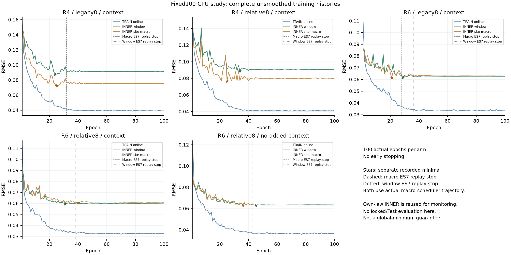
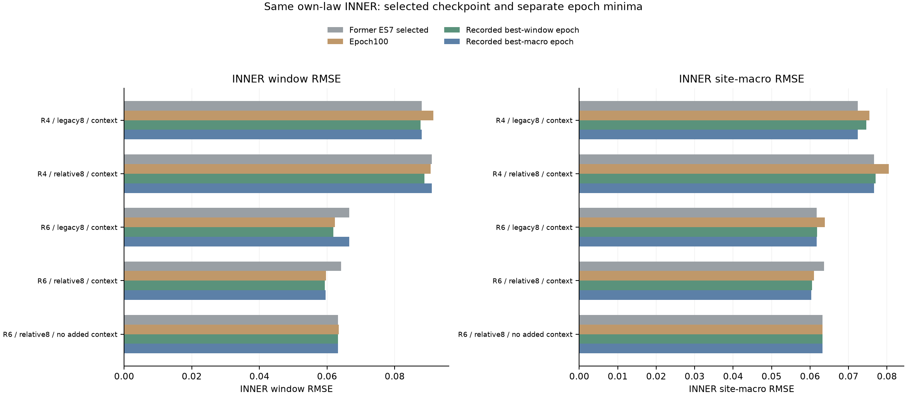
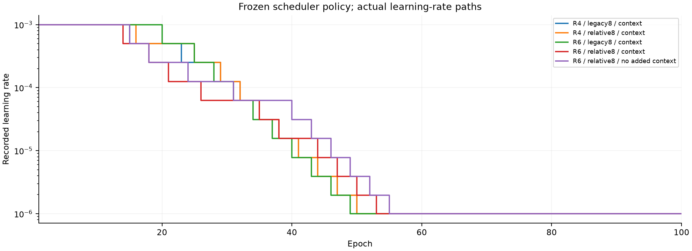

# R6 고정100epoch CPU 학습 결과

생성 시각: 2026-10-25T21:00:06.602902+00:00. 기존의 동일한 5개 CNN을 **early stopping 없이 실제100epochs** 학습한 TRAIN/INNER 실험이다. tree 재학습·대형 GPU 모델 재개·locked 패널 재평가·공식 Test 결과가 아니다. 기존 데이터와 결과를 덮어쓰지 않았다.

## 1. 비교 범위와 고정한 정책

동일한 immutable TRAIN/INNER, source split, seed, 8채널, 물리 정답, Adam 및 loss를 유지한다. epoch 종료를100으로 고정하고 ES 중단을 비활성화했다. 단, 하드웨어 실행 정책은 **arm당 CPU2 threads(이전4), 최대 5개 subprocess 병렬**로 달라졌다. 이는 학습 결과를 보고 바꾼 설정은 아니지만 floating-point reduction/궤적에 차이를 만들 수 있어 bitwise prefix 일치를 약속하지 않는다.

Adam LR=0.001, weight decay=0.0003, batch=128, gradient clip=1.0이다. loss=share MSE+0.25·energy-weighted cell MSE+0.05·derived presence BCE를 유지한다. 학습률 scheduler는 기존 **ReduceLROnPlateau(macro, factor0.5, patience2, minLR1e-06)** 정책을 그대로 두며 아래 실제 LR 경로를 공개한다. 이 보고서는 저장 기록을 읽기만 하며 fitting·checkpoint 교체·후처리·앙상블 선택을 하지 않는다. 전체 병렬 실행 경과는 **22.56분**, 다섯 arm의 fit 경과 합은 **110.34분**으로 서로 다른 시간 단위다.

R4 law와 R6 law의 INNER는 서로 다른 target population이다. 따라서 각 arm의 **자기 law 안에서** 이전 ES run과 비교한다. INNER는 이미 early stopping/epoch monitoring에 반복 사용되어 독립 OOF가 아니다. 5개 중 가장 낮은 값을 보고 공식 성능 순위나 대회 일반화를 주장하지 않는다.

## 2. 전체100epoch 곡선과 별도 최선 epoch

window RMSE 최소와 site-macro RMSE 최소를 **서로 독립적으로** 저장 이력에서 찾았다. 동일값이면 처음 관측한 epoch를 쓴다. 이는 기록한100개 epoch 중 최소이며, 최적화 전체의 global minimum 또는100epoch 이후에도 개선이 없다는 증거가 아니다. 실제100번째 epoch도 함께 보고해 사후 최소값만으로 결과를 제시하지 않는다.

| Arm | epoch100 window | epoch100 macro | 관측 best-window epoch / RMSE | 관측 best-macro epoch / RMSE | best-macro의 window RMSE | 분 |
| --- | --- | --- | --- | --- | --- | --- |
| r4law_legacy8_global | 0.091460 | 0.075456 | 24 / 0.087610 | 25 / 0.072434 | 0.087932 | 22.49 |
| r4law_relative8_global | 0.090628 | 0.080432 | 34 / 0.088791 | 25 / 0.076600 | 0.090926 | 22.29 |
| r6law_legacy8_global | 0.062353 | 0.063832 | 29 / 0.061902 | 21 / 0.061743 | 0.066575 | 22.54 |
| r6law_relative8_global | 0.059621 | 0.061064 | 31 / 0.059377 | 40 / 0.060336 | 0.059591 | 22.22 |
| r6law_relative8_local | 0.063445 | 0.063264 | 45 / 0.063207 | 36 / 0.063209 | 0.063259 | 20.80 |

주 선택 정책은 **strict lowest INNER window RMSE**이며, macro 최소는 별도 보조 기록이다. 두 기준 모두 min-delta를 적용하지 않고 동일값이면 처음 epoch를 저장한다. 아래는 best-window checkpoint에서 같은 eval mode로 계산한 TRAIN/INNER와 auxiliary presence metric이다. TRAIN와 INNER source 분포가 달라 gap 하나만으로 과적합의 원인을 확정할 수 없다.

| Arm | TRAIN eval RMSE | INNER window | INNER macro | INNER MAE | INNER bias | 고정 score AUC |
| --- | --- | --- | --- | --- | --- | --- |
| r4law_legacy8_global | 0.049398 | 0.087610 | 0.074595 | 0.052668 | +0.012413 | 0.982352 |
| r4law_relative8_global | 0.039028 | 0.088791 | 0.077013 | 0.050674 | -0.004634 | 0.982757 |
| r6law_legacy8_global | 0.032850 | 0.061902 | 0.061804 | 0.035479 | +0.008748 | 0.890196 |
| r6law_relative8_global | 0.031103 | 0.059377 | 0.060485 | 0.033690 | +0.006483 | 0.907450 |
| r6law_relative8_local | 0.033372 | 0.063207 | 0.063260 | 0.035945 | +0.004777 | 0.896901 |

TRAIN online RMSE는 epoch 중 바뀌는 weight의 minibatch 오차다. INNER는 epoch 끝 eval이므로 단순한 동일조건 train/validation gap이 아니다. 학습 loss를 낮추기 위해 쓰는 derived presence score도 보정 확률은 아니며 share 회귀와 상충할 수 있다는 기존 수식적 한계는 유지된다.

## 3. 이전 ES7 결과와 own-law INNER 비교

이전 run은 **site-macro를 ES 중단과 checkpoint 선택 모두에 사용**했고, 사용자의 현재 관심은 **window RMSE 최소**다. 이번에는 ES 비활성화 외에 주 checkpoint 기준도 strict window minimum으로 달라졌다. 따라서 새 best-window의 향상을 전부 ES 제거 하나의 효과로 돌릴 수 없다. CPU threads4→2, min-delta 선택→strict first-minimum 선택도 비교 차이다.

아래 새 Δ는 **새 이력의 exact best-macro epoch−이전 선택 checkpoint**이며 음수는 해당 재사용 INNER에서 낮아졌음을 뜻한다. 이를 통해 checkpoint 목적 변경의 일부를 분리해 보여주지만, exact minimum과 min-delta 규칙·수치 궤적 차이가 있으므로 완전히 독립 평가나 순수한 인과 효과의 추정으로 읽지 않는다.

| Arm | 이전 best / stop epoch | 이전 window | 이전 macro | 새 best-macro window Δ | 새 best-macro macro Δ |
| --- | --- | --- | --- | --- | --- |
| r4law_legacy8_global | 25 / 32 | 0.087932 | 0.072434 | +0.000000 | +0.000000 |
| r4law_relative8_global | 25 / 32 | 0.090926 | 0.076600 | +0.000000 | +0.000000 |
| r6law_legacy8_global | 21 / 28 | 0.066575 | 0.061743 | +0.000000 | +0.000000 |
| r6law_relative8_global | 14 / 21 | 0.064148 | 0.063658 | -0.004556 | -0.003322 |
| r6law_relative8_local | 36 / 43 | 0.063259 | 0.063209 | +0.000000 | +0.000000 |

## 4. Macro/window 각각의 분석용 ES7과 scheduler

먼저 원래 macro 이력에 `score<best−1e-5`면 best 갱신, 그 외 stale+1, stale7에서 최초 중단하는 이전 규칙을 그대로 재생한다. 학습기에서 저장한 `shadow_ES7`와 보고서의 독립 replay를 대조한다. 다음으로 **동일한100epoch 이력의 window RMSE**에도 같은 ES7/min-delta 규칙을 별도로 적용한다. 두 counterfactual은 분석용이며 학습을 중단하거나 checkpoint를 바꾸지 않는다. 동일값은 best를 갱신하지 않아 처음을 유지한다.

이는 optimizer/scheduler를 다시 돌린 실험이 아니며, 두 기준 모두 **실제로 사용한 macro-driven LR 경로** 위에서 계산한다. window-driven scheduler로 재학습했을 결과나100epoch 이후 성능은 알 수 없다. 과거 ES run과의 접두 epoch metric/LR 차이를 함께 기록하므로 동일 궤적을 가정하지 않는다. 특히 threads2/4 차이 때문에 새 이력의 macro ES7 stop이 예전 실제 stop과 같을 필요는 없다.

| Arm | 이전 실제 stop | 새 이력 ES7 최초 stop | counterfactual best epoch | counterfactual macro | 접두 비교 epochs | 접두 metric/LR maxabs |
| --- | --- | --- | --- | --- | --- | --- |
| r4law_legacy8_global | 32 | 32 | 25 | 0.072434 | 32 | 0.0000000000 |
| r4law_relative8_global | 32 | 32 | 25 | 0.076600 | 32 | 0.0000000000 |
| r6law_legacy8_global | 28 | 28 | 21 | 0.061743 | 28 | 0.0000000000 |
| r6law_relative8_global | 21 | 21 | 14 | 0.063658 | 21 | 0.0000000000 |
| r6law_relative8_local | 43 | 43 | 36 | 0.063209 | 43 | 0.0000000000 |

아래는 각 hypothetical stop까지 이미 관측할 수 있었던 **exact best-window RMSE**와 전체100epoch 최소를 비교한다. 개선량은 `stop까지 prefix minimum−100epoch minimum`으로, 양수면 그 prefix 뒤에 더 낮은 window 오차가 관측됐다는 뜻이다. 이를 해당 중단 정책을 실제로 바꾼 인과적 효과로 해석하지 않는다. ES7 stop이100epoch까지 생기지 않으면100으로 표기하며 개선량은0이다. min-delta로 갱신한 ES 내부 best와 prefix의 exact window minimum은 서로 다를 수 있다.

| Arm | macro ES7 stop/상한 | 그때 prefix best-window | window ES7 stop/상한 | 그때 prefix best-window | 전체100 best-window | macro stop 뒤 추가 개선 | window stop 뒤 추가 개선 |
| --- | --- | --- | --- | --- | --- | --- | --- |
| r4law_legacy8_global | 32 | 0.087610 | 31 | 0.087610 | 0.087610 | 0.000000 | 0.000000 |
| r4law_relative8_global | 32 | 0.089189 | 41 | 0.088791 | 0.088791 | 0.000398 | 0.000000 |
| r6law_legacy8_global | 28 | 0.063363 | 36 | 0.061902 | 0.061902 | 0.001461 | 0.000000 |
| r6law_relative8_global | 21 | 0.061963 | 38 | 0.059377 | 0.059377 | 0.002585 | 0.000000 |
| r6law_relative8_local | 43 | 0.063259 | 43 | 0.063259 | 0.063207 | 0.000052 | 0.000052 |

scheduler 정책을 바꾸지 않아도 ES를 제거하면 이후 validation 기록에 따라 LR이 추가로 낮아질 수 있다. 긴 학습의 효과는 그 고정 scheduler 아래의 실제 궤적에 대한 관측이다. 학습률·loss·augmentation·seed를 결과를 보고 재선택하지 않았다.

## 5. 해석 한계와 재현 근거

전체100epoch는 사용자가 요청한 epoch-budget 비교이며 성능 개선을 보장하지 않는다. epoch100이 더 나빠진 경우와 이전 ES보다 불리한 결과도 모두 보고한다. 같은 INNER에서 찾은 최소값에는 반복 관측·선택 편향이 남는다. 새로운 locked/OUTER/Test 평가 없이 이 결과를 LB 개선·공식 대표성·완전한 과적합 해소로 환산하지 않는다.

원본5arm의 context ON/OFF는 파라미터 수 차이가 있고, GroupNorm과 창별 상대 전처리 때문에 no-added-context를 엄밀한 국소 모델로 부를 수 없다. q05는 확인된 배경 B가 아니고 hard-negative의 A=0도 자연 선박 부재 라벨이 아니다. 이100epoch 비교는 그런 기존 생성·입력 정의를 검증된 실제 수중 ground truth로 바꾸지 않는다.

각 arm의100개 epoch weight와 best-window/best-macro/epoch100 alias, 마지막 optimizer·scheduler·Torch RNG state, 세 INNER prediction NPZ를 보존하고 SHA를 검증했다. 부분 학습 재개는 하지 않았다. 보고서 생성에서는 **모델 deserialization이나 NPZ array 로드 없이** 그 파일의 bytes만 무결성 hash로 읽었다. TRAIN/INNER 원본4파일도 opaque SHA만 확인했고, 과거 locked 결과·Test·GPU/SSH·공식 제출은 사용하지 않았다. 기존 dataset 감사 JSON은 locked 기술 요약을 포함하므로 내용을 파싱하지 않고 그 파일의 SHA만 검사했다. 과거 locked 패널은 이미 관찰되어 새 blind holdout이라고 부르지 않는다.

세 가지 기록 목적(epoch100, window 최소, macro 최소)을 구분해 보고하고, 이 단계에서 locked 성능에 맞춘 재학습을 하지 않는다. 모든 input/artifact SHA와 독립 이력 계산은 [재현 receipt](R6_FIXED100_TRAINING_REPORT.receipt.json)에 보존하며, 아래에는 핵심 JSON/code binding만 표시한다.

[새 설정](../configs/r6_fixed100_v1.json) · [전체 결과 JSON](R6_FIXED100_RESULTS.json) · [이전 guardrails 결과](R6_GUARDRAILS_AND_CPU_ABLATION_REPORT.md)

| 핵심 검증 입력 | SHA256 |
| --- | --- |
| configs/r6_fixed100_v1.json | `a12e75dd5e3d79db0ea99daf5cb87464c8f32f347e2e6b173d254cb38078b259` |
| reports/R6_FIXED100_RESULTS.json | `84f15c5a7f70d1325dfac5e7f661b367c72556f0fba561f7047d4f4973b09217` |
| reports/R6V2_DATASET_AUDIT.json | `4c72fb79d4aef20ed05e6bd72be13d206c8622c6a74c48930304b7f559e70369` |
| configs/r6_cpu_guardrails_v2.json | `ff1aaef4671013801fd79ac39222a70acf40d63acfcbc92e6493e873be23709e` |
| models/r6_fixed100_v1/all_models_frozen.json | `bfa1db940f9d8bb8becb1fa39c21974efb85ded7e007a7248a58c9f467da16cb` |
| ops/build_r6_fixed100_report.py | `f52c4e6597a942e17adc150e3912748c112f3602b52c6e8c0fe13a344584c516` |
| pipeline/relative_grid_r6.py | `00569f033dbf29ecee416221b05451a4cf97c354321f7048e653ea96a61bb8cf` |
| pipeline/relative_grid_r6_v2.py | `32001227d9ef2076e0b10da48666151dc75fb4d21447ea85be68e93d29e06aab` |
| pipeline/relative_models_r6_v2.py | `71c06993157e56177d43462320912891392cdd6026a14ceee483f8a77bc8affb` |
| pipeline/physics_features_r6_v2.py | `7940be5fabdf55f4c52d47ee51c74573dbcc2adcd1b65bab331c8a61cde3164a` |
| pipeline/hard_negatives_r6_v2.py | `b008312e2a316b3c58cbfed39dfaefb41070c6549b908a70285e389ac10b5aa8` |
| pipeline/robust_sampler_r6.py | `59a8bafbbad9c42c7628d2283ac5f9fb3550a6945686958ea207ebeb61b0722b` |
| pipeline/source_split_r6.py | `8f4c394d9278c49a84a2540209599496205bf985178940ee0110cbb57aebb492` |
| pipeline/cpu_ablation_r6_v2.py | `3076d917ab49769fff8d021e7ba3ed271dca7b0d5d98cef697066150171c2a92` |
| ops/run_r6_cpu_guardrails_v2.py | `1181c62e24182273b832b325d3f8c9d8932aecb6c1c8625372e7e8e098c14b60` |
| pipeline/passage_sampler_r4.py | `d56e8199e5cbee5ee22a96143fbba3186bf5ff0ddff9d0ed34a5c0f6d56a0162` |
| pipeline/mixtures.py | `07a860ae2f73db9932ecc5ad1117ef9c19d61470b0f1d694e19e7cc6ef8326bf` |
| pipeline/background_prior_features.py | `e29523c77eb571d501dbe0979f4d56a17859f88e3bb363ae7d70f41a4e31369a` |
| pipeline/fixed100_r6.py | `4621ee60c525e45f7a52a0bc3591818826cf2b19a970fbdbbed4d0b6fe3373b0` |
| ops/run_r6_fixed100.py | `a0fd8b9a5e536aa182dc825d87ce5592a36ef8a07c19adeb4f523ea7ae3d667d` |
| pipeline/runner_r5.py | `351f085f92ac1635d2ce4d91401d3984d2e158a49c9658d5610e0dd518be80d8` |
| pipeline/neural_r5.py | `482890f56d7986733cfb46c1ce961641a12523ea38d47b0f8388dbe3ea181e96` |
| pipeline/lgbm_r5.py | `623de7f5cf603e71e174fa3b2f7beef0e38ab171701338f6e520fd3351c7290d` |
| pipeline/fold_data_r5.py | `e3774c7cd0ba43a59899b6b22c9b37df5b0d3fc462dc51bccf2e607c5c1fb100` |
| pipeline/grid_inputs_r5.py | `81cb398b5cd4707df7cc12117c9cc91682312564ca3538d1736f174dbe3714f2` |
| pipeline/dynamic_passage_r5.py | `619f6bd3229f5d823670abc50576872f5e2de24d864ea0184ff9537dd4d1ce69` |
| pipeline/observation_augmentation_r5.py | `cae9d85c478f6609023cb6751df210ac5444cf710c732921a36fa314826f8764` |
| pipeline/physics_features_r5.py | `9cb0855400a16c6082bfdbfcb0f0dcc7389c3a54d08b4d8ff8bce45702de81f1` |
| pipeline/hierarchical_ensemble_r5.py | `547c57e976fec2616472b73264bf8a78c95e21abbc8697a25adf08825eba0ed2` |
| pipeline/hybrid_models_r5.py | `ac46324d37813a6888beee410fc9466f4504fa7d53052642ad895799f4700c51` |
| pipeline/grid_models_r5.py | `dbba465e19fb700f660692d2a1a6754d7e80fc6b22c804ba650173f5007b4502` |
| pipeline/foundation_masks_r5.py | `258d38dca9129399cab7b3d01b970241d0df6ff2ea831beece05738195047a05` |
| pipeline/load_foundation_r5.py | `eee9f41e23390194822cfa81aae4346031b9ffb52fc8501b1102ae501a9b9f93` |
| pipeline/models.py | `ccb099999612cfe5b78277eb150f7857663845abde23ee189845bcc6190a2e5c` |
| pipeline/inference_r5.py | `30f38265db7105cf56d66720b5f439adceb84bd09b9fa400ee7b451b99245f22` |
| models/r6_fixed100_v1/freeze.json | `0146ab919e7aa94b2301cc28054ad0fa96b771d7a5d01f47a3da9d9326745821` |
| models/r6_cpu_guardrails_v2/freeze.json | `09b9e9d59165359ed3bfb640989c7fb133173c3fcd5f09369902856ff29e4761` |
| models/r6_fixed100_v1/r4law_legacy8_global/summary.json | `c73261aee19809e7508a9262e25593e4ae07d2c50487cf147fccd0ed062bace6` |
| models/r6_cpu_guardrails_v2/r4law_legacy8_global/summary.json | `3a36c1bc8c502edd5d28ce47db434bb6e3adfa44c2e18b3910728442cade651b` |
| models/r6_fixed100_v1/r4law_relative8_global/summary.json | `2c7a9741ee4cc6f70591866ea7a03a70eaffd67accbafe1eece5e5148f77d3e9` |
| models/r6_cpu_guardrails_v2/r4law_relative8_global/summary.json | `6d045773ff662a8f6c7b007fab5813c737e15c898d6cb5229ede70db175e8870` |
| models/r6_fixed100_v1/r6law_legacy8_global/summary.json | `a157bd4f83441ad4650a3937e69737da7a75f2f319b3695662e9c9e5eb616d48` |
| models/r6_cpu_guardrails_v2/r6law_legacy8_global/summary.json | `e111094b8542bd4f29f3114a5a8bd7af1c89479b46a0b38c9a6251c6651109f0` |
| models/r6_fixed100_v1/r6law_relative8_global/summary.json | `6c370f1315f4bf0f70f54412f6c4c4cc5b270349f32dc1c96e082d1ba771ee34` |
| models/r6_cpu_guardrails_v2/r6law_relative8_global/summary.json | `6b547752da44d931fac19f3ac1fcf7dca7831966ea03df3a5b206f25dae609f4` |
| models/r6_fixed100_v1/r6law_relative8_local/summary.json | `d3ab73b1b5b9f3ef428aacf86a62b87f8daefc37eb00b000833a2d6bbd1bd071` |
| models/r6_cpu_guardrails_v2/r6law_relative8_local/summary.json | `8bab5e3f260b42d1c249d302a2abda5d114198a5b1caa1873bdb859a4295fed4` |
