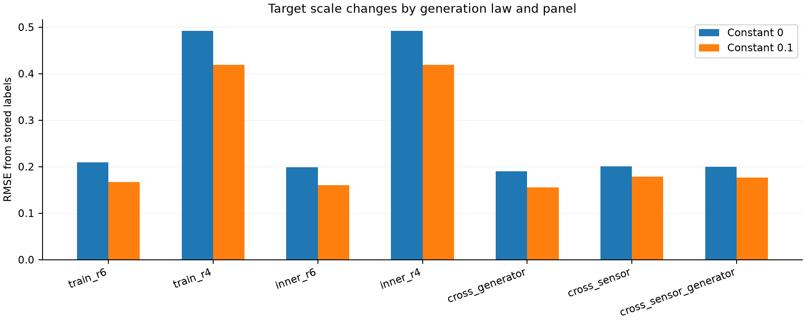
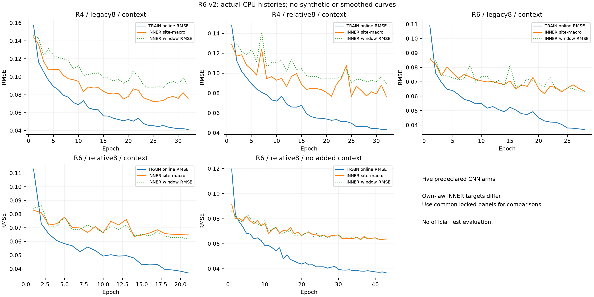

# R6 guardrails 개편과 Mac CPU ablation 결과

생성 시각: 2026-10-25T20:16:16.688505+00:00. **사전 정의한 5개 CNN과 2개 LightGBM의 작은 CPU 실험이다. 공식 Test 결과·5-fold OOF·대형 모델 성능·실제 LB 예측을 뜻하지 않는다.** 모든 arm과 상수 대조, 세 locked 합성 패널을 결과와 관계없이 보고한다. 이 보고서 생성기는 모델·앙상블·후처리 정책을 선택하거나 적합하지 않는다.

## 1. 이번 버전의 범위

- relative8은 기존 상대 채널 6개에 band q05 상대 dB/15와 `sqrt(w)`를 추가한다. q05는 창의 관측 통계이며, 확인된 순수 배경이나 정답 분리량이 아니다. `w`는 같은 0.1dB 관측에서 구한 정규화 선형 에너지다.
- 새 R6 law의 reference smooth EQ는 **±6dB**, low-pass 선택 확률은 **0**다. 시간 늘이기/반복 없이 native 궤적과 crop을 사용한다. R4 law 대조는 기존 R4 생성 법칙을 그대로 사용하므로 이 수치를 R4 대조의 EQ 설정으로 읽으면 안 된다.
- 명시적 hidden frequency context on/off를 비교하고, 자유 presence head 대신 사전 정의된 derived score를 사용한다. tree에는 safe 1–5kHz를 포함한 물리 특징 27개를 추가한다.
- TRAIN 원천만으로 LF hard-negative 후보를 정하고, 알려진 추가 성분 A=0인 합성 대조에 사용한다. 원래 바다에 선박이 전혀 없다는 정답을 얻은 것은 아니다.
- **Test/LB 분포·지역 비중·Benchmark RMSE/target moment에 맞추지 않았다.** 아래 우리 합성 데이터의 수치가 공식 hidden generator를 대표한다거나 LB 실패의 인과를 증명한다고 해석하지 않는다.

고정 설정: [r6_cpu_guardrails_v2.json](../configs/r6_cpu_guardrails_v2.json). 이번 arm은 7개로 고정했으며 자동 탐색·재시도 선택·후속 ensemble fitting을 하지 않는다.

적용하지 않은 조건도 명시한다. Benchmark 알고리즘은 확인되지 않아 그 RMSE²를 Test의 E[y²]로 읽을 수 없다. 상수 c의 MSE는 E[y²]−2cE[y]+c²이다. 지정한 전체 RMS .246, 양성 비율 .75~.8, 양성 평균 .20~.23에서는 상수 .1 RMSE가 약 .184~.201이므로 두 상수 baseline을 모두 .24~.26으로 만드는 조건은 양립하지 않는다. [사전 실행 계획](R6_GUARDRAILS_EXECUTION_PLAN.md)에 계산과 제외 범위를 남겼다. Test 집단에서 추정한 target·생성 분포에 맞추지 않는 방침은 [공식 규정](https://zindi.world/competitions/french-embassy-underwater-vessel-noise-challenge)의 Test 추론 전용 조건에 따른 것이며, 고정된 창별 전처리와 구분한다.

## 2. 원천 분리와 QC

배경 원천 창 수: **train 44,034, inner 11,825, cross_generator 3,167, cross_sensor 17,380**. 기존 R4 Fold0에서 허용된 TRAIN/INNER 원천 안에서 새 역할을 분리했다. 옛 OUTER/calibration/domain/sealed/Test 수치는 사용하지 않았다. 같은 센서 역할 간 support gap 최소 **24시간**, reference hull/day/UTC/SHA 격리를 감사했다.

| Site | 옛 clean TRAIN | 옛 경계 제외 TRAIN | 새 TRAIN | 새 INNER | cross-generator | cross-sensor |
|---|---:|---:|---:|---:|---:|---:|
| 1 Richards Bay | 30,160 | 3,044 | 33,204 | 8,839 | 2,591 | 0 |
| 2 Durban | 1,629 | 3 | 1,632 | 672 | 0 | 0 |
| 3 Cape_Recife | 0 | 240 | 240 | 0 | 0 | 0 |
| 4 Bird Island | 1,850 | 22 | 1,872 | 0 | 0 | 0 |
| 5 St Croix Island | 6,850 | 32 | 6,882 | 2,314 | 576 | 0 |
| 6 Riy_Banks | 0 | 204 | 204 | 0 | 0 | 0 |
| 7 St_Francis | 12,755 | 0 | 0 | 0 | 0 | 17,380 |

실제 원본 row ID로 찾은 후보 분 **4,356개**를 가렸으며 창 전체 제외를 대신해 TRAIN **3,545창**을 복구했다. 추가 QC/purge 제외는 **97창**이다. 경계 flag의 물리적 원인이 확인된 것은 아니며, 첫/끝 분을 일괄 삭제한 처리도 아니다.

| 역할 | 참조 clips | 선택된 source components |
| --- | --- | --- |
| train | 51 | 9 |
| inner | 18 | 3 |
| cross_generator | 18 | 3 |
| cross_sensor | 7 | 2 |

cross-sensor는 metadata hash로 정한 sensor group 4이며, 모델 성능이나 Test site 구성을 보고 선정하지 않았다. 여기서는 St Francis 원천이다. 이번 fit의 holdout이지만 연구자가 과거에 전혀 보지 않은 새 코퍼스라고 주장하지 않는다. TRAIN에 존재하면서 INNER가 없는 site도 있어 INNER macro가 모든 TRAIN site를 대표하지 않는다. 참조 그룹은 선택 pool 안에서의 직접 제약을 만족하며, 새 독립 물리 녹음이 늘어난 것은 아니다. [상세 원천 감사](R6V2_SOURCE_SPLIT_AUDIT.md).

기존 선택 pool **119clips/22groups**에서 현재 허용 pool **94/17**가 된 이유는 정확히 옛 OUTER **25/5**를 제외했기 때문이다. 새로운 clip 손실이나 추가 수집으로 생긴 숫자가 아니다. [독립 TRAIN/INNER 통합 감사](R6_GUARDRAILS_INDEPENDENT_AUDIT.md)는 모든 사용 reference ID가 허용된 역할에 속하고 TRAIN의 배경 순서·no-source·hard-negative 위치가 두 law에서 같음을 확인했다.

## 3. 물리 생성 법칙과 관측 정답

R6는 목표 share를 먼저 뽑아 alpha를 역산하지 않는다. 변형된 전체 참조 궤적의 **창 crop/mask 전** 완전 분 broadband peak를 `Rpeak`, 배경 관측 분 broadband 에너지 중앙값을 `Bmedian`으로 두고 `alpha=10^(ΔL/10)·Bmedian/Rpeak`를 사용한다. ΔL은 **Uniform[-10,10]dB**인 사전 감도 범위이며 공식 관측 SNR의 추정은 아니다. CPA가 창 밖이면 tail을 다시 증폭하지 않는다.

TRAIN/INNER: minute-first와 실제 1–3분 short crop. locked generator: edge-straddling과 native 2s-first-no-warp. 배치는 관측 mask가 아니라 기하학적 겹침으로 정한다. source가 미관측 셀에만 있으면 관측 q/share/presence=0이며 이를 삭제하거나 seed를 다시 고르지 않는다. caller의 **no-source 20%**와 전체 관측 y=0 비율은 다르다. 관측 추가 에너지 0일 때 observed/global SNR은 null이다. [사전 support 수정](R6_PREFIT_SUPPORT_CORRECTION.md).

정답 q/y는 unrounded known B+A에서 계산하고 유지했다. 모델의 rounded-energy w로 같은 q를 pooling하면 근사 차이가 생긴다. ±.05dB 양자화의 일반 bound는 약 .0057564이며 float32 오차는 추가다. 저장 세트의 원성분 정답 복원 최대 오차 **1.7792299e-07**, rounded-w gap 최대 **0.001916971**다. 이 gap을 없애려고 정답을 반올림된 입력 기준으로 바꾸지 않았다.

## 4. 입력·score·물리 특징과 receptive field

relative8의 순서는 band median 상대/10, q20 상대/15, 인접 관측 ΔdB/10, 저역 상승과 중고역 상승의 연속 동조, band median−창 median profile/20, 관측 mask, q05 상대/15, `sqrt(w)`다. db만 입력하며 query true q/y·site/recorder·recipe를 입력하지 않는다. common dB gain 불변성은 양자화된 값 위에서 성립한다. 임의 gain을 반올림 전에 더하면 경계를 넘을 수 있고, profile·w·sqrt(w)는 band별 offset 불변이 아니다.

CNN의 고정 score는 `0.5·predicted_share + 0.5·temporal_mask_contrast`다. contrast는 관측된 band indices10..22(약316–5012Hz)에서 각 band의 시간 최소 예측 q를 빼고 양수 차이의 전체 최댓값을 쓴다. 단일 관측 분은 그 band contrast=0이다. 별도 자유 presence classifier는 없고 BCE는 이 derived score의 logit에 작용한다. 수치상 logit의 endpoint clamp가 있다. AUC 향상은 설계만으로 보장되지 않는다. tree는 **0.5·share+0.5·TRAIN-fitted classifier probability**를 고정 사용하며 share/classifier 개별 AUC도 보고한다.

이 score는 [0,1]의 share·contrast에 대한 단조 결합이지만 **보정된 presence 확률은 아니다.** contrast≤1이므로 `score≤0.5+0.5·predicted_share`다. 낮은 share를 정확하게 예측하는 양성에서는 score를 1로 만들 수 없어 presence BCE를 0으로 낮출 수 없다. 그때의 BCE 하한은 `−log(0.5+0.5·predicted_share)`이며, share→0이면 log2에 접근한다. 따라서 **0.05·BCE를 줄이려는 gradient와 정확한 share 회귀가 상충할 수 있다.** 이는 사전 고정한 loss 실험의 수식적 한계이고 무부작용·성능 향상을 보장하지 않는다. 결과를 본 뒤 이 loss나 score를 바꾸지 않는다.

global context는 매 분 hidden의 mid(10..19), high(20..24), safe(15..22) 평균을 연결해 projection×sigmoid gate를 만들고 모든 주파수 위치에 더한다. 입력 음원의 분리 성분이나 정답 oracle이 아니다. **no-added-context arm을 엄밀한 국소 모델이라고 부를 수 없다.** 7개 3×3 convolution의 명목 경로 receptive field는 15×15이며, GroupNorm은 T/F 전체 통계에 의존한다. 상대 전처리의 창 median/q05/profile와 정규화 w도 이미 전역 정보다. 따라서 이 ablation은 명시적으로 추가한 hidden frequency context의 효과를 비교한다.

또한 context ON은 **64,449 parameters**, OFF는 **58,241 parameters**로 6,208개 차이가 있다. 입력·생성 law를 같게 두더라도 추가 context와 모델 용량이 함께 달라지므로 순수한 구조 한 요소의 인과 효과만 분리하는 비교는 아니다. 실제 arm별 크기도 아래 학습 표에 기록한다.

tree 물리 특징은 9값+9defined mask+9complete-minute count다. low0..8(≤200Hz), mid10..19(316–2512Hz), high20..24(3162–7943Hz), safe15..22(1000–5012Hz)의 선형 파워 합을 dB로 바꿔 max−median bump4개, low와 나머지3그룹의 시간 Pearson3개, 전체25band broadband dB 표준편차1개, paired high−low dB median tilt1개다. 각 그룹 전대역이 완전한 분만 사용한다. 정의되지 않은 값은 0과 mask/count로 표현한다. fitted state가 없는 db-only 특징이며 고정 0.1dB 입력을 내부에서 사용한다. [숫자 fixture](R6_PHYSICS_FEATURES_V2_FIXTURE.json).

## 5. TRAIN hard-negative의 의미와 규모

실제 TRAIN 원천 44,034창 중 **4,035개 후보**를 찾았다. LF bump≥TRAIN pooled q90(**14.595270dB**)이면서 LF bump>max(safe bump,high bump)+3dB다. 후보 선택은 raw SA QC dB로 하며 추가 반올림을 하지 않는다. 모델 입력 round.1 정책과 구분한다. 최소 지역 관측 분3, complete-region power만 사용했다. Test 통계나 과거 EDA 후보 숫자는 쓰지 않았다.

| Site | 후보 원천 창 |
| --- | --- |
| 1 Richards Bay | 3724 |
| 2 Durban | 27 |
| 3 Cape_Recife | 7 |
| 4 Bird Island | 156 |
| 5 St Croix Island | 111 |
| 6 Riy_Banks | 10 |

이는 **추가한 A가 0인 대조**이지 자연 선박 부재 라벨이 아니다. 후보 풀과 실제 합성 주입 예제 수를 구분한다. 사전 계획은 전체 TRAIN의 10%, 명시적 no-source 중 절반이며, 평가 패널에서는 이 선정 정책으로 sampling하지 않는다. 실제 TRAIN **819개 draw**는 **428개의 고유 창**을 사용했다. 전체 TRAIN **8,192개**도 고유 배경은 **5,639개**다. 작은 site의 후보를 cycling하므로 독립 원천 819개가 늘어난 것이 아니다. pooled threshold 때문에 원래 후보 site 구성이 균일하지 않고, 주입 시 site 동수 할당이 후보 희소 site의 반복을 늘린다. TRAIN-only 선정도 분포 변화/shortcut을 만들 수 있으므로 일반화 성공을 보장하지 않는다.

[후보 manifest](../data/versions/hard_negatives_r6_v2/manifest.json).

위 그림은 저장 순서상 **첫 hard-negative, 첫 R6 양성, 첫 R4 양성**을 선택했다. 예측·오차·그림의 모양을 보고 고른 사례가 아니다. rounded 관측, 알려진 인공 추가 성분 q, sqrt(w), q05 상대값, LF/MF/HF 관측 궤적을 함께 보여준다. q는 모든 자연 선박 에너지의 정답이 아니며, **A=0은 자연 선박 부재를 뜻하지 않는다. q05도 확인된 배경 B의 정답이 아니다.** 관측 결측은 회색이고 셀을 보간하지 않았다. [선택·SHA 근거](r6_guardrails_training_examples.selection.json) · [SVG](r6_guardrails_training_examples.svg) · [TRAIN-only 생성 코드](../ops/plot_r6_train_evidence.py).

## 6. 저장 데이터의 target scale

R4 대조를 포함해 저장한 역할 예제 합계는 **21,504개**다. 이를 독립 녹음 수로 세지 않는다. TRAIN은 site 동수 quota의 기본 draw에 hard-negative 정책을 더한 샘플링이며 작은 site의 원천은 반복될 수 있다. 모든 arm의 최종 locked 평가 입력/정답은 같은 패널이다.

| 저장 세트 | n | mean share | 관측 y=0 | no-source 실측 | 상수0 RMSE | 상수.1 RMSE | 단일 upper-band AUC |
| --- | --- | --- | --- | --- | --- | --- | --- |
| train_r6 | 8,192 | 0.129571 | 0.2052 | 1,638/8,192 (20.00%) | 0.209533 | 0.167302 | 0.687875 |
| train_r4 | 8,192 | 0.382024 | 0.2000 | 1,638/8,192 (20.00%) | 0.491890 | 0.418988 | 0.768800 |
| inner_r6 | 1,024 | 0.119956 | 0.2021 | 205/1,024 (20.02%) | 0.199072 | 0.160120 | 0.744375 |
| inner_r4 | 1,024 | 0.381905 | 0.2002 | 205/1,024 (20.02%) | 0.491817 | 0.418931 | 0.895071 |
| cross_generator | 1,024 | 0.109099 | 0.2090 | 205/1,024 (20.02%) | 0.189820 | 0.155601 | — |
| cross_sensor | 1,024 | 0.093201 | 0.5664 | 205/1,024 (20.02%) | 0.200983 | 0.178197 | — |
| cross_sensor_generator | 1,024 | 0.093060 | 0.5537 | 205/1,024 (20.02%) | 0.199626 | 0.176745 | — |

| 저장 세트 | 전체 draw | 고유 배경 | hard-negative draw | 고유 hard-negative 배경 | source있지만 관측추가0 |
| --- | --- | --- | --- | --- | --- |
| train_r6 | 8,192 | 5,639 | 819 | 428 | 43 |
| train_r4 | 8,192 | 5,639 | 819 | 428 | 0 |
| inner_r6 | 1,024 | 1,024 | 0 | 0 | 2 |
| inner_r4 | 1,024 | 1,024 | 0 | 0 | 0 |
| cross_generator | 1,024 | 1,024 | 0 | 0 | 9 |
| cross_sensor | 1,024 | 1,024 | 0 | 0 | 375 |
| cross_sensor_generator | 1,024 | 1,024 | 0 | 0 | 362 |

`—`는 해당 필드가 최종 JSON에 없거나 단일 class여서 AUC가 정의되지 않음을 뜻한다. 단일 upper-band 비율 진단은 모델 score와 다르며, 여기서는 indices18..24의 energy fraction이다. 이를 목표치로 낮추도록 generator를 조정하지 않았다.

**각 arm의 own-law INNER는 R4/R6 사이 target population이 다르다.** 두 law의 INNER는 배경 1,024개 순서를 공유하지만 명시적 no-source 각각 205개 위치는 독립 생성되어 **316행**에서 위치가 다르다. TRAIN은 두 law에서 no-source 위치가 일치하지만 INNER는 공통 target의 paired 비교가 아니다. 더 낮은 INNER RMSE를 곧 개선으로 읽지 않는다. 선별에 사용한 INNER 자체도 early-stop bias가 있으므로 완전 독립 OOF가 아니다. 상수 대조와 아래 공통 locked 패널을 함께 본다.

## 7. 실제 학습 설정과 INNER 결과

CNN: width32, blocks3, dropout0.1, Adam LR0.001, weight decay0.0003, 최대 **100epochs/ES7**, batch128, CPU threads4, gradient clip1.0. loss=share MSE+0.25·energy-weighted cell MSE+0.05·derived presence BCE. checkpoint는 own-law INNER site-macro RMSE로 선택한다. window RMSE도 함께 보고한다.

tree: 최대1500trees/ES40, LR0.035, leaves15, 최소leaf40rows. 회귀는 INNER site-macro, classifier는 INNER binary logloss로 stopping한다. CNN/tree는 엔진 충돌을 피하려 별도 프로세스에서 실행한다. 모델 fit 시간 합은 **24.61분**이며 전처리·최종 평가 시간을 제외한다.

| Arm | 크기 | best / 실행 | INNER RMSE | INNER macro | 고정 score AUC | share AUC | classifier AUC | 분 |
| --- | --- | --- | --- | --- | --- | --- | --- | --- |
| r4law_legacy8_global | 64,449 parameters | 25 / 32 | 0.087932 | 0.072434 | 0.981739 | 0.978880 | — | 5.03 |
| r4law_relative8_global | 64,449 parameters | 25 / 32 | 0.090926 | 0.076600 | 0.980148 | 0.977099 | — | 4.77 |
| r6law_legacy8_global | 64,449 parameters | 21 / 28 | 0.066575 | 0.061743 | 0.887570 | 0.830055 | — | 4.58 |
| r6law_relative8_global | 64,449 parameters | 14 / 21 | 0.064148 | 0.063658 | 0.889752 | 0.835341 | — | 3.26 |
| r6law_relative8_local | 58,241 parameters | 36 / 43 | 0.063259 | 0.063209 | 0.899674 | 0.832698 | — | 6.01 |
| r6law_legacy_tree | 3,827 features | share 444; presence 204 | 0.075422 | 0.077960 | 0.915917 | 0.815340 | 0.933366 | 0.62 |
| r6law_relative_tree | 3,827 features | share 454; presence 137 | 0.073374 | 0.074223 | 0.908189 | 0.818592 | 0.926289 | 0.34 |

TRAIN online RMSE는 epoch 중 변하는 weight의 minibatch 결과이고 INNER는 epoch 끝 eval이므로 직접 같은 평가 프로토콜의 train/val 격차가 아니다. R4 law 대조도 이 작은 CPU 구조와 새 split/QC/quantization을 사용하며 예전1.488M CNN의 완전 재현은 아니다. legacy8은 TRAIN q를 사용해 만든 배경 prior를 포함한 대조군이고 relative8은 이를 쓰지 않는다. 채널 비교는 여러 입력 정의를 함께 바꿔 각 요소의 독립 기여를 분해하지 않는다.

## 8. 전체 checkpoint 동결 후 공통 locked 패널

### cross_generator

| 모델/상수 | RMSE | Site macro | MAE | Bias | 고정 score AUC | share AUC | classifier AUC |
| --- | --- | --- | --- | --- | --- | --- | --- |
| r4law_legacy8_global | 0.075228 | 0.067665 | 0.035725 | +0.014608 | 0.885347 | 0.833374 | — |
| r4law_relative8_global | 0.079631 | 0.070350 | 0.037833 | +0.016255 | 0.866280 | 0.832347 | — |
| r6law_legacy8_global | 0.063089 | 0.064217 | 0.035774 | +0.017763 | 0.886379 | 0.842950 | — |
| r6law_relative8_global | 0.068443 | 0.062974 | 0.036662 | +0.018993 | 0.871449 | 0.831655 | — |
| r6law_relative8_local | 0.063231 | 0.062674 | 0.035732 | +0.012861 | 0.888600 | 0.821270 | — |
| r6law_legacy_tree | 0.068602 | 0.068713 | 0.039436 | +0.012076 | 0.919107 | 0.800839 | 0.945281 |
| r6law_relative_tree | 0.071427 | 0.068739 | 0.039649 | +0.013303 | 0.907765 | 0.791655 | 0.938929 |
| constant0 | 0.189820 | 0.205052 | 0.109099 | -0.109099 | 0.500000 | 0.500000 | — |
| constant0_1 | 0.155601 | 0.165346 | 0.114858 | -0.009099 | 0.500000 | 0.500000 | — |
| TRAIN_r6_mean | 0.156678 | 0.163797 | 0.126716 | +0.020471 | 0.500000 | 0.500000 | — |
| TRAIN_r4_mean | 0.314033 | 0.304347 | 0.294243 | +0.272925 | 0.500000 | 0.500000 | — |
### cross_sensor

| 모델/상수 | RMSE | Site macro | MAE | Bias | 고정 score AUC | share AUC | classifier AUC |
| --- | --- | --- | --- | --- | --- | --- | --- |
| r4law_legacy8_global | 0.448184 | 0.448184 | 0.376302 | +0.369669 | 0.606776 | 0.538634 | — |
| r4law_relative8_global | 0.515657 | 0.515657 | 0.421864 | +0.417352 | 0.665009 | 0.446163 | — |
| r6law_legacy8_global | 0.202509 | 0.202509 | 0.135481 | +0.126807 | 0.857782 | 0.725559 | — |
| r6law_relative8_global | 0.115570 | 0.115570 | 0.067223 | +0.055572 | 0.901600 | 0.859681 | — |
| r6law_relative8_local | 0.105865 | 0.105865 | 0.066641 | +0.036926 | 0.897107 | 0.803576 | — |
| r6law_legacy_tree | 0.216267 | 0.216267 | 0.182998 | +0.152929 | 0.812888 | 0.648268 | 0.878973 |
| r6law_relative_tree | 0.224560 | 0.224560 | 0.188307 | +0.157591 | 0.795453 | 0.631877 | 0.883221 |
| constant0 | 0.200983 | 0.200983 | 0.093201 | -0.093201 | 0.500000 | 0.500000 | — |
| constant0_1 | 0.178197 | 0.178197 | 0.129151 | +0.006799 | 0.500000 | 0.500000 | — |
| TRAIN_r6_mean | 0.181744 | 0.181744 | 0.145571 | +0.036370 | 0.500000 | 0.500000 | — |
| TRAIN_r4_mean | 0.339303 | 0.339303 | 0.324901 | +0.288823 | 0.500000 | 0.500000 | — |
### cross_sensor_generator

| 모델/상수 | RMSE | Site macro | MAE | Bias | 고정 score AUC | share AUC | classifier AUC |
| --- | --- | --- | --- | --- | --- | --- | --- |
| r4law_legacy8_global | 0.448858 | 0.448858 | 0.376874 | +0.365864 | 0.559971 | 0.504919 | — |
| r4law_relative8_global | 0.519008 | 0.519008 | 0.428296 | +0.420220 | 0.613444 | 0.442445 | — |
| r6law_legacy8_global | 0.200394 | 0.200394 | 0.134906 | +0.113021 | 0.814761 | 0.707640 | — |
| r6law_relative8_global | 0.122830 | 0.122830 | 0.071040 | +0.043596 | 0.859686 | 0.821152 | — |
| r6law_relative8_local | 0.115656 | 0.115656 | 0.071803 | +0.024953 | 0.862762 | 0.770538 | — |
| r6law_legacy_tree | 0.217485 | 0.217485 | 0.184088 | +0.151630 | 0.773772 | 0.632956 | 0.819006 |
| r6law_relative_tree | 0.225680 | 0.225680 | 0.189385 | +0.158006 | 0.767061 | 0.618496 | 0.837526 |
| constant0 | 0.199626 | 0.199626 | 0.093060 | -0.093060 | 0.500000 | 0.500000 | — |
| constant0_1 | 0.176745 | 0.176745 | 0.127777 | +0.006940 | 0.500000 | 0.500000 | — |
| TRAIN_r6_mean | 0.180343 | 0.180343 | 0.143751 | +0.036511 | 0.500000 | 0.500000 | — |
| TRAIN_r4_mean | 0.338661 | 0.338661 | 0.324099 | +0.288964 | 0.500000 | 0.500000 | — |

세 패널은 모두 우리 합성 정답이다. cross-generator는 generator와 참조 원천이 함께 달라져 연산자 하나의 순수 효과가 아니다. cross-sensor와 joint 패널은 배경 draw를 공유하므로 서로 독립 표본이 아니다. 선택 pool 경계 밖의 공식 평가를 대신하지 않는다.

| Locked 패널 | 단일 upper-band energy AUC | rounded-w target gap 최대 |
| --- | --- | --- |
| cross_generator | 0.774980 | 0.00095749 |
| cross_sensor | 0.497740 | 0.00157646 |
| cross_sensor_generator | 0.507037 | 0.00113685 |

## 9. 사전 대조의 동일 패널 RMSE 변화

Δ는 오른쪽 개편−왼쪽 대조다. 음수는 해당 합성 패널에서의 RMSE 감소이며 아래 전체 비교를 보고한다. 이를 보고 arm을 새로 선별하거나 앙상블을 맞추지 않는다.

| 패널 | 대조 | Δ RMSE |
| --- | --- | --- |
| cross_generator | R4 law: legacy8 → relative8 | +0.004403 |
| cross_generator | R6 law: legacy8 → relative8 | +0.005354 |
| cross_generator | relative8: R4 → R6 law | -0.011188 |
| cross_generator | R6 relative8: explicit global context 추가 | +0.005212 |
| cross_generator | Tree: legacy8 → relative8 | +0.002824 |
| cross_sensor | R4 law: legacy8 → relative8 | +0.067472 |
| cross_sensor | R6 law: legacy8 → relative8 | -0.086939 |
| cross_sensor | relative8: R4 → R6 law | -0.400087 |
| cross_sensor | R6 relative8: explicit global context 추가 | +0.009705 |
| cross_sensor | Tree: legacy8 → relative8 | +0.008293 |
| cross_sensor_generator | R4 law: legacy8 → relative8 | +0.070149 |
| cross_sensor_generator | R6 law: legacy8 → relative8 | -0.077564 |
| cross_sensor_generator | relative8: R4 → R6 law | -0.396178 |
| cross_sensor_generator | R6 relative8: explicit global context 추가 | +0.007174 |
| cross_sensor_generator | Tree: legacy8 → relative8 | +0.008195 |

단일 seed·제한된 source pool·8192 TRAIN의 작은 CPU 실험이므로, 이 결과만으로 실제 선박 분리의 SOTA·공식 hidden generator 재현·LB 개선 폭·이전 실패의 특정 인과를 확정하지 않는다. Group split·24h purge는 직접 공유를 줄이는 제약이며 같은 합성 법칙의 shortcut까지 제거하는 보장은 아니다. 무효/악화 결과도 삭제하지 않는다.

## 10. 재현 근거와 완료 범위

- 완료한 범위: 사전 정의한 source/QC·hard-negative 후보·8채널/27특징·5CNN/2tree CPU fit·공통3패널·상수4개·저장곡선과 모든 metric이다.
- 미완료 범위: production5fold, 전체 배경 온라인 합성 학습, 대형 backbone 공식 비교, 실제 Test 성능 검증이다.
- 이 보고서 생성에서는 모델 fitting/선택, 원시 배열 로드, Test/old OUTER 접근, GPU/SSH, 공개 게시/제출을 하지 않았다.
- R4/R5 frozen source를 수정하지 않는다. 새 guardrails 결과를 공식 Benchmark의 target moment나 Test 지역 구성에 맞추는 사후 조정은 하지 않는다.

첫 fit 진입은 모델 초기화 전에 중단됐다. pandas에서 온 site 문자열이 NPZ의 object dtype으로 저장되어 `allow_pickle=False`가 안전하게 거부한 직렬화 오류였다. 실제 모델 fit이나 결과를 보고 고른 재시도가 아니며, 첫 데이터와 실패 run은 보존했다. site를 명시적 Unicode로 저장하고 prepare에서 모든 NPZ 필드를 no-pickle로 재로드하는 검사를 추가한 뒤, **동일 seed/config/source**로 `r6_cpu_guardrails_v3_schemafix`에 전체 재생성했다. partial 데이터·모델을 재사용하지 않았다. 이 보고서는 합성 배열 경로를 하드코딩하거나 그 배열을 열지 않고 위 최종 dataset 감사와 결과 SHA binding을 검증한다.

운영 한계: locked 패널의 target 분포·에너지 등 기술 QA 요약은 데이터 준비 때 저장됐다. 이를 후보 선정·모델 fit·튜닝에 사용하지 않았으며, 모델의 locked 예측은 전 arm checkpoint 동결 뒤 실행했다. 완전한 정보 비노출 금고와 같은 절차였다고 과장하지 않는다. 또한 현재 재평가 방지용 출력 존재 검사는 inference 호출 **뒤**에 있으므로 재호출 시 계산 자체까지 사전에 막는 guard는 아니다. **이번 실행에서는 중복 locked 평가를 하지 않았다.** 이 한계를 보고하며 동결된 엔진을 결과 확인 뒤 변경하지 않는다.

[전체 결과](R6V2_CPU_ABLATION_RESULTS.json) · [Dataset audit](R6V2_DATASET_AUDIT.json) · [Source audit](R6V2_SOURCE_SPLIT_AUDIT.json) · [독립 통합 감사](R6_GUARDRAILS_INDEPENDENT_AUDIT.json) · [설정](../configs/r6_cpu_guardrails_v2.json)

| 입력/출력 근거 | SHA256 |
| --- | --- |
| models/r6_cpu_guardrails_v2/all_checkpoints_frozen_before_heldout.json | `21c63e12e662285d294c85b5c3c7fb138c9058b0b83d4283e3e210e1f59054c4` |
| models/r6_cpu_guardrails_v2/r4law_legacy8_global/summary.json | `3a36c1bc8c502edd5d28ce47db434bb6e3adfa44c2e18b3910728442cade651b` |
| models/r6_cpu_guardrails_v2/r4law_relative8_global/summary.json | `6d045773ff662a8f6c7b007fab5813c737e15c898d6cb5229ede70db175e8870` |
| models/r6_cpu_guardrails_v2/r6law_legacy8_global/summary.json | `e111094b8542bd4f29f3114a5a8bd7af1c89479b46a0b38c9a6251c6651109f0` |
| models/r6_cpu_guardrails_v2/r6law_relative8_global/summary.json | `6b547752da44d931fac19f3ac1fcf7dca7831966ea03df3a5b206f25dae609f4` |
| models/r6_cpu_guardrails_v2/r6law_relative8_local/summary.json | `8bab5e3f260b42d1c249d302a2abda5d114198a5b1caa1873bdb859a4295fed4` |
| models/r6_cpu_guardrails_v2/r6law_legacy_tree/summary.json | `90c2e7b9f941ffa15ace13ad3f43eeab738781ca60f784d9de20e62104edae90` |
| models/r6_cpu_guardrails_v2/r6law_relative_tree/summary.json | `8dc7c1aab87dd41a2a5c6aa9dfbc4a9ad81581a4323d38af9c6fc74e5e6e10d4` |
| reports/r6_guardrails_training_examples.png | `872067605707976e1c76e25cec7851f20049f72550681be2d69bcf11b74507fd` |
| reports/r6_guardrails_training_examples.svg | `77f0f82d07118f361eb299a5762d041f86a8c8a137be3dc584959525bc559e0b` |
| models/r6_cpu_guardrails_v2/r4law_legacy8_global/epochs.jsonl | `fa37fc5a27951953583395ea63f50f3fa5dd5f65f5af11f2a5fc5f8b4c4dfc88` |
| models/r6_cpu_guardrails_v2/r4law_relative8_global/epochs.jsonl | `21055cf07533c7518eff5b2928fca574d12094021923403d189bf12e115e7d38` |
| models/r6_cpu_guardrails_v2/r6law_legacy8_global/epochs.jsonl | `d53b1df1674502422c7a03df35bd0f0224b8d2a28b13ed52a8eccd562dd7e213` |
| models/r6_cpu_guardrails_v2/r6law_relative8_global/epochs.jsonl | `5157d8fd6574e503c5de0bc6039ad6e5a85def294953caf55329c442218af7f4` |
| models/r6_cpu_guardrails_v2/r6law_relative8_local/epochs.jsonl | `ebcedb2821f8829789c5ba72390957e988440eac2382f46082666c5b4b321978` |
| configs/r6_cpu_guardrails_v2.json | `ff1aaef4671013801fd79ac39222a70acf40d63acfcbc92e6493e873be23709e` |
| reports/R6V2_SOURCE_SPLIT_AUDIT.json | `38cc83eddd13b7451438cc1095812551c0b3b2dd192da38f64bce545087f4db3` |
| reports/R6V2_DATASET_AUDIT.json | `4c72fb79d4aef20ed05e6bd72be13d206c8622c6a74c48930304b7f559e70369` |
| reports/R6V2_CPU_ABLATION_RESULTS.json | `2debe9cc55ceef61bd1d92fff4ed7fd7407265821aa5bcb7ac7b1a48b1cb0d3e` |
| data/versions/hard_negatives_r6_v2/manifest.json | `a235908778511e78a8a912ea494755e00ed5d0bd0bd29eef874cd57b7abad375` |
| reports/R6_GUARDRAILS_INDEPENDENT_AUDIT.json | `b7556f51bb6f105fbd64d857ec1aba9e5e72775f833b3231fd517b7ff7e08df6` |
| reports/r6_guardrails_training_examples.selection.json | `3057b7bb75026b589e365ee2184df5a2252116e05d35c63e23959b092a8a2043` |
| ops/plot_r6_train_evidence.py | `cfa6bbe293dbfe503d6e390205a384f9c4b9903d505880c3ef4efdb001d0addb` |
| ops/build_r6_guardrails_report.py | `234901222bf07cb760ec406c68b1eae91e466a725b8e529b8516800c5515342d` |
