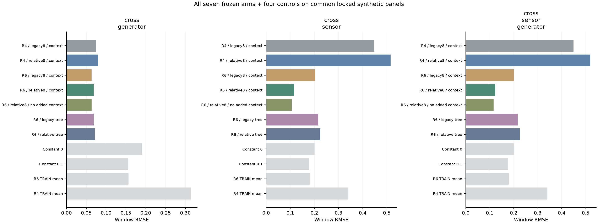
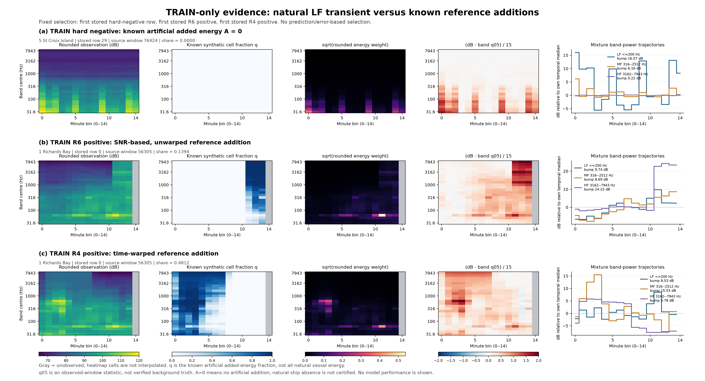

# R6 개편·로컬 진단: 현재 판정

**새 구현과 소규모 CPU 비교는 완료했다. 공식 Test와의 간극이 좁혀졌다고는 아직 결론내릴 수 없다. GPU 대형 모델 학습과 제출은 재개하지 않았다.**

## 요청한 3대 진단의 실제 수행 범위

1. **INNER vs Test 적대적 분류: 미실행.** Test에 출처 정답을 붙여 분류기를 적합하는 것은 [공식 규정](https://zindi.world/competitions/french-embassy-underwater-vessel-noise-challenge)의 Test 추론 전용 조건과 충돌한다. 스크립트는 Test 경로를 입력 단계에서 거부한다. 허용된 R6 TRAIN vs INNER의 출처 구분만 별도로 실행했다.
2. **상수/평균 baseline: 실행.** R5 Fold0 INNER 3,000개와 R6 INNER 1,024개의 알려진 합성 정답만 사용했다.
3. **Test vs INNER KS 및 Test 중앙값 맞추기: 미실행.** Test 통계를 생성기 수정의 목표로 사용하지 않는다. 대체 통계는 R6 TRAIN vs INNER이며 Test 비교로 바꿔 읽으면 안 된다.

구현: [local_alignment_audit.py](../ops/local_alignment_audit.py), [사전 계획](R6_LOCAL_ALIGNMENT_AUDIT_PLAN.json), [전체 결과](R6_LOCAL_ALIGNMENT_AUDIT.json), [진단 원문](R6_LOCAL_ALIGNMENT_AUDIT.md).

## 상수 예측 RMSE

| INNER | 상수0 | 상수0.1 | 해당 TRAIN 평균 | INNER 정답 평균(진단용 oracle) |
|---|---:|---:|---:|---:|
| R5, 3,000개 | 0.491873 | 0.418974 | 0.309864 | 0.309864 |
| R6, 1,024개 | 0.199072 | 0.160120 | 0.159162 | 0.158872 |

정답 평균으로 채운 값은 같은 INNER에서 적합한 최적 상수의 기술 통계다. 배포 모델의 검증 점수가 아니다. 상수 c의 MSE=Var(y)+(c−mean(y))²를 수치 검증했다. 공개 Benchmark 알고리즘이 확인되지 않아 그 RMSE²를 E[y²]로 단정할 수 없고, 모든 상수 baseline을 같은 목표 범위에 맞출 이유도 없다. **R6의 target 스케일이 작아졌다는 사실과 Test에 가까워졌다는 주장은 다르다.**

## 허용 원천 간 출처 구분·분포 차이

R6 TRAIN 8,192개와 INNER 1,024개의 db-only 특징 858개로 고정 LightGBM 200trees를 학습했다. 별도 탐색/ES 없이 원천 창 ID 단위 5-fold에서 **출처 구분 OOF AUC=0.903065**다. 이는 경쟁 모델의 presence AUC와도 다른 지표다.

| 특징 | TRAIN 중앙값 | INNER 중앙값 | INNER−TRAIN | KS 통계량 |
|---|---:|---:|---:|---:|
| 저역 bump, 31.6–501.2Hz | 4.923847 | 4.602042 | −0.321805 | 0.078857 |
| 고역 bump, 3.16–7.94kHz | 4.716398 | 8.802792 | +4.086394 | 0.201904 |
| 저·고역 시간 상관 | 0.337112 | 0.428972 | +0.091860 | 0.089966 |
| 전체 대역 시간 std(dB) | 2.342279 | 2.264040 | −0.078239 | 0.074585 |

모든 특징의 유효 표본은 TRAIN 8,192/INNER 1,024개다. 여기서 저역 정의는 요청대로 31.6–501.2Hz이며, hard-negative 선정의 ≤200Hz 정의와 다르다.

0.903은 **로컬 TRAIN과 INNER가 구별된다는 결과**다. TRAIN 6개 사이트 vs INNER 3개, TRAIN만의 hard-negative 강조, 원천 기간/참조 차이가 함께 반영된다. 어느 원인 때문인지 분해하지 않았다. 동일 배경 창의 반복은 fold 안에 묶었지만, 인접 창·동일 녹음 주간의 상관을 AV fold에서 완전히 제거한 것은 아니다. KS p-value도 독립 표본의 엄밀한 유의확률로 해석하지 않는다. 이 값을 낮추기 위한 자동 수정은 하지 않았다.

## 5개 CNN·2개 LightGBM 비교 결과

소규모 TRAIN 8,192개에서 최대100epoch/ES7/Adam/dropout0.1을 유지했다. 회귀와 셀 정답은 원래 추가 에너지에서 계산하고, 모델 w는 반올림 관측에서 계산했다. 7개 checkpoint를 모두 동결한 후 공통 진단 패널을 1회 평가했다.

| 사전 고정 비교군 | 다른 생성기 RMSE | 다른 센서 RMSE | 센서+생성기 RMSE |
|---|---:|---:|---:|
| 이전 R4 생성법칙·과거 입력 CNN | 0.075228 | 0.448184 | 0.448858 |
| 새 생성기·과거 입력 CNN | 0.063089 | 0.202509 | 0.200394 |
| 새 생성기·상대8채널·전역 문맥 CNN | 0.068443 | 0.115570 | 0.122830 |
| 새 생성기·상대8채널·추가 전역 문맥 없음 | 0.063231 | 0.105865 | 0.115656 |
| 새 생성기·상대 입력 LightGBM | 0.071427 | 0.224560 | 0.225680 |
| 상수0.1 | 0.155601 | 0.178197 | 0.176745 |

이 결과에서는 새 생성기와 상대 입력이 교차 센서에서 개선을 보였지만, R4/R6의 target prior도 달라져 전체 개선을 입력 제거 하나에만 귀속할 수 없다. 전역 문맥 추가는 이 실험에서 이득이 없었다. LightGBM은 교차 센서에서 상수보다 나빴다. 모든 결과를 보존했고 이 패널로 앙상블 가중치나 재학습 설정을 맞추지 않았다.

원래 R5의 INNER 0.090808/Public RMSE0.348009와 위 숫자는 같은 모델·같은 평가 모집단이 아니다. 이번 작은 CNN 약58k/64k 파라미터는 R5 Wide CNN1.488M 완전 재현도 아니다. 공식 Test 개선·LB 예측·전체5fold OOF로 읽으면 안 된다.

[상세 보고서: 전체7개 모델·수식·곡선·해시](R6_GUARDRAILS_AND_CPU_ABLATION_REPORT.md).

## 남아 있는 특이사항

- 고정 score=0.5 share+0.5 mask contrast는 보정 확률이 아니다. 이를 presence BCE에도 쓰면 낮은 share 양성에서 회귀와 충돌할 수 있다는 수식적 한계가 있다. 이번 결과를 보고 loss를 변경하지 않았다.
- q05는 실제 B 정답이 아니며, 긴 통과에서는 오염될 수 있다. sqrt(w)도 임의의 반올림 전 gain과 대역별 EQ에 대해 완전 불변인 것은 아니다.
- 3,545개 경계 제외 배경 창을 분 마스킹으로 복구했지만 flag의 고장 원인을 확정한 것은 아니다. hard-negative 819개는 고유 원천428개이며 자연 선박 부재 라벨이 아니다.
- 이번 Fold0 기전 실험에서는 St Francis를 센서 홀드아웃으로 남겼다. production5fold·전체 배경 동적 합성·대형 backbone의 새 본학습은 아직 하지 않았다.
- **공식 Test gap 해결은 미확인이다. GPU를 추가로 빌릴 단계라고 안내하지 않는다.**

실험 실패도 보존했다. 최초 경계 배치 지원 오류와 NPZ 문자열 직렬화 오류는 실제 모델 fitting 전에 발견·수정했고, 수정된 새 버전에서 동일 seed로 전체 재생성했다. 기존 R4/R5의 동결 코드17개 SHA는 학습 후에도 그대로다. [최종 검사](R6V2_POSTFLIGHT.json).
