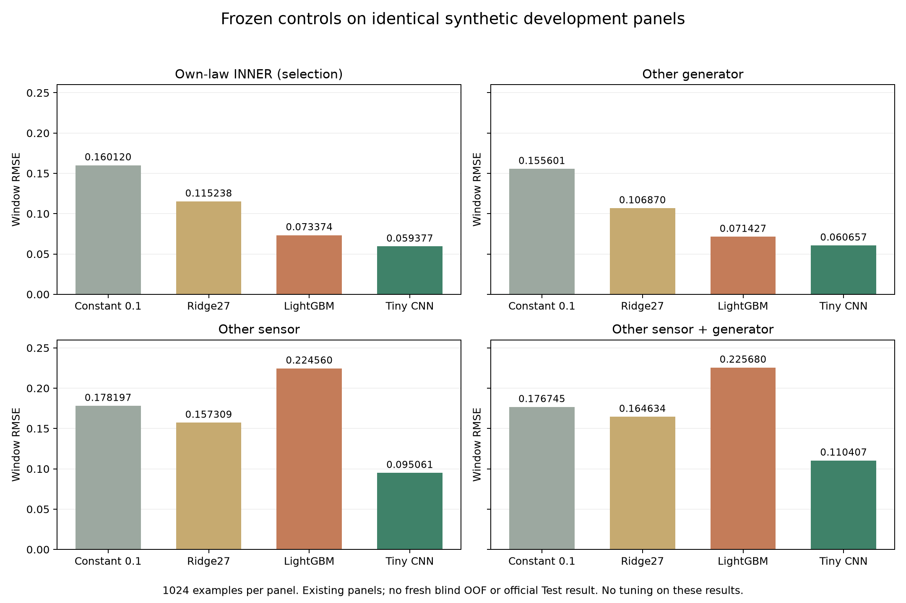

# R7 검산·전달성·소형 모델 대조 결과와 VTUAD 비교

기준일: 2026-10-26, Asia/Seoul. 세 가지 요청을 모두 CPU에서 실행했다. 이번의 새 fit은 고정 Ridge1회이며 CNN·대형 모델을 새로 학습하거나 공식 제출을 하지 않았다. `0.059377`은 앞서 완료한 R6 작은 CNN의 자체 INNER 최저값이다.

## 1. Anil45 글과 우리가 쓴 데이터가 같은가

**같은 VTUAD rebuilt v1.3.2 / DOI10.5281/zenodo.23037895를 사용했다.** [공개 고지](https://zindi.world/competitions/french-embassy-underwater-vessel-noise-challenge/discussions/35531)는 strict vessel/background와12개per-class archives, starter minute_band_power25대역 변환을 명시한다. 학습 모델·정확한 clip 수·합성 세기·분할은 공개하지 않는다.

우리는 strict archive4volume을 내려받고525WAV를 변환했다. 실제 R4/R5 참조 pool은119clips/22선택그룹, 현재 R6 실험은94/17 중 TRAIN51/9다.12개per-class archive의 사용 기록은 없다. 다만 이들은 같은scenario의 다른container/cut view이므로 별도 독립 원천이 늘어나는 것처럼 합산하지 않는다. [세부 원천 비교](R7_ANIL45_SOURCE_COMPARISON.md)

제출2회는 학습·로컬 실험2회를 뜻하지 않는다. 고득점자의 모델이나 합성법을 이 고지로 추론할 수는 없다. 같은 corpus를 쓰면서 성능이 다른 만큼, 우리 쪽에서는 합성/표현/학습목표의 전달성을 우선 검사할 이유가 있다. 공식 Test의 정확한 reference가 VTUAD라고 확정된 것도 아니다.

## 2. 데이터와 모델에서 무엇이 바뀌었나

| 항목 | 이전 제출 R5 raw CNN | 이번 R6 relative global CNN |
|---|---|---|
| 실제 구조 | Wide CNN 1,488,002개 파라미터 | 작은 CNN 64,449개; 5개 비교군은 tiny CNN 변형이며 대형 backbone 5종이 아님 |
| 학습·개발 표본 | Fold0 배경53,244개/epoch 동적 합성, INNER3,000 | 고정 TRAIN8,192 draws(고유 배경5,639), INNER1,024; 전체297,837 학습이 아님 |
| 원천·검증 | 시간/참조 그룹 분리, INNER4개 sensor가 TRAIN에도 존재 | sensor/source 역할 분리; 다른 센서·생성기 진단 포함. St Francis는 이번 TRAIN 제외 |
| 경계 후보 | 후보 분이 포함된 TRAIN 창 전체 제외 | 해당 분만 NaN, 기존3,545창 복구; 최소3관측분·24h purge 유지 |
| 참조 세기 | 목표share Uniform(.005,.95)를 먼저 정하고 alpha 역산 | peak-minute SNR [-10,+10]dB에서 alpha, share는 관측된 성분에서 계산. 이 범위의 공식 대표성은 미확인 |
| 시간 변형 | 2초 power를1/3~3배 warp 후fade·배치 | native minute-first/1~3분short, warp없음; 별도 edge/native2s 생성기로 진단 |
| 입력 | 절대db/100, TRAIN-fitted q0/Bhat ratio 포함8채널 | median/q20/q05 상대값, 인접Δ, 동조상승, 상대profile, mask, sqrt(w) 8채널 |
| 격자·pooling | raw 입력, raw 에너지 가중치 | 입력0.1dB·같은 rounded 관측에서w. q/share정답은 반올림 전 성분 유지 |
| 출력 | direct sigmoid mask→에너지pool, 별도 presence head | mask→에너지pool 유지, mask로 계산한 고정score. score의 이득·BCE 충돌은 별도 한계 |
| Adam/dropout/loss계수 | Adam lr.001,wd.0003,dropout.1;share+.25cell+.05BCE | 동일. 새로 추가한 개선이라고 세지 않음 |
| 실제 epoch·선택 | 26epoch/ES7, best19 | 실제100epoch/noES, window best31. 관측된 최소이며 global minimum 보장 없음 |

원래 R5 INNER 상수0 RMSE는0.491873, 새 R6 INNER는0.199072다. 두 문제의 target 스케일·표본도 바뀌었으므로 `0.090808→0.059377`을 같은 평가에서의 개선율로 계산하면 안 된다. 각 변경의 독립 인과효과도 이 비교만으로 확정하지 않는다. [구현별 근거](R7_SMALL_MODEL_CONTROLS_RESULTS.md)

## 3. 이전 제출 경로 검산 — 통과

- 375열의 minute/band순서, ID·mask round-trip, 잘못된header 거부, TRAIN/query 특징 및 에너지 가중치의 동일성을 검사했다.
- 원 R5 checkpoint best19를 CPU2/FP32로 재실행했다. INNER3,000개 RMSE **0.0908081471**를 재현했다. 기존CPU4 예측과 INNER/Test의 share·score·cell mask 모두 bitwise동일했다.
- frozen 후처리에서 원 CSV를 바이트까지 정확히 재생성했다. 이어 Whale의 실제 Zindi 제출 **Vz5mjZEr** 파일을 다운로드하여 확인했고, 제출 서버에서 받은96,743bytes와 로컬 CSV의 SHA256이 **e32b04a2b876a66da6046e1ef1fdae6fd7e768eb9365bde5aa7227ad235c83fe**로 일치했다.
- 물리 pooling 오차는 INNER 1.11e-07, Test 1.05e-07였다. 원본 checkpoint/prior/core/입력 해시는 바뀌지 않았다.

**발견 범위에서는 잘못된 CSV 업로드·열/ID순서·전처리 불일치·pooling 구현 오류가 재현되지 않았다.** 이것이 모든 모델 가정이 옳거나 공식 생성 분포가 맞다는 증거는 아니다. Test는 고정 예측의 archive 재현에만 사용했고 Test 통계/fit/튜닝/원천 추정은 하지 않았다. 원 감사 당시 미확인이던 업로드 바이트는 후속 확인으로 해소했다. [재현 감사](R7_R5_SUBMISSION_PATH_AUDIT.md) · [실제 업로드 파일 확인](R7_R5_UPLOADED_FILE_VERIFICATION.json)

## 4. 합성 방식의 전달성 — 모든5개 checkpoint 평가

각 arm의 best-window checkpoint는 ownINNER에서 이미 선택·동결되어 있었다. 아래3개 패널에 대해5×3=15회 strict-load CPU추론을 실행했다. 패널별1024개, 추론 경과 27.45초다. 다른 생성기·다른 센서·둘의 조합을 검사한다.

| 고정 tiny CNN 대조군 | 다른 생성기 | 다른 센서 | 센서＋생성기 |
|---|---:|---:|---:|
| r4law_legacy8_global | 0.074687 | 0.448952 | 0.449931 |
| r4law_relative8_global | 0.074590 | 0.511655 | 0.515098 |
| r6law_legacy8_global | 0.056932 | 0.183585 | 0.184142 |
| r6law_relative8_global | 0.060657 | 0.095061 | 0.110407 |
| r6law_relative8_local | 0.063506 | 0.106678 | 0.115731 |

R4 law만 유지한 tiny 대조군은 sensor/joint에서 크게 악화됐다. R6 relative global은 각각0.095061/0.110407이지만, generator-only에서는 R6legacy가0.056932로 더 낮다. 나쁜 결과와 다른 순위도 보존했다. cross성능으로 checkpoint·설정·앙상블 가중치를 다시 선택하지 않았다. **기존에 본 패널을 재사용한 개발용 비교이며 새로운 blind검증·5foldOOF·공식 Test가 아니다.** [전체 전이 결과](R7_FIXED100_TRANSFER_REPORT.md) · [독립 수치 검증](R7_FIXED100_TRANSFER_VERIFICATION.json)

## 5. 작은 모델로 개선을 입증 — 같은 창·같은 정답의 대조

Ridge는 TRAIN에서만27물리특징의 imputer/scaler와고정alpha10을 fit했다. 나머지는 상수·TRAIN평균·이미 동결된LightGBM/CNN이다. 모든 모델을 동일한 네 패널에서 비교했다.

| 고정 모델 | INNER | 다른 생성기 | 다른 센서 | 센서＋생성기 |
|---|---:|---:|---:|---:|
| Constant 0 | 0.199072 | 0.189820 | 0.200983 | 0.199626 |
| Constant 0.1 | 0.160120 | 0.155601 | 0.178197 | 0.176745 |
| TRAIN mean | 0.159162 | 0.156678 | 0.181744 | 0.180343 |
| Ridge (27 features) | 0.115238 | 0.106870 | 0.157309 | 0.164634 |
| Frozen LightGBM | 0.073374 | 0.071427 | 0.224560 | 0.225680 |
| Frozen tiny CNN | 0.059377 | 0.060657 | 0.095061 | 0.110407 |

CNN이 상수·Ridge보다 낮은 오차를 보여 추가 신호를 학습했다는 국소 근거는 있다. 반면 LightGBM은 INNER에서0.073374여도 센서+생성기에서는0.225680으로 상수0.1보다 나빴다. **낮은 INNER만으로 전달성을 판단하면 안 된다는 사례도 그대로 남아 있다.** 위 수치를 공식 점수로 환산하거나 우승 성능으로 예고하지 않는다. [모든 slice와재현성](R7_SMALL_MODEL_CONTROLS_RESULTS.md) · [104개 지표 검증](R7_SMALL_MODEL_CONTROLS_VERIFICATION.json)

## 6. 현재 판단과 남은 작업

실제 제출 CSV까지 재현됐으므로 단순 업로드·매핑 버그를 현재 격차의 설명으로 삼을 근거는 줄었다. R6 입력과 생성법은 자체 미관측sensor/다른generator에서 이전tiny대조보다 나았지만, 제한된참조원천·고정SNR범위·이미본검증패널·한seed라는 한계가 있다. 현재 수치가 실제 Test오차를 대표하는지는 미확인이다.

다음 설계에서는 단순 minute-first 대조와 참조원천/세기 변화의 민감도를 사전 고정해 비교할 수 있다. Anil45의 출처 고지를 전체 해법으로 오해해 모델을 바꾸거나 제한된 reference를 무조건 복구하지 않는다. 이번 보고서 생성에서는 추가 학습·새예측·튜닝을 수행하지 않았다. GPU학습·공식제출도 재개하지 않았다.

[입력·결과 SHA receipt](R7_REVIEW_RECEIPT.json)
