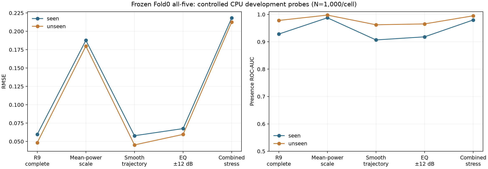

# R10 동결 모델: 배경 × 생성 연산자 교차 진단

Mac CPU FP32, 동결 Fold0 모델 5종과 기존 가중치(신경망 각각0.1, LightGBM0.6)를 사용했다. Test·미사용 report·GPU·재학습은 사용하지 않았다. 10개 교차 셀 × 1,000건과 ambient 500쌍을 새 development 진단 자료로 생성했다.

모든 교차 셀은 경계 분 QC 이후 **15분 모두 관측된 창**으로 제한했다. 따라서 관측량은 정확히 같고 무추가 비율은20%다. 이는 기존 R9 전체 검증 분포가 아닌 완전 관측 조건부 시험이다. 기존 selection과 같은 원천 풀에서 새로운 배경 창을 뽑았으며 모델 선택에 사용하지 않았다.

| 배경 | 생성 연산자 | RMSE | AUC score | 편향 | 정답 RMS | 평균 상수 RMSE |
|---|---|---:|---:|---:|---:|---:|
|seen|r9_complete|0.059704|0.928162|+0.010336|0.192203|0.157143|
|seen|mean_scale_only|0.187706|0.987669|-0.096647|0.515551|0.315546|
|seen|smooth_trajectory_only|0.057842|0.906750|+0.011651|0.153509|0.129553|
|seen|eq12_only|0.067555|0.918106|+0.005643|0.192317|0.157247|
|seen|combined_stress|0.218129|0.979706|-0.120716|0.515551|0.315546|
|unseen|r9_complete|0.048462|0.978000|+0.000437|0.193366|0.156084|
|unseen|mean_scale_only|0.179882|0.997550|-0.097881|0.515551|0.315546|
|unseen|smooth_trajectory_only|0.045322|0.962131|+0.002582|0.154275|0.128760|
|unseen|eq12_only|0.059646|0.965300|-0.003956|0.193450|0.156128|
|unseen|combined_stress|0.212688|0.994938|-0.121912|0.515551|0.315546|

기존 생성기를 새 배경에 옮겨도 이번 표본에서는 성능이 무너지지 않았다. 관측 평균 전력 SNR로 바꾸면 목표 비율 자체도 커지며(양성은 SNR/(1+SNR)), 모델이 큰 비율을 과소추정했다. 따라서 RMSE 차이를 순수한 사이트 암기·생성기 과적합의 인과 효과라고 단정하지 않는다. AUC는 높게 남아서 공식 AUC0.555 붕괴까지 재현한 것은 아니다.

mean_scale_only는 관측된15분 전체의 참조 평균 전력(무추가 분의0포함)과 배경 평균 전력으로 스케일을 계산한다. smooth_trajectory_only는 활성 support 중심으로0.8~1.25배 resampling과 끝값이0으로 강제되지 않는 Gaussian envelope를 적용한다. EQ±12는 **진단 스트레스**이며 실제 학습 레시피±6을 변경하지 않았다. combined만으로 원인을 귀속하지 않도록 단일 연산자 변화도 각각 실행했다.

양쪽의 TRAIN 배경 창 교집합은0이다. recorder 문자열/sensor component의 TRAIN 교집합0은 unseen에만 해당하며, seen은 기존 recorder와sensor component를 공유한다. 새 배경의 source/QC9394개 완전 관측 창에서1000개를 비복원 추출했으며 Saldhana935·Fish Hoek35·Sea Point30개다. site별 표본이 작고 불균형하므로 다른 해역 전체의 일반화를 입증하지 않는다. 메타데이터 sensor component는 실제 장비 개체 검증을 대신하지 않는다.

## 동일 정답의 선박 참조 대 ambient 참조

같은 남아공 배경, 동일1~3분 support(1분1쌍·2분160쌍·3분339쌍)·smooth EQ·목표 y∈[.01,.60]를 사용했다. 두 참조 각각의α를 물리식으로 풀어 정답을 동일하게 만들었으며 추가 ambient를0으로 재라벨링하지 않았다. 모두 양성이어서 AUC는 정의되지 않는다.

| 참조 | RMSE | 편향 | 정답 RMS |
|---|---:|---:|---:|
|ship|0.075954|-0.020911|0.353514|
|ambient|0.099583|-0.026508|0.353514|

같은 정답에 비슷하게 예측하는 것은 에너지 회귀 목표에 부합한다. ambient의 오차가 크다는 것은 이 대조 조건에서 참조 질감에 따른 민감도가 있다는 뜻이며, 선박 순수 소음이나 장비 암기를 단독으로 식별하는 실험은 아니다.

최초r1 진단은 실험용 warp가 짧은 edge support를 지우는 자체 오류로 중단했다. 원본 R9에는 이warp가 없다. 활성 support 중심 resampling으로 수정하고1080개 지지구간 fixture를 통과한 뒤 새r2 디렉터리에서 전체 재실행했다. 실패r1은 FAILED기록과 함께 보존했으며 결과선택에는 쓰지 않았다.

[전 모델 지표](all_models_metrics.csv) · [사이트·타깃 구간별 지표](site_and_target_slices.csv) · [MSE/RMSE/AUC 대조와 상호작용](factorial_effects.json) · [물리·산술 독립 검산](INDEPENDENT_VERIFICATION.json) · [원천 분리/QC](background_source_audit.json) · [사전 계획](predeclared_plan.json)

독립 리뷰 보완: seen1000개 중124개 원배경은 원래 fixed selection에도 포함됐다. 새 혼합을 만든 같은 원천 풀의 development 진단이며 완전히 새로운 배경 평가가 아니다. 509개 풀을 스케줄했으나 실제 양성 추가에 사용된 고유 reference는480개다.
