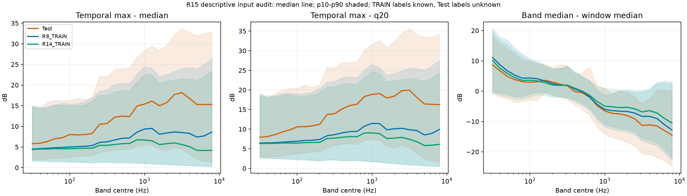

# R15 대역별 입력 분포 비교

이 문서는 원본 Test 1,500창과 실제 저장된 R9·R14 TRAIN 혼합창의 기술 통계다. 새 합성·모델 학습·보정·분포 맞춤·출력 변경은 수행하지 않았다. Test 정답과 실제 추가 선박 에너지 비율은 알 수 없다. 차이가 있어도 Public 오차의 인과 원인을 확정하지 않는다.

## 원천과 분모

| 자료 | 전체 창 | 샘플 | TRAIN 양성/추가0 | 원천 |
|---|---:|---:|---|---|
| Test | 1500 | 1500 | 정답 없음 | `data/raw/Test.csv` |
| R9_TRAIN | 78869 | 1500 | 54855/24014 | `models/r9_mac_trees_r2/fold_00/tree_epoch1_train.npz` |
| R14_TRAIN | 78869 | 1500 | 63095/15774 | `models/r14_production_nn_fold0_r1/raw_cache/epoch_038.npz` |

R9는 실제 Mac Tree 학습에 사용한 Fold0 epoch1이다. R14는 실행 중 NN이 실제로 사용한 Fold0 epoch38 rolling raw-cache이며 별도의 새 합성이 아니다. 한 epoch 스냅샷이므로 다른 epoch·모든 fold를 대표한다고 주장하지 않는다. 동일 개수 샘플은 seed202610271502의 무복원 추출이며 양 데이터 간 동일 배경·참조로 짝지은 실험이 아니다. 모든 원천의 NPZ/동반 receipt SHA는 source JSON에 기록했다. rolling 원본은 원학습의 캐시 정책으로 추후 삭제될 수 있어 이번 파생 수치를 보존했다.

## 계산식과 마스크

시간 통계는 각 대역에서 관측된 dB만 사용한다. `max−q20`의 q20은 dB 영역 선형 보간 분위수다. `median−window_median`의 window median은 관측된 전체 375셀의 중앙값으로 명시했으며, 대역별 중앙값 25개의 중앙값을 사용하는 대안도 별도 열에 보존했다. 추가 반올림·NaN 대체는 없다. 계산 float64, 파생 NPZ float32. 분포 p10/p50/p90의 분모는 유효 창 수이고 개별 열에 함께 기록한다.

LF≤200Hz는 index0..8, MF300..3000Hz는10..19, HF3000..8000Hz는20..24다. 251.2Hz는 이 세 군의 경계 밖이며 ALL25에 포함된다. 원 EDA 저대역31.6..501.2Hz(index0..12)는 다른 군으로 유지한다. 그룹 파워곡선은 선형 파워를 합한 후 dB로 변환하며, 대역별 bump의 평균과 구분한다.

## EDA 16.25dB와의 정의 대조

| 자료 | HF 5대역 선형합 곡선 bump p50 | HF 개별대역 bump 평균의 p50 | HF 선형합 bump>5dB |
|---|---:|---:|---:|
| Test | 16.246344 | 16.230000 | 83.867% |
| R9_TRAIN | 8.126166 | 8.240001 | 59.689% |
| R14_TRAIN | 4.663194 | 4.800001 | 48.857% |

기존 캐시와 ID 순서가 일치한다. 기존 `bump_high_db` p50=16.246345000; 이번 float64 재계산과 기존 float32 EDA의 최대 절대 차이는 9.08319473e-06dB다. 16.25dB는 **HF5대역 파워합 시계열**의 `max−median`이며, 25개 대역 bump의 중앙값이나 실제 선박 share가 아니다.

기존 EDA의 TRAIN 대조군은 원 SA 배경 샘플이다. 이번 R9·R14 TRAIN은 알려진 추가 에너지를 섞은 학습 혼합창이다. 두 TRAIN 분모와 레이블 의미를 혼동하지 않는다. 원 EDA의 사이트 프로브는 추정값이며 본 비교에서 실제 사이트 정답으로 사용하지 않았다.

## 25개 대역 전체표

각 셀은 p10 / p50 / p90 dB이다. 아래는 전체 창이며, 동일1500 샘플 및 TRAIN 추가0/양성 분리는 CSV에 모두 있다.

### max_minus_median

| Hz | Test | R9 TRAIN | R14 TRAIN |
|---:|---:|---:|---:|
| 31.6 | 2.100 / 5.800 / 15.000 | 1.650 / 4.500 / 14.900 | 1.600 / 4.400 / 14.600 |
| 39.8 | 2.000 / 5.900 / 14.210 | 1.600 / 4.600 / 14.700 | 1.600 / 4.500 / 14.400 |
| 50.1 | 2.050 / 6.300 / 15.800 | 1.550 / 4.700 / 14.700 | 1.500 / 4.500 / 14.400 |
| 63.1 | 2.200 / 7.000 / 16.305 | 1.500 / 4.800 / 15.300 | 1.400 / 4.600 / 15.000 |
| 79.4 | 2.400 / 7.250 / 16.210 | 1.500 / 4.900 / 15.600 | 1.400 / 4.550 / 15.200 |
| 100.0 | 2.500 / 8.025 / 16.200 | 1.500 / 5.000 / 15.400 | 1.300 / 4.600 / 14.960 |
| 125.9 | 2.700 / 7.925 / 16.855 | 1.400 / 5.100 / 15.500 | 1.300 / 4.650 / 15.000 |
| 158.5 | 2.845 / 8.000 / 16.510 | 1.300 / 5.150 / 16.000 | 1.200 / 4.700 / 15.200 |
| 199.5 | 2.900 / 8.250 / 17.100 | 1.200 / 5.350 / 16.900 | 1.100 / 4.700 / 16.050 |
| 251.2 | 3.700 / 10.500 / 22.300 | 1.400 / 6.100 / 18.600 | 1.200 / 5.400 / 17.550 |
| 316.2 | 4.000 / 10.700 / 21.955 | 1.400 / 6.250 / 18.800 | 1.200 / 5.400 / 17.500 |
| 398.1 | 4.300 / 12.200 / 23.855 | 1.300 / 6.700 / 20.100 | 1.100 / 5.600 / 18.400 |
| 501.2 | 4.290 / 12.475 / 23.900 | 1.300 / 7.100 / 20.500 | 1.100 / 5.800 / 18.700 |
| 631.0 | 4.400 / 12.350 / 24.210 | 1.300 / 7.200 / 20.300 | 1.000 / 5.850 / 18.700 |
| 794.3 | 5.200 / 14.925 / 26.705 | 1.200 / 8.600 / 22.700 | 1.000 / 6.750 / 20.800 |
| 1000.0 | 5.500 / 15.400 / 28.400 | 1.100 / 9.350 / 24.400 | 0.900 / 6.700 / 22.600 |
| 1258.9 | 5.500 / 16.125 / 29.500 | 1.000 / 9.500 / 24.100 | 0.900 / 6.500 / 22.550 |
| 1584.9 | 4.400 / 15.000 / 28.400 | 0.900 / 8.100 / 22.000 | 0.800 / 5.600 / 20.500 |
| 1995.3 | 4.045 / 15.775 / 29.755 | 0.800 / 8.400 / 22.600 | 0.700 / 5.800 / 21.000 |
| 2511.9 | 4.895 / 17.700 / 32.305 | 0.600 / 8.650 / 23.300 | 0.700 / 6.000 / 21.200 |
| 3162.3 | 4.495 / 18.150 / 33.655 | 0.500 / 8.500 / 24.100 | 0.600 / 5.600 / 21.600 |
| 3981.1 | 3.200 / 16.800 / 32.700 | 0.500 / 8.300 / 24.200 | 0.500 / 5.100 / 21.500 |
| 5011.9 | 2.100 / 15.300 / 32.000 | 0.400 / 7.400 / 24.000 | 0.400 / 4.200 / 21.100 |
| 6309.6 | 1.500 / 15.300 / 32.510 | 0.300 / 7.700 / 25.000 | 0.400 / 4.150 / 22.100 |
| 7943.3 | 1.395 / 15.300 / 32.855 | 0.300 / 8.600 / 26.400 | 0.300 / 4.200 / 23.400 |

### max_minus_q20

| Hz | Test | R9 TRAIN | R14 TRAIN |
|---:|---:|---:|---:|
| 31.6 | 3.120 / 7.920 / 19.326 | 2.680 / 6.440 / 18.840 | 2.660 / 6.340 / 18.460 |
| 39.8 | 2.880 / 8.100 / 17.664 | 2.620 / 6.500 / 18.540 | 2.560 / 6.340 / 18.260 |
| 50.1 | 2.938 / 8.580 / 19.004 | 2.520 / 6.540 / 18.500 | 2.440 / 6.360 / 18.120 |
| 63.1 | 3.136 / 9.280 / 20.022 | 2.500 / 6.680 / 19.120 | 2.380 / 6.460 / 18.740 |
| 79.4 | 3.600 / 9.790 / 20.404 | 2.440 / 6.820 / 19.260 | 2.280 / 6.440 / 18.800 |
| 100.0 | 3.700 / 10.600 / 20.464 | 2.360 / 6.900 / 18.840 | 2.140 / 6.420 / 18.380 |
| 125.9 | 3.858 / 10.630 / 21.300 | 2.320 / 7.120 / 19.040 | 2.120 / 6.560 / 18.440 |
| 158.5 | 4.200 / 10.800 / 20.622 | 2.120 / 7.160 / 19.440 | 1.960 / 6.600 / 18.640 |
| 199.5 | 4.200 / 11.240 / 21.304 | 2.000 / 7.360 / 20.340 | 1.840 / 6.620 / 19.380 |
| 251.2 | 5.318 / 13.730 / 25.946 | 2.220 / 8.320 / 21.940 | 2.080 / 7.620 / 20.800 |
| 316.2 | 5.798 / 13.930 / 25.580 | 2.220 / 8.600 / 22.180 | 2.080 / 7.720 / 20.840 |
| 398.1 | 6.200 / 15.160 / 26.944 | 2.040 / 9.040 / 23.120 | 1.920 / 7.920 / 21.460 |
| 501.2 | 6.300 / 16.000 / 27.084 | 2.040 / 9.360 / 23.300 | 1.920 / 8.100 / 21.600 |
| 631.0 | 6.118 / 16.350 / 27.142 | 2.100 / 9.420 / 23.120 | 1.900 / 8.080 / 21.520 |
| 794.3 | 7.136 / 18.350 / 30.206 | 1.840 / 10.760 / 25.140 | 1.860 / 9.020 / 23.320 |
| 1000.0 | 7.360 / 18.860 / 31.760 | 1.700 / 11.460 / 26.420 | 1.740 / 9.040 / 24.700 |
| 1258.9 | 7.012 / 19.080 / 32.608 | 1.536 / 11.420 / 25.700 | 1.620 / 8.860 / 24.220 |
| 1584.9 | 5.610 / 17.930 / 30.710 | 1.340 / 9.820 / 23.700 | 1.400 / 7.600 / 22.100 |
| 1995.3 | 5.298 / 18.420 / 32.340 | 1.220 / 10.100 / 24.120 | 1.240 / 7.720 / 22.380 |
| 2511.9 | 5.878 / 19.800 / 34.504 | 0.920 / 10.200 / 24.860 | 1.160 / 7.900 / 22.640 |
| 3162.3 | 5.298 / 19.940 / 35.600 | 0.820 / 9.840 / 25.580 | 1.020 / 7.400 / 22.940 |
| 3981.1 | 3.700 / 18.050 / 34.086 | 0.760 / 9.640 / 25.400 | 0.900 / 6.800 / 22.700 |
| 5011.9 | 2.436 / 16.410 / 33.302 | 0.620 / 8.520 / 25.100 | 0.700 / 5.820 / 22.200 |
| 6309.6 | 1.894 / 16.330 / 33.560 | 0.520 / 8.900 / 26.100 | 0.600 / 5.900 / 23.120 |
| 7943.3 | 1.620 / 16.240 / 34.202 | 0.500 / 9.920 / 27.464 | 0.540 / 6.120 / 24.400 |

### median_minus_window_median

| Hz | Test | R9 TRAIN | R14 TRAIN |
|---:|---:|---:|---:|
| 31.6 | -0.550 / 8.700 / 18.150 | -0.200 / 11.100 / 20.600 | -0.800 / 10.100 / 19.500 |
| 39.8 | -1.950 / 6.700 / 15.605 | -0.600 / 8.700 / 18.000 | -1.200 / 7.600 / 16.800 |
| 50.1 | -2.555 / 4.825 / 14.100 | -1.100 / 6.700 / 16.800 | -1.800 / 5.800 / 15.400 |
| 63.1 | -3.650 / 3.800 / 12.355 | -1.800 / 5.250 / 14.200 | -2.600 / 4.450 / 13.100 |
| 79.4 | -3.350 / 3.100 / 10.105 | -1.800 / 4.300 / 12.300 | -2.600 / 3.550 / 11.300 |
| 100.0 | -2.955 / 2.950 / 9.700 | -0.900 / 4.350 / 10.700 | -1.900 / 3.600 / 10.100 |
| 125.9 | -3.055 / 3.100 / 9.100 | -0.400 / 4.100 / 9.900 | -1.200 / 3.400 / 9.300 |
| 158.5 | -0.450 / 3.600 / 8.800 | -0.600 / 3.350 / 8.600 | -1.400 / 2.800 / 8.150 |
| 199.5 | -0.900 / 3.025 / 7.900 | -1.450 / 2.500 / 7.500 | -2.000 / 2.050 / 7.050 |
| 251.2 | -1.800 / 2.300 / 8.755 | -1.900 / 2.000 / 7.500 | -2.000 / 1.900 / 7.500 |
| 316.2 | -2.805 / 1.800 / 8.500 | -2.300 / 2.000 / 8.300 | -2.000 / 2.000 / 8.000 |
| 398.1 | -4.500 / -0.100 / 5.405 | -3.450 / 0.700 / 6.400 | -2.900 / 1.000 / 6.500 |
| 501.2 | -5.900 / -0.550 / 6.200 | -4.600 / -0.200 / 4.700 | -3.900 / 0.000 / 4.900 |
| 631.0 | -8.055 / -2.050 / 7.855 | -6.400 / -1.900 / 3.500 | -5.700 / -1.400 / 3.500 |
| 794.3 | -11.815 / -4.800 / 1.700 | -9.400 / -4.400 / 0.210 | -8.600 / -3.400 / 1.550 |
| 1000.0 | -14.110 / -6.500 / 0.900 | -11.700 / -6.000 / -1.300 | -10.900 / -4.950 / 1.000 |
| 1258.9 | -15.300 / -7.300 / -0.700 | -12.550 / -6.400 / -0.900 | -11.700 / -5.150 / 0.800 |
| 1584.9 | -16.000 / -7.500 / 0.200 | -13.000 / -6.600 / -0.100 | -12.300 / -5.400 / 0.400 |
| 1995.3 | -16.800 / -8.050 / -0.550 | -13.400 / -6.700 / 0.100 | -12.600 / -5.300 / 0.600 |
| 2511.9 | -18.000 / -9.100 / -1.695 | -14.300 / -7.200 / -0.500 | -13.500 / -5.800 / 0.300 |
| 3162.3 | -20.700 / -11.300 / -4.200 | -16.400 / -8.300 / -0.300 | -15.500 / -6.850 / 0.200 |
| 3981.1 | -20.910 / -11.100 / -2.300 | -17.200 / -8.300 / 0.300 | -16.150 / -6.400 / 1.000 |
| 5011.9 | -21.900 / -11.500 / 0.200 | -18.100 / -9.050 / 2.900 | -17.100 / -7.200 / 2.500 |
| 6309.6 | -23.000 / -13.025 / 0.455 | -20.200 / -11.050 / 3.400 | -19.150 / -9.000 / 2.700 |
| 7943.3 | -24.800 / -14.500 / -0.050 | -22.800 / -12.800 / 3.200 | -21.750 / -10.500 / 2.500 |

## 해석 한계

TRAIN의 share==0은 의도적으로 추가한 성분이 관측 에너지에 기여하지 않는다는 뜻이며, 원래 바다에 자연 선박 소리가 없다는 뜻은 아니다. 고주파 bump가 크다는 사실만으로 선박 유무·추가 share·숨은 정답을 정할 수 없다. TRAIN의 bump 구간별 알려진 share 표는 실제 생성 법칙의 조건부 기술 통계로만 제공하며 Test에 이식·보정하지 않는다. 데이터 구성·결측·epoch·기기·기본 배경과 참조 분포가 함께 다르므로 이번 대조는 원인을 분리한 ablation이 아니다.

파일: [25대역 전체/샘플/양성·추가0](band25_quantiles.csv), [대역군 정의별 통계](group_quantiles.csv), [TRAIN bump별 알려진 share](TRAIN_hf_bump_known_share_bins.csv).
