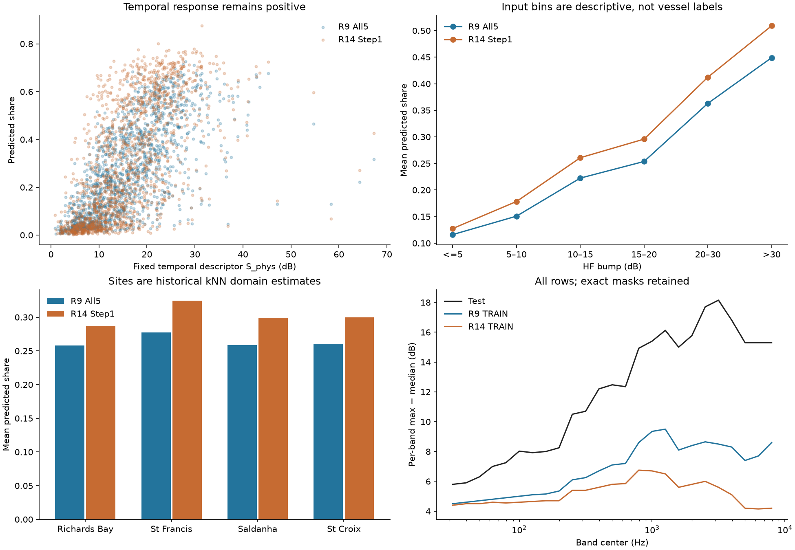
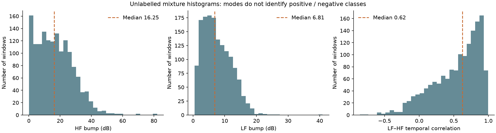
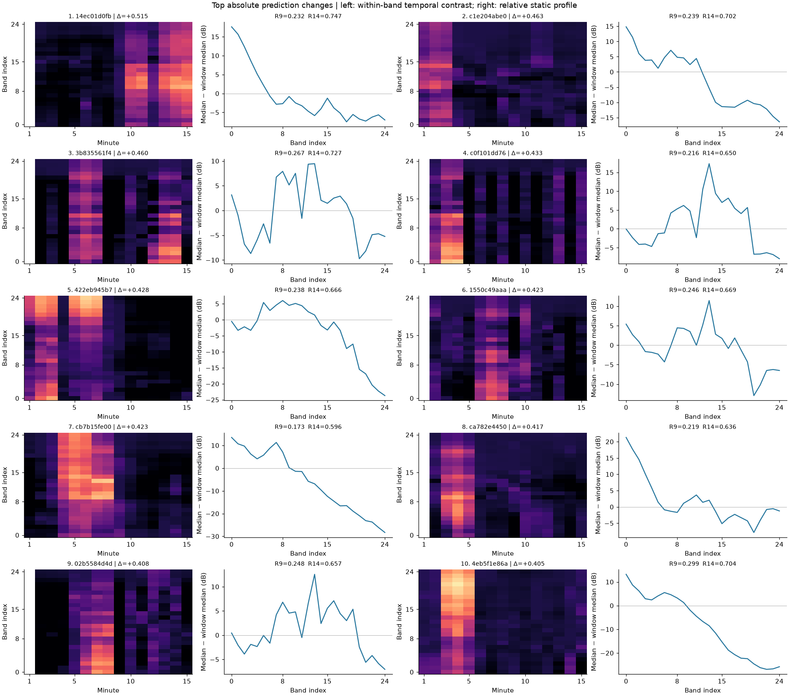
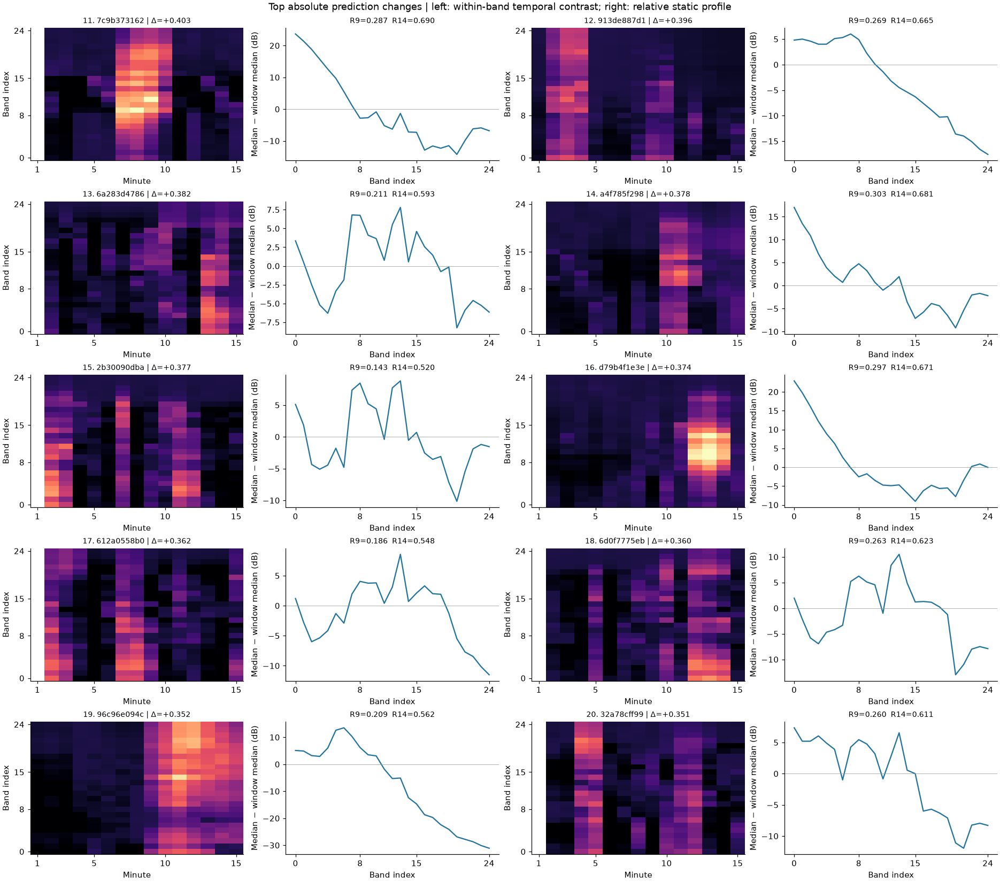
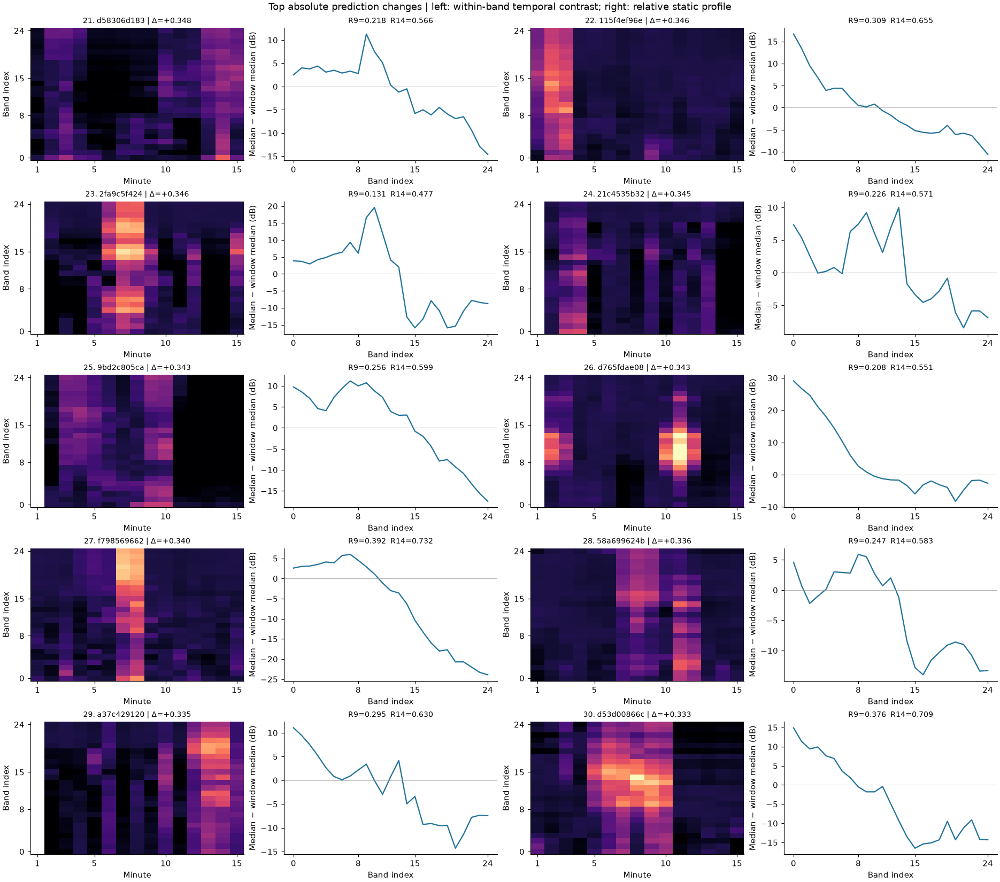
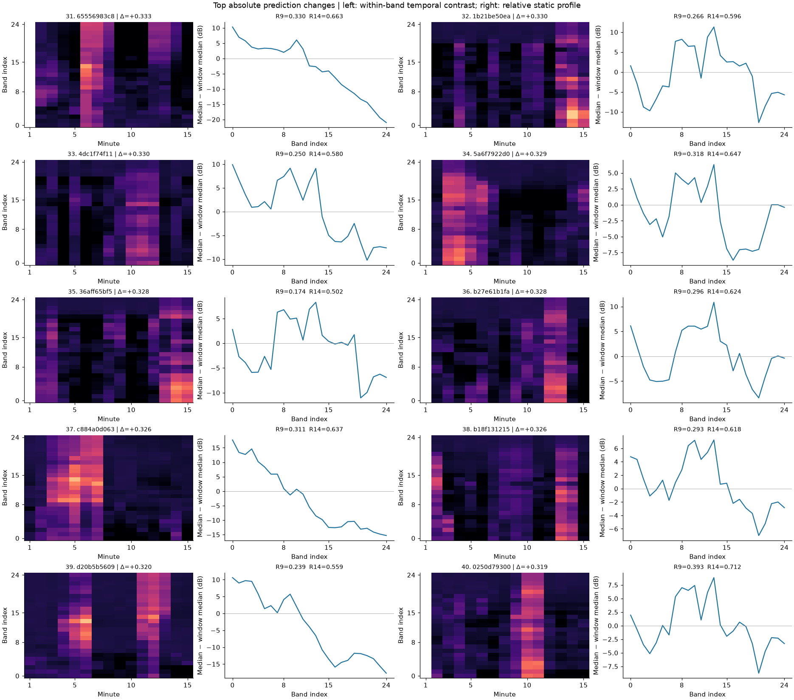
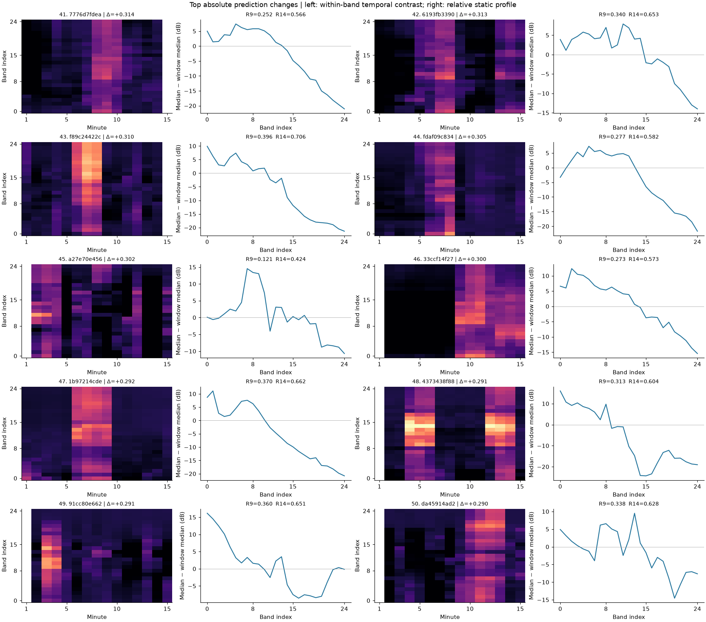

# R15 입력–출력 직접 대조 진단

작성 시각: 2026-10-27T14:27:18+09:00. TFGrid는 명시적 사용자 요청에 따라 SIGSTOP으로 일시 정지했다. 마지막 완료 epoch는 37, 해당 시점 best selection RMSE는 0.058705다. Fold 1~4는 시작하지 않았고 새 CSV 생성 감독도 보류했다. 기존 체크포인트·정책·데이터·제출 파일은 보존했다.

## 핵심 관측

1. EDA의 Test HF bump 중앙값 16.2463 dB와 >5 dB 비율 83.8667%를 재현했다. 그러나 같은 정의의 TRAIN HF bump 중앙값은 R9 8.1262 dB, R14 4.6632 dB다. 이 중앙값을 기준으로 R14 TRAIN과 Test의 차이가 더 크다. 이는 기술통계 차이이며 어느 Test 창이 양성인지나 실패 원인을 확정하는 수치는 아니다.
2. R14 score는 HF bump와 Spearman +0.5761, 사전 고정한 S_phys와 +0.6962, LF–HF 시간 상관과 +0.7159의 양의 상관이다. 시간 변화를 전혀 보지 않는다거나 역상관이라는 설명은 이 관측과 맞지 않는다.
3. 시간 변화 하위25%와 정적 고주파 비중 proxy 상위25%의 교집합36창에서는 R9 share 평균0.08614→R14 0.07283으로 감소했다. 실제 PCA/LF 채널의 결과도 별도 표에 보존했다. 한계: 주변 상관은 모델의 비선형 의존성이나 인과효과를 증명·반증하지 않는다.
4. CNN share 평균0.30982는 높지만 highshare Tree 평균0.32935가 더 높다. CNN만 높은 출력을 낸 것은 아니다. 이번 정책의 CNN 비중81.05%와 성능 악화는 함께 관측됐으나, 다중 변경된4개 제출의 비교가 CNN 용량·비중의 인과효과를 분리하지는 않는다.
5. kNN 추정 St Francis는487창이다. 첨부의489와 다르며 이 값은 실제 사이트 정답이 아니다. 입력 HF bump의 KS 차이는 남아공 원본 대 Test의 분포 차이로, Test 내부 양성·음성 AUC가 아니다.

## 1. 개별 모델 분포·R9 대비 상관

| 모델 | 출력 | 평균 | RMS | 중앙값 | >=0.90 비율 | R9 Pearson | R9 Spearman |
| --- | --- | --- | --- | --- | --- | --- | --- |
| R5 CNN | share | 0.35466 | 0.44523 | 0.30689 | 0.00067 | 0.88290 | 0.90151 |
| R5 CNN | score | 0.92009 | 0.94344 | 0.99615 | 0.86133 | 0.52292 | 0.79116 |
| R9 Tree5 | share | 0.26415 | 0.32563 | 0.24611 | 0.00000 | 0.98328 | 0.98675 |
| R9 Tree5 | score | 0.59212 | 0.60551 | 0.59181 | 0.00000 | 0.98061 | 0.98390 |
| R9 All5 | share | 0.26474 | 0.32698 | 0.23273 | 0.00000 | 1.00000 | 1.00000 |
| R9 All5 | score | 0.60768 | 0.61964 | 0.59960 | 0.00000 | 1.00000 | 1.00000 |
| R14 Step1 | share | 0.30333 | 0.38690 | 0.24816 | 0.00000 | 0.92120 | 0.93602 |
| R14 Step1 | score | 0.45932 | 0.50040 | 0.43002 | 0.00067 | 0.87146 | 0.89442 |
| R14 Wide CNN | share | 0.30982 | 0.40033 | 0.24732 | 0.00067 | 0.90136 | 0.91650 |
| R14 Wide CNN | score | 0.30982 | 0.40033 | 0.24732 | 0.00067 | 0.82828 | 0.87268 |
| R14 FDY | share | 0.26251 | 0.34613 | 0.19133 | 0.00000 | 0.91112 | 0.92890 |
| R14 FDY | score | 0.26251 | 0.34613 | 0.19133 | 0.00000 | 0.84535 | 0.89912 |
| R14 iTransformer | share | 0.25187 | 0.32817 | 0.19120 | 0.00000 | 0.89307 | 0.90326 |
| R14 iTransformer | score | 0.25187 | 0.32817 | 0.19120 | 0.00000 | 0.85187 | 0.90456 |
| R14 Tree baseline5 | share | 0.26835 | 0.32920 | 0.25235 | 0.00000 | 0.97143 | 0.97397 |
| R14 Tree highshare5 | share | 0.32935 | 0.41148 | 0.29469 | 0.00000 | 0.92049 | 0.93627 |

R14 NN의 score는 설계상 share와 동일하고 별도 classifier head가 없다. R14 Tree별/Fold별 독립 classifier raw 확률은 기존 query NPZ에 저장되지 않았다. 이미 저장된 최종 결합 score를 raw classifier 확률로 오인하거나 역산해서 실측이라고 표시하지 않았다. R9 Tree raw classifier는 원본 저장값을 별도 전체57series 표에서 제공한다.

## 2. 추정 사이트별 share 평균과 RMS

| 추정 사이트 | N | 모델 | share 평균 | share RMS | R9 대비 평균차 |
| --- | --- | --- | --- | --- | --- |
| 01 Richards Bay | 423 | R9 All5 | 0.25806 | 0.33070 | 0.00000 |
| 01 Richards Bay | 423 | R14 Step1 | 0.28694 | 0.37831 | 0.02888 |
| 01 Richards Bay | 423 | R14 Wide CNN | 0.29220 | 0.38886 | 0.03414 |
| 01 Richards Bay | 423 | R14 Tree baseline5 | 0.25905 | 0.33208 | 0.00099 |
| 01 Richards Bay | 423 | R14 Tree highshare5 | 0.30474 | 0.39847 | 0.04669 |
| 01 Richards Bay | 423 | R14 FDY | 0.26364 | 0.35417 | 0.00558 |
| 01 Richards Bay | 423 | R14 iTransformer | 0.27227 | 0.35276 | 0.01422 |
| 02 Durban | 32 | R9 All5 | 0.26941 | 0.33707 | 0.00000 |
| 02 Durban | 32 | R14 Step1 | 0.30852 | 0.39590 | 0.03911 |
| 02 Durban | 32 | R14 Wide CNN | 0.31521 | 0.40919 | 0.04580 |
| 02 Durban | 32 | R14 Tree baseline5 | 0.27224 | 0.34101 | 0.00283 |
| 02 Durban | 32 | R14 Tree highshare5 | 0.33718 | 0.42526 | 0.06777 |
| 02 Durban | 32 | R14 FDY | 0.29235 | 0.38142 | 0.02295 |
| 02 Durban | 32 | R14 iTransformer | 0.28438 | 0.36244 | 0.01497 |
| 04 Bird Island | 16 | R9 All5 | 0.17480 | 0.26343 | 0.00000 |
| 04 Bird Island | 16 | R14 Step1 | 0.20707 | 0.32061 | 0.03227 |
| 04 Bird Island | 16 | R14 Wide CNN | 0.21235 | 0.33391 | 0.03755 |
| 04 Bird Island | 16 | R14 Tree baseline5 | 0.18026 | 0.26275 | 0.00545 |
| 04 Bird Island | 16 | R14 Tree highshare5 | 0.21641 | 0.33050 | 0.04161 |
| 04 Bird Island | 16 | R14 FDY | 0.20246 | 0.32529 | 0.02765 |
| 04 Bird Island | 16 | R14 iTransformer | 0.18040 | 0.27343 | 0.00560 |
| 05 St Croix | 236 | R9 All5 | 0.26040 | 0.32369 | 0.00000 |
| 05 St Croix | 236 | R14 Step1 | 0.29955 | 0.37970 | 0.03915 |
| 05 St Croix | 236 | R14 Wide CNN | 0.30705 | 0.39213 | 0.04664 |
| 05 St Croix | 236 | R14 Tree baseline5 | 0.26176 | 0.32581 | 0.00135 |
| 05 St Croix | 236 | R14 Tree highshare5 | 0.31043 | 0.39661 | 0.05003 |
| 05 St Croix | 236 | R14 FDY | 0.27408 | 0.35436 | 0.01368 |
| 05 St Croix | 236 | R14 iTransformer | 0.26342 | 0.33486 | 0.00302 |
| 07 St Francis | 487 | R9 All5 | 0.27759 | 0.32389 | 0.00000 |
| 07 St Francis | 487 | R14 Step1 | 0.32457 | 0.39676 | 0.04698 |
| 07 St Francis | 487 | R14 Wide CNN | 0.33100 | 0.41265 | 0.05341 |
| 07 St Francis | 487 | R14 Tree baseline5 | 0.28666 | 0.32933 | 0.00907 |
| 07 St Francis | 487 | R14 Tree highshare5 | 0.37495 | 0.43687 | 0.09736 |
| 07 St Francis | 487 | R14 FDY | 0.24752 | 0.31915 | -0.03006 |
| 07 St Francis | 487 | R14 iTransformer | 0.21568 | 0.28480 | -0.06191 |
| 09 Fish Hoek | 15 | R9 All5 | 0.29778 | 0.37396 | 0.00000 |
| 09 Fish Hoek | 15 | R14 Step1 | 0.29787 | 0.39416 | 0.00009 |
| 09 Fish Hoek | 15 | R14 Wide CNN | 0.30022 | 0.40538 | 0.00244 |
| 09 Fish Hoek | 15 | R14 Tree baseline5 | 0.27928 | 0.34010 | -0.01849 |
| 09 Fish Hoek | 15 | R14 Tree highshare5 | 0.35167 | 0.43290 | 0.05390 |
| 09 Fish Hoek | 15 | R14 FDY | 0.28221 | 0.37688 | -0.01557 |
| 09 Fish Hoek | 15 | R14 iTransformer | 0.28606 | 0.34791 | -0.01171 |
| 10 Sea Point | 7 | R9 All5 | 0.27124 | 0.33930 | 0.00000 |
| 10 Sea Point | 7 | R14 Step1 | 0.31151 | 0.40914 | 0.04027 |
| 10 Sea Point | 7 | R14 Wide CNN | 0.32397 | 0.42813 | 0.05273 |
| 10 Sea Point | 7 | R14 Tree baseline5 | 0.25421 | 0.32593 | -0.01704 |
| 10 Sea Point | 7 | R14 Tree highshare5 | 0.28821 | 0.38849 | 0.01696 |
| 10 Sea Point | 7 | R14 FDY | 0.30485 | 0.40502 | 0.03360 |
| 10 Sea Point | 7 | R14 iTransformer | 0.28406 | 0.36702 | 0.01281 |
| 13 Saldanha Bay | 284 | R9 All5 | 0.25892 | 0.32853 | 0.00000 |
| 13 Saldanha Bay | 284 | R14 Step1 | 0.29937 | 0.38977 | 0.04045 |
| 13 Saldanha Bay | 284 | R14 Wide CNN | 0.30711 | 0.40387 | 0.04819 |
| 13 Saldanha Bay | 284 | R14 Tree baseline5 | 0.26058 | 0.32898 | 0.00165 |
| 13 Saldanha Bay | 284 | R14 Tree highshare5 | 0.30882 | 0.39959 | 0.04990 |
| 13 Saldanha Bay | 284 | R14 FDY | 0.27486 | 0.36472 | 0.01594 |
| 13 Saldanha Bay | 284 | R14 iTransformer | 0.27170 | 0.34998 | 0.01277 |

상관계수 전체는 [특징–예측 Pearson/Spearman](../r15_descriptive_audit_r1/feature_prediction_correlations.csv), [실제 정적 채널–예측 상관](../r15_static_channel_audit_r1/feature_prediction_correlations.csv)에 있다. 각 대역의 정적 오프셋을 상쇄하는 사전 고정 S_phys는 316.2–5011.9Hz의 대역별 max−median 평균이며, 선박 확률이나 share 정답이 아니다.

### 시간 돌출·동조와 예측의 실제 상관

| feature | series | Pearson | Spearman |
| --- | --- | --- | --- |
| bump_high_db | R9_all5.share | 0.57019 | 0.60136 |
| bump_low_db | R9_all5.share | 0.41019 | 0.50233 |
| corr_low_high | R9_all5.share | 0.66810 | 0.72159 |
| naive_share_q20 | R9_all5.share | 0.55716 | 0.55502 |
| S_phys_safe_mid_db | R9_all5.share | 0.67112 | 0.72792 |
| bump_high_db | R9_all5.score | 0.63356 | 0.68398 |
| bump_low_db | R9_all5.score | 0.31587 | 0.41536 |
| corr_low_high | R9_all5.score | 0.61444 | 0.66255 |
| naive_share_q20 | R9_all5.score | 0.47447 | 0.48086 |
| S_phys_safe_mid_db | R9_all5.score | 0.69771 | 0.76511 |
| bump_high_db | R14_step1.share | 0.51369 | 0.56174 |
| bump_low_db | R14_step1.share | 0.55400 | 0.59236 |
| corr_low_high | R14_step1.share | 0.68833 | 0.73927 |
| naive_share_q20 | R14_step1.share | 0.60044 | 0.58690 |
| S_phys_safe_mid_db | R14_step1.share | 0.63015 | 0.69572 |
| bump_high_db | R14_step1.score | 0.53393 | 0.57607 |
| bump_low_db | R14_step1.score | 0.52488 | 0.57377 |
| corr_low_high | R14_step1.score | 0.66674 | 0.71594 |
| naive_share_q20 | R14_step1.score | 0.57155 | 0.56578 |
| S_phys_safe_mid_db | R14_step1.score | 0.63731 | 0.69616 |

### 실제 PCA·LF-anchor 요약과 예측의 상관

| feature | series | Pearson | Spearman |
| --- | --- | --- | --- |
| PCA_positive_residual_RMS_db | R9_all5.share | 0.03744 | 0.09096 |
| PCA_positive_residual_RMS_db | R14_step1.share | 0.03803 | 0.09109 |
| PCA_positive_residual_RMS_db | R14_step1.score | 0.03984 | 0.08039 |
| MF_minus_LF_mean_db | R9_all5.share | 0.17645 | 0.20792 |
| MF_minus_LF_mean_db | R14_step1.share | 0.13665 | 0.15966 |
| MF_minus_LF_mean_db | R14_step1.score | 0.12961 | 0.13777 |
| LF_anchor_residual_RMS_db | R9_all5.share | 0.21206 | 0.26735 |
| LF_anchor_residual_RMS_db | R14_step1.share | 0.16470 | 0.22399 |
| LF_anchor_residual_RMS_db | R14_step1.score | 0.16871 | 0.21395 |

### 낮은 시간변화와 실제 정적 채널 상위25% 교차

| group | series | n | mean | median | rms |
| --- | --- | --- | --- | --- | --- |
| low_temporal_predeclared | R9_all5.share | 138 | 0.05535 | 0.04163 | 0.07225 |
| low_temporal_predeclared | R14_step1.share | 138 | 0.05236 | 0.03417 | 0.07425 |
| low_temporal_predeclared | R14.nn_bg_cnn.share | 138 | 0.05068 | 0.03008 | 0.07401 |
| low_temporal_AND_high_PCA_positive_residual_RMS_db | R9_all5.share | 10 | 0.07625 | 0.07354 | 0.09415 |
| low_temporal_AND_high_PCA_positive_residual_RMS_db | R14_step1.share | 10 | 0.09047 | 0.07947 | 0.11567 |
| low_temporal_AND_high_PCA_positive_residual_RMS_db | R14.nn_bg_cnn.share | 10 | 0.08493 | 0.07694 | 0.11207 |
| low_temporal_AND_high_MF_minus_LF_mean_db | R9_all5.share | 19 | 0.08078 | 0.07779 | 0.09372 |
| low_temporal_AND_high_MF_minus_LF_mean_db | R14_step1.share | 19 | 0.07031 | 0.04300 | 0.09621 |
| low_temporal_AND_high_MF_minus_LF_mean_db | R14.nn_bg_cnn.share | 19 | 0.06113 | 0.02805 | 0.09322 |
| low_temporal_AND_high_LF_anchor_residual_RMS_db | R9_all5.share | 8 | 0.07695 | 0.05612 | 0.09126 |
| low_temporal_AND_high_LF_anchor_residual_RMS_db | R14_step1.share | 8 | 0.06296 | 0.04370 | 0.08442 |
| low_temporal_AND_high_LF_anchor_residual_RMS_db | R14.nn_bg_cnn.share | 8 | 0.05123 | 0.02089 | 0.07691 |

PCA 잔차 상위 교집합은10개, MF−LF는19개, anchor RMS는8개다. 부호가 혼재하고 표본이 작으며 정답이 없으므로 오탐률로 해석하지 않았다. 모든 사이트별 share·score 분위수와 score≥0.90 비율은 [사이트×모델 전체표](../r15_descriptive_audit_r1/site_model_stats.csv)에 있다.

## 3. 25대역 max−median 비교 (dB)

R9와 R14는 각각 실제 Fold0 TRAIN 78,869창 전수를 사용했다. R9는 저장된 epoch1, R14는 실제 TFGrid epoch38용으로 생성된 snapshot이다. 이는 입력 캐시이며 마지막 완료 학습 epoch37과 구분한다. 원본 관측 마스크를 그대로 유지했고 Test는1,500창이다. 전체와 동일 seed1,500표본·양성/무추가 분리 결과를 모두 저장했다.

| band_index | frequency_hz | Test p50 | Test p90 | R9 TRAIN p50 | R9 TRAIN p90 | R14 TRAIN p50 | R14 TRAIN p90 |
| --- | --- | --- | --- | --- | --- | --- | --- |
| 0 | 31.600 | 5.800 | 15.000 | 4.500 | 14.900 | 4.400 | 14.600 |
| 1 | 39.800 | 5.900 | 14.210 | 4.600 | 14.700 | 4.500 | 14.400 |
| 2 | 50.100 | 6.300 | 15.800 | 4.700 | 14.700 | 4.500 | 14.400 |
| 3 | 63.100 | 7.000 | 16.305 | 4.800 | 15.300 | 4.600 | 15.000 |
| 4 | 79.400 | 7.250 | 16.210 | 4.900 | 15.600 | 4.550 | 15.200 |
| 5 | 100.000 | 8.025 | 16.200 | 5.000 | 15.400 | 4.600 | 14.960 |
| 6 | 125.900 | 7.925 | 16.855 | 5.100 | 15.500 | 4.650 | 15.000 |
| 7 | 158.500 | 8.000 | 16.510 | 5.150 | 16.000 | 4.700 | 15.200 |
| 8 | 199.500 | 8.250 | 17.100 | 5.350 | 16.900 | 4.700 | 16.050 |
| 9 | 251.200 | 10.500 | 22.300 | 6.100 | 18.600 | 5.400 | 17.550 |
| 10 | 316.200 | 10.700 | 21.955 | 6.250 | 18.800 | 5.400 | 17.500 |
| 11 | 398.100 | 12.200 | 23.855 | 6.700 | 20.100 | 5.600 | 18.400 |
| 12 | 501.200 | 12.475 | 23.900 | 7.100 | 20.500 | 5.800 | 18.700 |
| 13 | 631.000 | 12.350 | 24.210 | 7.200 | 20.300 | 5.850 | 18.700 |
| 14 | 794.300 | 14.925 | 26.705 | 8.600 | 22.700 | 6.750 | 20.800 |
| 15 | 1000.000 | 15.400 | 28.400 | 9.350 | 24.400 | 6.700 | 22.600 |
| 16 | 1258.900 | 16.125 | 29.500 | 9.500 | 24.100 | 6.500 | 22.550 |
| 17 | 1584.900 | 15.000 | 28.400 | 8.100 | 22.000 | 5.600 | 20.500 |
| 18 | 1995.300 | 15.775 | 29.755 | 8.400 | 22.600 | 5.800 | 21.000 |
| 19 | 2511.900 | 17.700 | 32.305 | 8.650 | 23.300 | 6.000 | 21.200 |
| 20 | 3162.300 | 18.150 | 33.655 | 8.500 | 24.100 | 5.600 | 21.600 |
| 21 | 3981.100 | 16.800 | 32.700 | 8.300 | 24.200 | 5.100 | 21.500 |
| 22 | 5011.900 | 15.300 | 32.000 | 7.400 | 24.000 | 4.200 | 21.100 |
| 23 | 6309.600 | 15.300 | 32.510 | 7.700 | 25.000 | 4.150 | 22.100 |
| 24 | 7943.300 | 15.300 | 32.855 | 8.600 | 26.400 | 4.200 | 23.400 |

### 기존 EDA와 동일한 대역 파워합→dB 시간 돌출

| dataset | group | n_rows | p10 | p50 | p90 |
| --- | --- | --- | --- | --- | --- |
| R14_TRAIN | MF_300_3000 | 78869 | 0.971 | 5.437 | 17.948 |
| R14_TRAIN | HF_3000_8000 | 78869 | 0.409 | 4.663 | 21.481 |
| R14_TRAIN | LF_EDA_le520 | 78869 | 1.192 | 4.063 | 12.509 |
| R9_TRAIN | MF_300_3000 | 78869 | 1.132 | 6.901 | 19.630 |
| R9_TRAIN | HF_3000_8000 | 78869 | 0.362 | 8.126 | 24.252 |
| R9_TRAIN | LF_EDA_le520 | 78869 | 1.301 | 4.337 | 12.775 |
| Test | MF_300_3000 | 1500 | 4.591 | 12.420 | 23.422 |
| Test | HF_3000_8000 | 1500 | 2.632 | 16.246 | 32.313 |
| Test | LF_EDA_le520 | 1500 | 2.349 | 6.806 | 13.703 |

대역별 dB 시간 돌출과 관측 추가 에너지 share는 같은 값이 아니다. HF bump15–20dB TRAIN의 알려진 share 중앙값은 R9 0.09261, R14 0.06641이다. 따라서 그 HF 돌출이 반드시 share0.3–0.6을 뜻한다는 주장은 실측과 다르다. Test share는 미공개이므로 이 값으로 추정·보정하지 않았다.

## 시각화·전수 행

히스토그램 모양이나 봉우리만으로 숨겨진 양성·음성을 나누지 않았다. HF bump≤5dB 창도242개 존재하므로 중앙값16.25라는 이유로 평탄한 창이 전혀 없다고 결론 내릴 수 없다.

- [1,500창 입력·출력 통합표](../r15_descriptive_audit_r1/joined1500.csv)
- [정적14채널 요약 통합표](../r15_static_channel_audit_r1/joined1500.csv)
- [상위50 절대 변화 창](../r15_descriptive_audit_r1/top50_absdelta.csv)
- [개별 모델 분포57series](../r15_member_audit_r1/distribution_summary.csv)
- [25대역 p10/p50/p90 전수·샘플·양성 분리표](../r15_band_comparison_r1/band25_quantiles.csv)
- [관측 밀도·알려진share 조건부·대역 그룹 분석](../r15_band_comparison_r1/README.md)
- [정적 채널 실제 수식 검산](../r15_static_channel_audit_r1/RESULTS.json)
- [인과 주장·물리식 점검](../r15_member_audit_r1/CLAIM_CHECK.md)

## 범위

신규 학습·모델 추론·Test 라벨 역산·가중치 조정·예측 보정·새 제출 CSV 생성은 수행하지 않았다. 정적 채널은 기존 TRAIN 적합 basis를 고정한 상태에서 입력 특징만 계산했고 NumPy와 공식 FP64 frontend를 전수 대조했다. 기존57출력 series의 ID 정렬·앙상블 산술·원본SHA를 검증했다. 이 결과는 원인 분리를 위한 기술통계이며 공식 AUC를 계산하거나 개선을 보장하지 않는다.

