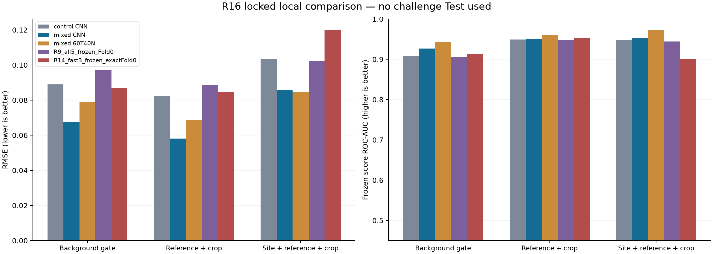
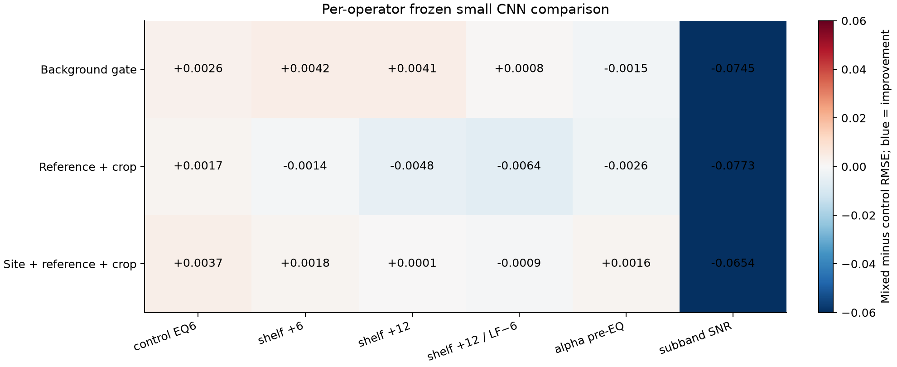
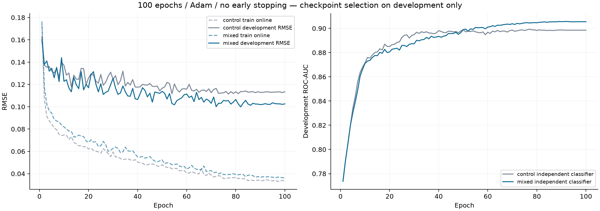

# R16 교차 생성기·참조·사이트 소형 학습 실험

기존 모델 평가, 새 소형 모델 2조건의 100에포크 학습, 정책 동결 후 별도 평가를 완료했다. **혼합 생성기 학습이 같은 소형 CNN의 조건 전이 오차를 줄였다. 다만 기존 모든 본체 모델을 이긴다는 결론이나 공식 LB 개선은 확인되지 않았다.** 이 실험에서는 `Test.csv` 및 기존 Test 통계 산출물을 읽지 않았다. R14 TFGrid와 Fold1–4 학습은 재개하지 않았다.

## 1. 실제 수행 범위

- 17,600개 저장 행: TRAIN control/mixed 각 4,000개, 평가 4역할×6연산자×400개. TRAIN 두 조건은 같은 4,000개 배경을 사용한다. 전체 고유 배경은 5,600개로, 연산자별 반복을 독립 음원 수로 세지 않는다.
- 참조 119클립/22개 선택 연결 성분을 A 66클립/12성분(TRAIN), B 19/5(fit·gate), C 34/5(report·domain)로 분리했다. hull/day/bytes/선택 구간 직접 중복은 0이며, 배경 역할 간 900초 support 기준 24시간 purge를 유지했다.
- 새 소형 회귀 CNN 26,305파라미터와 독립 분류 CNN 3,745파라미터(총 30,050), 회귀 466특징/분류 700특징 LightGBM을 control/mixed 각각 학습했다. 두 조건의 데이터량·seed·학습 설정은 같다.
- NN은 100epoch·Adam·dropout 0.1·cosine LR·조기 종료 없음으로 실행하고, 회귀 최저 fit RMSE/분류 최고 fit AUC 체크포인트를 따로 보관한다. Tree는 최대 600round·ES40이다. `local_fit`는 반복 선택에 사용한 개발 점수다.
- regression loss=`share MSE + 0.25×energy-weighted cell MSE`. 독립 분류 경로 BCE는 회귀 파라미터와 공유되지 않으며 교차 gradient0을 검증했다.
- 기존 R9/R14 개별 23모델과 고정 집계 6종도 동결 추론했다. R14 TFGrid는 예산을 끝까지 실행한 모델이 아닌 **중지된 epoch37 체크포인트**다.

## 2. 바꾼 생성 조건과 보존한 물리식

기준법은 기존의 EQ 후 전체 native broadband peak로 α를 계산하는 유효한 고정 SNR 생성 법칙이다. 새 조건에서는 **실제 관측되는 삽입 구간의 EQ 전 peak**로 α를 먼저 정하고, 25대역 로그 이득 평균이 0인 매끄러운 EQ를 적용한 뒤 재정규화하지 않는다. 다른 조건은 ≤200Hz와 >200Hz의 SNR을 독립 추출한다. 두 방식 모두 최종 변형 A에서 정답을 다시 계산했다.

`E=B+A`, `q=OA/E`, `y=ΣOA/ΣOE`. 저장 dB는 0.1dB 격자이며 raw q/y는 그대로 보존한다. 반올림 관측 에너지와 raw 정답 사이의 작은 풀링 차이는 정량화 오차 상한으로 검사한다. 각 파일의 명시적 무추가 비율은 정확히 20%다.

TRAIN의 새 EQ는 ±6dB, 평가에서는 ±12dB로 사전 고정했다. 자연 minute-first 전체 궤적 또는 연속 1–6분 crop을 사용하며 인공 평탄 full_smooth15·강제 highshare·반복·warp는 제거했다. report/domain은 peak 강제 포함 없이 원생 crop 시작점을 균일 추출한다. 관측 양성을 보장하는 배치와 삽입 구간 기준 α는 마스크에 조건화되므로, 이번 실험을 채널만 단독 변경한 완벽한 인과 분리로 해석하면 안 된다.

**수식 검산 결과:** scalar α 재계산은 HF/LF 상대비를 지우지 않는다. 18dB 기울기는 상대 파워비를 63.1배 바꾼다. 기존 법칙이 잘못된 정답을 만들었다고 단정하지 않고 서로 다른 생성 사전분포를 비교했다. zero-mean 로그 이득은 선형 에너지 합 보존과도 다르다.

## 3. 개발 점수와 독립 평가

| model | rmse | auc_classifier | auc_share |
| --- | --- | --- | --- |
| control CNN | 0.111354 | 0.899310 | 0.877109 |
| control 60T40N | 0.115154 | 0.918887 | 0.881107 |
| mixed CNN | 0.099917 | 0.905749 | 0.878314 |
| mixed 60T40N | 0.106486 | 0.924460 | 0.888431 |

아래 세 역할은 체크포인트·가중치·score 혼합률을 1,874개 산출물의 SHA와 함께 동결한 뒤 평가했다. gate는 별도 배경+B 참조, report는 C 참조+다른 crop, domain은 학습에서 제외한 사이트+C 참조+다른 crop이다. 각 행은 6연산자×400=2,400개를 합산한 RMSE이며 전체 OOF나 공식 LB가 아니다.

| role | model | rmse | bias | auc_frozen_score |
| --- | --- | --- | --- | --- |
| local_gate | control CNN | 0.088991 | -0.011067 | 0.908841 |
| local_gate | mixed CNN | 0.067740 | -0.006591 | 0.926895 |
| local_gate | mixed 60T40N | 0.078789 | -0.009578 | 0.942305 |
| local_gate | R9_all5_frozen_Fold0 | 0.097263 | -0.016908 | 0.906478 |
| local_gate | R14_fast3_frozen_exactFold0 | 0.086779 | -0.016541 | 0.913392 |
| local_report | control CNN | 0.082564 | -0.003308 | 0.949284 |
| local_report | mixed CNN | 0.058024 | 0.003235 | 0.949564 |
| local_report | mixed 60T40N | 0.068755 | -0.005137 | 0.960280 |
| local_report | R9_all5_frozen_Fold0 | 0.088718 | -0.004647 | 0.947474 |
| local_report | R14_fast3_frozen_exactFold0 | 0.084763 | -0.012201 | 0.952324 |
| domain_holdout | control CNN | 0.103227 | -0.005157 | 0.947747 |
| domain_holdout | mixed CNN | 0.085683 | 0.004790 | 0.952747 |
| domain_holdout | mixed 60T40N | 0.084430 | -0.007947 | 0.973138 |
| domain_holdout | R9_all5_frozen_Fold0 | 0.102313 | -0.012478 | 0.944531 |
| domain_holdout | R14_fast3_frozen_exactFold0 | 0.120179 | 0.002435 | 0.900833 |

같은 소형 CNN의 혼합 학습 효과에 대한 paired-background bootstrap(2,000회; 음수=개선):

| role | RMSE_mixed_minus_control | paired_background_bootstrap_p025 | paired_background_bootstrap_p975 | background_source_groups | paired_source_group_bootstrap_p025 | paired_source_group_bootstrap_p975 |
| --- | --- | --- | --- | --- | --- | --- |
| local_gate | -0.021252 | -0.031322 | -0.011906 | 8 | -0.033881 | -0.011185 |
| local_report | -0.024540 | -0.033378 | -0.015813 | 8 | -0.031792 | -0.015446 |
| domain_holdout | -0.017544 | -0.029413 | -0.006209 | 32 | -0.029838 | -0.000290 |

창 단위 구간과 배경 source-group 단위 구간을 구분했다. 창 단위는 같은 주간·녹음기 그룹의 상관을 무시하므로 모집단/source-group 신뢰구간으로 해석하면 안 된다. source-group 재추출도 각 역할의 8/8/32개 제한된 그룹에 조건부다. 두 방식 모두 참조 5개 성분의 불확실성을 완전히 포함하지 않는다. 6연산자 반복을 독립 표본으로 재추출하지 않았다.

## 4. score 독립화와 앙상블 상한 결과

새 score는 회귀와 분리된 classifier 확률을 기본으로, share 혼합률 0 또는 0.25를 fit에서만 선택했다. 비교용으로 share 단독 및 0.75 혼합도 함께 저장했다. 독립 classifier가 모든 조건에서 항상 우월하다고 가정하지 않는다.

| role | model | auc_share | auc_classifier | auc_25share_75clf | auc_75share_25clf | auc_frozen_score | classifier_ge099_fraction |
| --- | --- | --- | --- | --- | --- | --- | --- |
| local_gate | mixed CNN | 0.784603 | 0.926283 | 0.926895 | 0.905163 | 0.926895 | 0.440000 |
| local_gate | mixed Tree | 0.798210 | 0.938675 | 0.939980 | 0.931185 | 0.939980 | 0.297500 |
| local_gate | mixed 60T40N | 0.797871 | 0.941139 | 0.942305 | 0.929043 | 0.942305 | 0.357917 |
| local_report | mixed CNN | 0.844095 | 0.955267 | 0.949564 | 0.941335 | 0.949564 | 0.522500 |
| local_report | mixed Tree | 0.831676 | 0.959818 | 0.957832 | 0.951367 | 0.957832 | 0.439167 |
| local_report | mixed 60T40N | 0.842507 | 0.963600 | 0.960280 | 0.953926 | 0.960280 | 0.475000 |
| domain_holdout | mixed CNN | 0.845827 | 0.954564 | 0.952747 | 0.920319 | 0.952747 | 0.459167 |
| domain_holdout | mixed Tree | 0.855397 | 0.964896 | 0.966641 | 0.969199 | 0.966641 | 0.374583 |
| domain_holdout | mixed 60T40N | 0.855632 | 0.972552 | 0.973138 | 0.968405 | 0.973138 | 0.392500 |

분류 확률≥0.99 비율도 공개한다. 이 비율이 높은 원인이 정당한 확신인지 과도한 확신인지는 이 표만으로 단정할 수 없다. 따라서 ‘비포화가 완전히 해결됐다’고 표현하지 않는다. 확률 교정은 이번 실험에서 추가하지 않았다. report에서는 순수 분류 확률이 fit에서 선택한 0.25 혼합보다 AUC가 높았지만, 이 결과를 본 뒤 정책을 바꾸지 않았다.

기존 본체의 새 앙상블은 highshare를 제외하고 baseline Tree5+4NN을 사용했다. 고정 균형(50% Tree5+NN 각12.5%), 무제약 fit, 상한 fit을 모두 보고했다. 상한은 Tree5 가족40–80%, NN 각5–40%이며 Tree의 개별 fold는 최대16%다. **상한을 두면 반드시 RMSE가 개선된다는 가정은 하지 않는다.** 소형 60Tree40NN도 단독 CNN보다 나쁠 수 있어 모두 병기한다.

| role | model | rmse | auc_frozen_score |
| --- | --- | --- | --- |
| local_gate | R9__fixed50tree_4x12.5NN | 0.097260 | 0.871855 |
| local_gate | R9__unconstrained_fit | 0.095891 | 0.872552 |
| local_gate | R9__capped_fit | 0.096017 | 0.872389 |
| local_gate | R14_baseline__fixed50tree_4x12.5NN | 0.090787 | 0.918411 |
| local_gate | R14_baseline__unconstrained_fit | 0.086607 | 0.918236 |
| local_gate | R14_baseline__capped_fit | 0.088503 | 0.918418 |
| local_report | R9__fixed50tree_4x12.5NN | 0.087642 | 0.944596 |
| local_report | R9__unconstrained_fit | 0.087776 | 0.947422 |
| local_report | R9__capped_fit | 0.087290 | 0.946341 |
| local_report | R14_baseline__fixed50tree_4x12.5NN | 0.088515 | 0.971348 |
| local_report | R14_baseline__unconstrained_fit | 0.084645 | 0.971432 |
| local_report | R14_baseline__capped_fit | 0.086141 | 0.971452 |
| domain_holdout | R9__fixed50tree_4x12.5NN | 0.101836 | 0.941374 |
| domain_holdout | R9__unconstrained_fit | 0.104345 | 0.941914 |
| domain_holdout | R9__capped_fit | 0.103248 | 0.941784 |
| domain_holdout | R14_baseline__fixed50tree_4x12.5NN | 0.118694 | 0.932337 |
| domain_holdout | R14_baseline__unconstrained_fit | 0.121135 | 0.931009 |
| domain_holdout | R14_baseline__capped_fit | 0.118310 | 0.931947 |

실제 고정 가중치는 [POLICIES.json](../r16_locked_comparison_r1/POLICIES.json)에 있다. gate/report 결과를 본 뒤 가중치를 다시 맞추지 않았다. 기존 R14 모델의 가중치 상한만 바꾼 경우 domain RMSE는 약0.118로, 기존 고정 정책의 0.120보다 조금 나아졌을 뿐이다. 새로운 학습 데이터가 필요한 문제를 가중치 조정만으로 해결했다고 볼 수 없다.

## 5. 연산자별 결과와 학습 곡선

| role | operator | control_RMSE | mixed_RMSE | mixed_score_AUC |
| --- | --- | --- | --- | --- |
| local_gate | control_eq6 | 0.060603 | 0.063229 | 0.916133 |
| local_gate | mfhf_shelf6 | 0.048061 | 0.052241 | 0.942734 |
| local_gate | mfhf_shelf12 | 0.041310 | 0.045396 | 0.955234 |
| local_gate | mfhf_shelf12_lfminus6 | 0.042406 | 0.043185 | 0.959453 |
| local_gate | alpha_preEQ_inserted | 0.080661 | 0.079125 | 0.922266 |
| local_gate | independent_subband_snr | 0.177547 | 0.103046 | 0.865547 |
| local_report | control_eq6 | 0.047275 | 0.048989 | 0.949375 |
| local_report | mfhf_shelf6 | 0.046693 | 0.045311 | 0.958789 |
| local_report | mfhf_shelf12 | 0.049205 | 0.044444 | 0.962812 |
| local_report | mfhf_shelf12_lfminus6 | 0.051210 | 0.044786 | 0.964180 |
| local_report | alpha_preEQ_inserted | 0.068284 | 0.065651 | 0.949922 |
| local_report | independent_subband_snr | 0.163645 | 0.086353 | 0.912305 |
| domain_holdout | control_eq6 | 0.064950 | 0.068605 | 0.941602 |
| domain_holdout | mfhf_shelf6 | 0.061171 | 0.062931 | 0.965352 |
| domain_holdout | mfhf_shelf12 | 0.060447 | 0.060553 | 0.971250 |
| domain_holdout | mfhf_shelf12_lfminus6 | 0.061272 | 0.060397 | 0.972422 |
| domain_holdout | alpha_preEQ_inserted | 0.108060 | 0.109638 | 0.953398 |
| domain_holdout | independent_subband_snr | 0.192067 | 0.126680 | 0.912461 |

**개선은 모든 연산자에서 균일하지 않았다.** domain의 기존 control 조건은 0.06495→0.06861로 소폭 악화했고, EQ 전 삽입 구간 기준 조건도 0.10806→0.10964로 개선되지 않았다. 큰 이득은 독립 서브밴드 SNR 조건의 0.19207→0.12668에서 나왔다. 따라서 ‘어떤 채널에서도 더 강해졌다’는 결론은 부적절하다.

학습 온라인 RMSE는 다른 dropout 상태와 epoch 내 변화하는 모델을 섞어 측정하므로 최종 체크포인트 TRAIN RMSE와 동일하지 않다. 100epoch 탐색은 global optimum을 보장하지 않는다.

## 6. 이번 결과로 결정할 수 있는 것과 남은 한계

1. 같은 소형 모델의 교차 조건 성능 개선은 실측으로 판단할 수 있다. 그러나 모델 크기·데이터 양이 다른 기존 R9/R14와의 차이를 순수하게 생성기 효과라고 분리할 수 없다.
2. 참조 분리는 119개 선택 클립 부분 그래프 내의 조건부 독립이다. 전체525개 그래프는1개 성분이며 제외 bridge는 사용하지 않았다. 기존 R9/R14는509개 참조를 이미 학습했으므로 이들의 B/C 평가를 미관측 참조라고 부르지 않는다.
3. domain의3개 사이트는 이번 새 TRAIN에는 없지만 과거 개발 진단에서 사용한 도메인이다. 새 완전 blind 평가가 아니며 비공개 Test 생성기와 동일하다는 보장도 없다.
4. 이번 소형 실험은 Fold0 기반이며 전체5-Fold OOF가 아니다. 고정 R11 장시간/SF/HF 스트레스 패널 전체 회귀 시험과 다른 seed 반복은 남아 있다. 자연 장시간 실측이 적다는 제약도 그대로다.
5. 이번 Test 추론·통계 튜닝·적대적 검증·공식 제출은0회다. 과거 개발에서 Test 기술 통계를 본 사실을 없었던 일로 만들 수 없으므로 완전 무오염 개발을 주장하지 않는다.

## 7. 본체 확장 실행 계획

지금 중지된 R14 TFGrid는14채널/구레시피 체크포인트이므로 새8채널 학습으로 이어붙이지 않는다. 기존 파일은 보존하고 새 실행 ID로 시작해야 한다.

1. 이번 고정 채널 사전분포·상대8채널·독립 분류 계약을 본체 러너에 연결하고1-step 값/gradient/CPU–GPU 일치 검사를 실행한다. 고정 R11 스트레스 패널도 코드 변경 없이 추가 평가한다.
2. 순서는 빠른 본체 CNN, FDY-CRNN, iTransformer, TFGrid-FDY-Conformer, Mac CPU PhysicsTree다. 각 신경망은100epoch·Adam·조기 종료 없음·fit 최적 체크포인트를 독립 저장하며 Fold0부터 측정한다. Tree는별도 boosting/ES 규약을 사용한다.
3. 새 입력/레시피 본체의 개선이 확인될 때만 Fold1–4로 확장한다. 생성법·seed·원천 분할·정책 SHA를 미리 고정하고 각 fold의 외부 평가는 선택에 재사용하지 않는다.
4. 실제1epoch 처리량과 메모리를 측정하기 전에는 전체 소요 시간이나 LB 목표 달성을 보장하지 않는다. **이번 보고서는 GPU/MPS 본체 학습을 재개했다는 뜻이 아니다.**

## 8. 재현 자료

- [자료/API/원천 분리](../r16_cross_operator_r1/data/README.md)
- [데이터 독립 전수 QA](../r16_independent_qa_r1/DATA_INDEPENDENT_QA.json)
- [소형 학습 독립 QA](../r16_independent_qa_r1/SMALL_MODEL_TRAINING_QA.json)
- [전역 동결 기록](../r16_locked_comparison_r1/GLOBAL_FREEZE.json)
- [전수 지표 JSON](RESULTS.json) · [합산 지표 CSV](aggregate_metrics.csv)
- [소형 패널별 지표/저장예측](../r16_locked_comparison_r1/small_locked/RESULTS.json)
- [기존 모델 동결 평가](../r16_frozen_evaluation_r1/locked/RESULTS.json)
